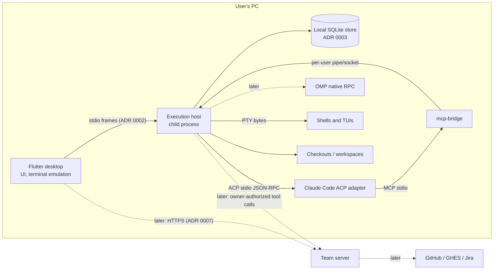

# Kumiko Architecture

The current system shape. Change designs read this first. Strategy: [strategy.md](strategy.md). Product direction and decisions D1-D55: [`changes/document-kumiko-direction/design.md`](changes/document-kumiko-direction/design.md). Foundational decisions: [`docs/adr/`](../docs/adr/).

No application code exists yet. Library and runtime claims below are documented, not qualified. The M1 changes qualify them.

## System triage

| Trigger | Applies | Evidence |
|---|---|---|
| T1 Components | Yes | Desktop UI, child execution host, runtime subprocesses, PTYs, tool bridge, and later the team server and external integrations. |
| T2 State | Yes | Local store (layout, sessions, drafts, solo records), native runtime histories, later shared team records. |
| T3 Concurrency | Yes | Multiple agents, terminals and tool calls run at once in the host; later several desktops write to shared records. |
| T4 Boundaries | Yes | Desktop-host protocol, ACP/OMP RPC, MCP bridge, team-server API, GitHub/Jira. Each crosses a process or authority boundary. |
| T5 Volume | Yes | Terminal output, streamed agent events, conversation history and growing project data. |
| T6 Risk | Yes | Agents mutate source and run commands. Private data must stay off the team server. Owner authority and company identity are involved. |

## Components

| Component | Responsibility | Owns (state) | Talks to via (contract) |
|---|---|---|---|
| Desktop (`desktop`) | Workbench UI, input, terminal emulation/rendering, close/exit confirmations | In-memory view state and terminal scrollback only | Host via ADR 0002; team server later via ADR 0007 |
| Execution host (`host`) | Spawns and owns runtimes, adapters, PTYs and the tool service; sole local-store writer; terminates all children when the desktop goes | Live process table, session records, local store | Desktop (ADR 0002); runtimes (ACP/RPC); PTYs; bridge endpoint (ADR 0005) |
| Runtime adapters (in host) | Map each runtime onto the session model, with qualified capabilities | Per-session protocol state | ACP over the agent's stdio; OMP RPC later (ADR 0004) |
| Tool service and `mcp-bridge` | Expose authorized Kumiko operations to agent sessions | Session-secret map | MCP stdio to the runtime; per-user local endpoint to the host (ADR 0005) |
| Local store | Durable local state | SQLite files | Host only (ADR 0003) |
| `domain` package | Pure rules shared by local and team paths | None | Library |
| `process_containment` package | `dart:ffi` bindings to OS process APIs: Windows job objects and process creation, POSIX `setsid`/`execve`/`killpg`, process start times, the marker scan, file identity. No native library of its own | None | Library used by the host, and by the desktop for the Windows outer job only |
| Team server (M4+) | Shared records, membership, identity, integrations | Shared database | Desktop and host over a negotiated API (ADR 0007) |

## State ownership

| State | Sole writer | Lifetime | Invalidation / rebuild | Authoritative copy |
|---|---|---|---|---|
| Open layout and working sets (Personal and per project): tabs that contain split trees of panes, the active tab, each tab's focused pane, a sparse focus history and the sidebar selection (format 2) | Host, on desktop request. The desktop authors the live layout and sends whole-document snapshots; the host validates them with the `domain` codec and stores one revision-guarded document per working set (ADR 0009, ADR 0011) | Until the user changes it; app exit does not mark tabs or panes closed | Restored on reopen; references to missing sessions or workspaces show as unavailable; a missing selected workspace is repaired to Personal; an invalid stored document is reported and replaced by the next save; store v4 discarded format 1 layouts | Local store (`working_set` row); desktop memory while running |
| User shell profiles (argv, environment, working directory) | Host `ProfileService` | Until the user removes them | Never rebuilt | Local store (`shell_profile`, store v3) |
| Default shell profile | Host `ProfileService` | Until the user changes it | Shown unavailable when it names a missing profile | Local store (`setting`) |
| Built-in shell profiles | Host `ProfileService` | One host run | Detected again at every host start | Host memory |
| Pane-to-terminal link | Desktop `TerminalController` | While the pane and desktop live, through moves; dropped with the pane on a user close or a clean exit (status 0, complete output) | Lost on reopen, so the pane shows *ended, not restored* | Desktop memory |
| Workspace cleanup state (*cleanup unresolved* flag and reasons) | Host holding the profile lock | Until a retried reconciliation cleans it or the user confirms | Checked before every launch against the workspace | Local store |
| Kumiko session record (target, runtime, native id, role) | Host | Until the user deletes it from history | Target never changes after creation; resume capability rechecked per adapter version | Local store |
| Conversation transcript | Runtime | The runtime's own retention | Read through the adapter's resume or history path | Runtime's native history |
| Live agent and terminal processes | Host | Until stop, close or host exit | Never rebuilt; reopen shows *saved, not running* | Host process table (memory) |
| Process ledger (pending entry before spawn, then pid, start time, containment id, target workspace) | Host holding the profile lock | Entry from before spawn until the unit is cleaned | Reconciled by the next lock holder before any launch | Local store |
| Unsent drafts and file recovery drafts | Host | Until sent, saved or explicitly discarded | An explicit discard deletes the draft so it cannot be recovered | Local store |
| Terminal scrollback | Desktop emulator | While the pane is open, through moves | Lost on close, crash or exit (layout-only reopen) | None durable |
| Shared records (M4+) | Team server | Server policy (D23) | Refetched after reconnect; cache is display-only | Team server |

## Boundaries and contracts

- **Desktop-host protocol:** defined in the `host_protocol` package, versioned with a `hello` handshake and capability set (ADR 0002). Both sides use the generated or shared types only.
- **Runtime protocols:** ACP (stdio, newline-delimited JSON-RPC; `session/new`, and `session/resume` or `session/load` per advertised capability) and OMP RPC. They are pinned per qualified adapter version in the adapter's qualification list (ADR 0004).
- **Kumiko tools:** MCP tool schemas are owned by the host tool service and versioned with it. Authorization is per call (ADR 0005).
- **Local store schema:** a version table in each database, with forward migrations run by the host (ADR 0003).
- **Team API (M4+):** negotiated compatibility in both upgrade orders (D26). There are no message types for private data (ADR 0007).
- **Dependency rule:** no package may add product-analytics, crash-report or remote-logging SDKs (D25). A dependency audit enforces this in CI.

## Resource bounds and failure visibility

Each change that introduces a flow sets its number, tests it and records it here. The mechanism and who finds out are fixed now. Numbers below marked *(scaffold)* were set by `scaffold-desktop-and-host` (design D6 and Resource Bounds).

| Flow / store | Bound | At the bound | On failure | Who finds out |
|---|---|---|---|---|
| Desktop-host pipe (all channels) | *(scaffold)* Frame payload ≤ 64 KiB (10-byte header); control message ≤ 1 MiB; data credit window 256 KiB per channel, topped up at half consumed; *(host-terminals)* ≤ 160 channels (open data channels) per connection, two per terminal plus room for sessions (≤ 40 MiB channel buffering per side), excess refused `channel-cap`, or `channel-limit` for an all-or-none reservation of a terminal's pair; pending outbound control ≤ 4 MiB per side, past it the peer is lost; ≤ 256 inbound control requests in flight, excess answered `busy`; one frame per writer flush, control first (ADR 0002); `hello` timeout 30 s; host-loss detection ≤ 2 s; control round-trip ≤ 250 ms worst of 100 under a saturating channel | A channel without credit pauses alone; control and other channels continue | Pipe loss is handled as host lost (row below) | User, immediately |
| Terminal output (host to desktop) | *(host-terminals)* 256 KiB channel window plus one 64 KiB reader chunk per terminal; after exit, PTY reading stops at EOF or 1 s of active reading (`outputComplete: false` past it); the desktop holds ≤ 1 MiB plus one chunk pending for its engine | Backpressure: the host stops reading that PTY until credit returns; the desktop pauses the channel while its engine is behind | Channel error closes the terminal with exit status shown | Terminal user |
| Terminal input (desktop to host) | *(host-terminals)* Desktop queue ≤ 1 MiB per terminal; host ≤ 576 KiB per terminal (256 KiB window, ≤ 256 KiB paused, one 64 KiB chunk with the writer) | Desktop refuses further input and shows *input paused*; the host pauses its subscription so no credit returns | n/a | Terminal user |
| Terminal lifecycle | *(host-terminals)* An opened terminal must be attached within 10 s; close acknowledged within the control bound (≤ 250 ms); close completion only after cleanup confirmation, within a 30 s settlement deadline (termination, marker scans, `ClosePseudoConsole` ≤ 5 s on Windows) | Unattached terminal closed by the host; past the deadline `terminal/closeFailed` and the unit unresolved | Workspace *cleanup unresolved* until a retry cleans it | Terminal user |
| Pending console cleanups (Windows) | *(host-terminals)* Active terminals plus pending `ClosePseudoConsole` calls ≤ 64; an entry clears when its native call returns or the host exits | New terminal refused `console-cleanup-pending` | n/a | Launching user |
| Terminal scrollback (desktop) | *(host-terminals)* Engine line cap per terminal, default 10 000 lines, configurable | Oldest lines are evicted | n/a | Visible scrollback limit |
| Agent session events (host to desktop) | Bounded queue per session | Backpressure to the adapter. Events are never silently dropped; overflow ends the stream with an error | Session marked *stopped or unknown* with reason | Session owner |
| Concurrent sessions and terminals | Configurable host cap: *(scaffold)* 64 units per host, excess refused `unit-cap` | New launch refused with a visible reason | n/a | Launching user |
| Tool calls per session | Bounded concurrency and argument/result size | Call rejected with error to the agent | Error result; never a fake success | Agent and session activity |
| Host process (whole) | One host per user profile (exclusive lock, ADR 0001). *(scaffold)* Shutdown on desktop loss ≤ 30 s: unit termination in parallel (POSIX SIGTERM, 2 s grace, SIGKILL, 3 s wait; Windows TerminateJobObject, 5 s wait), then at most two shared marker-scan passes of ≤ 10 s each; the desktop waits 35 s for host exit on quit | Second launch starts no execution; it shows "Kumiko is already running" and exits (window focus is later work) | Desktop shows host lost. On Windows the desktop terminates the host's job. On restart, the new host reconciles the process ledger before launching anything. Unresolved units, including pending entries without a pid and surviving marked descendants, put their workspace in *cleanup unresolved*, which refuses every new execution against it until a retry cleans it or the user confirms | User, immediately; cleanup results per session |
| Local store write or migration | Transactional; *(scaffold)* WAL with `synchronous=FULL`, one transaction per migration step, version in `PRAGMA user_version` (ADR 0008) | n/a | Write error surfaced on the triggering action; migration failure blocks startup with error | User |
| Layout document (per working set) | *(host-terminals, format 2)* ≤ 256 KiB encoded; ≤ 128 tabs; ≤ 16 panes per tab; ≤ 128 panes; pane `state` ≤ 4 KiB; `item` ≤ 4 KiB; ids and kinds ≤ 64 B; split ratio 0.1-0.9 (ADR 0009, ADR 0011) | Split, new tab or move into split refused with the limit shown; an oversized or invalid document is refused `layout-invalid` | Save refused or failed: *Layout not saved* with the reason and Retry; invalid stored document: empty layout with a restore notice | User, immediately |
| Layout saves (desktop to host) | *(workbench)* 500 ms debounce, maximum dirty age 2 s, one save in flight plus one coalesced snapshot, at most 2 saves unanswered (timed-out ones included), 10 s save deadline, quit flush ≤ 2 s; revision-guarded (`stale-revision`) | Newer snapshot replaces the pending one | A kill loses at most the last 2 s plus one round-trip while saves succeed; failing or stalled saves show *Layout not saved* | User |
| Workspaces (Personal) | *(workbench)* ≤ 64 workspaces, excess open refused `workspace-cap` | Open refused with the limit stated | n/a | User |
| Directory resolution (workspace open, check, load) | *(workbench)* ≤ 4 resolver isolates, 5 s timeout per path; excess open or Check again refused `busy`; load-time checks queue (≤ 64); a timed-out isolate keeps its slot until its call returns; with all slots held by timed-out calls, queued checks finish as *unavailable: host busy resolving folders* | Refused `busy` or queued | `resolve-timeout`: open refused, or workspace *unavailable: not answering*; control requests keep being answered | User, per workspace |
| Host diagnostics (stderr log) | Size-rotated local file (D46): *(scaffold)* `<profile>/logs/host.log`, 2 × 4 MiB, written only after the lock; the desktop keeps host stderr in a 64 KiB memory ring | Rotation; never deletes store data | n/a | Local diagnostics only |

Measured by `scaffold-desktop-and-host` on GitHub-hosted runners ([CI run 40843258433](https://github.com/sh1ny/kumiko/actions/runs/40843258433)); the tests print these lines as `measured:`. They are single runs, recorded to show the headroom against the bounds above, not as bounds themselves.

| Measurement | Bound | Windows | Linux | macOS |
|---|---|---|---|---|
| Control round-trip under 4 saturating channels, worst of 100 (median) | ≤ 250 ms | 2.4 ms (1.1 ms) | 1.6 ms (0.4 ms) | 11.0 ms (0.5 ms) |
| Unit termination, cooperative unit | 5 s wait (Windows); 2 s grace + 3 s (POSIX) | 0 ms | 11 ms | 15 ms |
| Unit termination, unit ignoring SIGTERM | 2 s grace + 3 s | n/a | 2012 ms | 2017 ms |
| Host shutdown on quit, 2 units with descendants | desktop waits 35 s | 139 ms | 65 ms | 71 ms |
| Host gone after the desktop is killed, 2 units | ≤ 30 s | 0 ms (the desktop's job ends it) | 52 ms | 28 ms |

## In-force ADRs

Lists accepted ADRs, plus proposed ones marked as such.

| ADR | Decision | Supersedes |
|---|---|---|
| [0001](../docs/adr/0001-desktop-and-child-execution-host.md) | Desktop UI plus one child execution host per user profile (exclusive lock); host owns all processes; ledger-based crash cleanup with workspace gate; no daemon | - |
| [0002](../docs/adr/0002-versioned-desktop-host-protocol.md) | Length-prefixed multiplexed frames over host stdio; JSON-RPC control; raw terminal channels; hello/capability negotiation; credit flow control with control priority | - |
| [0003](../docs/adr/0003-host-owned-local-sqlite-store.md) | Local SQLite store, host sole writer under the profile lock; transactional migrations; private by construction; package picked by M1 probe | - |
| [0004](../docs/adr/0004-runtime-adapters-and-session-identity.md) | Host-side runtime adapters with qualified capabilities; immutable session targets; stop vs close; resume only via the runtime's qualified path | - |
| [0005](../docs/adr/0005-host-tool-service-and-authorization.md) | One host tool service; ACP stdio `mcp-bridge` over a per-user pipe/socket; per-session secret; per-call authorization; connected only after a successful call | - |
| [0006](../docs/adr/0006-host-owned-ptys-and-terminal-rendering.md) | PTYs and shells in the host from argv profiles; emulation in the desktop; engine picked by M1 spike | - |
| [0007](../docs/adr/0007-optional-team-server-boundary.md) | Optional team server is sole writer of shared records; no offline replica; private data never crosses; technology decided at the team milestone | - |
| [0008](../docs/adr/0008-sqlite-binding-for-the-local-store.md) | `package:sqlite3` with its bundled SQLite; host built with `dart build cli` and shipped as `host/bin` + `host/lib`; WAL with `synchronous=FULL`; test host from a separate entry point | - |
| [0009](../docs/adr/0009-workbench-layout-document.md) | Workbench layout is a desktop-authored, host-validated snapshot per working set; `format` converted only by store migrations; tabs are `kind`, immutable `workspace`, `item`, `state` ≤ 4 KiB; unknown kinds pass through; revision-guarded saves. Amended by 0011: decision 3 (tab shape becomes the pane shape inside tabs) and decision 2 (store v4 discards format 1 layouts instead of converting them) | - |
| [0010](../docs/adr/0010-terminal-engine.md) | *(accepted, provisional)* Terminal engine `flutter_alacritty` (patched, vendored) behind one `TerminalSurface` boundary; provisional while the Linux/macOS user-verified bar items are `unproven`; they must pass before M1 closes | - |
| [0011](../docs/adr/0011-workbench-tabs-contain-panes.md) | Tabs contain panes: layout format 2 (tabs of split trees of panes, open set of view kinds, focus by tree and strip order); store v4 discards format 1 layouts by user decision; amends 0009 decisions 2 and 3 | - |
