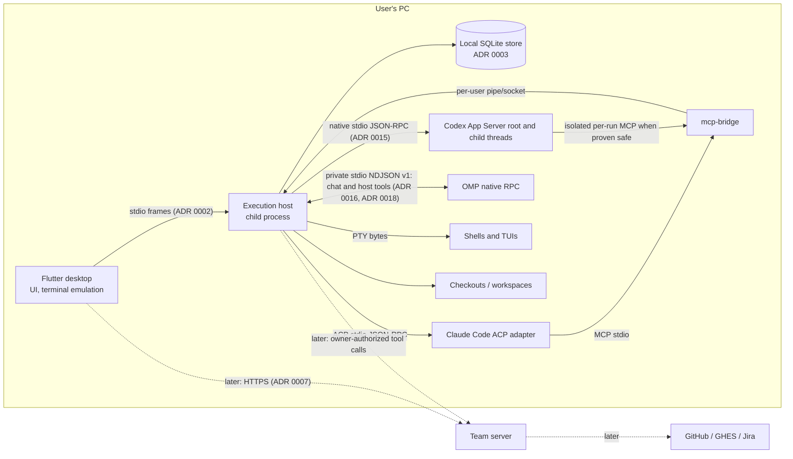

# Kumiko Architecture

The current system shape. Change designs read this first. Strategy: [strategy.md](strategy.md). Product direction and decisions D1-D55: [`changes/document-kumiko-direction/design.md`](changes/document-kumiko-direction/design.md). Foundational decisions: [`docs/adr/`](../docs/adr/).

The desktop and execution host are implemented. Runtime qualification is evidence-specific, not implied by implementation: Claude agent ACP 0.99.1 has confirmed Windows observations, while Linux/macOS user observations remain unproven (ADR 0012). The user closed M1 for Windows on 2026-11-08, deferring Linux/macOS qualification and the Windows terminal latency finding; see [the close record](../docs/qualification/m1-close.md). The checker remains provisionally ACCEPTED across platforms; this is not a claim of all-platform qualification.

## System triage

| Trigger | Applies | Evidence |
|---|---|---|
| T1 Components | Yes | Desktop UI, child execution host, runtime subprocesses, PTYs, tool bridge, and later the team server and external integrations. |
| T2 State | Yes | Local store (layout, sessions, drafts, solo records), native runtime histories, later shared team records. |
| T3 Concurrency | Yes | Multiple agents, terminals and tool calls run at once in the host; later several desktops write to shared records. |
| T4 Boundaries | Yes | Desktop-host protocol, ACP/OMP RPC, MCP bridge, team-server API, GitHub/Jira. Each crosses a process or authority boundary. |
| T5 Volume | Yes | Terminal output, streamed agent events, conversation history and growing project data. |
| T6 Risk | Yes | Agents mutate source and run commands. Private data must stay off the team server. Owner authority and company identity are involved. |

## Components

| Component | Responsibility | Owns (state) | Talks to via (contract) |
|---|---|---|---|
| Desktop (`desktop`) | Workbench UI, input, terminal emulation/rendering, close/exit confirmations | In-memory view state and terminal scrollback only | Host via ADR 0002; team server later via ADR 0007 |
| Execution host (`host`) | Spawns and owns runtimes, adapters, PTYs and the tool service; sole local-store writer; terminates all children when the desktop goes | Live process table, session records, local store | Desktop (ADR 0002); runtimes (ACP/RPC); PTYs; bridge endpoint (ADR 0005) |
| Runtime adapters (in host) | Map each runtime onto the session model, with capabilities justified by its runtime contract | Per-session protocol state | ACP for Claude; native App Server for Codex; native RPC for OMP (ADR 0004, ADR 0015, ADR 0016) |
| Agent adapter unit (one per live session) | Run one adapter and its tool descendants in containment; no shared multi-session adapter process | Host `AgentService` / `AgentSession` own the unit, shared runtime state, permissions, event relay and stderr ring; `UnitManager` owns containment and ledger settlement | ACP v1, native Codex App Server or native OMP RPC over piped stdio; desktop via one per-session event channel plus capability-gated control (ADR 0012, ADR 0016) |
| Tool service and `mcp-bridge` | Expose authorized Kumiko operations to agent sessions | Per-role catalog and shared call authorization; MCP session-secret grants; private OMP run bindings | Claude and Codex use the owner-only pipe or `tools.sock` via MCP stdio and a secret handshake. OMP calls through private runtime stdio without a secret (ADR 0005, ADR 0013, ADR 0018). |
| Local store | Durable local state | SQLite files: the main store, and the separate draft store `drafts.sqlite` owned by one host draft worker isolate (ADR 0014) | Host only, under the profile lock (ADR 0003, ADR 0014) |
| `domain` package | Pure rules shared by local and team paths | None | Library |
| `process_containment` package | `dart:ffi` bindings to OS process APIs: Windows job objects and process creation, POSIX `setsid`/`execve`/`killpg`, process start times, the marker scan, file identity. No native library of its own | None | Library used by the host, and by the desktop for the Windows outer job only |
| Team server (M4+) | Shared records, membership, identity, integrations | Shared database | Desktop and host over a negotiated API (ADR 0007) |

## State ownership

| State | Sole writer | Lifetime | Invalidation / rebuild | Authoritative copy |
|---|---|---|---|---|
| Open layout and working sets (Personal and per project): tabs that contain split trees of panes, the active tab, each tab's focused pane, a sparse focus history and the sidebar selection (format 2) | Host, on desktop request. The desktop authors the live layout and sends whole-document snapshots; the host validates them with the `domain` codec and stores one revision-guarded document per working set (ADR 0009, ADR 0011) | Until the user changes it; app exit does not mark tabs or panes closed | Restored on reopen; references to missing sessions or workspaces show as unavailable; a missing selected workspace is repaired to Personal; an invalid stored document is reported and replaced by the next save; store v4 discarded format 1 layouts | Local store (`working_set` row); desktop memory while running |
| User shell profiles (argv, environment, working directory) | Host `ProfileService` | Until the user removes them | Never rebuilt | Local store (`shell_profile`, store v3) |
| Default shell profile | Host `ProfileService` | Until the user changes it | Shown unavailable when it names a missing profile | Local store (`setting`) |
| Built-in shell profiles | Host `ProfileService` | One host run | Detected again at every host start | Host memory |
| Pane-to-terminal link | Desktop `TerminalController` | While the pane and desktop live, through moves; dropped with the pane on a user close or a clean exit (status 0, complete output) | Lost on reopen, so the pane shows *ended, not restored* | Desktop memory |
| Workspace cleanup state (*cleanup unresolved* flag and reasons) | Host holding the profile lock | Until a retried reconciliation cleans it or the user confirms | Checked before every launch against the workspace | Local store |
| Session record (`agent_session`: immutable target, runtime kind/profile, creating adapter identity, native id and timestamps) | Host `AgentService` | Inserted after verified creation; retained through close and profile deletion | Continue rechecks the original target and compatible runtime; it never substitutes a native id | Local store (store v5) |
| Private OMP locator and unconfirmed-save reason | Host `AgentService` | Locator persists with the saved record; warning lasts until a later proven outcome | No inferred locator or redirect rewrite; failed Continue preserves both | Local store (store v7, ADR 0019) |
| User runtime profiles (argv, environment, runtime kind; no `cwd`) and `default_runtime` | Host `RuntimeProfileService` | Until removed or changed | Never rebuilt; a missing selected default stays unavailable rather than being silently replaced | Local store (`runtime_profile`, `setting`, store v5) |
| Built-in runtime profile | Host `RuntimeProfileService` | One host run | Detected at host start with a 2 s overall off-isolate deadline; read-only and memory-only | Host memory |
| Live agent state, sequence and pending permissions | Host `AgentSession` | Live session lifetime | Lost with the host; desktop mirrors sequenced control states and shows *Stopped or unknown* on host loss | Host memory |
| Displayed agent transcript and pane-to-session link | Desktop `AgentController` | While the pane and desktop live; pane moves preserve them | Not persisted; explicit Continue may rebuild through load replay, or resume with earlier messages not shown | Desktop memory |
| OMP child roster and read-only display | Host OMP driver owns run attribution; desktop owns the open view | Roster ends with its root run; displayed contents remain until the view closes | Layout retains only root id, opaque child key and ordinal; restored child view is inert | Native registry and history, plus in-memory display (ADR 0019) |
| Adapter stderr | Host `AgentService` per-unit ring | Live adapter lifetime | Oldest bytes overwritten; never copied into the host log | None durable (memory only) |
| Conversation transcript | Runtime | The runtime's own retention | Read through the adapter's resume or history path | Runtime's native history |
| Live agent and terminal processes | Host | Until close, process exit or host exit; agent Stop cancels a turn, not the process | Never rebuilt; reopen shows *saved, not running* for agents | Host process table (memory) |
| Process ledger (pending entry before spawn, then pid, start time, containment id, target workspace) | Host holding the profile lock | Entry from before spawn until the unit is cleaned | Reconciled by the next lock holder before any launch | Local store |
| Stored unsent drafts (`draft` row per session with a saved record: text or tombstone, bytes, revision) | Host `AgentService`, through its draft worker isolate, on `agent/draftSave` or before dispatching a composer send (ADR 0014) | Until a send dispatches it or the composer is emptied; kept through pane close and quit | Revision-guarded from the session's single desktop link; tombstoned before dispatch or on empty save, leaving no copy in any profile file once committed (DELETE journal, `secure_delete`); never rebuilt; an unopenable store disables drafts until **Reset draft storage** | Draft store (`drafts.sqlite`, draft schema v1); desktop composer memory while unsaved |
| File recovery drafts (later) | Host | Until saved or explicitly discarded | An explicit discard deletes the draft so it cannot be recovered | Local store |
| Previous-exit snapshot (`quit`, `unexpected` or `none`, with opened-at) | Host, read from the immediately previous `host_instance` row when it takes the lock, before reconciliation (ADR 0014) | One host run; immutable | Never rebuilt; `exit_kind` is written `'quit'` only after `app/quit` and an input-closed close (store v6) | Host memory, from the local store's `host_instance.exit_kind` |
| Terminal scrollback | Desktop emulator | While the pane is open, through moves | Lost on close, crash or exit (layout-only reopen) | None durable |
| Shared records (M4+) | Team server | Server policy (D23) | Refetched after reconnect; cache is display-only | Team server |

## Boundaries and contracts

### Native Codex contract (ADR 0015)

The reviewed Codex design is being implemented by `codex-app-server-session`;
these are its normative contracts, not a claim that the runtime path or real
provider observations already pass. Claude's existing ACP behavior is retained.

AgentService/AgentSession keep lifecycle, reservations, drafts, sequenced control
and cleanup ownership. A narrow Codex driver owns native correlation and typed
mapping, sharing only concretely reused bounded wire mechanics with ACP. One
contained App Server owns one root and its children; UnitManager owns ledger and
settlement. Native child completion never proves process cleanup. Root completion
does not imply children are idle. AgentSession alone publishes the delegated
summary in sequenced state; close, quit and Stop read it even without event credit.
The driver owns authoritative child relationships and thread-qualified item keys;
unknown content is withheld, and registry overflow keeps warnings conservative.

`codex` profiles use native App Server; `claude-code` remains ACP. Discovery is
file-only within the existing two-second deadline. A separately contained
five-second version probe in the owner-only host profile directory, without
workspace configuration/tool grants, settles before root launch. Codex >=0.166.0
is admitted without pin or allowlist. Save exact executable version with adapter
identity `codex-app-server`; compatible profile selection never crosses kinds,
and adding Codex never changes an existing default. Core malformed contracts
fail the run; unsupported optional metadata/methods disable only their feature.
Raw native protocol stays inside the host; additive desktop controls require
negotiated capabilities, and run/turn/request fencing prevents stale writes.

Native turn completion determines outcomes, not request acknowledgements. Stop
atomically admits cancellation replies and root/known-child interrupts; saturation
refuses busy before writes. Timeout stays unconfirmed until native evidence.
Explicit Steer shares revision-guarded draft removal; ordinary Send is idle-only.
Never retry admitted input automatically. Continue revalidates immutable targets,
uses bounded native history and deduplicated snapshot/live delivery, and never
replays prompts or persists transcript text in Kumiko.

Safe MCP requires private stdin configuration with entry-only secret environment,
proven effective-config absence of `kumiko`, and no persistence or parent-process
secret. Otherwise chat starts with tools visibly unavailable. Root grants bind to
native thread creation without retry, keep per-call authorization and the existing
four-client cap, and revoke on settlement/loss. Runtime-written files and Kumiko
profile files require canary scans before a safe path is claimed. No child browser
or independent child authority is introduced.

Codex evidence is recorded per exact version/OS as PASS, INCOMPLETE or FAIL,
separately from runtime admission. Required observations are launch/streaming,
tool activity, approval, Stop, close/descendants, Kumiko call and auth-required;
optional recovery/steering/questions/child observations remain separate. Missing
evidence does not disable compatible versions. Claude qualification stays unchanged.

### Native OMP contract (ADR 0016, ADR 0018, ADR 0019)

One contained process serves one root `omp` session over private v1 NDJSON.
Both peers require `agent` and `omp`. OMP 18.20.1 or newer enters through a
contained version probe and executable recheck. Its ready frame must offer v1;
delta events and `get_state` precede saving the `omp-rpc` identity. This is the
reviewed transport contract, not evidence of real-runtime qualification.

Prompt admission commits user input; the native prompt result settles its ticket,
not necessarily the root's activity. Stop uses native abort and attributable child
cancellation without killing the process. Replies acknowledge commands; terminal
events prove outcomes. Close and announced ordinary quit revoke live authority,
then give OMP cancellation and EOF grace before containment settlement. A native
save warning is separate from unresolved cleanup. Desktop loss still uses the
shared shutdown path. OMP's native policy determines when tools ask. Kumiko shows
only supported one-shot and denial choices, and never offers OMP steering.

`omp-history` adds exact Continue and attributed read-only subagent panes. The
host checks the stored native file and workspace, verifies native identity after
launch, then stages a bounded root replay or reports earlier history unavailable.
The OMP driver owns the private run's child roster and reports activity even
without desktop credit. Child content never enters the parent transcript; only
open views hold it, on the same credited event channel. Layout stores no child
history, native locator or model-written label.

The host registers its allowed tools once with `set_host_tools`; each call
uses the authority of that live run's private connection. Successful
registration shows *not yet used*. Only a successful authorized call shows
*connected*. A failed registration leaves chat usable. An OMP run does not
start a bridge or depend on the MCP endpoint. A full event queue pauses
unread callbacks and approvals in that run without holding desktop control
or other runtimes.

| OMP resource | Bound | At limit/failure |
|---|---|---|
| Version probe | Contained; 4 KiB output, 5 s | Refuse start and settle before session spawn |
| Waiting commands | 32/session; 60 s startup commands, 10 s abort | Busy before writing; deadlines retire commands |
| Issued-id high-water mark | One integer/session | Drop late replies to issued IDs; fail on never-issued IDs |
| Events before admission | 64 entries or 256 KiB | Fail the session with a protocol reason |
| Open-message delta flags | 64 messages, 256 flagged indexes/message, 4 KiB encoded/message ID | Release on `message_end`; overflow fails without eviction |
| Decline and notify notices | 8 per turn or idle period, plus one overflow notice | Continue declining without more notices |
| Pending decisions and callbacks | 16 decisions; 8 authorized result writes; native request ids ≤ 4 KiB encoded | Cancel excess decisions and refuse excess calls. An unanswered required write that cannot be admitted fails the run |
| Tool cards | 16 open and 256 recently closed ids per prompt; tool ids and names ≤ 256 encoded bytes; retained argument preview ≤ 4 KiB per open card | Mark omissions at the open cap; evict the oldest closed id at its cap |
| OMP root reopen | Shared resolver admission and deadline; path ≤ 4 KiB, whole header in ≤ 8 KiB | Refuse unverified recovery before giving the runtime Kumiko authority |
| OMP root replay | v1; up to 32 pages of 50 messages; 1 MiB of normalized staging; one 60 s attempt | Discard incomplete replay; report unavailable history only after identity is verified |
| OMP child roster | Up to 16 active and 64 retained completed identities; 16 open child tool calls aggregate | Withhold unverified attribution; report incomplete activity |
| OMP child history | One read per root; ≤ 256 KiB file and ≤ 256 KiB normalized replay; one 10 s attempt | Refuse or report an unavailable snapshot; do not mix history with live output |
| OMP close or quit | Up to 2 s cancellation plus 2 s EOF grace, inside the existing shutdown budget; quit closes roots in parallel | Persist an unconfirmed-save reason; resolve process cleanup separately |

### Shared contracts

- **Desktop-host protocol:** defined in the `host_protocol` package, versioned with a `hello` handshake and capability set (ADR 0002). Both sides use the generated or shared types only.
- **Runtime protocols:** ACP v1 (stdio newline-delimited JSON-RPC; load/resume only when advertised and qualified for the exact adapter name/version); native Codex App Server stdio JSON-RPC (minimum 0.166.0); native OMP RPC v1 stdio NDJSON (minimum 18.20.1). Neither native path has an exact-version allowlist. Shared control uses `Capability.agent`; Codex controls and OMP start require their negotiated capability gates. Raw runtime frames never cross to the desktop (ADR 0004, ADR 0012, ADR 0015, ADR 0016).
- **Runtime qualification evidence:** [`docs/qualification/`](../docs/qualification/) holds real per-version, per-OS observations independently of archived change artifacts. `qualified_adapters.dart` and `tool/check_qualification.dart` keep claims tied to this evidence; fake-agent tests prove Kumiko behaviour, not real-adapter qualification. Claude agent ACP 0.99.1 currently claims load and resume from confirmed Windows observations; Linux/macOS user items remain unproven, permitting only provisional ACCEPTED across platforms. The Windows-only M1 close is an explicit scope decision, not an upgrade of this qualification evidence.
- **Kumiko tools:** The host owns the catalog and checks each call against the bound run, its role and its immutable target. ADR 0013 defines the MCP endpoint, handshake, envelope and bridge status. ADR 0018 adds the OMP native callback route with the same operation checks but no listener, bridge or secret. The desktop receives status, not callback RPC traffic. Exact-version qualification records stay separate from native admission.
- **Local store schema:** a version table in each database, with forward migrations run by the host (ADR 0003).
- **Team API (M4+):** negotiated compatibility in both upgrade orders (D26). There are no message types for private data (ADR 0007).
- **Dependency rule:** no package may add product-analytics, crash-report or remote-logging SDKs (D25). A dependency audit enforces this in CI.

## Resource bounds and failure visibility

Codex reuses the shared event/line/credit/write/control/stderr/transcript/unit
bounds below (ADR 0015), including the host-wide large-line permit. It adds:

| Codex resource | Bound | At limit/failure |
|---|---|---|
| Version probe | One per start, admitted as a UnitManager unit; 4 KiB combined retained output, 5 s | Refuse oversize/saturation; settle before root spawn |
| Native requests | 32/run within shared serialized-write budget; startup/history 60 active seconds, steer/answer ack 10 s | Busy before mutation; no automatic resend |
| Root turns | One foreground turn | Send disabled; explicit supported Steer only |
| Early correlation | 64 messages/256 KiB, charged to relay; 5 s after response deadline | Fail unresolvable flood visibly |
| Children | 64/root, shared identity limit | Visibility incomplete; extra content withheld |
| Unknown-child attribution | 32 messages/256 KiB charged to relay; 5 s | Notice, withhold content, never attribute to root |
| Interactions | 16/root including children, within control budget | Native cancellation/unavailable and visible capacity notice |
| Bridge connections | Existing four/root grant | Further child bridges refused busy without changing root tools status |
| History/child refresh | One read/root; <=50 items/page where supported; shared line cap and history deadline | Backpressure or resume unavailable |
| Item deduplication | 4096 thread-qualified keys/root | Oldest eviction with visible truncation; snapshot boundary prevents duplicate replay |

Native stdout is shared by transcript and RPC responses, so stalled transcript
credit may delay native Stop completion; local admission/acknowledgement remains
independent and remote timeout remains unconfirmed.

Each change that introduces a flow sets its number, tests it and records it here. The mechanism and who finds out are fixed now. Numbers below marked *(scaffold)* were set by `scaffold-desktop-and-host` (design D6 and Resource Bounds).

| Flow / store | Bound | At the bound | On failure | Who finds out |
|---|---|---|---|---|
| Desktop-host pipe (all channels) | *(scaffold)* Frame payload ≤ 64 KiB (10-byte header); control message ≤ 1 MiB; data credit window 256 KiB per channel, topped up at half consumed; *(host-terminals)* ≤ 160 channels (open data channels) per connection, two per terminal plus room for sessions (≤ 40 MiB channel buffering per side), excess refused `channel-cap`, or `channel-limit` for an all-or-none reservation of a terminal's pair; pending outbound control ≤ 4 MiB per side, past it the peer is lost; ≤ 256 inbound control requests in flight, excess answered `busy`; one frame per writer flush, control first (ADR 0002); `hello` timeout 30 s; host-loss detection ≤ 2 s; control round-trip ≤ 250 ms worst of 100 under a saturating channel | A channel without credit pauses alone; control and other channels continue | Pipe loss is handled as host lost (row below) | User, immediately |
| Terminal output (host to desktop) | *(host-terminals)* 256 KiB channel window plus one 64 KiB reader chunk per terminal; after exit, PTY reading stops at EOF or 1 s of active reading (`outputComplete: false` past it); the desktop holds ≤ 1 MiB plus one chunk pending for its engine | Backpressure: the host stops reading that PTY until credit returns; the desktop pauses the channel while its engine is behind | Channel error closes the terminal with exit status shown | Terminal user |
| Terminal input (desktop to host) | *(host-terminals)* Desktop queue ≤ 1 MiB per terminal; host ≤ 576 KiB per terminal (256 KiB window, ≤ 256 KiB paused, one 64 KiB chunk with the writer) | Desktop refuses further input and shows *input paused*; the host pauses its subscription so no credit returns | n/a | Terminal user |
| Terminal lifecycle | *(host-terminals)* An opened terminal must be attached within 10 s; close acknowledged within the control bound (≤ 250 ms); close completion only after cleanup confirmation, within a 30 s settlement deadline (termination, marker scans, `ClosePseudoConsole` ≤ 5 s on Windows) | Unattached terminal closed by the host; past the deadline `terminal/closeFailed` and the unit unresolved | Workspace *cleanup unresolved* until a retry cleans it | Terminal user |
| Pending console cleanups (Windows) | *(host-terminals)* Active terminals plus pending `ClosePseudoConsole` calls ≤ 64; an entry clears when its native call returns or the host exits | New terminal refused `console-cleanup-pending` | n/a | Launching user |
| Terminal scrollback (desktop) | *(host-terminals)* Engine line cap per terminal, default 10 000 lines, configurable | Oldest lines are evicted | n/a | Visible scrollback limit |
| Agent session events (host to desktop) | *(claude-acp-chat-session)* One data channel per live session (shares the 160-channel cap), 256 KiB credit window and 64 KiB frames; host queue 1 MiB plus at most 1 MiB overshoot (implementation admits one bounded encoded event at a time). ACP raw line ≤ 16 MiB; reading past 1 MiB requires the single host-wide large-line permit, released after parsing/normalization and before event delivery; stdout delivers chunks ≤ 64 KiB, with one native read on Windows or one SDK-owned read retained as zero-copy views on POSIX. Encoded events ≤ 256 KiB excluding the newline; text source chunks capped at 1 MiB and split on code point boundaries into ≤ 64 KiB encoded events, escaping counted | Queue saturation pauses adapter stdout; no queued events silently dropped. Other large-line readers wait for the permit. Oversized text/tool/plan content is visibly truncated or replaced by a notice, not a session failure; control stays separate | Raw line over 16 MiB or invalid ACP fails the session and settles its unit; channel errors are visible | Session owner |
| Agent lifecycle | *(claude-acp-chat-session)* Start `initialize` and `session/new` deadlines 60 s each; Continue `session/load` or `session/resume` 60 s active time, excluding bounded event-consumption pauses. Stop 10 s; attach 10 s; close cancels with 2 s grace before containment termination, using the existing 30 s settlement deadline | Stop sends cancel, never kills; past 10 s reports `notConfirmed` and stays `stopping` until a late turn result. Attach timeout closes the unit but keeps the record | Start failure creates no record; close failure reports `agent/closeFailed` and preserves the cleanup gate | Session owner |
| Native permission request IDs | *(claude-acp-chat-session)* String JSON-RPC IDs ≤ 4 KiB encoded JSON contents (UTF-8 and escaping counted, quotes excluded); integer IDs preserved; ≤ 16 pending permissions, hence ≤ 64 KiB encoded native ID contents per session | Oversized native request IDs fail `adapter-protocol` before permission publication or retention; never truncate an identifier or claim an undeliverable selected reply | Native unit settled, saved record retained | Session owner |
| Native adapter identity | *(claude-acp-chat-session)* Initialize name and version each ≤ 4 KiB encoded JSON string contents, including UTF-8 and escaping | Oversized identity refused `adapter-protocol` before qualification, persistence or start/Continue response construction; never truncate identity | Native unit settled; prior saved record retained | Session owner |
| Native session identity | *(claude-acp-chat-session)* `session/new` ID ≤ 4 KiB encoded JSON string contents, including UTF-8 and escaping; accepted identity retained exactly | Oversized IDs refused `adapter-protocol` before creation callback, persistence or request-future ownership; unused creation-result metadata discarded | Native unit settled; no incomplete session record | Session owner |
| Agent launch executable probes | *(claude-acp-chat-session)* ≤ 4 off-isolate filesystem probes per host; 5 s deadline; no interactive waiting queue | Saturation/timeout returns `busy` before channel reservation or process spawn; a timed-out native probe retains its slot until it returns | Other live sessions' control remains responsive; first-match/refusal semantics preserved | Launching user |
| Agent transcript (desktop) | *(claude-acp-chat-session)* 2,000 entries or 8 MiB of accounted text/metadata per chat, whichever first; text entries ≤ 64 KiB; event reassembly ≤ 256 KiB plus one 64 KiB frame | Oldest entries evicted behind a visible marker; memory-only, never a stored conversation copy | Invalid event stream marks the pane failed | Session owner |
| Session records | *(claude-acp-chat-session)* Unbounded in M1; design estimate about 300 B per record (10,000 ≈ 3 MiB), not stored transcripts; `agent/records` ≤ 128 ids per request; deletion belongs to the M2 Sessions surface | Requests above 128 ids refused `invalid-params` | Store errors surfaced; no incomplete session record on failed start | Session owner |
| Runtime profiles | *(claude-acp-chat-session)* 64 user profiles; ≤ 256 args of ≤ 4 KiB each, ≤ 128 environment overrides, ≤ 12 KiB encoded total per profile (shared shell-profile bounds); built-in detection ≤ 2 s overall | Save refused `invalid-profile`; built-ins refused `read-only-profile`; detection timeout leaves no built-in and a reason | Unavailable profile/default or executable shown; no silent launch substitution | Launching user |
| Adapter stderr ring | *(claude-acp-chat-session)* 64 KiB per live session (4 MiB at 64 sessions), memory-only; start-error diagnostic tail ≤ 4 KiB | Oldest bytes overwritten; never written to host diagnostics | Relevant tail included in start failure | Session owner; no durable stderr log |
| Concurrent sessions and terminals | Configurable host cap: *(scaffold)* 64 units per host, excess refused `unit-cap` | New launch refused with a visible reason | n/a | Launching user |
| Tool calls per session | Bounded concurrency and argument/result size | Call rejected with error to the agent | Error result; never a fake success | Agent and session activity |
| Host process (whole) | One host per user profile (exclusive lock, ADR 0001). *(scaffold)* Shutdown on desktop loss ≤ 30 s: unit termination in parallel (POSIX SIGTERM, 2 s grace, SIGKILL, 3 s wait; Windows TerminateJobObject, 5 s wait), then at most two shared marker-scan passes, each with a 10 s clock that starts after its opening listing, and after a pass that left processes to confirm (killed, or unreadable) a settle whose 1 s clock stops new exit-check sweeps (a sweep already started and its 10 ms poll delay can finish after it). These clocks are checked between synchronous process-table steps, not inside one, and the shutdown deadline stops the wait without cancelling a unit's ending, which can still record its outcome; the desktop waits 35 s for host exit on quit | Second launch starts no execution; it shows "Kumiko is already running" and exits (window focus is later work) | Desktop shows host lost. On Windows the desktop terminates the host's job. On restart, the new host reconciles the process ledger before launching anything. Unresolved units, including pending entries without a pid and surviving marked descendants, put their workspace in *cleanup unresolved*, which refuses every new execution against it until a retry cleans it or the user confirms | User, immediately; cleanup results per session |
| Local store write or migration | Transactional; *(scaffold)* WAL with `synchronous=FULL`, one transaction per migration step, version in `PRAGMA user_version` (ADR 0008); the draft store instead uses a DELETE journal with `synchronous=EXTRA` and `secure_delete=ON` (ADR 0014) | n/a | Write error surfaced on the triggering action; migration failure blocks startup with error | User |
| Layout document (per working set) | *(host-terminals, format 2)* ≤ 256 KiB encoded; ≤ 128 tabs; ≤ 16 panes per tab; ≤ 128 panes; pane `state` ≤ 4 KiB; `item` ≤ 4 KiB; ids and kinds ≤ 64 B; split ratio 0.1-0.9 (ADR 0009, ADR 0011) | Split, new tab or move into split refused with the limit shown; an oversized or invalid document is refused `layout-invalid` | Save refused or failed: *Layout not saved* with the reason and Retry; invalid stored document: empty layout with a restore notice | User, immediately |
| Layout saves (desktop to host) | *(workbench)* 500 ms debounce, maximum dirty age 2 s, one save in flight plus one coalesced snapshot, at most 2 saves unanswered (timed-out ones included), 10 s save deadline, quit flush ≤ 2 s; revision-guarded (`stale-revision`) | Newer snapshot replaces the pending one | A kill loses at most the last 2 s plus one round-trip while saves succeed; failing or stalled saves show *Layout not saved* | User |
| Terminal activity | *(app-exit-and-reopen)* `terminal/activity` ≤ 64 terminal ids per request; 1 s deadline; one off-isolate read in flight per host; ≤ 3 program names of ≤ 64 B per terminal (ADR 0014) | Above 64 ids refused `invalid-params`; a concurrent request answered `busy` (desktop treats it as unknown); unread ids `unknown` | `unknown` warns *may be running programs*; never cached | Closing or quitting user |
| Exit dialog | *(app-exit-and-reopen)* One activity poll per second while open; quit flush (layout and drafts) ≤ 2 s shared; host exit wait 35 s (ADR 0014) | — | A failed Stop keeps its item with *cleanup unresolved*; a draft not stored after the flush is listed *Draft not saved* | User, in the exit dialog |
| Stored drafts | *(app-exit-and-reopen)* ≤ 256 KiB encoded JSON string contents per draft (UTF-8 and escaping counted); ≤ 32 MiB of `bytes` across all drafts (ADR 0014) | `draft-too-large` or `draft-cap`; stored drafts unchanged | *Draft not saved* with the reason; composer keeps the text | User, on the pane |
| Draft worker and saves | *(app-exit-and-reopen)* One draft operation at a time; ≤ 16 pending worker operations; 5 s host deadline per operation; desktop ≤ 8 draft requests in flight, one in flight plus one coalesced per link, 500 ms quiet, 2 s maximum dirty age, 10 s per save (ADR 0014); measured on Windows: a 4 KiB save or send-removal commit takes a median of about 5 ms and at worst 25 ms, under the 100 ms bound (ADR 0014 Consequences) | `draft-unavailable` at once past 16 pending or while *not responding* | Timeout marks the store *not responding* until the stuck operation returns, then `agent/draftStoreReady`; an unopenable store disables drafts and refuses composer sends `draft-unavailable` before dispatch; control and cleanup never wait on it | User, on the pane |
| Workspaces (Personal) | *(workbench)* ≤ 64 workspaces, excess open refused `workspace-cap` | Open refused with the limit stated | n/a | User |
| Directory resolution (workspace open/check/load, agent targets, unit launch rechecks) | *(workbench, claude-acp-chat-session)* One shared pool of ≤ 4 resolver isolates, 5 s timeout per path; interactive requests refuse saturation as `busy`; load-time checks queue (≤ 64); a timed-out isolate keeps its slot until its call returns; with all slots held by timed-out calls, queued checks finish as *unavailable: host busy resolving folders* | Refused `busy` or queued | `resolve-timeout`: open refused, workspace/target unavailable; control requests keep being answered; no pending launch row before resolution and post-await shutdown checks | User, per workspace |
| Host diagnostics (stderr log) | Size-rotated local file (D46): *(scaffold)* `<profile>/logs/host.log`, 2 × 4 MiB, written only after the lock; the desktop keeps host stderr in a 64 KiB memory ring | Rotation; never deletes store data | n/a | Local diagnostics only |

**Agent-session host memory design budget** (not a measured RSS ceiling): per session without a large line, 1 MiB line buffer + 256 KiB channel window + 1 MiB queue + 1 MiB allowed overshoot + 64 KiB stdin chunk + 1 MiB stdin queue + 64 KiB stderr ≈ 4.4 MiB; at the shared 64-unit cap, ≈ 280 MiB. One additional host-wide large line contributes a 16 MiB buffer plus decoded JSON estimated at up to about 3× the line, ≈ 64 MiB in total. The design worst case is therefore ≈ 350 MiB with 64 stalled sessions, or ≈ 110 MiB for ten sessions with one large line. Without the permit, 64 simultaneous large lines alone could approach 4 GiB. Desktop transcript budgets are separate (ten chats ≈ 80 MiB). These estimates exclude POSIX SDK-owned output buffers: one SDK read per output stream is retained while its bounded views drain.

Measured by `scaffold-desktop-and-host` on GitHub-hosted runners ([CI run 40843258433](https://github.com/sh1ny/kumiko/actions/runs/40843258433)); the tests print these lines as `measured:`. They are single runs, recorded to show the headroom against the bounds above, not as bounds themselves.

| Measurement | Bound | Windows | Linux | macOS |
|---|---|---|---|---|
| Control round-trip under 4 saturating channels, worst of 100 (median) | ≤ 250 ms | 2.4 ms (1.1 ms) | 1.6 ms (0.4 ms) | 11.0 ms (0.5 ms) |
| Unit termination, cooperative unit | 5 s wait (Windows); 2 s grace + 3 s (POSIX) | 0 ms | 11 ms | 15 ms |
| Unit termination, unit ignoring SIGTERM | 2 s grace + 3 s | n/a | 2012 ms | 2017 ms |
| Host shutdown on quit, 2 units with descendants | desktop waits 35 s | 139 ms | 65 ms | 71 ms |
| Host gone after the desktop is killed, 2 units | ≤ 30 s | 0 ms (the desktop's job ends it) | 52 ms | 28 ms |

## In-force ADRs

Lists accepted ADRs, plus proposed ones marked as such.

| ADR | Decision | Supersedes |
|---|---|---|
| [0001](../docs/adr/0001-desktop-and-child-execution-host.md) | Desktop UI plus one child execution host per user profile (exclusive lock); host owns all processes; ledger-based crash cleanup with workspace gate; no daemon | - |
| [0002](../docs/adr/0002-versioned-desktop-host-protocol.md) | Length-prefixed multiplexed frames over host stdio; JSON-RPC control; raw terminal channels; hello/capability negotiation; credit flow control with control priority | - |
| [0003](../docs/adr/0003-host-owned-local-sqlite-store.md) | Local SQLite store, host sole writer under the profile lock; transactional migrations; private by construction; package picked by M1 probe | - |
| [0004](../docs/adr/0004-runtime-adapters-and-session-identity.md) | Host-side runtime adapters with qualified capabilities; immutable session targets; stop vs close; resume only via the runtime's qualified path; Codex ACP choice superseded by 0015 only | - |
| [0005](../docs/adr/0005-host-tool-service-and-authorization.md) | One host tool service; ACP stdio `mcp-bridge` over a per-user pipe/socket; per-session secret; per-call authorization; connected only after a successful call | - |
| [0006](../docs/adr/0006-host-owned-ptys-and-terminal-rendering.md) | PTYs and shells in the host from argv profiles; emulation in the desktop; engine picked by M1 spike | - |
| [0007](../docs/adr/0007-optional-team-server-boundary.md) | Optional team server is sole writer of shared records; no offline replica; private data never crosses; technology decided at the team milestone | - |
| [0008](../docs/adr/0008-sqlite-binding-for-the-local-store.md) | `package:sqlite3` with its bundled SQLite; host built with `dart build cli` and shipped as `host/bin` + `host/lib`; WAL with `synchronous=FULL`; test host from a separate entry point | - |
| [0009](../docs/adr/0009-workbench-layout-document.md) | Workbench layout is a desktop-authored, host-validated snapshot per working set; `format` converted only by store migrations; tabs are `kind`, immutable `workspace`, `item`, `state` ≤ 4 KiB; unknown kinds pass through; revision-guarded saves. Amended by 0011: decision 3 (tab shape becomes the pane shape inside tabs) and decision 2 (store v4 discards format 1 layouts instead of converting them) | - |
| [0010](../docs/adr/0010-terminal-engine.md) | *(accepted, provisional)* Terminal engine `flutter_alacritty` (patched, vendored) behind one `TerminalSurface` boundary; provisional while the Linux/macOS user-verified bar items are `unproven`; they must pass before M1 closes | - |
| [0011](../docs/adr/0011-workbench-tabs-contain-panes.md) | Tabs contain panes: layout format 2 (tabs of split trees of panes, open set of view kinds, focus by tree and strip order); store v4 discards format 1 layouts by user decision; amends 0009 decisions 2 and 3 | - |
| [0012](../docs/adr/0012-agent-session-transport-and-qualification.md) | *(accepted 2026-11-01; qualification provisional)* One contained adapter process per agent session; transcript data separate from sequenced control state; `Capability.agent` runtime/agent contract; argv profiles without a bundled adapter; exact-version and advertised capabilities backed by per-OS evidence checked in CI. Claude agent ACP 0.99.1 load/resume is ACCEPTED from Windows evidence; Linux/macOS user observations must pass for M1 QUALIFIED. Codex-only exact-version admission/feature gating superseded and initialization/process wording refined by 0015; Claude rules remain in force | - |
| [0013](../docs/adr/0013-kumiko-tool-endpoint-bridge-and-catalog.md) | Refines 0005: owner-only named pipe (SDDL, cancellable overlapped I/O) or `tools.sock` (0600); secret handshake line with 5 s / 512 B bounds; built-in MCP subset served by the host with the bridge as a byte relay; per-role catalog (`coding -> kumiko_session_info`) checked per call; four-state tools status in sequenced agent state; `kumiko tool call` evidence item and `toolDeliveryFailures` checker rule (additive amendment of 0012 decision 7) | - |
| [0014](../docs/adr/0014-app-exit-decisions-terminal-activity-and-local-drafts.md) | Desktop exit coordinator owns the quit decision (per-item Stop, bulk, Cancel; host told only `app/quit`); terminal busy = unit holds a process besides its shell, read on demand with an expected leader image fixed before spawn, with stated close-race, script and escapee limits; per-session revision-guarded drafts removed before dispatch; separate host-owned `drafts.sqlite` (DELETE journal, `synchronous=EXTRA`, `secure_delete`) on a bounded worker isolate with an exclusive reset; `host_instance.exit_kind` and a previous-exit snapshot taken before reconciliation. Amends 0003 (single-store wording) and 0008 (WAL rule) for drafts only | - |
| [0015](../docs/adr/0015-native-codex-app-server-and-child-identity.md) | Accepted 2026-11-10: native Dart Codex driver; one contained App Server/root; minimum 0.166.0 without allowlist; native controls/history; isolated root MCP and attributed child activity | 0004 Codex ACP choice only; 0012 Codex exact-version gating only; refines 0005 decision 2 and 0013 decisions 7/8/12; amends 0014 decision 1 for active children. All unaffected decisions, including Claude qualification, immutable authority, drafts and terminals remain in force. |
| [0016](../docs/adr/0016-native-omp-rpc-transport.md) | Native OMP v1 NDJSON; contained 18.20.1 minimum-version probe; `omp` peer gate and `omp-rpc` saved identity; decline interactive requests and omit Kumiko tool delivery | 0004 decision 2 and 0012 decisions 5–7 for OMP admission only; 0005 decision 2 and 0013 decisions 7, 8 and 12 for OMP tool delivery only |
| [0017](../docs/adr/0017-tests-never-gate-on-elapsed-time.md) | Tests assert order and outcome, never elapsed time; deadlines under test run on an injected or fake clock or are fired explicitly; real time only as generous hang guards; measurements are printed as `measured:` and checked by qualification, not gated. The ten shared rules live in `AGENTS.md`. Amends 0014's Consequences sentence that the draft latency test fails above a 100 ms median; the 100 ms reopening threshold stands | - |
| [0018](../docs/adr/0018-omp-approvals-and-private-host-tools.md) | OMP one-shot approvals under native policy, root tool cards and private authorized callbacks with no MCP secret | ADR 0016 decision 5 for interaction and tool delivery only; refines the shared tool and transport rules for OMP |
| [0019](../docs/adr/0019-omp-history-child-view-and-shutdown.md) | Exact OMP Continue and bounded v1 history, attributed read-only child panes, per-run control identity and orderly native shutdown | Only OMP Continue, child and shutdown clauses of 0016; OMP run identity and peer gating in 0018; ordinary OMP quit in 0014 |

ADR 0004 and 0012 remain in force for their unchanged scope; the native-runtime
exceptions are indexed in ADRs 0015, 0016, 0018 and 0019. Accepted ADR decisions remain historical; scoped amendments are recorded in the later ADRs.
