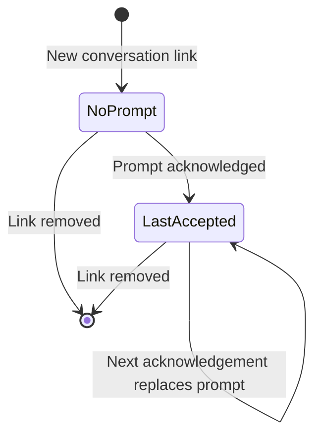

# Design

## Triage

| Trigger | Applies? | Evidence |
|---|---|---|
| T1 Components | No | The workbench already mounts the shared agent view (`packages/desktop/lib/src/workbench_page.dart:1369-1383`). The change stays within that view and its existing controller. |
| T2 State | Yes | Keep one accepted prompt per open session link. The existing Retry field is assigned before admission (`packages/desktop/lib/src/agent/agent_controller.dart:1397-1417`). |
| T3 Concurrency | No | Reuse the existing awaited send and its result guard (`packages/desktop/lib/src/agent/agent_controller.dart:1397-1426`). Add no deferred work. |
| T4 Boundaries | No | Keep the existing prompt request and draft revision (`packages/desktop/lib/src/agent/agent_controller.dart:1410-1416`). No runtime or storage contract changes. |
| T5 Volume | No | The controller already rejects prompts above `maxAgentPromptBytes` before dispatch (`packages/desktop/lib/src/agent/agent_controller.dart:1382-1392`). Retain one reference, not a list. |
| T6 Risk | Yes | The new keyboard path could send partial composing text if it mishandled an IME confirmation. Send can remove a draft before dispatch under ADR 0014 (`docs/adr/0014-app-exit-decisions-terminal-activity-and-local-drafts.md:42-46`). |

TIER: FULL

## Context

`AgentPaneView` displays the same composer for all three runtimes and gates Send with `link.canSend` (`packages/desktop/lib/src/agent/agent_pane_view.dart:327-351`). The gate requires a live, connected, idle link with no pending send or steering (`packages/desktop/lib/src/agent/agent_controller.dart:250-257`). The send method independently checks that gate and rejects whitespace before dispatch (`packages/desktop/lib/src/agent/agent_controller.dart:1376-1381`). The link listens to edits of its text controller and marks changed text as a draft edit (`packages/desktop/lib/src/agent/agent_controller.dart:49-56,150-155`). See [proposal.md](proposal.md) for the owner decisions.

## Decisions

### D1: Handle physical keys at the focused composer

- Choice: Wrap the existing multiline field in a non-focusable ancestor `Focus` key handler. Handle only plain Enter and Up and Shift+Enter, treating both Enter keys alike. Plain means no Shift, Control, Alt, or Meta; lock keys do not affect the shortcut. Active composition means `link.prompt.value.composing.isValid` at dispatch (A1). Do not invoke a composer shortcut during composition. On Windows only, claim a composing Enter delivered to Flutter to prevent the embedder from interpreting it as a newline (A1). Consume Enter repeats without submitting. Use the same send callback as the button; consume blocked Enter so it neither submits nor inserts a newline. Apply Shift+Enter as one text-editing value replacement, including the updated selection, so it works without a separate platform text event. Pass nonempty Up and unrecognized combinations to Flutter.
- Rejected: Use a text-input submit action or watch for newlines in the buffer. Either would mix keyboard submission with IME, paste, or text entry and would not distinguish Shift+Enter.
- Reversal cost: low.
- Important: yes. Changes how users submit drafts and confirm IME candidates.
- Chosen by: agent.

### D2: Remember the acknowledged prompt on the session link

- Choice: Keep one memory-only slot on `AgentLink`, writable only by the controller and read-only to the view. Replace it only after a successful `promptAgent` result, including Retry, under the existing host and link ownership check. Reuse the submitted `String` without copying it. Restore it as an ordinary composer edit with the caret at its end; do not mute the draft listener. If that recalled text is left unsent, it can survive as a draft under ADR 0014, not as recall history.
- Rejected: Read the Retry field or derive recall from displayed messages. A refused attempt already replaces the Retry field (`packages/desktop/lib/src/agent/agent_controller.dart:1397-1417,1432-1447`). Display history merges adjacent entries and can evict old ones (`packages/desktop/lib/src/agent/agent_transcript.dart:75-97,145-149`). Neither identifies the last accepted prompt in this open conversation.
- Reversal cost: low.
- Important: yes. Defines which prompt Up recalls after a refused send.
- Chosen by: agent.

### Decision summary

| # | Decision | Choice | Rejected | Reversal cost | Important | Chosen by |
|---|---|---|---|---|---|---|
| S1 | Keyboard scope | Shared keys; mirror Send while streaming | Runtime-specific bindings, queue, or steering | Low | Yes | User |
| S2 | Recall scope | Most recent accepted prompt in this open conversation | Search restored history | Low | Yes | User |
| D1 | Key handling | Exact physical shortcuts, leaving IME confirmation alone and blocking Windows raw Enter fallback during composition | Infer submission from text input | Low | Yes | Agent |
| D2 | Recall source | Keep one link-local acknowledged prompt | Retry field or transcript | Low | Yes | Agent |

## Assumptions

- A1: Windows Enter that confirms a candidate either travels the IME-processed path without an app key event or reaches Flutter before its composing range clears. For a raw Enter that reaches Flutter, the pinned engine is expected to run its multiline fallback only if the app does not claim the event. Task 1.1 checks the pinned SDK input code. A widget test injects the active composing range and asserts that Flutter claims raw Windows Enter without changing the draft. Only the native check below verifies the candidate-to-key ordering and the next deliberate Enter. If either case fails, D1 reopens.
- A2: On Linux and macOS, an Enter that D1 passes through during candidate confirmation is handled by the platform IME and does not become a newline or a second commit. The pinned SDK routes unclaimed keys through GTK or AppKit text input; actual IME output on those platforms has not been checked. Depends on it: D1 pass-through and the "Confirm an IME candidate" scenario on Linux and macOS. A failed native check reopens D1 for that platform.

## Carried constraints
- C1: Keyboard submission respects the Send gate and does not intercept IME confirmation to submit or add text. Kind: invariant. Destination: spec: specs/agent-sessions/spec.md → Requirement: Agent composers support keyboard editing and submission.
- C2: Recall uses the last accepted prompt from the open conversation, never restored history or a separate prompt store. Kind: deliberate gap. Destination: spec: specs/agent-sessions/spec.md → Requirement: Agent composers support keyboard editing and submission.

## Diagrams (FULL)

## State & Ownership (FULL)

| State | Owner (sole writer) | Lifetime | Invalidation / rebuild | Authoritative copy |
|---|---|---|---|---|
| Last accepted prompt for recall | `AgentController.send` on the current `AgentLink` | Open conversation | Next successful submission replaces it. Ending the link discards it. No rebuilt value on restore. | The exact text of the acknowledged submission |
| Composer text and selection | Existing link text controller; Flutter and explicit composer editing actions edit its value | Existing draft lifecycle | Existing logic clears only the admitted, unchanged draft (`packages/desktop/lib/src/agent/agent_controller.dart:1418-1430`). | Link's current `TextEditingValue` |

## Failure & Visibility (FULL)

| Component | Failure | Recovery | Retry safe? | Who finds out |
|---|---|---|---|---|
| Composer | Send unavailable or the draft blank | Leave the draft unchanged. Once allowed, require a fresh Enter or Send. | Yes, when Send is available. | The user sees the unchanged draft and existing Send state. |
| Session link | Prompt admission refused, or host/link changes before acknowledgement | Leave the recall slot unchanged. Existing send failure and drafts handle the refusal (`packages/desktop/lib/src/agent/agent_controller.dart:1432-1449`). | Existing Send rules apply; never send automatically. | The user sees the existing failure or disconnected state. |

## Resource Bounds (FULL)

| Queue / buffer / cache / transfer | Bound | At the bound | Timeout | At 10x / 100x |
|---|---|---|---|---|
| Recall slot per link | One prompt, at most 256 KiB UTF-8 (`packages/desktop/lib/src/agent/agent_controller.dart:1382-1392`, `packages/host_protocol/lib/src/messages.dart:1794`) | Replace the slot on acknowledgement; no search or accumulation. | None added. | More turns do not increase retained history. More open links add at most one slot each. |

## Flow & State Gaps (FULL)

- Update recall only within the current-host, owned-link branch after acknowledgement. The existing submission latch prevents overlapping admissions (`packages/desktop/lib/src/agent/agent_controller.dart:250-257,1397-1398,1418-1426,1440-1445`). Text typed meanwhile stays an unsent draft under the existing guard.
- The slot follows the link, not transient widget state. Removing a pane removes the link; starting a new session creates a different link (`packages/desktop/lib/src/agent/agent_controller.dart:785-801,919-937`). Application start builds each pane's link fresh from pane identity, not prompt history (`packages/desktop/lib/src/agent/agent_controller.dart:761-783`). Host loss, `restore()` and Continue reuse the same link (`packages/desktop/lib/src/agent/agent_controller.dart:740-758,806-869,985-1044`). The slot survives them while the pane stays open and is never cleared or rebuilt there.
- Pressing Up while an acknowledgement is pending may recall the previous accepted prompt only if the field is empty. That is a new draft edit, so a late acknowledgement cannot discard it.

## Mechanism Ledger (FULL)
| Mechanism | Built? | Why | Evidence that would change the call |
|---|---|---|---|
| Exact composer-local key handler and IME check | Yes | Plain Enter is an explicit send, but composition confirmation is not. Mouse submission and nonempty caret navigation must still work. | An existing framework binding that dispatches the same commands without claiming composition confirmation. |
| One acknowledged prompt slot | Yes | Retry and displayed history do not reliably identify the complete most recent acknowledged prompt. | A link API that already owns the exact acknowledged prompt for the same lifetime. |
| Saved recall history, queue, or automatic retries | No | Not needed for shortcuts in an open conversation. A queue would change Send semantics. | A separate owner-approved change to the session contract. |

## Risks / Trade-offs

- Widget tests can dispatch physical key events to Flutter and inject a composing range. They cannot reproduce every native IME's candidate UI. Do not describe these tests as native IME qualification.
- The shortcut is intentionally local to the composer. It does not replace normal Enter activation of a focused button or arrow behavior outside the composer.
- Check A1 by hand before archive on the Windows release build. In Microsoft Japanese IME and Microsoft Pinyin, confirm a candidate with Enter and observe no send and no line break. Press Enter again and observe one send. Record each IME, the Windows build, and the outcome in the change. A failure reopens D1.

## ADRs

- In force, constraining this change: ADR 0004 for conversation identity, ADR 0014 for draft ownership and submission, and ADR 0017 for deterministic tests.
- To record during apply: none.
