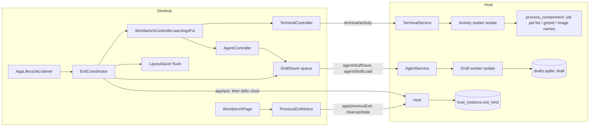
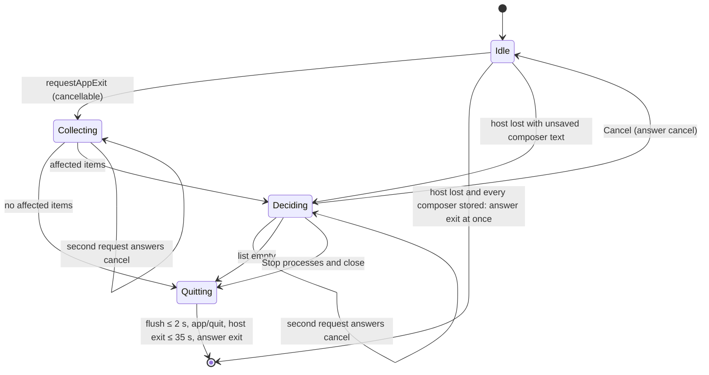
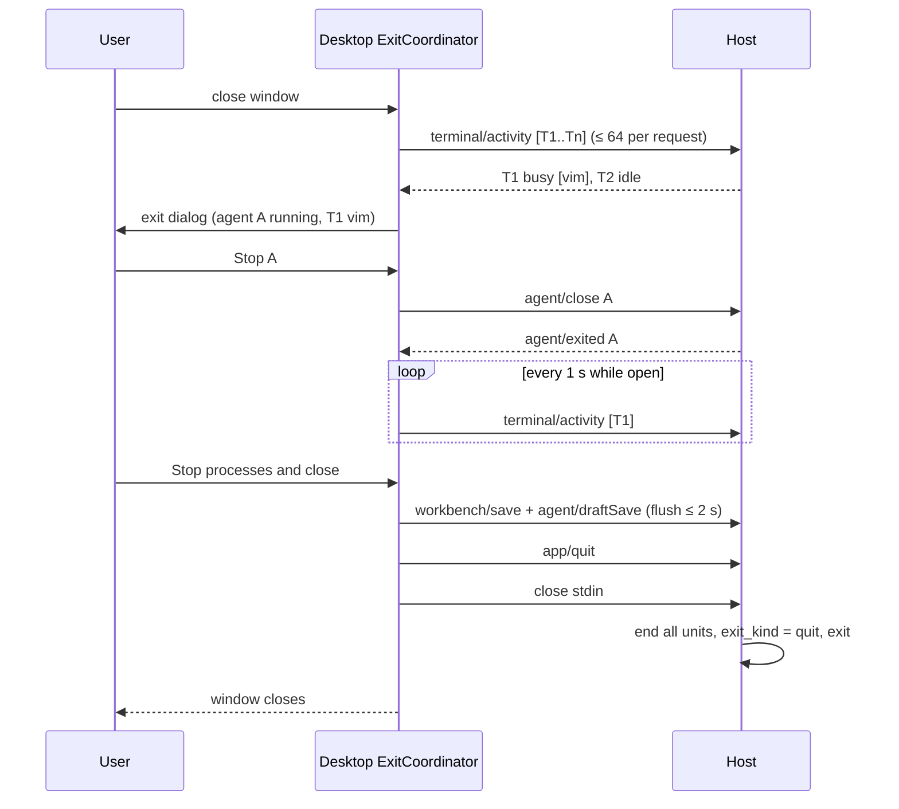

# Design

## Triage

| Trigger | Applies? | Evidence |
|---|---|---|
| T1 Components (new component, or 3+ with directed relationships) | Yes | New desktop exit coordinator and draft saver; host activity reader (worker isolate) and draft store; desktop, host, `process_containment` and store all take part in quit and close |
| T2 State (persistent state, caches, 3+ state machine) | Yes | Store v6 `host_instance.exit_kind`; new draft store `drafts.sqlite` (draft schema v1); exit coordinator state machine (idle, collecting, deciding, stopping, quitting); per-session draft save state |
| T3 Concurrency (background work, workers/isolates, async, retries) | Yes | Activity reads off-isolate under a deadline; debounced draft saves racing sends and pane closes; items finishing or failing while the exit dialog is open; re-entrant exit requests |
| T4 Boundaries (data format, migration, shared interface, IPC, external) | Yes | Store migration v5→v6; a second host-owned database file with its own migrations; new protocol methods and `lifecycle` capability; OS process APIs (job process list, `getsid`, image names); Flutter's `System.requestAppExit` contract |
| T5 Volume (grows without a fixed bound) | Yes | Drafts grow with session records (unbounded in M1); process table size on POSIX; exit list grows with panes |
| T6 Risk (security, money, data loss, unrecoverable user data) | Yes | Exit ends user processes; unsent text is user data that cannot be recreated; stored prompt text must not outlive a send (D29) |

TIER: FULL

## Context

See `proposal.md` for the problem and scope. Grounding:

- **Exit today.** `AppLifecycleListener.onExitRequested` flushes the layout, shuts the host down and always answers `exit` (`packages/desktop/lib/main.dart:105-113`). Flutter routes window close and Quit on all three embedders through the cancellable `System.requestAppExit` once the framework is initialized; an exit the OS requires bypasses the callback (Flutter macOS `FlutterEngine.mm` and Linux `fl_platform_handler_request_app_exit`, checked through Context7). Host shutdown is the stdin close: `HostSession.quit()` waits up to 35 s (`host_protocol/lib/src/launcher.dart:440-476`), and the host ends every unit (`host/lib/src/host.dart:471-498`).
- **Close confirmation.** `WorkbenchController.requestClose` collects synchronous `ViewCloser.warnsOnClose` reasons, shows one dialog, re-checks and closes (`desktop/lib/src/workbench_controller.dart:597-624`; `view_closer.dart:3-6`). Agents warn when running, waiting for approval, stopping or sending (`agent/agent_controller.dart:858-870`). Terminals warn whenever the shell is `starting` or `live` (`terminal/terminal_controller.dart:551-555`). The dialog is `showCloseWarning` (`terminal/profiles_dialog.dart:88-135`).
- **Composer.** One `TextEditingController prompt` per `AgentLink` (`agent_controller.dart:38`). It is cleared after an accepted prompt (`:769-770`), carried into a new session in the same pane (`:459`), and disposed with the link (`:175-177`). Pane state stores only `runtimeName` and `sessionId` (`:461, :484-487`).
- **Store.** Migrations are a list, version = length, currently v5 (`host/lib/src/store/store.dart:14-130`), WAL with `synchronous=FULL` (`:166-167`). `host_instance.closed_cleanly` is set to "no live units" at exit (`host.dart:505`), so a desktop kill with settled units reads as clean.
- **Units.** `ContainedUnit` exposes the unit's `pid` (`process_containment/lib/src/contained_unit.dart:22-42`). On Windows each unit has its own job object, and `jobActiveProcesses` reads its count (`windows_jobs.dart:68-81`). On POSIX each unit is a session leader (host-process-cleanup "Units are contained and marked"), and `PosixProcessTable` lists pids (`posix_process_table.dart:32-60`). The bundled `OpenConsole.exe` is started by the host process (`process_containment/test/pty_windows_test.dart:63-75` finds it as a child of the host). Whether it lands in the unit's job is **unverified**; task 2.1 settles it.
- **Layout saver pattern.** It uses a 500 ms debounce, a 2 s maximum dirty age, one save in flight, a 10 s deadline and a revision guard (`desktop/lib/src/layout_saver.dart:14-31`). Drafts reuse the shape.
- **Prompt bound.** `maxAgentPromptBytes` = 256 KiB of UTF-8 (`host_protocol/lib/src/messages.dart:1606, 1866-1871`). The control message bound is 1 MiB.

## Decisions

### D1: The desktop owns the exit decision; the host learns only that it is a quit

- **Choice:** A desktop `ExitCoordinator` runs inside `onExitRequested`.
  - It collects the affected items, shows the exit dialog, performs per-item stops through the existing close messages (`agent/close`, `terminal/close`) without removing panes, and finally answers `exit` or `cancel`.
  - On `exit` it flushes layout and drafts (shared 2 s quit flush), sends `app/quit`, then closes the connection as today.
  - The host's only new duty is recording `exit_kind = 'quit'` when `app/quit` preceded an `inputClosed` close.
- **Rejected:** A host-driven exit, where the desktop asks the host to "prepare exit" and the host enumerates affected units and drives the stops. The host has no notion of panes or titles, so the list would need a second mapping back to views. It would also add a host state machine for a decision that is purely UI, and the host already ends everything on connection close.
- **Reversal cost:** Low. It is desktop-internal, apart from one additive notification.

### D2: Busy means the unit holds a process besides its shell, read on demand

- **Choice:** `terminal/activity` reads, for each named terminal, the processes of its contained unit. Every process other than the unit's leader (`ContainedUnit.pid`) makes the terminal busy. The leader counts only while it still runs the shell's image, which is checked as follows:
  - **POSIX:** the unit's pid survives `execve` (`process_containment/lib/src/unit_exec.dart:12-28`), so `exec vim` would otherwise read as idle. The expected image is not observed after start, because nothing pauses the shell until the host could read it. It is fixed before the spawn, from the profile's executable as the host resolves it for `execve`, with symlinks resolved (device and inode on Linux, the canonical path on macOS). On each read the leader's current image is compared with that expectation (`/proc/<pid>/exe` device and inode; `proc_pidpath`). A different image is busy and named by its image. An unreadable image is unknown.
  - **Windows:** there is no `exec`, so the leader is always the shell.
  - The read runs on demand in one `Isolate.run` per request, under a 1 s deadline.
  - **Windows:** `QueryInformationJobObject(JobObjectBasicProcessIdList)` on the unit's job.
  - **Linux:** `/proc/<pid>/stat` session field equals the unit pid.
  - **macOS:** `getsid(pid)` equals the unit pid.
  - Zombies are excluded.
  - A profile whose executable is a script runs its interpreter as the leader image. Such a terminal reads busy at its prompt, which is the safe direction. ADR 0014 names it, and the M1 walk records it per shell.
  - Names come from the image basename: `QueryFullProcessImageNameW`, `/proc/<pid>/comm`, or `proc_name`. Each is cut to 64 bytes on a character boundary, at most three per terminal, in ascending pid order.
- **One rule everywhere:** pane close, tab close and the exit list all use it. `ViewCloser.warnsOnClose` becomes `Future<Map<String, String>> warningsFor(List<String> paneIds)`, so one activity request covers a whole tab or the exit list.
- **Rejected:**
  - **PTY foreground process group (`tcgetpgrp`).** It misses background jobs and has no ConPTY equivalent, which would mean two rules.
  - **Host-pushed activity changes.** These come from polling every terminal continuously. That costs process-table scans and control traffic all the time, for information needed only at close and exit.
  - **The marker scan.** It walks every process environment with a 10 s pass bound, which is far too slow for an interactive close.
- **Reversal cost:** Medium. It defines user-visible warning behaviour and is recorded in ADR 0014. Evidence that would reopen it: shells that keep resident helper processes (for example Nushell plugins with a plugin GC timeout) making idle terminals read busy in the M1 walk.

### D3: Drafts are host-stored per session and saved like the layout

- **Choice:** Drafts live in the draft store (D4) as `draft(session_id TEXT PRIMARY KEY, text TEXT NULL, bytes INTEGER NOT NULL, revision INTEGER NOT NULL, updated_at TEXT NOT NULL)`. There is no foreign key across files: the host checks that the session record exists in the main store before every save. A NULL `text` is a tombstone that keeps the revision floor. The M2 history deletion must delete a session's draft row with its record.
  - A desktop `DraftSaver`, one per session link, follows the layout saver's states: 500 ms quiet, 2 s maximum dirty age, one save in flight plus one coalesced text, and a 10 s deadline.
  - Saves run across all links through one desktop draft queue with ≤ 8 requests in flight.
  - Each link keeps a monotonic draft revision. It starts at 0 for a new session, and every composer edit raises it.
  - `agent/draftSave` carries `(text, revision)`. The host refuses a revision not above the stored one with `stale-revision`, and the refusal carries the stored revision.
  - **Revision floor recovery.** The desktop never trusts its local counter alone:
    - `agent/draftLoad` returns the stored text (or none) and the stored revision. A load that arrives after the user already edited the composer only raises the link's revision above the stored one; it never replaces the composer text.
    - On `stale-revision`, the link raises its revision above the stored one and saves the *current* composer text once more (never the refused text), unless the submission guard below holds it back. One re-save per refusal; the re-save is above the floor, and one save per link is in flight, so it cannot loop.
    - A failed load therefore costs nothing durable: the composer stays empty with *Draft not loaded*, the stored draft stays until the user types, and the first save after typing recovers the floor through `stale-revision` if needed.
  - **One writer per session.** A session's draft has one writer: its single desktop link. The host already refuses a second open of a saved session (`agent_service.dart:573`). The desktop keeps at most one link per session id; a layout pane that names a session already linked elsewhere shows it without a composer.
  - **Synced links.** A link is *synced* once the host has told it the stored revision: a draft load, a save acknowledgement (which now returns the stored revision) or a `stale-revision` reply. On sync, the link's counter is raised above the stored revision. A new session is synced at 0. A link whose load failed and that has had no reply yet is *unsynced*.
  - **Submission guard.** From Send until the prompt's result arrives, the link holds the submitted snapshot. While it holds it, the link sends no save of that snapshot: a pending or coalesced save of it is dropped, and a `stale-revision` re-save is skipped while the composer is unchanged since Send (it still shows P because `AgentController.send` clears only after acceptance, `agent_controller.dart:734-770`). Edits typed after Send are newer and save normally. On acceptance the guard is released and the composer is cleared only if it is unchanged since Send. On any refusal the guard is released and the current composer text is saved above the floor.
  - **Retry after storage recovers.** A link whose latest revision is unsaved because of `draft-unavailable` is retried when the host sends `agent/draftStoreReady`, which it sends whenever the draft store becomes available: after a slow open, and when *not responding* clears. The desktop then saves each such link once, through the draft queue, subject to the submission guard. A failure there leaves the link *unsaved* and visible, as before.
  - Empty text removes the draft.
  - `agent/prompt` gains an optional `draftRevision`, the composer revision whose text is being sent, and `draftSynced`, whether the link was synced at Send. Send sets both. Retry, which resends `lastPrompt`, sets neither.
  - **Send order:** for `agent/prompt` with `draftRevision = r`, the host validates the request, then commits the draft change, then dispatches to the adapter.
    - The draft change: if the link was unsynced, or the stored revision is ≤ r, the text is removed. An unsynced link's revisions are not comparable with the stored one, and with one writer per session anything stored before the link synced is an earlier edit of what the composer shows. The revision floor is always raised to max(stored, r). Removal keeps the row as a tombstone (`text` NULL, `revision` max(stored, r)), so a late save at or below it is refused even after a restart. Newer text (a synced link's revision > r) stays.
    - If the commit fails, the prompt is refused `store-error` before dispatch. If the draft store does not answer within the draft deadline (D4), the prompt is refused `draft-unavailable` before dispatch; that removal may still commit later. Either way nothing runs and sending again is safe.
    - **Any refusal of a prompt that carried `draftRevision`** (store error, `draft-unavailable`, or the adapter refusing after dispatch): the composer still holds the text (`AgentController.send` keeps it on failure, `agent_controller.dart:734-770`). The desktop raises the link's revision above r and saves it again, so the draft is stored again even if the removal committed.
    - A host lost between commit and dispatch leaves the text in the composer, saved again after Restart host.
  - The save is flushed on pane close (before `agent/close`) and in the quit flush.
  - A link whose latest revision is not stored after a flush (refused, failed or timed out) is *unsaved*. Pane close and the exit list name it (agent-sessions "Closing with an unsaved draft says it will be lost"). No loss is silent apart from a desktop kill or an OS-required exit, which lose at most the edits since the last successful save.
  - Restore calls `agent/draftLoad` per restored chat pane, ≤ 8 at a time.
  - A link with no saved record (starting or failed start) keeps text in memory and shows *Draft not saved*. *New session* gives the new link an empty composer, replacing today's carry-over at `agent_controller.dart:459` for links that had a record. Retry after a failed start still keeps the text, because no conversation exists yet.
- **Rejected:**
  - **Drafts in the pane `state` of the layout document.** Pane state is ≤ 4 KiB, and a draft must outlive its pane's close (D7). It is also session-scoped, not pane-scoped.
  - **A desktop-written draft file.** That breaks ADR 0003, where the host is the sole store writer. It also breaks the second-launch rule that a refused launch writes nothing to the profile.
- **Reversal cost:** Medium. It is a stored table, but it is additive and owned by one service.

### D4: Drafts live in a separate rollback-journal database on their own isolate, so a committed removal leaves no copy and draft I/O never blocks control

- **Choice:** `<profile>/drafts.sqlite` is the draft store.
  - It is owned by a **draft worker isolate** in the host process, with the only connection to the file. `AgentService` talks to it over a port; the host's control isolate never runs a draft SQLite call.
  - The worker is spawned after the main store is open and reconciliation has started; nothing in startup, reconciliation, Stop, permission replies or desktop-loss handling awaits it. It opens the file under the already-held profile lock and applies its own `PRAGMA user_version` migrations (draft schema v1) transactionally.
  - **Admission and deadline.** The worker runs one operation at a time. The host admits ≤ 16 pending draft operations; past that it answers `draft-unavailable` at once. Each operation has a 5 s host-side deadline. On timeout the host answers `draft-unavailable` and marks the store *not responding*: further operations are answered `draft-unavailable` at once, without queueing, until the stuck operation returns. The worker keeps ownership of the timed-out operation; its late result clears *not responding* and the host sends `agent/draftStoreReady`.
  - **Settings.** `journal_mode = DELETE`, `synchronous = EXTRA` and `secure_delete = ON`. `EXTRA` also syncs the directory after the journal is deleted, so a committed removal survives power loss; `FULL` in DELETE mode does not guarantee that (SQLite `PRAGMA synchronous`). After opening, the worker reads the three settings back and disables drafts if any differs.
  - When a draft is updated or removed, its old content is zeroed in the database file, because secure delete overwrites freed and replaced cell content. The rollback journal holding the old page images is deleted at commit. So once a removal or overwrite commits, no file under the profile holds the old text: there is no WAL to checkpoint and no purge obligation to carry.
  - A crash mid-transaction leaves a hot journal holding the *current* draft. The next open rolls it back, which is correct, and then deletes the journal.
  - Draft operations are single-row and ≤ 256 KiB. The main store and its WAL never touch this file, and the control isolate never waits on the worker, so a stalled or failed draft store cannot delay cleanup or control.
  - **Unavailable.** A draft store that cannot be opened, migrated or verified disables drafts with a visible reason: every chat pane shows *Draft not saved: draft storage unavailable*. Everything else starts, including reconciliation, launches, Stop and Retry.
    - A send carrying `draftRevision` is refused `draft-unavailable` before dispatch whenever its removal cannot be confirmed: while drafts are disabled, and while the store is *not responding*. The composer keeps the text. Retry, which carries no `draftRevision` and removes nothing, still dispatches.
    - **Reset draft storage.** While drafts are disabled, chat panes offer **Reset draft storage**. After a confirmation that says every stored draft will be lost, the desktop sends `agent/draftReset`. The host reserves the reset synchronously, before its first await; while that reservation exists, another `agent/draftReset` is refused `draft-store-in-use` and every draft operation is answered `draft-unavailable`. Under the reservation the host stops the old worker and waits until it has exited, deletes `drafts.sqlite` and its journal, then starts the one successor worker on a fresh file. Only that successor, once open and verified, ends the reservation and sends `agent/draftStoreReady`, and the desktop saves each unsaved link (D3). If the exit wait, the delete or the new open fails, the reservation ends with drafts still disabled, the reset is refused with the reason, and sends stay refused.
    - `agent/draftReset` is refused `draft-store-in-use` (a new error code) unless drafts are disabled, so it can never discard a working store.
  - At host exit the worker is not awaited. A transaction cut off by the exit is rolled back from its hot journal at the next open.
  - Drafts are never written to the host log.
- **Rejected:**
  - **Drafts in the main store with a WAL purge** (rounds 1-3). A synchronous checkpoint misreported prompt results and blocked control. A background checkpoint contended for the main store's locks, did not own automatic checkpoints, and its startup purge could block reconciliation.
  - **Draft calls on the control isolate, like the main store's writes** (round 4). A stalled open, hot-journal recovery or commit would hold reconciliation, Stop and desktop-loss cleanup; drafts are the only store work that is user-paced and optional, so they move off.
  - **Switching the main store to a rollback journal.** It contradicts ADR 0008 and costs ledger and layout write throughput, for a property only drafts need.
  - **Encrypting drafts with a local key.** The key lives in the same profile, so the text remains recoverable.
- **Reversal cost:** Medium. It is a second database file with its own schema and one worker isolate, but it is additive. It is recorded in ADR 0014, which amends ADR 0003's single-store wording: still host-owned, still under the lock. Evidence: the canary scenarios scan every profile file while the host runs and after a kill.

### D5: The previous exit is a recorded kind, not "no live units"

- **Choice:**
  - Store v6 adds `host_instance.exit_kind TEXT NULL CHECK (exit_kind IN ('quit'))`. The host writes `'quit'` in `_finish` only when it received `app/quit` and the close reason was `inputClosed`.
  - When the host takes the lock, before reconciliation starts, it reads the immediately previous instance row: the highest id below its own. It keeps `{kind: quit | unexpected | none, openedAt}` as an immutable in-memory snapshot. Reconciliation deletes earlier instance rows without units (`host/lib/src/cleanup_service.dart:75`, `ledger.dart` `deleteUnreferencedInstances`), so a later read could find the row gone or an older one.
  - `app/previousExit` returns that snapshot.
  - The desktop asks once, for its first host connection, and shows the notice when `cleanup/state` reports reconciliation finished. The counts come from that state. Dismissal lives in memory.
  - `closed_cleanly` stays as it is.
- **Rejected:**
  - **Reusing `closed_cleanly`.** It is true after a desktop kill whose units settled (`host.dart:505`), which is exactly the case to report.
  - **A desktop "running" marker file.** The desktop would write into the profile, and a refused second launch would touch it.
- **Reversal cost:** Low. It is an additive nullable column.

### D6: The M1 walk is recorded in this change, and the kill test uses real units

- **Choice:**
  - `openspec/changes/app-exit-and-reopen/m1-walk.md` lists every M1 exit criterion per OS, each with its result (`pass`, `fail` or `unverified`), who verified it, the date and the evidence: a CI run, a test name, or the user's word.
  - Linux and macOS user items are `unverified` by the user's decision of 2026-11-02.
  - The host lifecycle integration test gains a case: a stand-in desktop starts the test host, opens a real terminal running a child program and a fake-ACP agent session, and is then killed. The test asserts that no host, shell, child or adapter process remains, on all three CI OSes.
- **Rejected:** Driving the bundled Flutter desktop binary from a tool script and killing it. CI would need a display and a release desktop build per job, for no added coverage of the host-side guarantee that does the work.
- **Reversal cost:** Low.

## Diagrams (FULL)

Components and contracts (T1, T4):



Exit coordinator state machine (T2, T3):



Quit with an affected item (T3, T4):



Draft save and delete (T2, T4):

```mermaid
sequenceDiagram
    participant C as Composer
    participant S as DraftSaver
    participant H as Host AgentService
    participant DB as Draft worker + drafts.sqlite (DELETE journal, EXTRA, secure_delete)
    participant A as Adapter
    C->>S: text changed (revision r)
    S->>H: agent/draftSave(id, text, r) after 500 ms quiet / 2 s age
    H->>DB: UPSERT draft if r > stored revision
    C->>H: agent/prompt(id, text, draftRevision r)
    H->>DB: tombstone if stored revision ≤ r (commit; journal deleted)
    alt commit failed
        H-->>C: store-error or draft-unavailable (not dispatched); C re-saves above r
    else committed
        H->>A: session/prompt
        H-->>C: accepted or refused
    end
```

## State & Ownership (FULL)

| State | Owner (sole writer) | Lifetime | Invalidation / rebuild | Authoritative copy |
|---|---|---|---|---|
| Stored draft (`draft` row in `drafts.sqlite`) | Host `AgentService`, on `agent/draftSave` or before dispatching a send | Until a send dispatches it or the composer is emptied; kept through pane close and quit | Tombstoned before dispatch or on empty save, with no copy left once committed (D4); never rebuilt | Draft store |
| Composer text | Desktop `AgentLink.prompt` | While the link lives | Loaded from the stored draft on restore; sent to the host by `DraftSaver` | Desktop memory while typing; the store after a successful save |
| Draft save state (clean / pending / in flight / failed, with reason) | Desktop `DraftSaver` per link | Link lifetime | Reset on successful save; failure shown on the pane | Desktop memory |
| Quit announced | Host `Host`, on `app/quit` | One host run | n/a | Host memory, then `exit_kind` |
| `host_instance.exit_kind` | Host, in `_finish` | Permanent per instance row | Never updated after exit | Local store |
| Previous-exit notice shown / dismissed | Desktop `WorkbenchController` | One desktop run | Not shown again after dismissal or a Restart host | Desktop memory |
| Exit coordinator state and item list | Desktop `ExitCoordinator` | One exit attempt | Rebuilt from agent states and activity polls while open; discarded on Cancel or exit | Desktop memory, derived from host-reported state |
| Terminal activity result | Host activity reader, per request | One request | Never cached; read again on each request | OS process table at read time |

## Failure & Visibility (FULL)

| Component | Fails / dies mid-operation → | Recovery | Retry safe? | Who finds out |
|---|---|---|---|---|
| Activity reader | Times out or throws (process table unlistable, access denied) | Unread terminals reported `unknown`, warned as *may be running programs*; a timed-out isolate keeps the single activity slot until it returns, and further requests are answered `busy` (desktop treats it as unknown) | Yes, a read only | User, in the warning |
| Exit coordinator | Host lost while the dialog is open | Process items become *Stopped or unknown* and leave the list. Unsaved-draft items do not depend on the host and stay: every composer whose latest revision is not confirmed stored, including text typed after the loss. With only process items gone, the dialog stays until the user decides | n/a | User, in the dialog |
| Per-item Stop | `agent/closeFailed` / `terminal/closeFailed` | The coordinator keeps the item in its own failed set, independent of links and activity polls, with the error and *cleanup unresolved*, and without Stop: the host has given up the live object (ADR 0012), so a second close cannot retry. Recovery belongs to the durable cleanup owner: bulk close (the next host reconciles) or Cancel and then the existing cleanup list (Retry cleanup / Confirm processes are gone) | No per-item retry; reconciliation retries | User, in the row |
| Quit flush | Layout save fails or exceeds 2 s | Quit proceeds; the layout notice is moot at exit; the last saved layout is restored | n/a | Nobody; bounded by the layout saver's existing rule |
| Quit flush (drafts) | A draft save fails, is refused or exceeds 2 s | That pane joins the exit list as *Draft not saved* with the reason; quitting then needs the bulk action, which states the draft will be lost, or Cancel | Yes (Cancel, then edit to retry) | User, in the exit dialog |
| Host during quit | Unit not terminated by the 30 s deadline | Host exits; unit stays in ledger; next launch reconciles and shows the previous-exit notice only if not quit, else the cleanup status | Yes (reconciliation) | User at next launch |
| Desktop killed | n/a | Host ends units (existing), records no quit; next launch shows the notice | n/a | User at next launch |
| Draft save | Host refuses (`draft-too-large`, `draft-cap`, `unknown-session`) or is lost | Pane shows *Draft not saved* with reason; composer keeps text; next edit after recovery saves again | Yes, whole-text upsert | User, on the pane |
| Draft load | Fails or times out | Composer empty, *Draft not loaded* with reason; stored draft untouched until the user types | Yes | User, on the pane |
| Draft removal before dispatch | Commit fails, or no answer within the draft deadline | The prompt is refused (`store-error` or `draft-unavailable`) before dispatch; nothing runs; the desktop saves the composer text again above r | Yes, nothing ran | User, on the pane |
| Draft worker | Stalls (fsync, hot-journal recovery, migration) | Operations answered `draft-unavailable` within 5 s, then at once while *not responding*; control, reconciliation and cleanup unaffected | Yes, once it returns | User, on the pane |
| Draft save | `stale-revision` | Link raises its revision above the returned floor and saves the current composer text once more | Yes | Nobody needs to; silent recovery |
| Draft store | Cannot be opened, migrated or verified at start | Drafts disabled with a visible reason; composer sends refused `draft-unavailable` before dispatch; Retry, reconciliation and everything else continue; **Reset draft storage** offered | Yes, at next start or by reset | User, on every chat pane |
| Draft reset | Second reset while one is reserved | Refused `draft-store-in-use`; the first reset alone owns worker replacement | Yes, after it ends | User, on the pane |
| Draft reset | Old worker does not exit, delete or fresh open fails | Reset refused with reason; drafts stay disabled and composer sends stay refused | Yes, reset again or next start | User, on the pane |
| v6 migration (main store) | Fails | Transaction rolls back, startup blocked with error (existing local-store rule) | Yes | User |
| Previous-exit snapshot | Row unreadable at lock time | Snapshot `none`; no notice; failure logged; startup continues | n/a | Local diagnostics |

## Resource Bounds (FULL)

| Queue / buffer / cache / transfer | Bound | At the bound | Timeout | At 10x / 100x |
|---|---|---|---|---|
| `terminal/activity` request | ≤ 64 terminal ids; the desktop batches larger sets (≤ 128 panes → 2 requests) | `invalid-params` above 64 | 1 s per request; unread ids `unknown` | Per-request cost is O(processes on the machine) on POSIX: ~500 → a few ms; 5,000 → tens of ms; 50,000 → may pass 1 s, giving `unknown` and a warning (safe) |
| Activity reads in flight | 1 per host | Further requests answered `busy` | — | n/a |
| Program names | ≤ 3 per terminal, ≤ 64 B each | Extra processes counted, not named (`vim and 4 more`) | — | Fixed |
| Exit dialog polling | 1 activity request per second while open | — | 1 s | Fixed |
| Draft text | ≤ 256 KiB encoded JSON string contents (UTF-8 and escaping counted) | `draft-too-large`; stored draft unchanged | — | Fixed per draft |
| Stored drafts total | ≤ 32 MiB of `bytes` across all rows | `draft-cap`; others unchanged | — | Count is bounded by records (unbounded in M1, as now); the cap holds bytes at any count. 10x typical (100 drafts of 1 KiB) is far below it |
| Draft saves in flight (desktop) | ≤ 8 across links; per link one in flight plus one coalesced | Newer text replaces the coalesced one | 10 s per save | Well under the host's 256 in-flight control requests |
| Draft loads at restore | ≤ 8 concurrent, one per restored chat pane (≤ 128 panes) | Queued | 10 s per load | Fixed by pane cap |
| Quit flush (layout + drafts) | 2 s total, shared | Quit proceeds | 2 s | Fixed |
| Draft worker operations | One at a time; ≤ 16 pending in the host; one row ≤ 256 KiB each; `synchronous=EXTRA` (journal and directory synced) per commit | `draft-unavailable` at once past 16 pending or while *not responding* | 5 s per operation at the host; 10 s per save at the desktop | File size bounded by the 32 MiB total draft cap plus free pages; 1 worker isolate per host |

## Flow & State Gaps (FULL)

- **Item state changes during the dialog.** The list is derived from live agent state and activity polls. An item that goes idle or ends leaves the list. A terminal that goes from idle to busy while the dialog is open (a background job starts) joins it at the next poll.
- **Final check before quit.** When the list empties, one more activity request runs. If it finds a new busy terminal, the dialog stays with that item rather than quitting.
- **Close race.** A terminal read as idle can start a program between the read and its close; the program then ends with the shell. The window is one activity round-trip (milliseconds). This is accepted and stated in ADR 0014.
- **Re-entrant exit.** A second `requestAppExit` while collecting or deciding answers `cancel` immediately and leaves the open dialog in place.
- **Cancel after partial stops.** Stopped agents show *Saved, not running* and stopped terminals *ended* with **Start shell**. Nothing is restored and the layout is unchanged.
- **A pane closed meanwhile.** If a user close or a clean shell exit removes a pane while the exit dialog is open, its item leaves the list. Layout saves continue normally during the dialog.
- **Removal vs send result.** The draft change commits before dispatch (D3). A failure refuses the prompt before it runs, so a reported failure never hides a prompt that ran.
- **Draft vs send.** This is resolved by the revision contract in D3. Retry carries no `draftRevision` and removes nothing. Edits typed while a prompt is pending have revisions above the sent one, so they survive. A late save at or below the sent revision is refused `stale-revision`.
- **Draft vs pane close.** A link already *unsaved* is named in the close confirmation (agent-sessions). Otherwise the flush is awaited, bounded by the 10 s save deadline, before `agent/close`. If that flush fails, the close stops and the confirmation is shown with *Draft not saved*, so nothing is lost silently.
- **Failed Stop vs polling.** Failed items live in the coordinator's failed set, not in the live-derived list, so an activity poll reporting the terminal `ended` cannot remove them.
- **Restart mid-quit.** A host killed after `app/quit` but before `_finish` records no quit, so the next launch shows the notice. This is accepted: processes may not have been settled.
- **Host without `lifecycle`.** Only possible with mismatched builds in tests. The app quits without `app/quit` and no notice is shown.

## Mechanism Ledger (FULL)

| Mechanism | Built? | Why (harm nobody catches / expensive later) | Evidence that would change the call |
|---|---|---|---|
| Per-item Stop in the exit dialog | Yes | User decision (D7, 2026-11-02) | — |
| Activity deadline + `unknown` → warn | Yes | Without it, a stuck read would hang close or exit, or silently skip a warning, which loses processes | — |
| Draft revision contract (`draftRevision`, tombstone floor) | Yes | Without it a Retry or an edit during sending deletes or recreates the wrong text, silently (review C1) | — |
| Separate rollback-journal draft store | Yes | Sent text would survive in the main store's WAL; purging it there needed checkpoints that broke control, results and startup (rounds 1-3) | — |
| Draft worker isolate with admission and deadline | Yes | A stalled draft open or commit on the control isolate would hold reconciliation and desktop-loss cleanup (round 4 C1) | — |
| `draftSynced` on composer sends | Yes | After a failed load, a send at a low local revision would keep the replaced stored draft as if it were newer (round 6 C1) | — |
| Submission guard on the desktop link | Yes | A stale-revision re-save during a pending send would store the sent text above its tombstone (round 5 C1) | — |
| Refusing sends while drafts are disabled, with a confirmed reset | Yes | Dispatching without removal would let a stored earlier draft return after a healthy restart (round 7 C1); refusing without a reset would block sends for good on a corrupt file | — |
| `agent/draftStoreReady` notification | Yes | A compensating save refused while the store was not responding would never be retried (round 5 M1) | — |
| `stale-revision` carries the stored revision | Yes | After a failed load, edits below the unknown floor would be refused and lost (round 4 M2) | — |
| Draft removal before dispatch | Yes | Removal after dispatch can fail once the prompt has already run, so the text would return as an unsent draft (round 3 M2) | — |
| Unsaved-draft exit items independent of the host | Yes | Quitting during host loss would drop typed text silently (round 2 M2) | — |
| Expected leader image from the resolved profile executable (POSIX) | Yes | `exec vim` would close without a warning, losing unsaved edits (round 1 C2); an image observed after start can already be vim (round 2 M1) | — |
| Previous-exit snapshot before reconciliation | Yes | Reconciliation deletes the row the notice needs (review M1) | — |
| Secure delete + WAL truncate | Yes | Sent prompt text would linger in profile files; nobody would notice; the requirement is privacy | — |
| Total draft cap | Yes | Drafts are stored data and records are unbounded; adding a cap later means refusing existing data | — |
| Live re-check + final check before quit | Yes | Otherwise a program started during the dialog is killed without a warning | — |
| Automatic host respawn | No | Host loss is visible with Restart host already | User walk shows Restart host is missed |
| Continuous activity push | No | Needed only at close and exit | A UI need for a live "busy" badge (M2 Sessions/terminal list) |
| Draft history or undo after send | No | D7 needs only the current unsent text | — |
| Persisting drafts for panes with no record | No | No conversation exists to own it (D7: per original conversation) | Users losing typed text during slow starts in the walk |
| Desktop-side draft cache for host-lost periods | No | The composer keeps the text in memory; it is saved on the next edit after restart | — |
| Detecting processes that escape their unit | No | Containment scope decision, issue #9 | #9 lands |

## Risks / Trade-offs

- [Shells with resident helpers read busy at their prompt (Nushell plugins, `ssh-agent` started by a profile)] → the warning names the program, so the user sees why; the walk records it per shell, and ADR 0014 names it as the reopen evidence for D2.
- [A second database file in the profile] → it is host-owned and under the lock like the store, recorded in ADR 0014; a failure to open it disables only drafts.
- [Each draft save fsyncs the journal, the database and the directory] → saves are debounced and human-paced, off the control isolate; the cost is measured in task 4.
- [Power-loss durability rests on SQLite's documented `EXTRA` contract] → tests assert the effective settings and the crash (hot journal) rollback; a real power cut is not exercised, and the walk record says so.
- [A script-executable profile reads busy at its prompt] → this is the safe direction. The warning names its interpreter, and the walk records it per shell.
- [`OpenConsole.exe` might be in the unit's job and read as a program on Windows] → task 2.1 tests an idle PowerShell unit. If it is in the job, exclude the console host pid captured at pseudo-console creation.
- [The quit waits up to 35 s for host shutdown with the window open] → this is existing behaviour. The window shows *Quitting…* while it waits.
- [Changed behaviour: an idle terminal now closes without a warning] → this was the user's decision. The proposal states it, and the close tests are updated.
- [Changed behaviour: *New session* no longer carries composer text] → this follows D7 (no moving drafts). The old draft is still stored for its session.
- [Linux/macOS user items stay unverified] → M1 cannot close until they are recorded (roadmap close rule).

## ADRs

- **In force, constraining this change:**
  - 0001: the host owns processes, and desktop loss ends everything;
  - 0002: control priority, capabilities and bounds;
  - 0003: the host is the sole store writer, with transactional migrations;
  - 0004: stop vs close, and immutable records;
  - 0006 and 0010: host PTYs and the engine;
  - 0008: WAL and `synchronous=FULL`;
  - 0009 and 0011: the layout document (exit never marks panes closed);
  - 0012: the agent contract and per-session units.
- **To record during apply:** ADR 0014 "App exit decisions, terminal activity and local drafts". It covers D1, D2 (including the close race, the script-executable case and the escapee limit), D3, D4 (the separate draft store, which amends ADR 0003's single-store wording) and D5.

## Open Questions

- The exact copy of the exit dialog and notice strings beyond those the specs name. This is settled in the widget, and no spec or task changes with it.
