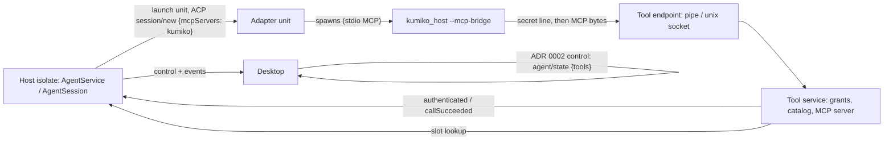
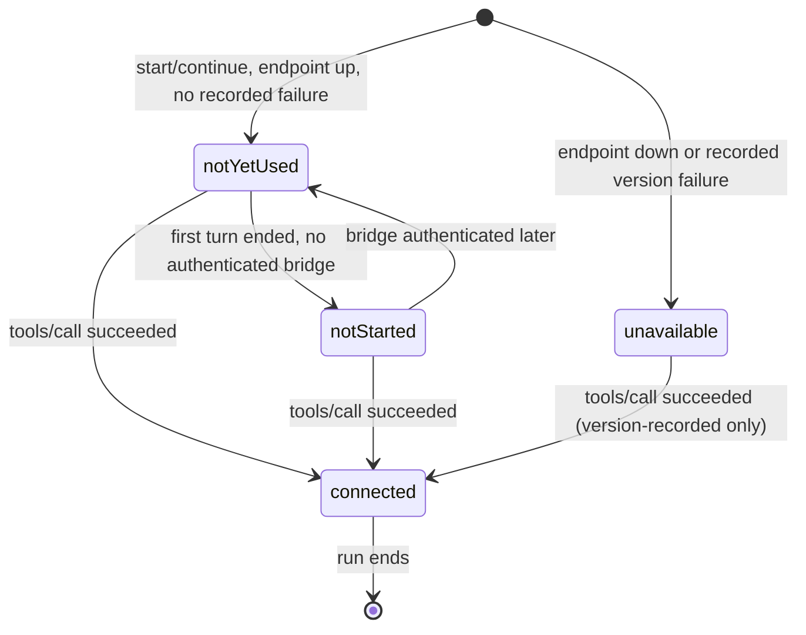
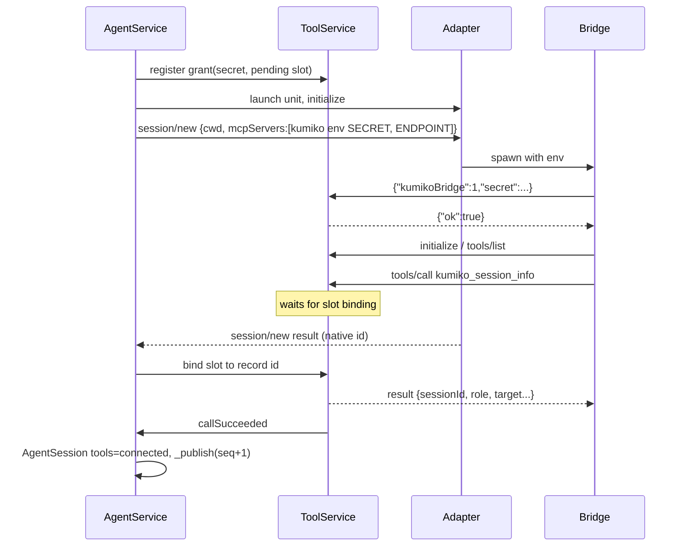

# Design

## Triage

| Trigger | Applies? | Evidence |
|---|---|---|
| T1 Components (new component, or 3+ with directed relationships) | Yes | New tool service, endpoint listener and `mcp-bridge` process; adapter → bridge → endpoint → tool service → `AgentService`/`AgentSession` → desktop. |
| T2 State (persistent state, caches, 3+ state machine) | Yes | In-memory secret map and a four-state Kumiko tools status per live session. No persistent state changes (store stays v5). |
| T3 Concurrency (background work, workers/isolates, async, retries) | Yes | Concurrent bridge connections, tool calls racing `session/new` and close, and Windows pipe accept and I/O in worker isolates. |
| T4 Boundaries (data format, migration, shared interface, IPC, external) | Yes | New IPC (bridge ↔ host handshake and MCP), ACP `mcpServers` entry, additive `host_protocol` fields, qualification evidence format. |
| T5 Volume (grows without a fixed bound) | Yes | Connections, in-flight calls and line sizes come from processes Kumiko does not control. |
| T6 Risk (security, money, data loss, unrecoverable user data) | Yes | A new local listening surface and a credential (ADR 0005). |

TIER: FULL

## Context

See proposal.md. Current state:
- ACP requests send an empty `mcpServers` in `newSession`, `loadSession` and `resumeSession` (`packages/host/lib/src/agent/acp/acp_client.dart:252-278`).
- `AgentService._open` (`packages/host/lib/src/agent/agent_service.dart:597-700`) launches one contained unit per session through `UnitManager.launch(kind: 'agent')`, runs `initialize`, and inserts the session record only inside `newSession`'s `onCreated`, so the Kumiko session id does not exist until `session/new` answers. Adapters may start MCP servers while `session/new` is still pending.
- `AgentSession` is the sole writer of live state and its sequence (`packages/host/lib/src/agent/agent_session.dart:30-98`, `_publish`). `AgentStateParams` carries `sessionId`, `seq` and `state` (`packages/host_protocol/lib/src/messages.dart:1934`).
- The host always runs as a compiled executable and already re-executes itself for `--unit-exec` (`host_main.dart`; `unit_manager.dart:284` uses `Platform.resolvedExecutable` as the shim). The bridge reuses that pattern.
- On POSIX the host refuses a profile directory that is not owner-only (`host.dart`, `_notOwnerOnly`).
- `dart:io` Unix domain sockets exist only on Linux, macOS and Android (Dart API docs, `InternetAddressType`). Windows needs a named pipe through FFI. `process_containment` already does Windows pipe I/O in worker isolates that own the handle (`windows_pipe_io.dart:20-210`), and is the only FFI package.
- ACP v1 `session/new` requires `mcpServers`; stdio entries are `{name, command, args, env:[{name,value}]}`, and v1 agents must support stdio (ACP docs; v2 adds a `type` field and a capability, not used here).
- Qualification: `qualified_adapters.dart` holds `(name, version, claims)` tuples parsed by `tool/check_qualification.dart` (item list at `:17-27`); evidence lives in `docs/qualification/claude-agent-acp.md`.

## Decisions

### D1: One host-side MCP server, with the bridge as a byte relay

- **Choice:** The host implements the MCP server: JSON-RPC 2.0, newline-delimited, with `initialize`, `notifications/initialized`, `ping`, `tools/list` and `tools/call`. Other requests get `-32601`; notifications (no `id`), such as `notifications/cancelled`, are never answered: unknown ones are ignored, and a cancellation of an in-flight call drops its result. `kumiko_host --mcp-bridge` authenticates (D3), then copies bytes stdin → endpoint and endpoint → stdout without parsing MCP. Protocol version: the host answers `initialize` with the client's requested `protocolVersion` when it is one of the versions the host supports (`2025-06-18`, `2025-03-26`, `2024-11-05`), else its newest.
- **Rejected:** MCP served inside the bridge, with the bridge calling host RPCs. It would put a second protocol implementation and part of the authority logic into a process the adapter controls, and every new tool would change two programs. Also rejected: `package:dart_mcp`, a new dependency for four methods, with a dependency audit entry and an upgrade surface.
- **Reversal cost:** medium. The bridge stays unchanged if a library replaces the built-in subset later.

### D2: Per-user endpoint: profile-directory socket on POSIX, owner-only named pipe on Windows

- **Choice:** POSIX: `ServerSocket.bind(InternetAddress('<profile>/tools.sock', type: unix), 0)`. The profile directory is already verified owner-only, and the socket is `chmod 0600`. Any existing `tools.sock` is deleted first, which is safe because the profile lock makes this host its only owner. If the path exceeds the platform `sun_path` limit (104 bytes on macOS, 108 on Linux, checked in bytes), the endpoint is unavailable (D7) and the host continues. Windows: `\\.\pipe\kumiko-tools-<128-bit random hex>`, created with `CreateNamedPipeW(PIPE_ACCESS_DUPLEX | FILE_FLAG_FIRST_PIPE_INSTANCE (first instance only) | FILE_FLAG_OVERLAPPED, PIPE_TYPE_BYTE | PIPE_REJECT_REMOTE_CLIENTS, ...)`. Its security descriptor is built from the SDDL `D:P(A;;GA;;;<current user SID>)(A;;GA;;;SY)`, and the user SID is read from the process token. All endpoint I/O on Windows is overlapped and cancellable by the host. `WindowsPipeReader`/`WindowsPipeWriter` are **not** reused for endpoint connections: their blocking `ReadFile`/`WriteFile` (`windows_pipe_io.dart:300-321`) cannot run on an overlapped handle, and they only unblock when the peer closes, which here is a process the host does not control. Instead, an accept worker isolate waits on `ConnectNamedPipe` (overlapped) together with a stop event via `WaitForMultipleObjects`, keeps one pending instance, and creates the next one after each connect. Each connection gets one worker isolate that owns its handle and runs overlapped `ReadFile`/`WriteFile`, each waiting on its I/O event plus the connection's stop event. A host-initiated close (preamble deadline, authentication refusal, `busy`, line bound, revocation, host shutdown) signals the stop event; the worker calls `CancelIoEx`, waits for the cancelled operation with `GetOverlappedResult(..., bWait: TRUE)`, then `DisconnectNamedPipe` and `CloseHandle`, and exits. The host joins the worker before counting the slot free. A Windows test asserts that a client that connects and never writes or closes is disconnected by the host within the preamble deadline, and that its slot is free again. The endpoint name reaches the bridge in the MCP entry environment (`KUMIKO_TOOL_ENDPOINT`). New code goes into `process_containment` (`windows_pipe_server.dart`, and a client `openWindowsPipe`) beside the existing pipe I/O.
- **Rejected:** a localhost TCP endpoint with a token (rejected in ADR 0005). Also rejected: a per-user `/tmp/kumiko-<uid>` socket directory as primary or fallback. It needs owner, mode and symlink checks and a stale-socket sweep across several hosts, while the profile directory already has an owner-only check and a single owner. Also rejected: Windows AF_UNIX sockets via FFI. Its ACL story differs from the named pipe that ADR 0005 names, and nothing else in the code uses Winsock.
- **Reversal cost:** medium (endpoint mechanics only; ADR 0005 rates them medium).

### D3: Bridge handshake: one secret line, one answer, then MCP

- **Choice:** The bridge reads `KUMIKO_TOOL_ENDPOINT` and `KUMIKO_TOOL_SECRET` from its environment. If either is missing or the connect fails, it writes one stderr line and exits 2 before reading stdin. After connecting, it sends `{"kumikoBridge":1,"secret":"<base64url 32 bytes>"}\n`. The host answers `{"ok":true}\n` or `{"ok":false,"error":"unauthenticated"}\n` and closes. The host compares secrets in constant time on the decoded bytes. Unauthenticated connections have a 5-second deadline and a 512-byte preamble bound; a wrong first line, a non-JSON line or an MCP message closes the connection. Only after `ok` does the bridge start relaying, and the host only then feeds lines to the MCP server for the bound session.
- **Rejected:** carrying the secret inside MCP `initialize` (`clientInfo` or `_meta`). It would let unauthenticated peers reach the JSON-RPC parser, and it ties authentication to an MCP field the adapter might rewrite. Also rejected: putting the secret in the bridge's argv. Argv is visible to every local process through the process table, while environment variables are not readable by other users.
- **Reversal cost:** low (bridge and host ship together in one executable).

### D4: The secret is bound to a live session slot created before launch

- **Choice:** `AgentService._open` mints the secret (`Random.secure`, 32 bytes) and registers a `ToolGrant` in the tool service before `units.launch`. The grant is held by a pending slot with target, role `coding`, runtime kind and profile. Once `initialize` answers, the slot gets adapter name and version, and in `onCreated` (or at Continue registration) it is bound to the `_Agent` and its record id. `kumiko_session_info` arriving while the slot is unbound waits on the slot's binding future, which completes on bind or fails with *session unavailable* when the attempt fails. The `session/new` 60-second deadline bounds that wait. Before any adapter stderr tail leaves the host (start-failure messages, `agent_service.dart:744-764`), every occurrence of a live or just-revoked secret of that run is replaced with `<redacted>`. The grant is revoked in every path that ends the run: start failure (the existing `on Object catch` cleanup), adapter exit, close, and host shutdown. Revocation closes that grant's open connections.
- **Rejected:** minting after `session/new` returns and patching the entry. The entry must be in `session/new` itself, and adapters may start the server during it. Also rejected: keying grants by native session id, which does not exist yet when the bridge may connect.
- **Reversal cost:** low.

### D5: Authorization is a per-role tool table checked on each call

- **Choice:** `ToolCatalog` maps a role to its allowed tools. M1 has `coding → {kumiko_session_info}`. `tools/list` returns only the role's tools. `tools/call` checks, at call time: the grant is live, the tool is in the role's set, and the arguments validate against the tool's schema (`kumiko_session_info` takes an empty object; extra properties are rejected with `-32602`). Results come only from the grant's own slot, never from an argument. Unknown or forbidden tools get the MCP error `-32602`, message `tool <name> is not available`.
- **Rejected:** checking only at `tools/list` time. Authority can change between list and call (close, and later team grants), and ADR 0005 decision 4 requires a check on every call.
- **Reversal cost:** high for the authorization model (ADR 0005). Evidence is already settled by ADR 0005; this change only implements it.

### D6: Kumiko tools status is part of `AgentSession`'s sequenced state

- **Choice:** `AgentSession` gains `toolsStatus` (`notYetUsed | connected | notStarted | unavailable`) and `toolsReason`. It stays the sole writer and publishes changes through `_publish`, so the state sequence orders tools changes against turn state (ADR 0012 decision 2). The grant itself records `everAuthenticated` and `everCalled` from the pending-slot stage on, because the bridge may authenticate during `session/new`, before the `AgentSession` exists (`agent_service.dart:657-672`). When the session is created it reads those flags (an earlier successful call yields `connected` at once). Afterwards the tool service also notifies `AgentService` of `authenticated` and `callSucceeded`, which forwards them to the session on the host isolate. The first-turn-end check reads the grant's `everAuthenticated` flag, not forwarded events. Transitions:
  - start: `notYetUsed`. It is `unavailable` instead when the endpoint is down (reason `endpoint-unavailable: <cause>`) or the adapter version has a recorded failure (D8);
  - first successful `tools/call` → `connected` (terminal for this run);
  - first turn end while the grant's `everAuthenticated` is false → `notStarted`;
  - from `notStarted`, a later authentication → `notYetUsed` (the adapter did start it);
  - from `notStarted` or `unavailable` (version-recorded), a later successful call → `connected`. Observation beats the record.
  `AgentStateParams`, `AgentStartResult` and the Continue result get an optional `tools: {status, reason?}` object, additive with no protocol version bump. The desktop shows it as one line under the chat status.
- **Rejected:** a separate `agent/tools` control notification with its own sequence. Two sequences for one session can reorder on the desktop and need a second stale check.
- **Reversal cost:** low.

### D7: Endpoint failure is a host-wide degraded mode, not a start failure

- **Choice:** If the endpoint cannot be created, the host logs it and keeps running. Sessions then get **no** `kumiko` entry and show `unavailable: endpoint-unavailable: <cause>`. Sending a bridge that cannot connect would only produce a failing MCP server inside the agent.
- **Rejected:** failing host start. Tools are additive, and M1's terminals and chat must not depend on them.
- **Reversal cost:** low.

### D8: Tool delivery evidence in the qualified list and the checker

- **Choice:** `qualified_adapters.dart` keeps its tuples; tool delivery uses a separate literal list `toolDeliveryFailures = <(String, String, String)>[]` holding `(adapterName, version, observed failure)`. A version in it shows `unavailable` with that text (D6). Delivery itself is not a claimed capability: every session gets the entry, and only an observed call yields `connected`. The checker adds `kumiko tool call` to the baseline items, required per OS for every listed version, with the same OS rules as the other user items: Windows must be recorded; Linux and macOS may be `unproven`. Checker rule for this item, amending ADR 0012 decision 7 additively:
  - A `fail` row must carry the observed failure in its `Notes` cell as `observed: "<text>"` (no pipes, single line). A `fail` without it fails the checker.
  - A `fail` is accepted only when `toolDeliveryFailures` lists the same adapter name and version with exactly that `<text>`. An accepted `fail` counts as a satisfied item, because the exit criterion allows "reports Kumiko tools unavailable for that adapter version with the observed failure". The checker prints it as `TOOL DELIVERY FAILURE RECORDED: <adapter> <version> <os>: <text>`.
  - A `fail` without a matching list entry, a list entry whose evidence is `pass`, `unproven` or missing, and a list entry whose text differs from the evidence all fail the checker, naming the adapter, version and OS.
  - Verdicts are otherwise unchanged: **QUALIFIED** when every checked item passes or is an accepted tool-delivery failure; **ACCEPTED** while allowed `unproven` items remain; never QUALIFIED with an unaccepted `fail`.
  - Source grammar: after `qualifiedAdapters`, the parser reads a second literal `const toolDeliveryFailures = <(String, String, String)>[ ('<name>', '<version>', '<text>'), ];`. Its third string may contain spaces but no single quote, backslash or newline. An empty list is valid. A missing or unparseable second literal fails the checker.
  - Transition: the existing 0.99.1 Windows evidence has no `kumiko tool call` row, so the checker change and that row land together. Apply includes a real Windows qualification run by the user (the driver's new tool step) before the checker change is committed. The qualification driver adds a step that prompts the agent to call `kumiko_session_info`, then records the session's tools status and the call result.
- **Rejected:** a `tools` capability claim that gates delivery. ADR 0005 decision 5 already ties *connected* to an observed call. Gating delivery on qualification would withhold the entry from exactly the versions that need observing.
- **Reversal cost:** low.

### D9: The bridge is never a ledger unit of its own

- **Choice:** The bridge is the adapter's child, inside the agent unit's job object (Windows) or process group (POSIX), so ADR 0001/0012 containment and settlement cover it. Because MCP stdio clients commonly launch servers with a reduced environment plus the entry's `env`, the `kumiko` entry's `env` also carries `KUMIKO_UNIT=<the session unit's containment marker>` (`unit_exec.dart:10`), so the POSIX marker scan still finds a bridge whatever environment policy the adapter applies. It neither registers in the ledger nor takes the profile lock. It exits on stdin EOF, on endpoint EOF or error, and on any write failure. It writes nothing to disk.
- **Rejected:** the host launching bridges as separate units and handing their pipes to the adapter. ACP stdio MCP servers are spawned by the agent, so the host cannot own that process without a non-stdio transport.
- **Reversal cost:** low.

### D10: Record ADR 0013 for the tool endpoint and bridge contract

- **Choice:** During apply, write ADR 0013 *Kumiko tool endpoint, bridge handshake and tool catalog* (accepted after this review). It covers D2's endpoint, ACL and cancellable Windows I/O, D3's handshake, D5's per-role catalog and the MCP subset, D6's status semantics, and D8's additive amendment of ADR 0012 decision 7 (the `kumiko tool call` item, `toolDeliveryFailures` and its checker rule). ADR 0012 itself stays unchanged. Update the architecture index and the Kumiko tools contract line. It refines ADR 0005 and does not supersede it.
- **Rejected:** leaving these binding details only in this archived change. Later tool changes (M2 read-only role, M3 project tools) must follow them, and ADR 0012 set the precedent for keeping such contracts out of archives.
- **Reversal cost:** low.

## Diagrams (FULL)

Components (T1):

Status state machine (T2):

Start sequence with a bridge that connects during `session/new` (T3, T4):

## State & Ownership (FULL)

| State | Owner (sole writer) | Lifetime | Invalidation / rebuild | Authoritative copy |
|---|---|---|---|---|
| Endpoint (socket file / pipe name, listener) | `ToolService` | Host run | Recreated at each host start; stale socket replaced under the profile lock | Host memory + socket file |
| Grants (secret → slot) | `ToolService` (register/bind/revoke called only from `AgentService` on the host isolate) | One live session run | Revoked on start failure, adapter exit, close, host exit; never rebuilt | Host memory only |
| Slot binding (record id, adapter) | `AgentService` | One live session run | Set once at bind | Host memory |
| Authenticated connections | `ToolService` | Until EOF, revoke or host exit | Not rebuilt; the bridge exits and the adapter decides whether to restart it | Host memory |
| Kumiko tools status + reason | `AgentSession` | One live session run | Reset to the start value on each Continue | Host memory; desktop mirrors by sequence |
| Tool catalog per role | Code constant (`ToolCatalog`) | Build | Changes ship with the host | Source |
| `toolDeliveryFailures` | Source literal, checked against evidence by CI | Release | Edited only with evidence | `qualified_adapters.dart` + qualification doc |

## Failure & Visibility (FULL)

| Component | Fails / dies mid-operation → | Recovery | Retry safe? | Who finds out |
|---|---|---|---|---|
| Endpoint creation | No endpoint for this host run | Next host start | Yes | Host log; every pane shows *unavailable: endpoint-unavailable* |
| Endpoint accept loop (Windows worker) dies | No new connections; existing ones continue | None this run; the tool service marks the endpoint down and new sessions start *unavailable* | n/a | Host log; new panes show *unavailable* |
| Bridge cannot connect | Bridge exits 2 with one stderr line; adapter sees a failed MCP server | Adapter's own behaviour | Yes (idempotent) | Pane shows *not started by the adapter* after the first turn |
| Bridge dies mid-call | Connection EOF; host drops the in-flight call result | Adapter may restart the server; a new bridge re-authenticates with the same secret | Yes: the only tool is read-only | Adapter reports a tool error in the transcript as a tool card |
| Host dies | Bridges see EOF and exit; containment kills the unit | Next host's reconciliation (ADR 0001) | n/a | Desktop shows host loss (existing) |
| Adapter rejects `session/new` | Start fails as today; grant revoked | User retries | Yes | Pane shows the start error |
| Call while slot unbound and start fails | Call answers *session unavailable* | n/a | Yes | Agent sees the error |
| Wrong/missing secret | Connection refused | n/a | n/a | Host log line (counter, no secret); nobody else, by design |
| Malformed MCP from an authenticated bridge | JSON-RPC parse error `-32700` for that line; line over bound → connection closed | Adapter may restart the bridge | Yes | Host log |

## Resource Bounds (FULL)

| Queue / buffer / cache / transfer | Bound | At the bound | Timeout | At 10x / 100x |
|---|---|---|---|---|
| Unauthenticated connections | 16 concurrent | Further accepts closed at once | 5 s preamble deadline | Pressure only from the user's own processes; refusal keeps it flat |
| Authenticated connections | 4 per grant, 256 total (unit cap 64 × 4) | New connection refused with `{"ok":false,"error":"busy"}` | None while open; closed on revoke | 64 sessions × 4 is the ceiling; fixed |
| Preamble line | 512 bytes | Connection closed | 5 s | Fixed |
| MCP line from bridge | 1 MiB | Connection closed and logged | — | Fixed; tool args are tiny |
| In-flight calls per connection | 8 | Further calls get `-32000 too many concurrent calls` | Call waiting on slot binding: bounded by `session/new` 60 s | Fixed |
| Outbound queue per connection | 1 MiB of pending result bytes | Stop reading that connection's requests until drained (socket backpressure) | — | Fixed; one result is < 4 KiB |
| Grants | One per live session run (≤ unit cap 64) | Bound by the unit cap | — | Fixed |
| `kumiko_session_info` result | < 4 KiB (path bounded by OS path limits) | — | — | Fixed |
| Windows pending pipe instances | 1 pending; `nMaxInstances` = 256 | `CreateNamedPipe` busy → client retries via `WaitNamedPipe` 2 s, then bridge exits 2 | 2 s client wait | Fixed |
| Windows connection workers | One isolate per connection, ≤ 16 unauthenticated + 256 authenticated | Accept refused at the caps (D3 bounds); every worker is cancellable by its stop event (D2) | Host close → `CancelIoEx` + join, no peer cooperation needed | Fixed |

The endpoint I/O runs on the host isolate (POSIX `Socket` streams) or in per-handle worker isolates (Windows, as in `windows_pipe_io.dart`). Tool handling reads only memory and never awaits desktop credit, so ADR 0002 control is not delayed (spec *Tool traffic never uses the desktop connection*).

## Flow & State Gaps (FULL)

- **Bridge connects before `session/new` answers:** authentication succeeds against the pending slot and sets the grant's `everAuthenticated`; `tools/list` answers from the role; `kumiko_session_info` waits for binding (D4). The session, created afterwards, takes its initial tools status from the grant flags, so the first-turn-end check never reports *not started* for a bridge that authenticated early.
- **Start fails after the bridge connected:** revoke closes the connection; any waiting call answers *session unavailable* first.
- **Close while a call is in flight:** revoke happens when the session enters `closing`; in-flight calls are answered with an error if not yet answered, and the connection is closed.
- **Successful call and turn end race:** both reach `AgentSession` on the host isolate in arrival order. If turn end arrives first with no authentication, the status becomes `notStarted`, then `connected`. The sequence keeps the desktop's view ordered.
- **Adapter restarts the bridge:** a second connection with the same secret is accepted (up to 4); the status never regresses from `connected`.
- **Continue while the old run's bridge lingers:** the old grant was revoked at exit, so the lingering bridge's connection is closed and it exits; the new run has a new secret.
- **Host restart:** no grants survive; saved sessions show no tools status until Continue.
- **Stale socket file** from a killed host: removed under the profile lock before binding.
- **Desktop reconnect** is not a thing in M1 (host lifetime is tied to the desktop).

## Mechanism Ledger (FULL)

| Mechanism | Built? | Why (harm nobody catches / expensive later) | Evidence that would change the call |
|---|---|---|---|
| Owner-only pipe DACL + remote reject | Yes | Security boundary; otherwise any local user could try secrets | — |
| Constant-time secret compare | Yes | Cheap; avoids a timing oracle on a local credential | — |
| Preamble deadline and connection caps | Yes | A stuck or hostile local client could otherwise hold host resources indefinitely | — |
| Slot binding wait | Yes | Adapters can call during `session/new`; without it the first call fails and could look like a broken delivery | — |
| Per-call authorization | Yes | ADR 0005 requirement; expensive to retrofit into a public tool contract | — |
| `notStarted` detection at first turn end | Yes | Without it a session whose adapter ignored the entry shows *not yet used* forever, and the exit criterion's "or reports unavailable with the observed failure" has no runtime signal | — |
| `toolDeliveryFailures` list | Yes | The exit criterion requires a per-version failure report; the checker ties it to evidence | — |
| Retry `session/new` without `mcpServers` on error | No | It would create a second native session after an ambiguous error and hide a delivery failure | Qualification shows a target adapter version that rejects any non-empty `mcpServers` |
| `/tmp` socket fallback for long profile paths | No | Profile paths in the default locations are well under 100 bytes; failure is visible as *unavailable* | A user report or CI profile path over the limit |
| `SO_PEERCRED` / `getpeereid` peer check on POSIX | No | The 0700 profile directory already blocks other users; the secret blocks same-user processes without it | A supported platform where directory mode does not restrict socket connect |
| Native repository registration fallback (D15) | No | Not qualified; out of scope for M1 | A runtime that cannot accept session injection |
| Secret rotation within a run | No | Secret lives only for one run in memory and in the adapter's environment | Evidence that adapters persist MCP env to disk beyond the run |
| MCP library dependency | No | Four methods; audit cost | Needing resources, prompts or streaming results |

## Risks / Trade-offs

- [The adapter persists the MCP entry, with the secret, in its native session history] → The secret is per run and revoked at run end, so a persisted copy is useless afterwards. The qualification step notes whether the history contains it.
- [The real adapter fails to start stdio MCP servers on some version (ACP issue #883)] → Visible as *not started by the adapter*. Recording the observed failure in `toolDeliveryFailures` satisfies the exit criterion's alternative branch.
- [The FFI named-pipe server is new native code with an access-control role] → Integration tests on Windows CI assert that the DACL is owner-only (`GetSecurityInfo` read back) and that remote clients are rejected (flag set). The worker-isolate handle ownership pattern is reused from `windows_pipe_io.dart`.
- [Claude Code may namespace or rename tools (`mcp__kumiko__kumiko_session_info`)] → The tool name is ours; qualification prompts by description and records the name the transcript shows.
- [macOS `sun_path` 104-byte limit with long home directories] → Checked at bind; reported as *unavailable* with the path length; fallback not built (ledger).

## ADRs

- **In force, constraining this change:** ADR 0001 (containment, ledger), ADR 0002 (control never behind data), ADR 0004 (session identity, qualified capabilities), ADR 0005 (tool service, delivery, secret, authorization, honesty), ADR 0012 (one contained adapter unit per session, sequenced state, qualification evidence and checker).
- **To record during apply:** ADR 0013 *Kumiko tool endpoint, bridge handshake and tool catalog* (D10), refining ADR 0005 without superseding it.

## Open Questions

- Whether Claude agent ACP 0.99.1 starts stdio MCP servers during `session/new` or lazily at the first turn. Both are handled (D4, D6); the qualification run records which one happens.
