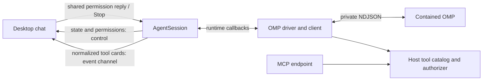
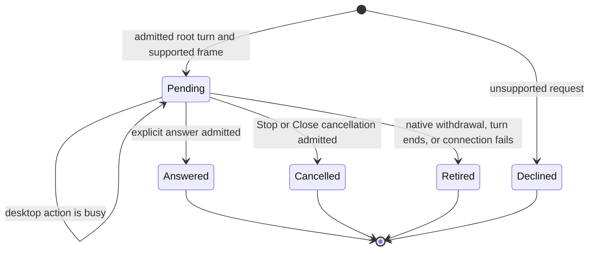
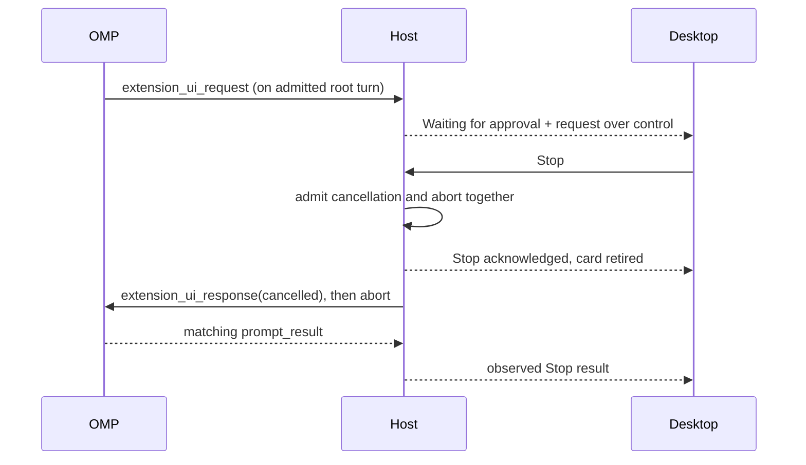
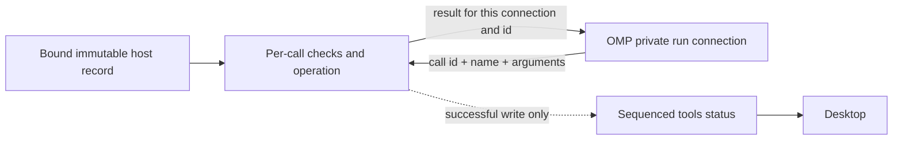

# Design

## Triage

| Trigger | Applies? | Evidence |
|---|---|---|
| T1 Components | Yes | The OMP client and driver, host session and tool service, and desktop exchange distinct messages. |
| T2 State | Yes | Approval requests and host tool registration have more than two states. Tool cards need live identity tracking. No durable state changes. |
| T3 Concurrency | Yes | Native replies, withdrawals, Stop, Close and write completion can race. |
| T4 Boundaries | Yes | OMP stdio adds interactive and callback frames. The existing desktop-host control and event formats stay unchanged. |
| T5 Volume | Yes | OMP can send any number of progress frames, approvals and callbacks over a session. |
| T6 Risk | Yes | Translating an approval incorrectly can authorize more than the user selected. A host tool must not act for another run. |

TIER: FULL

## Context

[Proposal](proposal.md) records the owner's scope. Existing seams:

- OMP starts after readiness/version 1 and the delta event filter; `get_state` supplies the native id before `onCreated` inserts the saved record (`packages/host/lib/src/agent/omp/omp_driver.dart:73-90,95-112`; `packages/host/lib/src/agent/agent_service.dart:1136-1166`). Early updates are staged until prompt acceptance; the synchronous callback commits the user event first (`packages/host/lib/src/agent/omp/omp_driver.dart:152-171,410-435`).
- The driver currently cancels interactive frames and counts tool starts (`packages/host/lib/src/agent/omp/omp_driver.dart:289-295,315-345,443-456`). `OmpClient` reads typed NDJSON, correlates command ids, and bounds output consumption and input admission (`packages/host/lib/src/agent/omp/omp_client.dart:34-48,78-139`).
- `AgentSession` already accepts native permissions through `onPermission`, maps local choices to native results, publishes separate control notifications and retires requests through `onRetired` (`packages/host/lib/src/agent/agent_session.dart:72-84,827-852,911-922,1085-1120,1192-1227`). Stop admits cancellation before publishing Stopping; Close and exit already own teardown (`packages/host/lib/src/agent/agent_session.dart:1313-1344,1374-1413`). The existing OMP send path wraps admission exceptions in a Future (`packages/host/lib/src/agent/omp/omp_client.dart:116-120`); this cannot be used to commit a permission answer or Stop synchronously.
- The MCP service looks up tool definitions by role and validates arguments, then obtains `kumiko_session_info` from the grant's bound slot (`packages/host/lib/src/agent/tools/tool_service.dart:555-601`). `ToolCatalog` owns the one coding tool and the input schema (`packages/host/lib/src/agent/tools/tool_catalog.dart:27-53,56-82`). OMP currently has neither a grant nor tools (`packages/host/lib/src/agent/agent_service.dart:1033-1061`).
- Desktop tool cards already accept sparse per-id updates and show truncation; permission cards render their preview as literal selectable text (`packages/host_protocol/lib/src/agent_events.dart:32-62,100-107`; `packages/desktop/lib/src/agent/agent_pane_view.dart:422-448,508-541`). The shared permission codec marks losses from either field or encoded message bounds (`packages/host_protocol/lib/src/messages.dart:2382-2458`).
- The agent event relay pauses reading the runtime at its bound rather than dropping output (`packages/host/lib/src/agent/agent_session.dart:582-602`; `packages/host/lib/src/agent/agent_service.dart:221-241`). The contract distinguishes no desktop credit from a full host event queue (`openspec/specs/desktop-host-protocol/spec.md:185-198`).

## Decisions

### D1: Recognize a narrow OMP approval shape and preserve the exact wire answer

- **Choice:** Accept the documented OMP 18.20.1 approval fallback shape in A1. On an admitted agent-invoked root turn, use `RuntimePermission` with an OMP title, the full supplied native text as preview and two choices. Match raw option strings before redaction. The reply is `extension_ui_response` with the original request `id` and the raw `value` of the offered one-shot or `Deny` choice. Never echo a label constructed by Kumiko. Show a short policy note in the OMP pane: OMP settings decide when tools ask; Kumiko only answers supported one-shot approvals and does not sandbox OMP. Launch argv and native settings stay unchanged.
- **Classifier:** Require method `select`, a first line of `Allow tool: <nonblank tool name>` and a unique, exact ordered choice shape. Normal approval is `Approve`, optionally `Approve <subject> for this session`, then `Deny`. Cached approval is the ordered native grant labels and their corresponding `Always ` labels, then `Approve Once` and `Deny`. Recognize only the documented target/file/directory pairs (A1). Retain neither the remembered choices nor the original frame after classification. Decline selection metadata that changes option semantics, including descriptions, checkbox state or markers. Missing or unknown options, source truncation/elision markers, unsupported UI methods, or loss at the shared display bound cannot yield an actionable card. Preserve line breaks; escape other C0/C1 and bidi controls, apply existing known-secret redaction and decline if redaction would hide part of the requested action. Bound the input before transforming it and check the encoded display budget after transforming it. Use fixed summaries for malformed frames rather than reflecting raw data.
- **Rejected:** Let users operate a generic OMP dialog, infer permission scope from a tool event, or send remembered grant values. The fallback has no structured approval discriminator and the remembered choices can change subsequent approvals outside the current call.
- **Reversal cost:** Low for another supported frame shape; high if a remembered grant has already changed native policy.
- **Important:** yes (user-visible permission scope).
- **Chosen by:** user for the one-shot and policy scope; the strict classifier implements that scope.

### D2: Keep permission state in AgentSession and admit Stop atomically

- **Choice:** Use the existing `AgentSession` pending table and shared `onRetired` hook. Scope OMP's local request token to its Kumiko session id and monotonic request counter. Do not use the Codex `runId` field, which would also publish native turn identity in `AgentSession._publish` (`packages/host/lib/src/agent/agent_session.dart:187-196`). This change creates a new Kumiko session id for each OMP run; Continue remains unavailable. The OMP driver validates a native request id before using it, and a duplicate of a live native approval id fails that run rather than replacing or answering the original request. Map `extension_ui_request` method `cancel` by exact `targetId` to retirement, without a response. Retire the turn's remaining cards synchronously on observed terminal result, before any transcript await. A recognized request arriving before an agent turn is admitted, during Stop or Close, or with no slot receives `{cancelled:true}` if stdin remains usable. Do not set `timedOut`. Display-only `open_url` and editor/status mutations do nothing; keep bounded `notify` text and unsupported-dialog notices.
- **Commit point:** Introduce OMP native admission methods that throw a synchronous busy refusal before accepting a desktop action. For Stop, concatenate the cancellation JSONL frames and one correlated `abort` into one admitted write, with normal per-line encoding. Register its command id before the write is visible and change session state only after admission; a full writer or pending-command table enqueues nothing. No application retry. The running turn's `prompt_result`, not the abort response, settles Stop. If an admitted write fails, the client fails the run. Ordered Close revokes tool authority and retires choices before abort/EOF; if its required cancellation cannot be admitted, fail closed and settle containment rather than claiming the runtime was answered. Leader exit ends all choices without writes.
- **Rejected:** Hold even approval-shaped pre-admission selects for the commit point. In the ordinary root model path the native admission callback runs before agent execution (A3), so that would not help its normal approvals. A native input hook can issue a lookalike select and wait for its reply before returning the prompt response. Kumiko has no discriminator and declines early dialogs immediately. Separate admission calls for cancellation and abort are also rejected: a second admission can fail after some cancellations were already sent.
- **Reversal cost:** Medium because callers rely on busy leaving the request pending.
- **Important:** yes (binds a control and authorization contract).
- **Chosen by:** agent.

### D3: Map bounded root tool events onto shared cards

- **Choice:** Map native `tool_execution_start` to one `tool` event, `tool_execution_update` to a replacement progress snapshot, and `tool_execution_end` to terminal state and final content. Use the exact native `toolCallId` to find an open card; require the same `toolName` on updates. Allocate a monotonic local card id at start so old desktop cards cannot be updated by reuse in a later prompt. Keep only bounded argument text needed to preserve it when result content replaces a snapshot. Use the native name and ordinary text blocks; show available args and result text, with omission indicators for unsupported content, clipping, or unusable metadata. Do not manufacture locations, diffs or status from tool names, assistant tool-call deltas, or nested `details`. `tool_stream_update` is tool-specific and does not replace a known snapshot. Child frames never enter this mapping.
- **Correlation:** Keep open ids for the current root prompt. Keep recently closed ids in a bounded FIFO to refuse duplicate starts and post-terminal updates. Reaching the closed-id cap evicts the oldest closed id; a later start reusing an evicted id opens a new card with a fresh local id. Only the open cap refuses new cards. An unrecognized update/end or invalid identity creates no card and contributes to one bounded incomplete-activity notice. Root events outside a prompt are not attributed to it; only the first such omission in an idle period is noted. On prompt completion clear the registry after marking still-open cards incomplete without asserting a native outcome. Retire on admission refusal without emitting its staged activity. Stage normalized data, including tool fields, under the existing admission bound; do not retain the source envelope or copy arbitrary argument/result JSON into the relay.
- **Rejected:** Reconstruct execution from assistant message snapshots or append native cumulative progress. The former can claim work that never ran; the latter duplicates output and grows with each snapshot.
- **Reversal cost:** Low for more content types; medium for tool card attribution.
- **Important:** yes (changes visible activity and binds identity).
- **Chosen by:** agent.

### D4: Bind native tool authority to the private run connection

- **Choice:** Use `set_host_tools` once after verified `get_state` and before registering the live record/usable session. Project each role-authorized catalog definition to OMP `name`, `label` (the name), `description` and `parameters`. Set `loadMode: essential` for the current catalog tool. An exact `toolNames` match confirms registration. A definite remote refusal, wrong acknowledgement or local registration deadline with healthy transport yields *unavailable* with a bounded reason and no re-registration. An unhealthy transport still fails Start. Do not probe repo config or start an MCP bridge. Do not register an MCP grant. The MCP endpoint can be down while this native route works. A known delivery failure for this adapter/version also leaves tools unregistered with its recorded reason; no such evidence is added here.
- **Authority:** Activate a run-scoped tool callback only after `AgentService` inserts the saved record and sets up the owning `AgentSession`, without yielding between those operations. Before activation, after revocation, or on unsuccessful registration a correlatable callback gets an error and no operation. The only source of caller identity is the private OMP connection `AgentService` opened for that root process. The host captures the local owner context, coding role, adapter facts, Kumiko record id and immutable target. Use the same role/name/argument checks and bound session-info execution for both MCP and OMP. Keep MCP authentication and binding waits in the MCP path; the shared tool operation reads only the supplied bound host facts, not another registry or an argument-supplied identifier. Do not add a new tool or a second authorization catalog.
- **Delivery:** Handle `host_tool_call` in the OMP driver, and reply only on that connection with the exact request id, bounded text content and `isError` on refusal. Request `id` correlates the reply; `toolCallId` is native activity identity and never selects a run. Check authority and registration before synchronous in-memory execution. Treat a duplicate live request id as a protocol error. `host_tool_cancel.targetId` retires the matching result observation and never sends a second response; bytes already admitted cannot be recalled. Report *connected* only after a successful authorized result writes and the still-current run and callback are not cancelled. A registered run without such a result stays *not yet used*. Close, failure, leader exit and host teardown revoke the callback before any await in the teardown path; ignore late write completions. No reply is required after native input closes.
- **Rejected:** A second executor, MCP loopback inside the host, config-file injection, or a bearer credential for native callbacks. These duplicate authorization or create an unnecessary credential/configuration path. An OMP RPC host-tool route is not MCP support.
- **Reversal cost:** High for authorization and transport identity; medium for registration shape.
- **Important:** yes (binds authorization and changes delivery).
- **Chosen by:** user for private RPC without a secret; agent for binding and observation details.

### D5: Retain bounded event backpressure and priority desktop control

- **Choice:** Keep the shared relay and native pipe. Normalize control on frame receipt without waiting for event credit. Below the event queue bound, an OMP approval and its reply can progress with no transcript credit. Above the bound, OMP stdout is paused, so unobserved native approval, result or tool callback frames wait behind earlier output in that one run. A displayed choice, Stop or Close still travels on desktop control. Never treat acknowledgement as native completion. There is no new wire message, flag or capability gate beyond `agent` and `omp`.
- **Rejected:** Bypass the full queue by dropping transcript data or add a second transport. The first breaks the shared event contract and OMP provides no separate callback pipe for the second.
- **Reversal cost:** Medium because changing it affects the event-loss and ordering guarantees.
- **Important:** yes (binds observable progress under backpressure).
- **Chosen by:** agent.

### Decision summary

| # | Decision | Choice | Rejected | Reversal cost | Important | Chosen by |
|---|---|---|---|---|---|---|
| S1 | Approval scope | Native policy, one-shot answers | Override native settings or grant remembered choices | Low to add types; high for persisted grants | Yes | User |
| S2 | Kumiko tools | Private native RPC, shared host authority | Require OMP MCP injection | Medium for delivery; high for authorization | Yes | User |
| S3 | Roadmap scope | Root work only; leave qualification separate | Extend history, children, role enforcement or qualification | Low | Yes | User |
| D1 | Approval recognition | Match a narrow native `select` shape and send an exact explicit choice | Generic dialogs or tool-event inference | Low; high for a persistent grant | Yes | User (scope) |
| D2 | Permission lifecycle | Shared owner, exact withdrawal, atomic Stop admission | Wait for commit with an early dialog or send a non-atomic Stop | Medium | Yes | Agent |
| D3 | Tool cards | Root execution frame identity and bounded snapshots | Infer tool execution or append snapshots | Low to medium | Yes | Agent |
| D4 | Tool authorization | Confirm once; bind to connection and reuse operation checks | Secondary executor, MCP, credential or config injection | High for authority; medium for registration | Yes | User (transport); agent (binding) |
| D5 | Backpressure | Keep the shared bounded relay and control | Drop transcript data or add another transport | Medium | Yes | Agent |

## Assumptions

- **A1:** The supported minimum wire is anchored to the public OMP 18.20.1 source at `b7fe8c7f`, not observations of an installed runtime. The transport study identifies this revision and the v1 envelope (`openspec/changes/archive/2026-11-23-omp-rpc-transport/design.md:52-64,88-96`). The [approval builder and fallback](https://github.com/can1357/oh-my-pi/blob/b7fe8c7f/packages/coding-agent/src/tools/approval.ts) supply the header, omission marker and exact choices. The [RPC documentation](https://github.com/can1357/oh-my-pi/blob/b7fe8c7f/docs/rpc.md) documents `select`, `cancel`, `set_host_tools` and host-tool results. The [v1 encoder](https://github.com/can1357/oh-my-pi/blob/b7fe8c7f/packages/coding-agent/src/modes/rpc/rpc-frame.ts) marks elisions in shortened values. Its `overflowFrame` emits `rpc_frame_error` with `originalType` when the failed frame had a string type, and no request or tool id. The [agent event types](https://github.com/can1357/oh-my-pi/blob/b7fe8c7f/packages/agent/src/types.ts) define execution events. Another runtime version may use different shapes; reject unsupported shapes as specified rather than guessing. This assumption informs D1–D4. Change 5 owns the real Windows walk.
- **A2:** A matching approval shape does not authenticate a native built-in. An installed OMP extension can originate a structurally identical request. D1 relies on the user making an explicit choice after seeing OMP's literal supplied detail, not on treating that text as trusted run scope. Kumiko cannot show raw execution arguments that OMP itself never supplied. Change 5 tests the observed installed approval shape; neither the fixture nor this protocol enforces a read-only role.
- **A3:** In the pinned minimum's normal prompt path, [`#promptWithMessage`](https://github.com/can1357/oh-my-pi/blob/b7fe8c7f/packages/coding-agent/src/session/agent-session.ts) fires `onPromptAdmitted` before asynchronous model setup and before dispatching `agent.prompt`. [`watchAndReportPromptResult`](https://github.com/can1357/oh-my-pi/blob/b7fe8c7f/packages/coding-agent/src/modes/rpc/rpc-prompt-results.ts) releases the RPC command on that callback; the [RPC prompt handler](https://github.com/can1357/oh-my-pi/blob/b7fe8c7f/packages/coding-agent/src/modes/rpc/rpc-mode.ts) returns success without waiting for the agent's first tool call. Native approvals for such a prompt follow its response. The same handler awaits extension `input` hooks and builtin command dispatch before normal admission. A hook's `select` emits immediately and awaits the response with no approval marker. D2 therefore declines any pre-admission dialog rather than mistaking hook or startup interaction for an admitted model tool approval. Do not assume a global event-order guarantee; early transcript frames remain defensively staged. Check the pinned source before implementing D2; change 5 checks the ordering on a real Windows prompt.

## Carried constraints

- **C1:** Native approval settings remain authoritative; exact explicit one-shot answers are the only positive replies. Kind: invariant. Destination: `spec: specs/omp-sessions/spec.md → Requirement: OMP interactive requests are declined until supported`.
- **C2:** Never answer a native withdrawal; scope desktop decisions to the pending request and do not confuse admission with completion. Kind: invariant. Destination: `spec: specs/agent-sessions/spec.md → Requirement: Permission requests are answered only by an explicit choice`.
- **C3:** No generic UI dialog, remembered authorization or native-policy enforcement claim. Kind: deliberate gap. Destination: `ADR 0018`.
- **C4:** Use execution-event identity with bounded replacement content, not inferred execution or append-only snapshots. Kind: invariant. Destination: `spec: specs/omp-sessions/spec.md → Requirement: OMP root tool events update the corresponding card`.
- **C5:** No root reassignment of child tool events; history and steering are not added. Kind: deliberate gap. Destination: `spec: specs/omp-sessions/spec.md → Requirement: OMP features not yet supported are visibly unavailable`.
- **C6:** Both tool routes share host authorization; OMP authority comes from the private run connection and not a secret, MCP endpoint or caller-selected run. Kind: invariant. Destination: `ADR 0018`.
- **C7:** OMP registration is not successful tool use; no bridge startup state for a native run. Kind: invariant. Destination: `spec: specs/agent-tool-access/spec.md → Requirement: The Kumiko tools status reports only what was observed`.
- **C8:** No second callback transport or event dropping to bypass same-run backpressure. Kind: rejected alternative. Destination: `ADR 0018`.
- **C9:** No live qualification or exact-version gate from fixtures. Kind: deliberate gap. Destination: `ADR 0018`.
- **C10:** A busy Stop must leave the original request live. Cancellation and abort share one admission. Kind: invariant. Destination: `doc comment: packages/host/lib/src/agent/omp/omp_driver.dart OmpRuntimeDriver.cancelWithPermissions`.
- **C11:** OMP desktop permission tokens and tool card ids are unique per Kumiko session id only because each OMP run has a new session id. Any change that enables OMP Continue must first scope them per run. Kind: invariant. Destination: `ADR 0018`.

## Diagrams (FULL)

### Component graph (T1)

### Permission lifecycle (T2)

### Approval and Stop sequence (T3)

### Tool authority data flow (T4)

## State & Ownership (FULL)

| State | Owner (sole writer) | Lifetime | Invalidation / rebuild | Authoritative copy |
|---|---|---|---|---|
| Runtime UI wait and native approval policy | OMP | Native dialog / runtime policy lifetime | Runtime cancels, times out or handles the response | OMP |
| Pending desktop request, offered answer map and local request counter | AgentSession | Pending request / live run | Explicit answer, retirement, Stop, Close or loss; never restored | Host memory |
| Native command id, waiters and bytes admitted to stdin | OmpClient | One live connection | Response, deadline or transport closure | Host memory |
| Prompt-local staging, tool ids and display previews | OmpRuntimeDriver | One prompt, except monotonic card ids live for the run | Refusal, terminal result or transport loss; no reconstruction | Host memory |
| Displayed cards and approval presentation | Desktop transcript | Live pane | Existing eviction/close policy; no new persistence | Desktop mirror |
| Native tool registration, current callable context and pending successful writes | OmpRuntimeDriver for this connection; AgentService supplies the bound facts once | One run | Revoke on Close/failure/loss; settle on cancel or write completion, no attachment to another run | Host memory |
| Tools display status | AgentSession | One run | Set from registration result, updated on successful live tool result | Sequenced host state |
| Session record and target | AgentService | Saved record lifetime | Existing close/reopen contract; no new fields or writes | Local store |

## Failure & Visibility (FULL)

| Component | Fails / dies mid-operation → | Recovery | Retry safe? | Who finds out |
|---|---|---|---|---|
| OMP approval frame | Known interactive frame cannot be supported or displayed | Cancel by exact id; a malformed or elided id fails the run instead of leaving an unanswered wait | No automatic retry | Bounded notice or Failed |
| Desktop permission or Stop | Stale choice or a full native writer | Refuse without side effects, keeping a still-pending card usable | User may try a still-pending action | Desktop control result |
| Required OMP write | Fails after admission, or fail-closed cancellation/error cannot be admitted | Fail the run and settle containment; on explicit Close, finish the existing containment path | Do not resend | Failed or close settlement result |
| Root tool event | Missing identity, conflicting duplicate start or clipped display data | Mark the card or activity incomplete; never guess another id or a terminal status | No replay | Transcript |
| Registration | OMP rejects/collides, acknowledges wrong names or misses deadline on healthy transport | Report tools unavailable, deny calls, keep prompt usable | No retry in the same run | Tools status |
| Native callback | Invalid, unavailable, or withdrawn | Refuse by exact id when possible; missing or unusable call id fails the run. Withdrawal never generates a second response | Not by host | OMP call error or Failed |
| `rpc_frame_error` | Native v1 shrank a frame past recoverability and sent no correlation id | For a known one-way transcript event, show a bounded omission notice without guessing a card id. For an interactive or host-tool frame, or absent or unknown `originalType`, fail the run. Kumiko cannot exclude an unanswered wait or safely retire a request | No replay | Transcript or Failed |
| Native pipe/session | Exits during an action or after a reply admission | Revoke authorization, retire pending choices and settle the existing unit; keep the saved record if committed | New session only | Existing exit/failure status |
| Desktop transcript | Consumer makes no progress | Apply existing bounded same-run backpressure without dropping events | Credit can resume | Other runs and desktop control remain serviceable |

## Resource Bounds (FULL)

| Queue / buffer / cache / transfer | Bound | At the bound | Timeout | At 10x / 100x |
|---|---|---|---|---|
| OMP pipes and event relay | Existing 16 MiB native line limit and shared permit above 1 MiB, 1 MiB native queued input and 1 MiB relay plus one admitted event | Oversized frame fails; input refuses synchronously; relay pauses stdout | Existing command and close deadlines | Same limits; no new spill or queue |
| Native command waiters | Existing 32 per run | Refuse before any write, including the whole Stop batch | Existing 60 s ordinary / 10 s abort; use the ordinary deadline for registration too | Bounded |
| Permission identities and pending data | Native ids ≤ 4 KiB encoded and shared 16 pending interactions; existing permission DTO's 4 KiB title, 16 KiB preview, 256 B per label and 64 KiB encoded message | No truncated approval; auto-cancel a well-formed request that does not fit | OMP owns dialog expiry; no new host timer | Bounded; excess requests do not retain previews |
| OMP notices for rejected interactions | Existing 8 per turn or idle period plus one overflow notice | Keep cancelling and stop emitting repeated notices | Period resets at turn settlement | Constant |
| Early data of all kinds | Existing 64 entries / 256 KiB; charge complete normalized encoded event bytes and terminal overhead | Fail before accepting extra staged data | Settle or discard on prompt admission outcome | Bounded |
| Tool identities and preview | 16 open and 256 recently closed native ids per prompt; ≤ 256 encoded bytes per native tool id and name; ≤ 4 KiB argument text per open card; one incomplete-activity notice per prompt or idle period | Refuse new cards while the open cap is full. Evict the oldest closed id when its cap is reached. Keep updating known open cards | Clear on prompt terminal, refusal or loss | Memory stays bounded; sequential calls keep opening cards |
| Tool result projection | Existing host event and content-item limits; bound projection before encode, omit non-text result media | Mark loss and keep obtaining later events | None | One bounded event projection per input; no whole-result retention |
| OMP callback id and result writes | Ids ≤ 4 KiB encoded; at most 8 accepted authorized result writes in flight, including cancelled writes until they settle; session-info body follows ADR 0013 decision 17 | Correlatable excess callback gets a bounded busy error. If any mandatory error cannot be admitted, fail the run. Other callbacks do not open a pending binding waiter. | No additional waiting job: synchronous read-only operation; native writer owns transmission | Input queue cap bounds remaining error frames |

## Flow & State Gaps (FULL)

- Before admission the host declines dialogs immediately, including lookalikes, so an input hook can finish. The native root tool approval path in A3 begins after admission. An early transcript or terminal frame still honors the existing Send commit point. A local completion is not an agent turn. Register local pending ids only for a live admitted turn. Ignore late native withdrawals that name no pending request; accept neither a second desktop reply nor a reply scoped to a different request.
- Process terminal permission retirement synchronously when its `prompt_result` is identified, not in an event-delivery completion callback. Finish turn state through the existing ordered transcript path. A native frame not yet read because its output is paused cannot retire a known pending card; a late exact-id answer then cannot apply to any other OMP request.
- Stop while approving is settled by whichever action admits first. An admitted approval is no longer in the cancellation batch. A busy batch consumes nothing, and a successful batch retires cards before later desktop messages. Late native results settle using the existing Stop path. A Close after Stop does not repeat admitted cancellation/abort.
- After leader exit or stdin EOF do not write to a dead native input while draining accepted output. Before an ordinary Close sends EOF, deny an arriving callback without dispatching a tool. Host loss destroys the binding; another run starts with a new private connection.
- An early `host_tool_call` after a registration response but before the record bind has no authority and receives an error. A late registration success after a timeout does not reactivate tools. Native transport correlation discards already-issued retired command responses, preserving the one-attempt decision.
- A tool end with missing display data may still carry a valid terminal state, but an invalid identity or non-boolean supplied `isError` cannot finalize a card. The contract's omitted `isError` means no error on a valid `tool_execution_end`; the absence of an end frame means unconfirmed. Never rewrite earlier completed cards to represent retry or background activity.
- Tests use fixture acknowledgements and ordered pipe events, not waits for worker scheduling. Inject/fake the deadline for the timeout branch after registration/abort is observed. All other real-time limits are generous outer hang guards. ADR 0017 applies.

## Mechanism Ledger (FULL)

| Mechanism | Built? | Why | Evidence that would change the call |
|---|---|---|---|
| Narrow approval recognizer plus complete bounded display | Yes | A generic `select` supplies no permission discriminator or one-shot token type, so a text-to-boolean or clipped grant can change authority | Typed native approval protocol with exact scope |
| Exact request retirement and atomic Stop writes | Yes | Source cancellation can retire one pending choice while another remains; separate writes can partially cancel a Stop | A native atomic abort-and-withdraw operation |
| Bounded per-prompt tool identity and snapshot state | Yes | Interleaving, duplicate starts and missing terminal events otherwise corrupt multiple tool cards | Native per-prompt tool event ids and complete normalized snapshots |
| Shared authorization and private connection binding | Yes | An independent callback executor could bypass role, target or argument validation; a bearer secret is unnecessary on this connection | A second trusted caller needs a different transport, not different policy |
| Bounded pending write observation | Yes | A write can fail or be cancelled before its completion is observed; registration alone is not connection evidence | A native result acknowledgement with matching identity |
| General dialog bridge, persisted grants and OMP policy override | No | Beyond the owner-approved one-shot scope and not enforcement | Reviewed typed native contract and owner decision |
| New callback queue, listener, registry, credentials or MCP config writes | No | The private native connection already provides run correlation and bounded transport | A new native protocol with separate requirements |
| OMP history, child controls and read-only enforcement | No | Separate roadmap changes; this change cannot prove their lifecycle or policy | Changes 4, 5, and 9 |

## Risks / Trade-offs

- **[Risk]** OMP can change the fallback wording or option shape without a protocol bump. Unknown shapes cancel and do not stop basic chat. Qualification records the actual supported version and native approval behavior, without a new allowlist.
- **[Risk]** Some tools run without native prompts, and the runtime can omit details before emitting the dialog. The pane names the native policy limit. Decline known loss rather than claiming authority for incomplete text; do not imply this is containment or read-only enforcement.
- **[Trade-off]** The shared v1 output pipe has head-of-line backpressure. Preserve ordered lossless transcript delivery and independent desktop control; a same-run native frame not yet read cannot be acted on.
- **[Risk]** Adding a native execution path can diverge from MCP authorization. The two transports share the catalog, argument checks and bound operation. Mixed-runtime and cross-run tests check the caller-visible contract.
- **[Trade-off]** Start now waits for one optional registration command. A healthy but silent peer can delay Start by the registration deadline. It then opens with tools unavailable. Pre-record callbacks cannot run tools and no launch-time transcript buffer is added.

## ADRs

- **In force:** ADR 0002 (desktop control and capability evolution), ADR 0004 decisions 1, 3, 4 and 6 (adapter mapping, immutable target, lifecycle and native setup), ADR 0005 decisions 4–6 (authorization and honest status), ADR 0012 decisions 1–3 (containment and ordered shared messages), ADR 0013 (existing MCP endpoint, grants and catalog), ADR 0015 (Codex and its private MCP configuration unchanged), ADR 0016 decisions 1–4 (OMP transport and lifecycle), and ADR 0017 (event-based tests).
- **During apply:** Record ADR 0018, *OMP approvals and private host tool delivery*. Supersede ADR 0016 decision 5 except preservation of native policy. Refine ADR 0005 decisions 1–3 and 5 and ADR 0013 decisions 4, 7, 8, 12, 16 and 18–20 for OMP only: the active private callback replaces grant liveness in decision 16. Clarify ADR 0012 decision 2 for native same-run backpressure without changing the existing control and transcript order. Update the architecture component graph, tool service row, Native OMP contract, shared tools contract, resource rows and in-force index in the same task. Do not edit accepted ADR files.

## Open Questions

- The owner-approved Change 5 walk will record which approval and host-tool shapes the installed Windows runtime actually emits. Those observations do not block the fixture implementation or change this design's refusal behavior.
