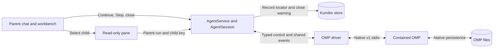
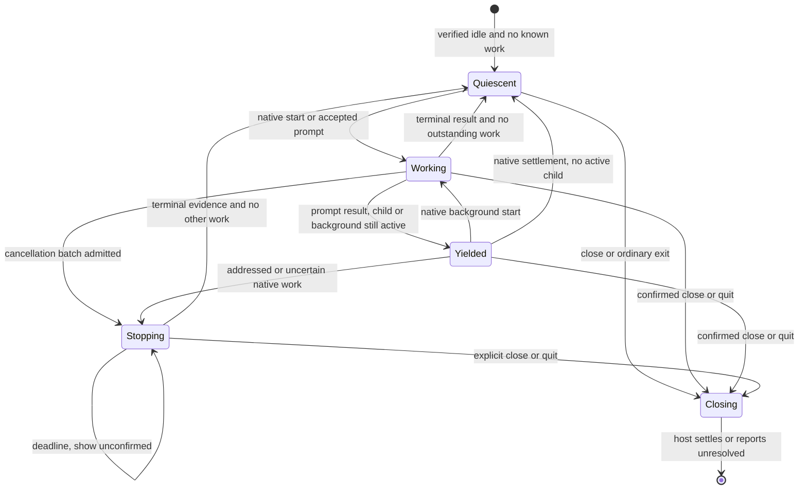
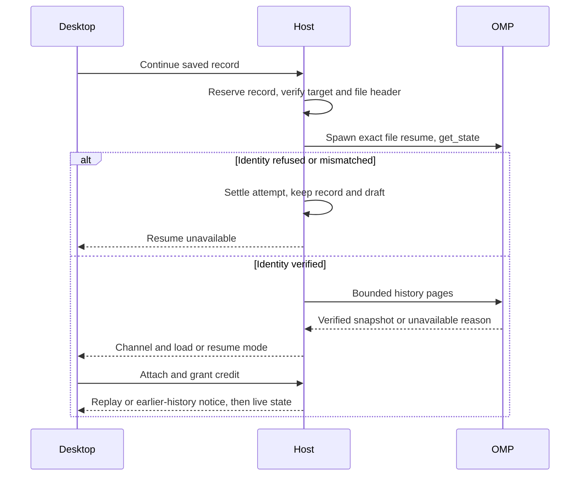
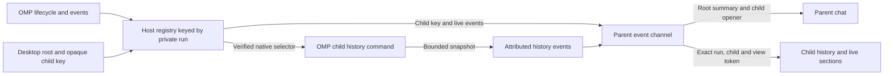

# Design

## Triage

| Trigger | Applies? | Evidence |
|---|---|---|
| T1 Components | Yes | The desktop, execution host and OMP exchange separate control and transcript messages. The workbench adds a child view with no process. |
| T2 State | Yes | The host records a native locator and the outcome of orderly shutdown. Live root and child state are independent. |
| T3 Concurrency | Yes | Native events can race command replies, credit pauses, Continue, Stop and close. Quit can race an already admitted close. |
| T4 Boundaries | Yes | The store migration, negotiated desktop protocol and OMP v1 contract change different interfaces. |
| T5 Volume | Yes | Root and child histories, child rosters and tool output can outgrow a frame or the workbench's display limits. |
| T6 Risk | Yes | Pairing a saved record with the wrong native session can expose or mutate unrelated history. A forced exit can discard unsaved messages. |

TIER: FULL

## Context

[Proposal](proposal.md) records the owner-approved scope. Existing seams:

- The saved record binds the native session id to an immutable target. Continue reserves that record before resolving the original workspace or selecting a compatible profile. An OMP-specific refusal currently bypasses those checks (`packages/host/lib/src/agent/agent_service.dart:738-762,842-914`). The main store adds migrations transactionally (`packages/host/lib/src/store/store.dart:113-139,203-224`).
- The OMP driver accepts v1, selects delta messages, then verifies the id from `get_state`. It neither retains a path nor loads history. `AgentService` registers private host tools only after the first identity check (`packages/host/lib/src/agent/omp/omp_driver.dart:105-162,286-305`; `packages/host/lib/src/agent/agent_service.dart:1164-1179,1362-1374,1414-1430`).
- Continue returns a reserved channel. The shared restore path waits for attach, frames a load replay and reaches Idle only after restore; the resume path emits an earlier-history notice (`packages/host/lib/src/agent/agent_service.dart:1553-1596`; `packages/host/lib/src/agent/agent_session.dart:278-298`). The native OMP reader supports synchronous normalization before releasing the line and bounded delivery afterward (`packages/host/lib/src/agent/omp/omp_client.dart:58-65,149-192`).
- `AgentSession` publishes delegated state independently of transcript credit and aggregates Stop from addressed native turn results and remaining delegated work. The OMP driver's native turn map contains only the prompt ticket; its batch can include one abort and pending permission replies (`packages/host/lib/src/agent/agent_session.dart:191-263,1327-1385`; `packages/host/lib/src/agent/omp/omp_driver.dart:85-88,248-283`). OMP approval tokens use the Kumiko session id, so Continue would reuse that namespace without a change (`packages/host/lib/src/agent/agent_session.dart:839-845`; ADR 0018 decision 2).
- The desktop already uses sequenced delegated state for Stop, pane close and quit. Its transcript renderer hides child content other than lifecycle rows, and its transcript has bounded retention and per-tool replacement (`packages/desktop/lib/src/agent/agent_controller.dart:252-268,592-612,1665-1703,1755-1766`; `packages/desktop/lib/src/agent/agent_pane_view.dart:490-515`; `packages/desktop/lib/src/agent/agent_transcript.dart:65-100,119-149`). The event decoder currently requires a direct parent whenever thread identities are present (`packages/host_protocol/lib/src/agent_events.dart:72-85,111-119`). The workbench can register a view kind without a closer and split an existing pane (`packages/desktop/lib/src/workbench_controller.dart:112-134,609-613`; ADR 0011 decisions 1-3).
- Pane close sends native abort before EOF and attempts leader exit before settlement. Ordinary quit currently closes the native clients and settles all units with the desktop-loss path. The host records quit only when `app/quit` and desktop input EOF both occur (`packages/host/lib/src/agent/agent_session.dart:1388-1414`; `packages/host/lib/src/agent/agent_service.dart:1812-1868,2091-2121`; `packages/host/lib/src/host.dart:378-384,538-571`).

## Decisions

### D1: Use the recorded file and verify native identity before exposing Continue

- **Choice:** Add nullable `omp_session_file` and `omp_history_unconfirmed` fields to `agent_session` in one forward migration. The latter stores a bounded reason code, not a native error. Existing rows retain their keys, targets, timestamps and drafts; none gain an inferred locator. At Start, accept a bounded absolute path from the same `get_state` as the id. Check syntax and length only, because OMP can allocate the path before it creates the file. An absent or invalid path leaves the locator unset. The record owns the locator; no remote request or saved layout supplies it. Do not rewrite it to follow a different id or file. If OMP reports it moved the session, say that exact recovery may be unavailable; do not claim the replacement as the saved record.
- **Continue:** Preserve the shared reservation, executable probe and target checks. An OMP record without a compatible peer, usable locator or compatible profile refuses without launching a session. Only Continue checks existence, regularity and the header. After the target check, read the bounded prefix of the exact local file. Allow one leading OMP title slot, then require a session header with the saved id and recorded cwd equal to the saved target by the host's directory identity checks (A1). Refuse missing, empty or wrong files. Use OMP's path form of `--resume <absolute path>` in the original cwd. Start is unchanged. Continue preserves permitted profile argv and environment. Refuse anything outside A1's allowed argv instead of removing it or assembling a command string. The user can select the built-in or a compatible custom OMP profile.
- **Commit point:** On readiness and before tool registration, prompt admission, desktop attachment or history, require `get_state` to report the exact saved id and the same normalized locator. A native redirect, fallback or broken transport fails the attempt and settles the contained unit. Use fixed bounded reasons for locator-bearing errors and suppress locator-bearing startup diagnostics on this path; never send the file path or header to the desktop. Keep the record and draft intact. Use the existing run nonce privately for OMP approval tokens and all projected live/replay tool identities. Do not enable steering or add inherited child tool authority. After verification and history decision, register a fresh root-only private host-tool binding as in ADR 0018.
- **Rejected:** `open_session` or latest/prefix lookup can adopt another chat. `switch_session` on the pinned runtime can materialize an empty or missing file as a fresh session at the requested path (A1). This can happen after a host existence check. A strict file launch plus positive identity check refuses rather than deliberately invoking that write path. Also rejected: creating a Kumiko-managed OMP session directory or indexing or editing native journals.
- **Reversal cost:** High for durable identity; low for expanding the supported passive argv set. A future native exact, read-only selector that refuses relocation could replace the preflight and startup selection.
- **Important:** yes. This binds stored data, target and runtime authority.
- **Chosen by:** user for exact recovery and the old-record limit (S1); agent for the verified file-launch mechanism.

### D2: Read a bounded root snapshot before attaching the new live stream

- **Choice:** Stay on OMP v1. After D1 verification, request one `get_messages_page` at a time with the native cursor. Check shape, cursor progress, constant count and final count. Stage only normalized replay events under a single attempt budget. Recheck the exact id and locator and that the native session stayed quiescent through the snapshot. If native work intrudes before the replay handoff, do not mix it into the snapshot. Refuse Continue if identity or transport is no longer trustworthy; otherwise use the resume-only result with an earlier-history reason for a rejected, stale, oversized, or malformed history response. Do not retry or fall back to a monolithic read. Return `load` only for the validated snapshot and deliver it between shared replay markers after attach. No Send is admitted before the replay handoff. Preserve an ordered boundary with any bounded, separately observed live output after that handoff, without synthesizing a prompt or reusing historical tool ids for a live card.
- **Projection:** Map supported native user and assistant text, thinking, assistant tool calls and persisted results into read-only transcript events in native order. A tool call is a recorded call, not proven success. A matching native result can update that card using its recorded outcome. Mark unsupported blocks and removed display content; retain neither native extensions' arbitrary data nor a raw page outside its decode. A verified empty snapshot is different from an unavailable history.
- **Rejected:** Tail the filesystem for root messages, expose page one before validation, or negotiate v2 and allocate a large frame to fit an arbitrary message. The public cursor supplies one chronological view within v1; a known shortfall is preferable to a plausible-looking partial replay.
- **Reversal cost:** Medium. New native history transports can stay inside the OMP driver.
- **Important:** yes. This sets which old messages the user sees and which native events may create live work.
- **Chosen by:** agent.

### D3: Keep child attribution in the OMP run and keep Stop evidence separate

- **Choice:** Install the OMP child subscription before the run becomes usable. Negotiate `events` for child-aware peers and use `progress` without child views for older peers. Seed known active identities with one bounded `get_subagents` after subscribing, reconcile frames observed while the snapshot is pending, and enter the conservative state if the native method, shape or high-water mark cannot establish the roster. Lifecycle/attributed progress supplies the child identity and status. Native `subagent_event` supplies id plus event, not a direct parent or a run nonce (A2). Project content only for a known child on this private connection. If ids conflict across different locator/owner metadata, withhold content and refuse control for that id. If OMP revives the same child with the same proven locator, retain the view identity but allocate new tool card ids. Do not infer the direct parent from a task name or tool id. Treat clipped identity, overflow or impossible order as incomplete. Keep lifecycle/known active membership after the root yields. Show child messages when OMP reports completed messages and normalize child tool execution snapshots with the existing sparse replacement rules. Child permissions, URI and tool authority do not follow view identity.
- **Activity:** Root ticket completion preserves the existing `prompt_result` meaning. Track OMP quiescence separately from that ticket, using `get_state.isSettled`, `prompt_result.sessionSettled`, native starts and `session_settled` in transport order. Background work can keep the root in the close/quit/Stop set without creating a desktop turn or an invented user message. Include known child count, incomplete attribution and OMP activity facts in sequenced `AgentSession` control state. For an older peer use the existing conservative `incomplete` bit where new facts would otherwise be lost. Close and quit do not wait for a transcript event to learn facts already decoded; completely unread native frames still share pipe backpressure. Known unresolved or incomplete work never becomes a false idle merely because a turn ends. On cap or unsupported roster, retain uncertainty until native evidence settles it or the run ends.
- **Stop:** Keep atomic native write admission. Extend `OmpClient`'s existing writer with an all-or-none set of correlated commands so pending approvals, a needed root abort and supported cancellations of known active children form one admitted batch. Busy leaves Stop and approvals unchanged. The responses alone do not complete Stop. Feed the shared aggregator one result for each addressed root ticket or child activation when its native terminal event proves it. `aborted` proves child interruption; ordinary completion proves it finished first; ambiguous or failed interruption is not Stopped. An unaddressable active or uncertain block, a refused cancellation, or a missing terminal event remains unconfirmed until matching evidence or explicit Close. A new child or background turn starting while Stop is pending also prevents a false Stopped; no automatic retry or chase of later work. Do not send `cancel_subagent` for a child whose current identity cannot be matched. Never kill the process for chat Stop.
- **Rejected:** Count `task` calls, copy a child's output into the parent, negate active work when the main response yields, or use the cancel command acknowledgement as a terminal event.
- **Reversal cost:** Medium. The host owns correlation; native variants can refine the adapter without changing the desktop's work ownership.
- **Important:** yes. Attribution and cancellation affect both privacy and close/quit decisions.
- **Chosen by:** agent within S2 and S3.

### D4: Add a view, not another live or saved agent

- **Choice:** Advertise additive `omp-history` on both peers. Gate OMP Continue, the OMP child event shape and one `agent/childHistory` method on the negotiated set. Keep `agent` and `omp` sufficient for Start and root controls. Use the existing event channel with `rootThreadId` and an opaque run-scoped child `threadId` that never equals the root id. Accept an absent `parentThreadId` only in the decoder for an OMP link attached over an `omp-history` connection. Codex keeps its mandatory three-id shape. Classify an event as child when its `threadId` differs from `rootThreadId`, not by the presence of a direct parent. Apply this before transcript routing, text grouping or rendering; Codex-only question handling keeps its existing scope. Drop attributed OMP child content other than lifecycle rows before `AgentTranscript.add` on the parent, so it cannot displace root history.
- **Read:** Tag child history replay with the request's bounded view token, so stale responses cannot append to a reopened or different view. Control carries only receipt and small status. Before one native read, the host validates the root, live run, child key and current attachment. Use the exact file selector already reported by the child registry, never a desktop path or a registry id that might now name another file. Require a local regular file with a size within the history preflight bound. An absent, inaccessible or oversized file refuses the read. Check the native response path, bounded reply and non-reset offset, and normalize complete records only. Empty arrays without a valid session header mean history unavailable, not proof the child did no work.
- **Presentation:** Register an OMP child view kind without a closer and exclude it explicitly from `launcherViews`. Clicking a known child row focuses its exact open view or splits beside the parent in that tab and workspace. Use the existing layout cap and report failure without replacing a pane. Persist only the root id, opaque child key and host-assigned ordinal label, such as `Subagent 3`. Never persist a native name, description, assignment or other model- or user-written text in this view's layout metadata. Restored child panes are inert because the old live scope is gone. Only the parent can Continue. A child view that outlives its run keeps its displayed content until closed or the desktop exits and reports history unavailable. Opening a new child with the same name cannot reconnect an old view. Move or close touches only layout and display subscription. Do not attach a second event channel or add a draft, process, approvals or send controls.
- **Snapshot seam:** OMP v1 child history comes back as file entries, not as the same identity stream as live events (A2). Use labeled native history and live sections within the pane. Do not concatenate them into a timeline or deduplicate by message text. Live starts when the pane subscribes; no unopened child buffers. A completed message near open can appear once in each labeled source. If history is unavailable, retain live activity and show the gap. Reuse transcript bounds and plain-text/tool rendering with no child permissions or interactive runtime controls.
- **Rejected:** A new child session, a tab strip inside a pane, a duplicate transport, persisted child logs, or a guessed snapshot/live merge. Raw owner metadata and file locators stay in the host.
- **Reversal cost:** Medium for the negotiated API and saved pane kind. An upstream stable sequence or shared message ids could support one merged child timeline later.
- **Important:** yes. This binds child viewing and request authority.
- **Chosen by:** user for a read-only pane with native history (S2); agent for the snapshot and protocol shapes.

### D5: Separate orderly OMP shutdown from unit settlement

- **Choice:** Share one OMP graceful phase between confirmed pane/item close and ordinary app quit. Freeze new work for the closing run; revoke private tool binding and retire pending interactions before awaits. Admit qualified native cancels for known current work. Wait at most the abort grace, close stdin and keep consuming native stdout to EOF within the separate EOF grace. Do not wait for desktop credit in this terminal drain; once the caller has authorized closing, stop delivering transcript data and accept only shutdown evidence. Clean native exit is status 0 observed after deliberate EOF within grace with no transport failure that makes its outcome unverifiable. Missing evidence, nonzero exit or fallback is an unconfirmed history save, distinct from `UnitOutcome.cleaned`. A runtime with no native persistence gets an unavailable reason, never a success label. Recovered transient persistence notices alone do not outweigh a verified normal exit; OMP's disposal exit is the final signal (A3). Do not expose persistence diagnostic paths or raw native failures on this metadata channel.
- **Quit:** The desktop makes the decision and rechecks for newly affected OMP roots before announcing exit. Per-item Stop is still confirmed containment close. After `app/quit` and input EOF, the host runs the OMP grace phase for live roots in parallel, joins already admitted closes rather than sending duplicate cancels, and reserves the remaining shared shutdown budget for UnitManager. Probes and half-open/failed starts are not saved sessions and remain cleanup-owned. The host keeps the existing desktop-loss policy on any other connection end, including OS-required exit. Do not block the `app/quit` acknowledgement on native shutdown. Persist only the bounded unconfirmed outcome before host teardown. On a negotiated `omp-history` connection, `agent/records` returns this and a bounded `continueUnavailable` reason code for an OMP record without a locator. Neither carries a path. The restored parent disables Continue and shows its reason before any request for this record, and separately shows any unconfirmed save. Explicit pane close reports the warning even if the pane disappears. A clean persisted result can clear a prior warning; a failed Continue cannot. If storing the outcome fails, surface a bounded store warning rather than record a success. Layout, draft, and unresolved process cleanup remain separate.
- **Rejected:** Route ordinary quit through immediate containment kill; hold the connection until every OMP process exits; or treat zero live units as proof of a saved OMP conversation. The first loses OMP's flush path, the second widens the protocol and exit wait, and the third conceals an observable loss.
- **Reversal cost:** Medium for exit ordering and durable warning semantics.
- **Important:** yes. It affects transcript durability and what the user is told after closing.
- **Chosen by:** user for warning and truthful save (S3); agent for the graceful phase and status storage.

### Decision summary

| # | Decision | Choice | Rejected | Reversal cost | Important | Chosen by |
|---|---|---|---|---|---|---|
| S1 | Exact Continue | Saved OMP conversation only | Guessing or replacement | Medium | Yes | User |
| S2 | Child view | Attributed read-only pane and parent Stop | Summary alone or independently live child | Medium | Yes | User |
| S3 | Close and quit | Warn about work and report native save evidence | Equate yield or containment cleanup with save | Medium | Yes | User |
| D1 | Locator | Host-owned exact path, strict launch and identity verification | Implicit selection or switch that can mint a file | High | Yes | User / agent |
| D2 | Root replay | Validate one bounded v1 snapshot before attach | Filesystem replay, partial delivery or large v2 frames | Medium | Yes | Agent |
| D3 | Child control | Bounded native roster and terminal evidence | Name inference or cancellation acknowledgement as completion | Medium | Yes | Agent |
| D4 | Child pane | Existing root stream, negotiated run-scoped read | Independent child authority or inferred history merge | Medium | Yes | User / agent |
| D5 | Shutdown | Shared OMP close grace and separate persistence outcome | Immediate quit kill or claiming a save from cleanup alone | Medium | Yes | User / agent |

## Assumptions

- **A1: Native file selection.** At the repo's documented minimum OMP 18.20.1 (`b7fe8c7f`), [`main.ts`, `createSessionManager`](https://github.com/can1357/oh-my-pi/blob/b7fe8c7f/packages/coding-agent/src/main.ts) opens a path given to `--resume` with `throwIfMissing: true`. It may follow OMP's own continuation link or move/copy path, or load project configuration during startup. [`SessionManager.open` and `setSessionFile`](https://github.com/can1357/oh-my-pi/blob/b7fe8c7f/packages/coding-agent/src/session/session-manager.ts) distinguish strict open from the RPC switch fallback and show that path allocation can precede the first write.
  - **Header:** [`splitTitleSlot` in `session-loader.ts`](https://github.com/can1357/oh-my-pi/blob/b7fe8c7f/packages/coding-agent/src/session/session-loader.ts) skips an optional leading fixed title slot. The first session record then carries `type: session`, `id` and `cwd` as defined in [`session-entries.ts`](https://github.com/can1357/oh-my-pi/blob/b7fe8c7f/packages/coding-agent/src/session/session-entries.ts). The prefix limit is Kumiko's refusal bound, not a promise that OMP always writes a short header. Do not retain or display the title or other fields.
  - **Argv:** The pinned [`args.ts`](https://github.com/can1357/oh-my-pi/blob/b7fe8c7f/packages/coding-agent/src/cli/args.ts) and [`flag-tables.ts`](https://github.com/can1357/oh-my-pi/blob/b7fe8c7f/packages/coding-agent/src/cli/flag-tables.ts) define the allowed forms. Require exactly one `--mode rpc` or `--mode=rpc`. Permit `--config`, `--session-dir`, `--provider`, `--model`, `--thinking`, `--tools` and `--approval-mode` with one nonempty, non-flag-looking value as a separate element or `--flag=value`. Permit bare `--no-extensions`, `--no-skills`, `--no-rules`, `--no-context-files`, `--no-lsp`, `--no-pty`, `--no-tools`, `--no-prewalk`, `--no-title`, `--no-ui` and `--offline`. Refuse all other forms, including positionals, `--`, missing values, paths that would be interpreted as options, and mode, target, restore or session-selection overrides. No full OMP argument parser in Kumiko.
  - **Limit:** The run is user-configured, not sandboxed. The host cannot stop native startup hooks or lock out independent changes to native files. It checks file and target before launch and grants no Kumiko authority to mismatched readiness. Dependencies: D1, D2. The evidence is public source, not an installed-runtime observation.
- **A2: Native history and child frames.** The pinned [RPC reference](https://github.com/can1357/oh-my-pi/blob/b7fe8c7f/docs/rpc.md) describes `get_messages_page`, v1 overflow, quiescence, subagent subscription, roster, child history and cancel. The pinned [child registry](https://github.com/can1357/oh-my-pi/blob/b7fe8c7f/packages/coding-agent/src/modes/rpc/rpc-subagents.ts) accepts only files it knows, retains completed references temporarily and can return no complete entries; the [event payload](https://github.com/can1357/oh-my-pi/blob/b7fe8c7f/packages/coding-agent/src/task/types.ts) identifies the child but carries no stable join key to saved messages. It does not promise historical children are fed to a replacement run. Dependencies: D2-D4. Fixtures cover the host's handling of these shapes, not producer behavior across versions.
- **A3: Native disposal.** Pinned [`rpc-mode.ts`, `disposeAndExit`](https://github.com/can1357/oh-my-pi/blob/b7fe8c7f/packages/coding-agent/src/modes/rpc/rpc-mode.ts) drains stdout and exits nonzero on durability failure still latched on disposal. EOF is an orderly request, not an acknowledgement. These semantics justify D5. Raw exit code cannot establish recovery of a particular history file on disk, so the desktop does not promise it.

## Carried constraints

- **C1:** Keep the exact native id and original target. Never substitute a conversation or recover an old record by inference. Kind: invariant. Destination: `spec: specs/omp-sessions/spec.md → Requirement: OMP Continue opens only the exact recorded conversation`.
- **C2:** The locator and outcome live in owner-local host storage. No prompt, transcript, child history or raw runtime path goes into a layout or onto a control channel. Kind: invariant. Destination: `ADR 0019`.
- **C3:** Preserve OMP v1 and bound all replay. No v2 buffer or monolithic fallback to force history to work. Kind: rejected alternative. Destination: `ADR 0019`.
- **C4:** A stable Kumiko record id is not a live run nonce. Fence OMP approval tokens and tool item identities per run, with no added tool authority for a child preview. Kind: invariant. Destination: `ADR 0019`.
- **C5:** Withhold unattributed child output. The backing process identifies the root, not the immediate parent of all descendants. Kind: invariant. Destination: `spec: specs/desktop-host-protocol/spec.md → Requirement: Child events retain attribution under bounded delivery`.
- **C6:** A child view is read-only. It does not acquire its own Continue or process, even on reopen. Kind: deliberate gap. Destination: `spec: specs/agent-sessions/spec.md → Requirement: A subagent pane views its parent's child without owning work`.
- **C7:** A native command response, root yield and containment settlement are different facts. None substitutes for a terminal cancellation or an orderly persistence outcome. Kind: invariant. Destination: `ADR 0019`.
- **C8:** Existing `agent`/`omp` peers can still launch and stop the root; unsupported history does not bypass the further gate and newer child frames never go to an older decoder. Kind: invariant. Destination: `spec: specs/desktop-host-protocol/spec.md → Requirement: OMP sessions require a compatible peer`.
- **C9:** Exact-version qualification remains separate from compatible runtime admission and belongs to change 5. Kind: deliberate gap. Destination: `ADR 0019`.

## Diagrams (FULL)

### Components (T1)

### Work and settlement (T2)

### Continue (T3)

### Child access and data flow (T4)

## State & Ownership (FULL)

| State | Owner (sole writer) | Lifetime | Invalidation / rebuild | Authoritative copy |
|---|---|---|---|---|
| Saved id, target and OMP locator | `AgentService` under host profile lock | Saved record lifetime | Missing/mismatched native file refuses recovery; no inferred rewrite | Store v7, verified native state before use |
| OMP last unconfirmed-save reason | `AgentService` | Until a proven later native save outcome or record removal | Failed Continue cannot clear it | Small reason code in store v7 |
| Root ticket, native activity and child registry | OMP driver | One private runtime run | Authoritative lifecycle, loss or Close; no reattachment to an old private run | Driver's bounded projection of OMP facts |
| Stop, published delegated facts and approval ownership | `AgentSession` | One live root | Native terminal evidence, retire requests, or containing unit ends | Shared sequenced state |
| Root normalized replay | OMP driver until attach, then shared relay | One Continue | Drop on invalid snapshot, timeout, Close or loss | OMP history for the verified session |
| Child history and live display | Desktop child pane controller | One open view in current app | Clear staged history on loss or failed replay; preserve finished display in memory; restored view is inert | OMP native history and attributed live events, kept distinct |
| Child pane placement | Workbench layout | Until user closes pane | Save and restore normal pane metadata; no transcript serialization | Existing layout document |
| Native close phase and unit settlement | `AgentService` for EOF and leader outcome; `UnitManager` for process proof | One close/quit per unit | Join concurrent owners, fall back within existing deadline | Native status, I/O and unit ledger separately |

## Failure & Visibility (FULL)

| Component | Fails / dies mid-operation | Recovery | Retry safe? | Who finds out |
|---|---|---|---|---|
| Locator preflight or native reopen | Missing, replaced, wrong target, busy or unreadable | Keep record and draft; settle any attempted unit | User can Continue again after fixing the native cause | Parent sees resume unavailable, never a replacement |
| Root history | Cursor invalid, refusal, timeout or oversize | Discard staged snapshot; continue without earlier history only after identity is still confirmed | No automatic retries | Parent sees earlier messages not shown and a bounded reason |
| Child attribution | Startup subscription absent, conflicting identity or capacity reached | Withhold uncertain events; keep native actions limited and close warnings conservative | No automatic retries | Parent shows incomplete or unavailable child activity |
| Child read or viewer | Native refuses, stale view, overflow, malformed reply or run ends | End read or ignore stale result; no action on another child | Explicit re-open on the verified live run only | Child view reports history unavailable or incomplete |
| Stop | Native refusal, child remains active, deadline fires | Stop stays unconfirmed for live unresolved work; Close remains available | Busy is safe to retry because it admitted nothing | Parent sees separate Stop result |
| Close or quit | EOF not admitted, forced termination, output lost or runtime exits nonzero | Settle containment and record unconfirmed history separately | No automatic retry of native actions | Live close warning or restored parent; ledger still reports process cleanup |

## Resource Bounds (FULL)

Reuse the OMP v1 physical-frame ceiling, OMP client command cap, `NativeWriteAdmission`, one agent relay per root, and shared channel/control limits in the architecture. No new listener or queue for child operations.

| Queue / buffer / cache / transfer | Bound | At the bound | Timeout | At 10x / 100x |
|---|---|---|---|---|
| Locators and file probes | 4 KiB encoded path; 8 KiB prefix including any title slot and complete session header; bounded off-isolate preflight under the existing resolver admission policy | Refuse missing, non-local/non-regular, invalid or oversized data; no directory scan | Existing resolver deadline | Refuse excess simultaneous probes before spawn |
| Root history | One request at once; 32 pages of at most 50 messages; 1 MiB of encoded normalized replay staged per run; bounded cursor <= 4 KiB | No partial replay; fall back to verified resume | One 60 s overall attempt budget, not per-page renewal | Long histories refuse explicitly; memory bounded at one staged replay per attaching root |
| Child registry | 16 active activations, 64 retained completed identities/run, 256 B encoded native ids, bounded labels, locators as above | Keep active entries ahead of completed; evict oldest completed and refuse their later reads; overflow makes visibility incomplete | Lifetime of run | No unbounded registry or command batch; unaffected runs continue |
| Child live projection | 16 tracked open tool calls aggregate per root across children; bounded normalized previews and one omission notice per child activation | Drop uncorrelatable content with a visible incomplete marker, not root content | Ends at native terminal or run exit | No per-child multiplication of the open-tool cap |
| Child history read | One read in flight/root, <= 256 KiB native file stat before the one v1 response, <= 256 KiB encoded normalized replay | Refuse if bigger or native frame cannot return it; no paging loop for child `fromByte` | One 10 s read budget including preflight; response not delivery | Extra views wait for explicit reopen after busy; no prefetch of unopened children |
| Child desktop display | Only open panes store content. Reuse transcript bounds, with a combined 8 MiB / 2,000 entries across history and live in each viewer; global layout pane caps apply | Visible oldest-content eviction; no persistent copy | Close frees the display | Only user-held views consume space; unopened children cost no desktop log |
| Native Stop batch | Up to the active child bound plus one root command, within 32 outstanding commands and shared write/interaction caps | Entire request refuses `busy` before mutation | Existing shared 10 s Stop deadline; inject timers in tests | No per-child wait before acknowledgement; no automatic retries |
| Close and quit | Existing 2 s cancellation grace plus 2 s EOF/leader grace per unit, concurrent on quit and inside the existing shared deadline | Settle process using remaining budget; no later grace renewal, warn if unconfirmed | Use existing `limitOmpClose` seam and shared shutdown deadline | No serial per-root shutdown waits; desktop does not wait longer |

## Flow & State Gaps (FULL)

- Revalidate target after any preflight await that can move the spawn. Recovery proof belongs to the original path and id, not simply the same executable. An OMP startup redirect or changed id cannot bind root tools, an event channel or a replacement chat. Native external changes between the host's preflight and the runtime's own open cannot be made atomic by Kumiko; never offer the unverified result.
- Root replay either validates within one attempt or is discarded. Native `session_busy`, `stale_cursor`, repeated cursors and overflow can never select an earlier page as the transcript. No attachment or live work receives replay until identity verification. Attach timeout and Close free any staged snapshot.
- Observe native child state in decode order, before event delivery. Withheld or expired content does not settle a known child. A stopped child's terminal status and its current activation, not a count falling to zero or reused native id, settle interruption. If `session_settled` arrives while any child remains active, do not declare that child stopped.
- Start or EOF may race approval and host-tool calls. Preserve atomic admission, current-run token checks and revocation before sending anything in teardown. A child view cannot create an alternate permission or tool route.
- An OMP child path is selected only by the live host registry. A late response after view close, run replacement or registry retirement does not become the next view's history. Moving a pane preserves its token; reconnect after restart does not.
- The final quit check reopens the normal decision if a newly affected OMP root appears after the first check and before the quit announcement. No status acknowledgement substitutes for cancellation consent. If a close was already admitted, ordinary quit joins its grace within the same deadline. A later `UnitOutcome.cleaned` never erases an already observed native save warning.

## Mechanism Ledger (FULL)

| Mechanism | Built? | Why | Evidence that would change the call |
|---|---|---|---|
| Exact native locator with preflight and state verification | Yes | Prevent stale or missing paths and OMP redirects from silently adopting a different conversation | An upstream strict identity-and-cwd open with no substitutions |
| Root cursor staging before replay | Yes | A later stale cursor otherwise leaves a plausible but incomplete restored conversation | A native replay protocol that labels a cancellable atomic snapshot |
| Child run fence and one registered selector | Yes | Run, name and tool ids can repeat; old pane input must not read the new history | A globally non-reusable OMP child/activation id with scoped reads |
| Credited child projection and read-only view | Yes | Ownership stays with the parent; routing by text or opening another agent would change work and privacy | User-approved independent child session lifecycle |
| Native EOF outcome on confirmed close and quit | Yes | The current bulk kill can interrupt OMP's own persistence and cannot prove a save | A supported explicit native flush with authoritative persistence outcome |
| New root history engine, child file tailer, exact-version pin | No | Native snapshot plus an explicit gap covers the supported cases without copying runtime code or adding a history store | New scope or same-version native evidence that requires a different contract |
| Automatic repair, moved history discovery and child-history snapshot/live deduplication | No | OMP can change identity and gives no stable join key across sources; guessing could expose or rewrite the wrong history | Exact native relocation proof or shared message ids |

## Risks / Trade-offs

- Large individual messages may not pass OMP v1. Continue can still succeed without claiming an older transcript when the original identity remains verified.
- Native child history reads need a bounded exact file. The file can change after stat, so local admission is a bound on Kumiko's decision, not a guarantee about OMP's native allocator. The v1 frame and host staging limit remain in force.
- If native visibility stays incomplete, close and quit can warn even when work has finished. A spurious warning is preferable to killing unseen work without asking.
- Ordinary quit shares its existing total time limit with OMP flush. Once the grace is spent, cleanup wins and save confirmation remains unknown.

## ADRs

- In force: ADRs 0001-0005, 0008, 0011, 0012 and 0014-0018. Keep Claude and Codex behavior and their accepted ADRs unchanged. D6, D7 and D29 from the parked direction apply with OMP as its own native RPC runtime. No change to the parked artifacts.
- During apply, record ADR 0019 for exact OMP recovery, v1 history, read-only attributed child panes, per-run control and OMP native shutdown. Amend only the relevant OMP clauses of ADRs 0016 and 0018, and the ordinary-quit path of ADR 0014. Update the `openspec/architecture.md` index and bounds.

## Open Questions

Real Windows observations on the installed OMP build, including which native child history it returns and which shutdown signals are observed, belong to `omp-rpc-qualification`. This change makes no qualification claim from fixtures.
