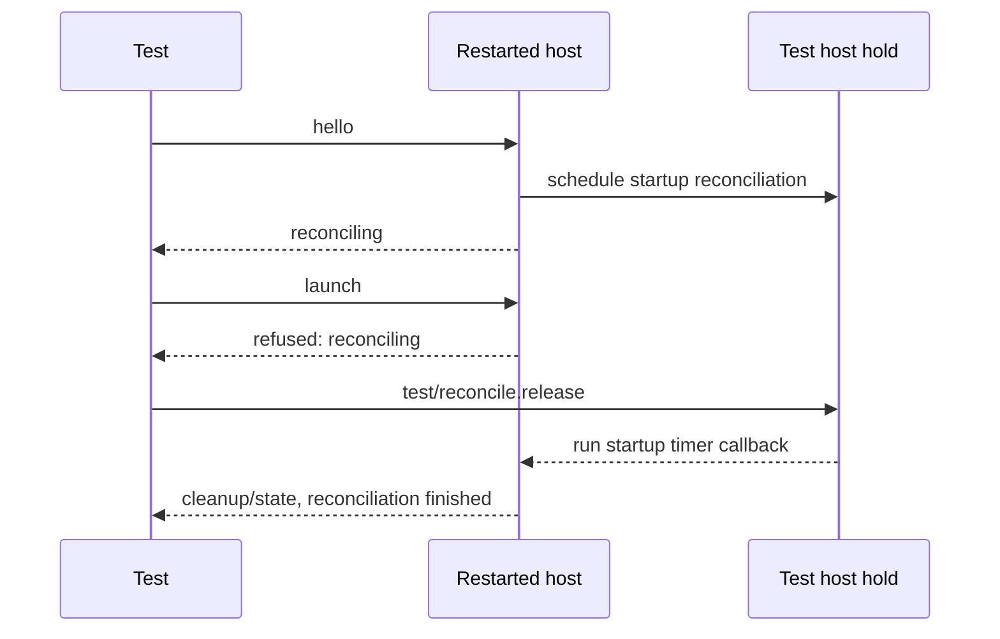
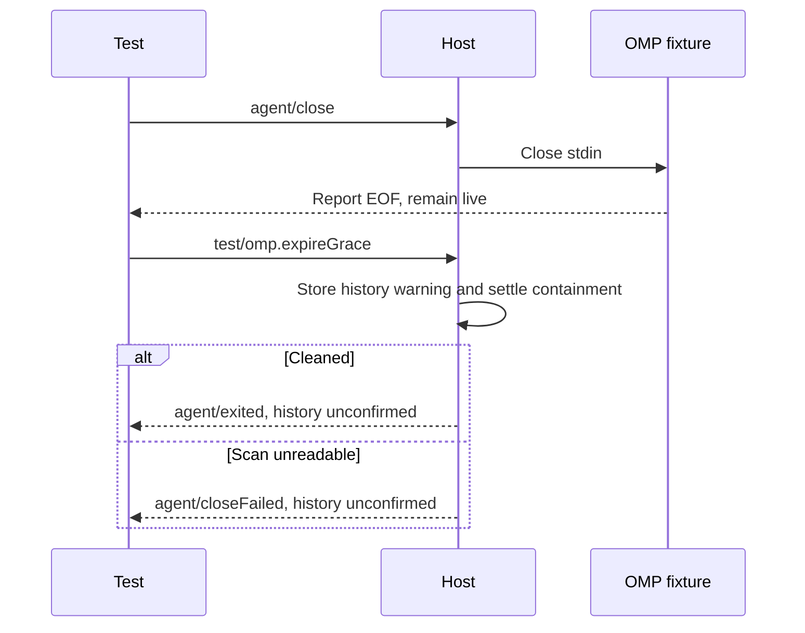

# Design

## Triage

| Trigger | Applies? | Evidence |
|---|---|---|
| T1 Components | Yes | The test, test host extension and existing startup reconciliation each take part in the held startup. |
| T2 State | No | One in-memory hold per opted-in test host, with no persisted state. |
| T3 Concurrency | Yes | Startup reconciliation runs asynchronously while the test sends a launch request. |
| T4 Boundaries | Yes | The test and the test executable coordinate through a test-only RPC. |
| T5 Volume | No | The regression uses two rows and at most one synthetic PID. |
| T6 Risk | No | The change does not affect the shipped host, its signals or its cleanup decisions. |

TIER: FULL

## Context

- On restart the host settles the earlier rows in one batch and writes the results before clearing the launch gate and notifying the desktop (`packages/host/lib/src/cleanup_service.dart:56-85`). `Settler` runs one marker scan for that batch and applies an unreadable PID to each row without a prior termination failure (`packages/host/lib/src/settler.dart:95-112`, `packages/host/lib/src/settler.dart:136-146`). An unresolved row blocks launches against its own workspace (`packages/host/lib/src/unit_manager.dart:156-183`).
- The test's fixture probe checks reported PIDs through `isProcessAlive` (`packages/host/test/it/support/harness.dart:69-81`, `packages/host/test/it/support/harness.dart:128-131`). The scan needs its own exit evidence. On macOS a PID may still be listed with no readable start time; the lookup then cannot confirm an exit (`packages/process_containment/lib/src/posix_process_table.dart:507-524`). PR #51's log gives the unreadable PID and two distinct leader PIDs, but no proof of the unreadable process's identity or life cycle.
- Both start/restart tests wait for a refusal by setting a 1.5-second `reconcileDelay` (`packages/host/test/it/reconcile_test.dart:8-11`, `packages/host/test/it/reconcile_test.dart:39-62`, `packages/host/test/it/reconcile_test.dart:64-101`). The host schedules that delay during `hello`, before returning its `reconciling` state (`packages/host/lib/src/host.dart:355-376`, `packages/host/lib/src/cleanup_service.dart:56-60`).
- The test host already supplies an environment-selected `reconcileDelay` and registers its own methods (`packages/host/lib/src/test_hooks/test_hooks.dart:137-142`, `packages/host/lib/src/test_hooks/test_hooks.dart:207-212`). The release entry point does not use its extension (`packages/host/lib/src/host_extension.dart:10-13`, `packages/host/tool/kumiko_host_test.dart:12-25`).
- The second macOS run of PR #51 failed `OMP: OMP does not exit`: `AgentPeer.close` rejects `agent/closeFailed` (`packages/host/test/it/support/agent_support.dart:117-132`), and the test also expects an empty ledger (`packages/host/test/it/omp_test.dart:2304-2324`). The notification contained `scan-unreadable:7891` and `nativeEofUnconfirmed`. The OMP requirement separates the containment result from the history warning (`openspec/specs/omp-sessions/spec.md:224-236`); the host records the warning before ending the unit, then includes it in either notification (`packages/host/lib/src/agent/agent_service.dart:2040-2045`, `:2049-2083`).

## Decisions

### D1: Preserve the real crash test and control the scan evidence separately

- **Choice:** Keep the two real fixture trees, crash, restart, pre-release refusal and fixture-exit assertions. On Windows require both rows to be deleted. On POSIX require both deleted or both retained unresolved for the same `scan-unreadable:<pid>`. For retained rows require the original IDs, a positive PID in the reason, the reported unresolved counts, and `cleanup-unresolved` from both targets. Reject partial cleanup and any other reason. In the launch-gate test for an unaffected workspace, assert the actual launch and fixture readiness instead of assuming the previous, different workspace is clean. Use minutes-scale hang guards for cleanup notifications, fixture readiness and fixture exit, rather than the 20 s and 30 s defaults in `packages/host/test/it/support/harness.dart:56-67` and `:265-276`. Expiry is never an expected outcome.
- **Choice continued:** Use `Settler(table:)` (`packages/host/lib/src/settler.dart:53-60`) in the same test file with a temporary real ledger and two old rows whose leader identities are already gone or attested. An empty table must delete both rows. A table that always denies one synthetic PID must retain both with the exact reason. Use the recorded sentinel on POSIX and pass a matching prior job attestation on Windows, so neither branch probes a real leader. This test verifies the host's batch outcome, not how long the scan settles. The scan's own deadline cases already use a fake clock; the persistent denial cannot turn into a clean result if the runner is slow.
- **Rejected:** Assert only that no fixture is alive. That would miss a host that deletes unresolved rows and allows new work. Also rejected: replace the native crash test with the fake table; that would stop exercising the escaped descendant and Windows job.
- **Reversal cost:** Low. The outcome assertions and fake table are local to the integration test file.
- **Important:** No. The outcomes are already in the cleanup contract.
- **Chosen by:** agent.

### D2: Hold the existing startup wait in the test executable

- **Choice:** In the opted-in test host, pass a private, nonzero `Duration` instance as `reconcileDelay` and intercept only that instance in a scoped Dart zone. Return a manual, one-shot `Timer` for it. Other timers use the parent zone. Release it through a no-argument `test/reconcile.release` method in `TestHostExtension`. Test hosts without the opt-in keep their existing options and run without the zone. The tests release the first host before launching fixtures, then release the restarted host only after they receive the refusal. Release from teardown if the test fails before releasing.
- **Rejected:** A longer wait would still race the test. Also rejected: a `HostFaults` release gate or `HostOptions` hold read by `CleanupService`. This is an established pattern, endorsed by ADR 0017: `waitForTerminationRelease`, `waitForSpawnScanRelease` and `draftOpenHeld` (`packages/host/lib/src/host_faults.dart:69-86`, `packages/host/lib/src/host.dart:328-334`). S1 keeps production cleanup unchanged. If the owner revisits S1, that gate can replace the zone hook.
- **Reversal cost:** Low. Remove the opt-in and test-only method together.
- **Important:** Yes. It introduces a private test executable contract.
- **Chosen by:** agent.

### D3: Verify OMP history and process cleanup separately

- **Choice:** In the non-exiting OMP fixture test, capture the root's PID and start identity from its running ledger row. Send `agent/close`, wait for the fixture's EOF report and fire the existing manual grace expiry. Require the captured identity to be live at EOF and gone after settlement. Require exactly one terminal notification for this session: `agent/exited` with reason `closed` and no ledger row, or on POSIX `agent/closeFailed` with a positive `scan-unreadable:<pid>` and only the original row unresolved for that reason. In the unresolved case also require a launch into the fixture workspace to be refused. Both outcomes must carry `nativeEofUnconfirmed`, and the saved record must carry the same warning. Use the same minutes-scale hang guard policy as D1.
- **Choice continued:** Add a deterministic variant with `killFails` enabled before `agent/close`. After the EOF report and manual grace expiry, require exactly one `agent/closeFailed` with `kill-failed:injected` and `nativeEofUnconfirmed`. Check the original unresolved row, the persisted `agent_session` warning and the refused launch, and confirm the fixture still runs. In teardown disable the fault, kill only the recorded fixture identity and wait for it to stop before deleting its workspace. This variant covers C4 on all three platforms. The real-scan case still tests the fixture's forced exit and the two permitted cleanup outcomes.
- **Rejected:** Change `AgentPeer.close` for all tests. Its callers that need a confirmed close still need it to reject failures. Also rejected: accept any close failure as proof of an unconfirmed history save. That could hide a faulty kill or transport failure.
- **Reversal cost:** Low. One case in the OMP integration file.
- **Important:** No. The test follows the existing contract for both notifications.
- **Chosen by:** agent.

### Decision summary

| # | Decision | Choice | Rejected | Reversal cost | Important | Chosen by |
|---|---|---|---|---|---|---|
| S1 | Scope | Test-only fix | Change production cleanup | Low | Yes | user |
| D1 | Evidence | Real process exits plus deterministic ledger cases | Liveness alone or fake-only coverage | Low | No | agent |
| D2 | Order | Explicitly release the test host's startup wait | Wall-clock grace or the existing pattern of gates read by production code | Low | Yes | agent |
| D3 | OMP close | Assert native EOF warning and separate cleanup outcome | Loosen the shared close helper or accept any failure | Low | No | agent |

## Assumptions

- **A1:** The log does not distinguish a fixture descendant from another process or an unreaped PID from another kind of refused read. No decision or task depends on that distinction.

## Carried constraints

- **C1:** The real fixture liveness probe does not establish that the earlier scan accounted for all possible marked processes. Kind: invariant. Destination: doc comment: `packages/host/test/it/reconcile_test.dart` crash reconciliation test.
- **C2:** The test-host zone intercepts one startup timer by duration identity and must not affect any other timer. Kind: invariant. Destination: doc comment: `packages/host/lib/src/test_hooks/test_hooks.dart` `_ReconcileHold`.
- **C3:** The native crash test uses the production process table unfiltered and never retries or reruns reconciliation to reach a clean ledger. Kind: invariant. Destination: doc comment: `packages/host/test/it/reconcile_test.dart` crash reconciliation test.
- **C4:** A completed forced stop does not confirm that native history was saved, and an unconfirmed save does not imply that no cleanup was attempted. Kind: invariant. Destination: doc comment: `packages/host/test/it/omp_test.dart` non-exiting OMP close test.

## Diagrams (FULL)

T1 and T4 share the same boundary. The test driver calls the test host; the extension releases the wait in the unchanged host.

T3. The launch refusal is observed before the test releases reconciliation.

T3 and T4, OMP close orders the manual grace expiry after EOF and keeps both outcomes in the notification.

## State & Ownership (FULL)

| State | Owner | Lifetime | Invalidation | Authoritative copy |
|---|---|---|---|---|
| Suspended timer callback | Test host extension | One host startup | Cleared on release or cancellation; recreated on restart | Timer in the opted-in test host |
| Controlled process evidence | Individual test | One `Settler` invocation | Discarded with the fake table | Table in the test |
| Unit rows and cleanup count | Existing ledger | One profile, under the existing lock | Cleanup deletes rows or marks them unresolved | SQLite ledger |
| OMP close warning and outcome | Existing agent service | One close; warning persists with the saved record | Runtime disposal ends the notification sequence; the warning remains | Close notification and `agent_session` row |

## Failure & Visibility (FULL)

| Component | Failure | Recovery | Retry safe? | Who finds out |
|---|---|---|---|---|
| Startup hold | Release reaches an opted-in host with no hold scheduled | Reject the request; the test fails | A release of an already released hold has no effect | Test runner |
| Integration test | Assertion fails before the release | Release the live host in test teardown and then dispose it | No retry for a failed test | Test runner |
| Live scan | A PID remains unreadable | The test checks the exact unresolved batch and workspace refusal | The product's existing Retry is unchanged; the test does not use it | Test if the status or reason is wrong |
| OMP grace expires while the root is alive | The save cannot be confirmed | The host attempts real containment cleanup and reports that outcome separately | No retry for this test | Desktop; the test checks the notice and persisted warning |

## Resource Bounds (FULL)

| Resource | Bound | At the bound | Timeout | At 10x or 100x |
|---|---|---|---|---|
| Manual startup timer | One per opted-in host process | Reject a second capture; no queue | No hold timer expires on its own | Independent per fixture host |
| Fake table and ledger | At most one synthetic PID and two rows per test | Fixed fixture data | The test makes no elapsed-time assertion | No accumulation or shared process state |
| OMP close evidence | One recorded root identity and one terminal notification per case, with real scan or `killFails` | More than one terminal notification fails the test | A minutes-scale hang guard only | Independent per fixture host |

## Flow & State Gaps (FULL)

- The host schedules reconciliation before responding to `hello`, so the release request comes after the hold has been set. A new process after a crash owns a new hold, independent of the first process.
- A post-release state notification may arrive before the release reply. The desktop stand-in retains the notifications (`packages/host/test/it/support/harness.dart:238-247`, `packages/host/test/it/support/harness.dart:265-276`), so the test waits for the finished state rather than relying on reply order.
- Do not release a dead host. Test teardown releases the current host if it is connected and always disposes it. The production process tables remain unfiltered in the crash test.
- In the OMP case either notification can arrive after the grace release. Await either, then require exactly one and check the process and ledger after settlement. The shared close helper stays strict.

## Mechanism Ledger (FULL)

| Mechanism | Built? | Why | Evidence that would change the call |
|---|---|---|---|
| Test-only timer hold | Yes | A stalled test client can miss a real timer window and fail without a product regression | If the owner revisits S1, use the existing `HostFaults` release-gate pattern |
| Retry until real scan is clean | No | A retry changes the observation and hides a valid unreadable result | None for this regression |
| Strict shared `AgentPeer.close` | Keep | Other tests require confirmed containment | None for this scope |
| New scan setting in release host | No | The existing internal table seam is enough to control the ledger outcomes | None for this scope |

## Risks / Trade-offs

- The hold uses the existing startup `Duration` path. Keep it opt-in, match by identity, and prove that the host really refuses a launch before release. Do not broaden the zone hook to ordinary timers.
- The real OS may report a different scan failure. This change does not reinterpret those failures or drop the requirement that each reported fixture stops.
- The native crash test still runs production's 10 s scan-pass budget and 2 s and 3 s termination waits (`packages/process_containment/lib/src/marker_scan.dart:116-123`, `packages/host/lib/src/settler.dart:239-252`). A stalled runner can still fail the exact-reason check with `scan-timeout` or `termination-timeout`. A test-only change cannot inject those clocks through `Settler`. This is an ADR 0017 residual for #28, not a reason to accept those outcomes or retry.
- The OMP case uses the same unfiltered POSIX scan, as well as the host's production settlement budget (`packages/host/lib/src/agent/agent_service.dart:2197-2212`). The injected grace expiry controls native history timing, not either cleanup budget. Failures other than the reported unreadable result remain test failures.

## ADRs

- **In force, constraining this change:** ADR 0001 distinguishes fixtures that stopped from a scan that confirmed cleanup.
- **In force, constraining this change:** ADR 0017 requires order and outcome assertions, explicit control of deadlines under test, and minutes-scale hang guards.
- **To record during apply:** None.
