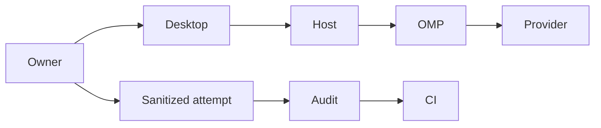
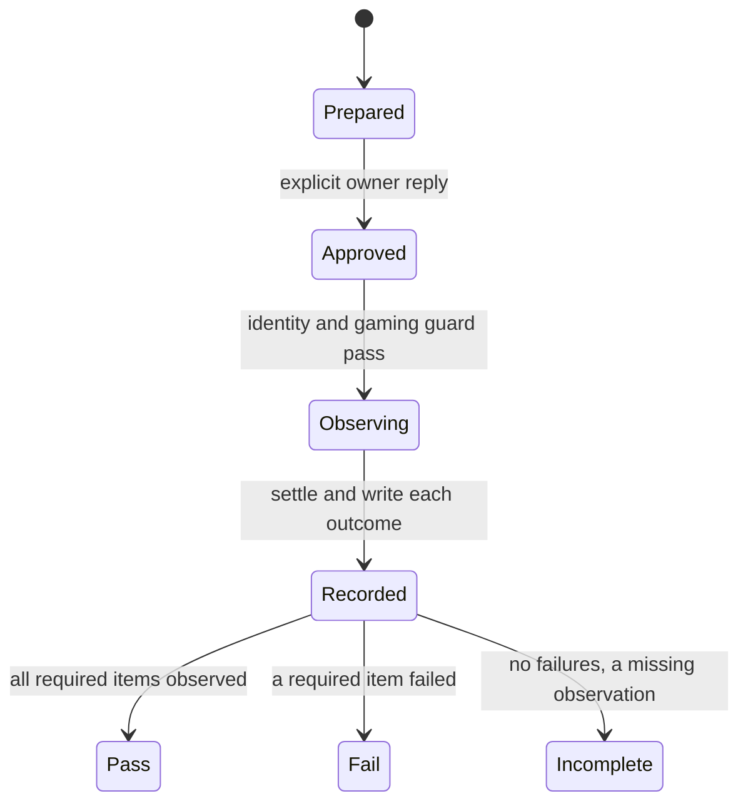
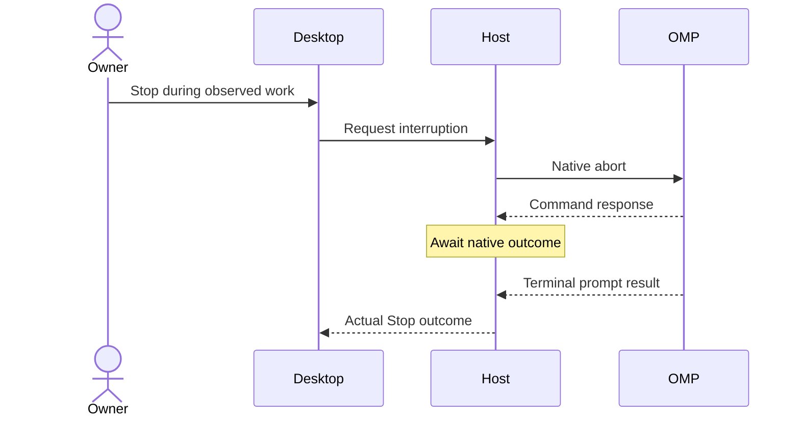
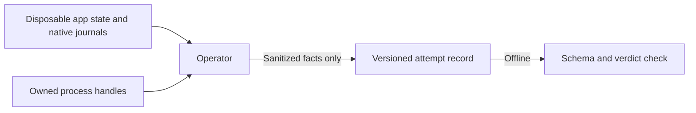

# Design

## Triage

| Trigger | Applies? | Evidence |
|---|---|---|
| T1 Components | Yes | The walk drives the desktop, bundled host and real OMP process. The repository audit reads a new evidence file. |
| T2 State | Yes | The audit reads a persistent record with separate PASS, FAIL and INCOMPLETE results. The product store does not change. |
| T3 Concurrency | Yes | Stop can lose a race to native completion. Root and child can finish in either order. Windows process exit and journal persistence are separate observations. A second native Close must not bypass a pending exit decision. |
| T4 Boundaries | Yes | The walk uses the OMP provider and a checked-in evidence format. The Windows runner must route the main-window close into Dart without changing the desktop-host protocol. |
| T5 Volume | Yes | Evidence grows with attempts. The walk must not retain raw runtime output, transcripts, journals or profiles. |
| T6 Risk | Yes | Model use spends account quota. OMP has native tool permissions and state. The walk must protect the owner's projects and credentials. |

TIER: FULL

## Context

[The proposal](proposal.md) covers M2 change 5. The walk uses the release desktop and its bundled host, which is the Windows release CI build path (`.github/workflows/ci.yml:114-124`). The app selects its host and profile before connecting and advertises both `omp` and `ompHistory` (`packages/desktop/lib/main.dart:32-59`). Its Windows profile is under the process's `LOCALAPPDATA` when that variable is absolute (`packages/desktop/lib/src/host_location.dart:46-61`).

The host uses the contained version probe, then private v1 NDJSON; its recorded version is independent of admission and qualification (`docs/adr/0016-native-omp-rpc-transport.md:19-38`). The pane displays the host's adapter name and version (`packages/desktop/lib/src/agent/agent_pane_view.dart:120-132`). Exact Continue uses a recorded native file and checks its identity before restoring history or binding tools. Child panes use the owning root and require the history peer capability. Stop and orderly shutdown use different native evidence (`docs/adr/0019-omp-history-child-view-and-shutdown.md:10-14`).

OMP only offers recognized one-shot approvals or denial under native policy. The OMP tool binding uses private RPC, without a Kumiko MCP entry or secret (`docs/adr/0018-omp-approvals-and-private-host-tools.md:16-20`). `kumiko_session_info` takes no arguments and returns the session identity and target from the host (`packages/host/lib/src/agent/tools/tool_catalog.dart:58-74`).

Codex's approach separates an approved attempt, durable observations and an offline audit (`docs/qualification/codex-app-server.md:26-54,94-122,1345-1364`). Keep that split. OMP has no MCP grant canary or auth-signature registry to qualify. Add an OMP check at the offline CLI boundary, where it already loads native evidence and prints results (`tool/check_qualification.dart:1097-1150`, `mise.toml:43-48`).

The second walk and the owner independently observed the Windows window disappear with a permission pending and no quit warning. The host did not record a coordinated quit; A's OMP exited 1. Existing integration coverage calls Flutter's Dart exit handler directly. It cannot catch a native message that never reaches that handler.

## Decisions

### D1: Audit each attempt on its own

- Choice: Add `docs/qualification/omp-rpc-windows.json`, a JSON array of attempts. Each attempt has `id` (UTC start timestamp in ISO 8601), `version` (the exact OMP version without `omp/`, matching native version syntax), `os` (`windows`), `revision` (full Kumiko source commit), `model` (exact `provider/model` pinned for both root and child), `approval` (`sha256`, the 64 lowercase hex digits of the exact plan text presented to the owner, and `approvedAt`, the UTC ISO 8601 approval time), and `items`. Each item has `item`, `result` and `notes`. Results are `pass`, `fail` or `unverified`; notes are nonempty sanitized observations or reasons. Require exactly one row each for `launch`, `prompt`, `streaming`, `immutable target`, `Stop`, `one-shot approval`, `denial`, `tool activity`, `kumiko tool call`, `exact Continue`, `history restore`, `read-only child pane`, `close` and `ordinary quit`. Item matching is case-sensitive. Put optional real observations in the runbook, not the checked evidence file.
- Audit: Extend the default offline CLI with a separately testable OMP check. Read the record only with no positional arguments; keep both legacy inputs unchanged. Reject a missing default file, invalid shape or identity fields, missing, unknown or repeated items, unsupported OS, repeated attempt ids and missing, malformed or repeated approval references. Print `OMP OBSERVATIONS: <id> <version> windows: <status>` per valid attempt. Status is FAIL if a required row failed, else INCOMPLETE if one is unverified, else PASS. `[]` prints `OMP OBSERVATIONS: none recorded`. Malformed evidence makes the CLI exit nonzero without printing OMP statuses. An accurately reported negative observation does not fail the offline CI check. Print only validated attempt identity and status or field/index diagnostics, not notes or raw parser excerpts. The approval digest links the receipt to the approval; the offline check cannot authenticate the reply or the operator's observations.
- Rejected: Add a runtime allowlist, combine rows across attempts or versions, or make a real failure impossible to record because the audit treats it as malformed. Do not adapt the Codex Markdown grammar or its MCP/auth rules to an OMP walk.
- Reversal cost: Medium after other attempts use the format.
- Important: yes (binds the evidence format and interpretation).
- Chosen by: agent, within S1.

### D2: Separate preparation from the owner-approved run

- Choice: Prepare one disposable directory with two fixtures, a Kumiko profile selected through a child-process `LOCALAPPDATA`, native session and artifact storage, and a qualification-only OMP argv profile. Use absolute paths and the packaged desktop and release host. The host inherits that `LOCALAPPDATA`; the version probe preserves it (`packages/host/lib/src/agent/omp/version_probe.dart:31-44`, `packages/host/lib/src/agent/agent_service.dart:1030-1041`) and so does the OMP workspace launch unless the profile overrides it (`packages/host/lib/src/agent/agent_service.dart:964-971,1137-1149`). Do not use the owner's Kumiko profile or projects. Do not copy, export or print credentials, dump the environment, or write the owner's settings. Native sign-in may refresh normally. This is not a sandbox.
- Gate: Before asking, use identity/help, exact-version public documentation and local non-secret metadata only. Resolve the OMP config, auth, session and cache roots under the exact launch environment. Abort if native sign-in resolution would change or if root and child session data would leave scratch. Verify executable and release build identity, native isolation flags, available tool names and policy. Pin the same exact provider model for root and child. Use a temporary native overlay and explicit profile arguments that Continue permits. Disable unrelated extensions, tool discovery, rules, prewalk, memory, remote session storage, model fallback and background provider features with verified flags and settings. Abort if these conditions require touching the owner's settings or copying credentials. Do not use RPC launch as a pre-approval probe.
- Approval: Freeze the exact plan text shown to the owner. It names an attempt, version, executable and build identities, exact model, targets, profile, redirected roots, prompts, owner clicks and provider side effects. Hash its UTF-8 bytes. Before the first launch check the approved plan digest and match the actual version, executable, build, model, targets, profile argv, overlay and queued prompt list to it. After explicit approval and before launching, exclusively create a spent marker for that digest in the approved scratch root. An existing marker or recorded digest refuses reuse. Keep the marker through failure and cleanup until the attempt record is saved. Check the gaming guard before building and again before the walk; live work waits while the owner is gaming. A changed input or extra prompt requires fresh approval. No replays under the same approval.
- Rejected: Use the normal Kumiko profile or a real project, move credentials, add a headless runner, drop the Codex plan-hash binding, or infer live permission from build approval.
- Reversal cost: Low for this procedure, high for an unauthorized provider call or data change.
- Important: yes (money and local data boundary).
- Chosen by: user for the gates and temporary workspaces; agent for the preparation procedure.

### D3: Observe the desktop and check process and journal facts separately

- Choice: Keep the walk manual. The approval asks the owner to watch and operate the GUI when needed. Launch the desktop as a direct child of the operator's process and retain its process handle. While the app and its descendants are live, enumerate only its parent-PID chain. Check process creation times and end-to-end parent ownership to rule out PID reuse, and open handles immediately. Label each owned runtime tree by its pane before any close. Wait for those handles, not a delay or a name search. If ownership or required exit evidence is missing, do not pass the affected row. Use scratch journal metadata for identity and save proof; do not use model text as proof. Record coarse outcomes without process/session ids, paths, command lines, raw model output or screenshots.
- Ordered walk (at most eight root prompts, with one short delegated assignment):
  1. Open workspace A and start OMP without a prompt. Check Idle and the displayed exact adapter version. Send a bounded, tool-free numbered text reply. Observe the prompt once, reply growth before Idle and no final duplicate.
  2. Request one harmless operation on a named scratch fixture and choose Deny. Check the displayed choices match the intended one-shot/deny pair and the denied operation did not complete. For a read, use a fresh value not in the prompt and inspect the actual tool result, not the model's account.
  3. Switch the selected workspace to B. In A's original pane, ask for one allowed fixture operation followed by one `kumiko_session_info` call. Inspect the full preview before approving the one matching operation. Check the native tool card and native callback result, compare the returned target to A and the adapter version to Start, and check that tools move from not yet used to connected after the call. No made-up output or registration-only pass.
  4. Ask A for lengthy but bounded text without tools. Press Stop while text is still growing; record Stopped, Finished before Stop or Stop not confirmed separately. Only actual interruption and a still-live root qualify Stop. The next prescribed A prompt checks the same process accepts new work. Do not substitute process kill or retry a missed Stop.
  5. Ask A for one prescribed harmless child assignment on fixture content. Open its row and check that the child has its own attributed content, child events do not appear in the parent's transcript, and the child offers no composer, permission decisions, Stop, steering or Continue. The parent can still show its own task card or summary. An observed child model mismatch fails the child row; missing model proof keeps it unverified. Leave the child pane open for reopen. Note child history and delegated Stop separately if the approved operation reaches those states; do not use a stale row for a live pass.
  6. Start a second root in B and submit one harmless operation. Hold its approval pending. Attempt pane close and cancel, then confirm close while still affected. Do not approve the pending operation to force close. Pass `close` only if Cancel kept the work, the confirmed pane closed, every owned handle in B signaled and A stayed available. If required handle evidence is missing, record unverified.
  7. Request another harmless approval in A and leave it pending. Try ordinary app quit, check the affected-work warning, cancel it, then confirm **Stop processes and close**. Pass `ordinary quit` only with all owned handles signaled, OMP exit 0, the retained root saved and not running on reopen, an inert child pane, no unconfirmed-save or cleanup warning, and the prior expected root history present in scratch. Check this before attributing any new work to Continue. Missing required evidence means unverified. A warning that matches an abnormal outcome is truthful; it does not pass the orderly-save check.
  8. Explicitly Continue A. Check that the retained journal id and target match, that chronological root messages and tool results return before live output, and that no new work was submitted. Compare bounded scratch journal metadata before and after Continue for unchanged prior message/tool counts and no replacement root file. Send one final short tool-only confirmation prompt if specified in the approved walk. Check the callback uses the original Kumiko id and target. Close the attempt and settle handles before cleanup.
- Rejected: Rely on a model's claims, use sleeps to arrange the races, or use a native acknowledgement, exit alone or zero visible child cards as the proof of Stop or save.
- Reversal cost: Low.
- Important: yes (sets what a qualification pass means).
- Chosen by: agent, within the user-approved desktop walk.

### D4: Publish capability differences without promoting missing evidence

- Choice: Put a shared-contract comparison in `docs/qualification/omp-rpc.md` with contract references and actual version/attempt notes. Cover private native v1 RPC and separate minimum-version admission; prompt admission versus terminal result and quiescence; approval shape and missing remembered grants, generic questions or steering; bounded root tool cards; private root-only host callbacks instead of MCP; native provider/settings and profile model choice rather than provider/account management; exact file selection and bounded root snapshot or explicit history unavailable; child live/run-scoped history and attribution limits, read-only control and inert restored child panes; and Stop, close and quit's distinct evidence. Distinguish intentional limits, installed-runtime failures, and cases left unobserved. Mark the personal read-only coding role and Sessions browser outside this change. A read-only pane is not a read-only runtime role. Retain failed attempts; do not paper over a defect by calling it a capability difference. No installed-version tool failure registry entry or product change without an owner-approved scope decision.
- Rejected: Treat an absent event as a contract gap, infer native MCP support from host tools, or label all shared controls available because root chat streams.
- Reversal cost: Low.
- Important: yes (binds user-visible support claims).
- Chosen by: user for the comparison and no unapproved production fixes; agent for the document layout.

### D5: Route Windows main-window Close through the existing quit coordinator

- Regression: Run the real Windows runner in a test-owned child process with a scripted agent awaiting permission. Post `WM_SYSCOMMAND` / `SC_CLOSE` to its own top-level runner HWND identified by process and window class, never by title. Do not call the Dart lifecycle handler or coordinator directly. Red must reproduce an exit without warning: the main window is gone, the desktop exits 0 and the host has no coordinated quit record. If an auxiliary native window exposes Flutter's predicate, first establish that it matches the release failure and check green with and without it.
- Failure boundary: The pinned Flutter Windows engine intercepts `WM_CLOSE` only when its last-window predicate passes. Test the observed path, and cover an auxiliary native window if that predicate is the cause. If the regression cannot reproduce or the cause differs, stop and update the diagnosis before changing production code.
- Proof: The rendered warning is the receipt for the first Close. For a repeated Close, observe the existing dialog regain focus before asserting that it is still the same dialog and the agent is still waiting. After Cancel, check that the agent unit survives and that another native Close opens a fresh dialog. Use no waits measured in elapsed time except one generous hang guard. The test belongs in its own integration file. The parent verifies that the host records a coordinated quit before the window is destroyed, the desktop exits 0 and the agent unit ledger is empty afterward. A test observer must not change the production close order.
- Repair boundary: If the runner bypasses the coordinator, handle the main window's `WM_CLOSE` before Flutter can independently handle it. Each request goes to the existing coordinator once; repeated requests can focus the current dialog but never reach default close. The runner holds no affected-work state. Register the private Dart handler before host startup and remove it on dispose; a Close with no handler cannot enter or skip a quit decision. Only a successful `exit` response, after coordinated host shutdown, permits native window destruction without a second quit request. Late or failed replies cannot destroy a window during teardown. Auxiliary-window closes, OS-required exits and other platforms keep their paths.
- Live rerun: After the regression is green, obtain explicit owner build approval, then build and hash the fixed packaged release. Bind its revision and hashes into a new exact plan. With fresh owner run approval and a new scratch profile, check pane Close in B and use native title-bar Close in A while a permission is pending. Have the owner watch the warning, Cancel and confirmation. Seed one minimal child result so its inert pane can be checked after reopening. Observe explicit Continue and root history replay before sending more work. Preserve the failed attempts and leave untouched rows unverified; never combine runs.
- Chosen by: user (Ormy item 101, event `e3159`) for the fix and scoped rerun; agent for the test seam and platform boundary.
- Reversal cost: Low.
- Important: yes (a native Close must not end pending work without a decision).

### Decision summary

| # | Decision | Choice | Rejected | Reversal cost | Important | Chosen by |
|---|---|---|---|---|---|---|
| S1 | Scope | Windows desktop walk and offline audit | Runner, fixture qualification, version gate | Low/medium | Yes | User |
| D1 | Evidence | Separate exact-version attempts linked to one approval | Merged results or live admission input | Medium | Yes | Agent |
| D2 | Authority | Hash-bound approval and checked scratch environment | Unbound approval, owner profile, projects or copied credentials | Low/high | Yes | User and agent |
| D3 | Proof | Desktop observations plus scratch process and journal facts | Timing guesses, model or ack as proof | Low | Yes | Agent |
| D4 | Differences | Contract comparison, failures and unobserved cases separate | Native feature parity by inference | Low | Yes | User and agent |
| D5 | Windows title-bar Close | Existing quit decision reached from the native main window | Call the Dart handler directly in the regression or coordinate quit twice | Low | Yes | User and agent |

## Assumptions

- A1: The installed executable reported `omp/19.2.1` from `--version`. This establishes identity only. D2 checks it again for the actual executable. The [19.2.1 CLI settings documentation](https://github.com/can1357/oh-my-pi/blob/v19.2.1/docs/settings.md) and [RPC reference](https://github.com/can1357/oh-my-pi/blob/v19.2.1/docs/rpc.md) are source evidence, not confirmation that the installed profile, child model, approvals or persistence behave as planned. D2 must resolve the actual settings, paths and model before the owner run gate.
- A2: A model is not a scripted peer. It can omit a requested tool, fail to yield an attributable child, or finish before Stop. D3 handles each as a missed or failed observation, never as an inferred pass or permission to retry.

## Carried constraints

- C1: Windows observations bind only the exact installed version; the version minimum and normal admission remain independent. Kind: invariant. Destination: `spec: specs/omp-sessions/spec.md → Requirement: Real OMP qualification is recorded separately from regression tests`.
- C2: The audit validates recorded shape and outcomes offline. It cannot create real evidence or combine attempts. Kind: invariant. Destination: `spec: specs/omp-sessions/spec.md → Requirement: The OMP evidence audit runs offline`.
- C3: A private host callback is not MCP, and a native one-shot card is not sandbox enforcement. Kind: deliberate gap. Source: ADR 0018. Destination: `docs/qualification/omp-rpc.md`, Differences from the shared contracts.
- C4: Native quiescence, containment settlement and resumability are different observations. Attribution and Continue remain scoped to the recorded target and run. Kind: invariant. Source: ADR 0019. Destination: `docs/qualification/omp-rpc.md`, Differences from the shared contracts.
- C5: The explicit owner approval, separate from build approval, is required before the real walk. Kind: invariant. Destination: `spec: specs/omp-sessions/spec.md → Requirement: Real OMP qualification is recorded separately from regression tests`.

## Diagrams

Component paths (T1).

Attempt lifecycle (T2).

Stop ordering (T3).

Evidence boundary (T4).

## State & ownership

| State | Sole writer | Lifetime | Invalidation or rebuild | Authoritative copy |
|---|---|---|---|---|
| Approved walk plan | Operator prepares and claims; owner authorizes | One attempt | Changed inputs invalidate approval; exclusive claim consumes it | Approval reply, private plan and spent marker |
| App profile and layout | Scratch host through ordinary desktop requests | One walk and reopen | Delete after owned processes settle | Temporary Kumiko profile |
| Native journal and child records | OMP | One walk and reopen | Do not repair or edit; delete temporary data after proof | Native scratch storage |
| Public observation record | Qualification operator | Retained across changes | Correct only with retained source observations; do not overwrite an earlier outcome with a later run | Checked-in evidence file |
| Verdict | Offline checker | One invocation | Recompute from each attempt | That attempt's required rows |

## Failure & visibility

| Component | Failure | Recovery | Retry safe? | Who finds out |
|---|---|---|---|---|
| Preparation | Identity, settings, scratch location or native sign-in resolution cannot be verified under the actual launch environment | Stop before launching. Report the missing or changed fact | Repeat non-provider preparation only after the facts change | Owner |
| Approved plan | Digest, version or launch inputs do not match, or the approval was spent | Refuse launch. Record the reason without exposing the plan | Fresh owner approval | Owner |
| Desktop or OMP | Startup error, early completion, missing tool or child event, or link loss | Use existing controls to close the owned attempt. Record the failing step, observed results and later unrun rows | Fresh approval for another attempt | Owner and evidence reader |
| Process settlement | An owned handle remains live after safe shutdown | Keep scratch data that may still be in use, report the exact owned process privately and resolve it before deleting | Never substitute name-based kill or recycle the profile | Owner |
| Native persistence | Journal absent, redirected or inconsistent; quit marks save unconfirmed | Preserve observed warning and keep Continue or history unverified if it cannot be checked | Never select the newest file or replay a prior action | Owner and evidence reader |
| Offline audit | Record missing, invalid or too large | Fail the audit before OMP statuses and point to the field or item, without echoing raw content | Yes, after correction | CI and operator |

## Resource bounds

| Resource | Bound | At the bound | Timeout | At 10x / 100x |
|---|---|---|---|---|
| Provider work | D3's eight root submissions and one child assignment. Tool loops can cause extra provider requests; no dollar cap is claimed | Do not send more prompts. Stop or close on out-of-plan work | A generous outer operator hang guard only; the outcome is not a wall-clock pass or fail | Refuse additional work without new approval |
| Scratch state and observation | Two fixture workspaces; only the approved release processes and needed local journals. Read bounded scratch metadata, not entire private profiles or transcripts | A missing or uncheckable fact is unverified. Do not expand the inspected scope | Use process handles to confirm exit; unresolved cleanup stays open | No bulk scan or output capture; the repo stores no raw state |
| Offline audit | One file, at most 1 MiB read; 14 rows per attempt with single-line notes up to 512 UTF-8 bytes each | Reject rather than truncate. Grow the record format or split its history in a reviewed change if it reaches the cap | Local synchronous read, no network and no runtime waits | Linear in file size, with the same hard bound |

## Flow & state gaps

- Do not use a delay to reach a check. Approval pending and visible streaming are barriers; if they disappear first, record the event observed. A root yield does not establish child completion.
- A failed or interrupted attempt records verified rows plus explicit failures or unverified rows. Never promote one after another attempt runs. Reopen under the same scratch profile only after the prior desktop, host and OMP handles settle.
- A saved-looking pane does not prove native history. Continue is explicit. Check the saved root identity and prior messages, and keep history unverified if only continuation succeeds.
- If model settings, installed OMP or scratch ownership change between approval and launch, do not start. Between attempts the previous record does not authorize another launch.

## Mechanism ledger

| Mechanism | Built? | Why | Evidence that would change the call |
|---|---|---|---|
| Offline evidence validation | Yes | Unchecked missing or merged rows can silently create a version claim | An existing equivalent OMP check |
| Scratch isolation and hash-bound run gate | Yes, as operator procedure | Real provider and native state are in scope before the first prompt, and stale approval can spend quota | None for the owner gate |
| Headless paid runner or automated approval picker | No | More paid paths and authority; cannot prove desktop controls or pane ownership | A separately approved need for a repeatable non-GUI observation |
| Native auth simulation, stop-by-kill and forced persistence faults | No | Not necessary for the approved normal walk; fixtures exercise the negative paths without touching the owner's account | Separate owner-approved fault investigation |
| Production qualification registry or policy | No | The existing native admission is independent of evidence | A separately approved and reviewed product change |

## Risks and trade-offs

- Model behavior can make the walk incomplete. Keep the outcome rather than increasing the prompt budget or using a different model.
- A scratch cwd and process-scoped settings are not a sandbox. Block unapproved tools and model routes at preparation, inspect each displayed operation before approving it, and stop on unplanned behavior.
- Screenshots, raw journals, process command lines and diagnostics can reveal account or path data. Record only sanitized observations and delete scratch files once owned processes settle.

## ADRs

- In force: ADRs 0004, 0012, 0016, 0017, 0018 and 0019. This applies their existing transport, privacy, recorded-evidence and test boundaries.
- To record during apply: none. The durable evidence contract belongs in `omp-sessions`; the native Windows path restores the existing `app-exit` contract without changing it.

## Open questions

None that change the design. The exact approved model and native settings, and whether each real event occurs, are recorded during preparation and the walk, respectively.
