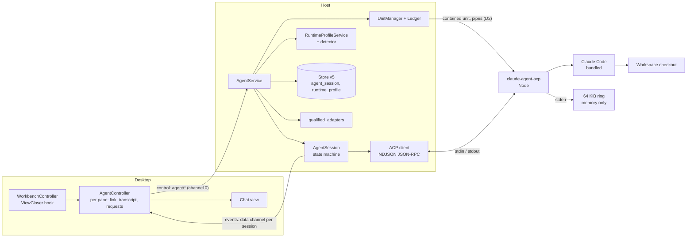
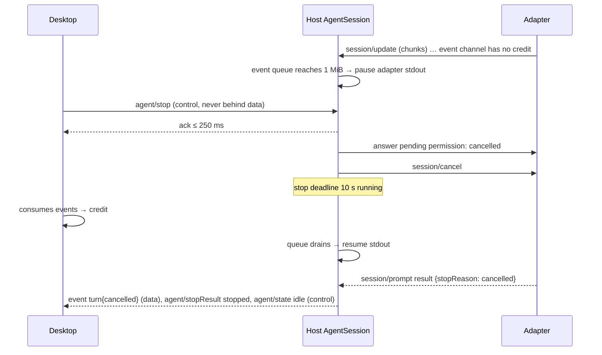

# Design

## Triage

| Trigger | Applies? | Evidence |
|---|---|---|
| T1 Components (new component, or 3+ with directed relationships) | Yes | New adapter subprocess per session, host agent service and ACP client, desktop chat view and controller. Desktop → host → adapter → Claude Code, plus the store. |
| T2 State (persistent state, caches, 3+ state machine) | Yes | Store v5 adds `runtime_profile` and `agent_session` tables and the `default_runtime` setting. The session turn state machine has more than 3 states. The desktop holds a bounded transcript. |
| T3 Concurrency (background work, workers/isolates, async, retries) | Yes | Adapter stdout reader (an isolate on Windows), concurrent sessions, Stop racing turn end, close racing exit, permission requests racing Stop. |
| T4 Boundaries (data format, migration, shared interface, IPC, external) | Yes | ACP (external, newline-delimited JSON-RPC), new desktop-host methods and an event channel format, store migration v5, Windows piped-stdio containment. |
| T5 Volume (grows without a fixed bound) | Yes | Streamed replies, tool output, load replay, transcript display, session records. |
| T6 Risk (security, money, data loss, unrecoverable user data) | Yes | The agent mutates source and runs commands. Permission answers must be honest. Credentials stay native. Transcripts must not leak into Kumiko's files or logs (D29, D46). |

TIER: FULL

## Context

The proposal gives scope and user decisions. This section covers the code the approach builds on.

- **Units and the ledger.** `UnitManager.launch` (`packages/host/lib/src/unit_manager.dart:79-204`) runs these steps, in order:
  1. Checks shutdown, reconciliation, the outer job and the unit cap (`unit-cap`, 64, `host_options.dart:5`).
  2. Resolves the target identity (`target-unavailable`).
  3. Applies the cleanup gate (`cleanup-unresolved`, :119-125).
  4. Writes a pending ledger row before the spawn (:134).
  5. Spawns, marks the row running, and ends the unit through `Settler` on exit or request.

  A unit with no PTY has its stdout and stderr drained and discarded (`unit_manager.dart:231-236`).
- **Process spawn.**
  - POSIX: `spawnPosixUnit` runs the `--unit-exec` shim with real pipes (`posix_unit.dart:166`). Only the PTY path reads an exec-status pipe, so a failed `execve` without a PTY shows only as exit 126/127.
  - Windows: `spawnWindowsUnit` (`windows_unit.dart:172`) gives a non-PTY unit an inheritable `NUL` handle for its standard handles (:196-213). There are no pipes. `lpApplicationName` is the executable, so no PATH or PATHEXT search happens and `.cmd` shims cannot run.
- **Terminal pattern to reuse.**
  - `TerminalService.open` (`host/lib/src/terminal/terminal_service.dart:166-273`) reserves channels (`Connection.reserveChannels`, `host_protocol/lib/src/connection.dart:262`), launches through `UnitManager`, returns ids, waits for attach (10 s, `HostOptions.attachTimeout`), and relays bytes under credit.
  - Blocking reads with one chunk in flight run on isolates: `PtyReaderIsolate` and `PtyWriterIsolate` (`terminal_io.dart:32,154`).
  - Close is acknowledged on entering `closing`, settled within 30 s (`settleDeadline`), then reported `exited{closed}` or `closeFailed`.
- **Protocol.** Methods, capabilities and errors are hand-written in `host_protocol/lib/src/messages.dart`:
  - `Method` (:16), `Capability` (:51), `methodCapability` (:60), `ErrorCode` (:86).
  - Strings are clamped (`maxReasonBytes` 256, :394).
  - Limits: control messages ≤ 1 MiB, frames ≤ 64 KiB, channel window 256 KiB, 160 channels (`frame_codec.dart`).
  - The host advertises `workbench` and `terminal` (`host/lib/src/host.dart:92-93`) and dispatches requests in `_onRequest` (:299).
- **Store.** `schemaMigrations` (`host/lib/src/store/store.dart:14-96`) is at v4. Each step is one transaction. A newer store is refused.
- **Shell profiles**, the model for runtime profiles:
  - `domain/lib/src/profile/` holds validation.
  - `host/lib/src/profiles/profile_service.dart` and `shell_detector.dart` (`splitSearchPath`, off-isolate probing with a 2 s cap) do detection.
  - Store v3 holds `shell_profile` and `setting`.
- **Desktop.**
  - View kinds are `ViewKind(id, label, {needsWorkspace, warnsOnClose})` in `registeredViews` (`desktop/lib/src/workbench_controller.dart:26,92`).
  - Panes render through a chain in `_PaneBody` (`workbench_page.dart:1205`).
  - `requestClose` (`workbench_controller.dart:553`) collects warnings and confirms once. Terminals are a hard-coded branch, with `TerminalController.warnsOnClose` at `terminal_controller.dart:549`.
  - Host loss is `HostPhase.hostLost` (`host_controller.dart:20,98`).
- **Tests and CI.**
  - The test host (`host/tool/kumiko_host_test.dart`) adds `test.*` capabilities, faults and `--test-fixture` programs (`host/lib/src/test_hooks/`).
  - CI (`.github/workflows/ci.yml`) runs on Windows, Linux and macOS and installs no Node.
- **ACP and the adapter**, facts checked on 2026-10-31 against `agentclientprotocol.com`, the v1 schema and `agentclientprotocol/claude-agent-acp` v0.99.1 source:
  - Transport and protocol: newline-delimited JSON-RPC 2.0 over stdio, protocol version 1.
  - Adapter capabilities: `loadSession: true` and `sessionCapabilities{list, resume, close, ...}`. The adapter uses its own built-in tools (not the client `fs`/`terminal` methods) and bundles Claude Code (Node ≥ 22).
  - Cancel: `session/cancel` is a notification. The client must answer pending permission requests `cancelled`, and the agent answers the prompt with `stopReason: cancelled`.
  - Load and resume: `session/load` replays history as `session/update`. `session/resume` does not.
  - The adapter blocks on update delivery (issue #1269), so its stdout must be read continuously.
  - The `authRequired` error code is unverified.
- **Direction sources** carried into the specs are listed in the proposal. No referenced stores.

## Decisions

### D1: One adapter process per session, as a contained unit of kind `agent`

- **Choice:**
  - Each Kumiko session starts its own adapter process through `UnitManager.launch(kind: 'agent', target: <workspace path>)`, so the ledger, unit cap, cleanup gate and settlement apply unchanged.
  - Close terminates that unit, and a crash affects one session only.
  - The adapter's own multi-session support is not used.
- **Rejected:** one long-lived adapter process per runtime profile, hosting every session through `session/new`. Closing one session could not terminate only its tool processes, since they share one process tree. A crash would end every session. The ledger target would no longer be one workspace, which breaks the per-workspace cleanup gate (ADR 0001).
- **Reversal cost:** medium. Sharing a process later changes the agent service and ledger kinds, not the protocol or the store.

### D2: Piped standard I/O inside containment on both platforms

- **Choice:** `process_containment` gains a `pipes` option for non-PTY units.
  - **Windows:**
    - `CreatePipe` makes three pipes. Only the child ends are inheritable and listed in `PROC_THREAD_ATTRIBUTE_HANDLE_LIST`, with `STARTF_USESTDHANDLES`.
    - `CREATE_NO_WINDOW`, `CREATE_SUSPENDED` and job-then-resume are kept as for plain units. The parent closes the child ends after the process is created.
    - The parent ends are read and written on dedicated isolates (blocking `ReadFile` and `WriteFile`, one chunk in flight), following `PtyReaderIsolate` and `PtyWriterIsolate`.
  - **POSIX:**
    - The existing `Process` pipes are used.
    - `UnitManager` stops draining them when `pipes` is set and hands the streams to the caller.
    - The shim's exec-status pipe is not used: today it is the shim's own stdout (`unit_exec.dart:43-51`), which a piped unit needs for ACP.
  - **Executable checks (both platforms):**
    - Before `launch`, the agent service resolves the profile's executable to an absolute path (D11 resolution rules) and checks that it exists and is executable (POSIX `access(X_OK)`; Windows: a regular file ending `.exe`).
    - A failure is refused as `executable-not-found` or `not-executable`, naming the path, with no unit started.
    - An exit with status 126 or 127 before `initialize` answers (POSIX shim exec failure) maps to `executable-not-found` (127) or `not-executable` (126), with the stderr tail.
  - **Both:**
    - stderr is read into a 64 KiB in-memory ring per session.
    - It is never written to `host.log`, because adapter error output can carry prompt text (D46).
- **Rejected:** starting the adapter with `dart:io` `Process.start` outside containment. It escapes the ledger, the job and the marker scan, so a killed desktop or host could leave Claude Code and its tool processes running (ADR 0001).
- **Reversal cost:** low. It is an additive option of the spawn primitive.

### D3: A thin, typed ACP client written in the host

- **Choice:** `host/lib/src/agent/acp/` implements the ACP v1 subset this change uses:
  - Requests the host sends: `initialize`, `session/new`, `session/load`, `session/resume`, `session/prompt`.
  - Notification the host sends: `session/cancel`.
  - Notification the host receives: `session/update`.
  - Request the host answers: `session/request_permission`.

  Other details:
  - Framing is newline-delimited UTF-8 JSON with a 16 MiB line bound (Resource Bounds).
  - Any other request from the adapter is answered `-32601 method not found`.
  - Unknown `session/update` kinds and unknown fields are ignored.
  - The client advertises `fs.readTextFile: false`, `fs.writeTextFile: false`, `terminal: false` and no `auth` capabilities, and requests `protocolVersion: 1`.
- **Rejected:** a community Dart ACP package (`acp_dart` 0.5.0, `acpd` 1.0.0). None is maintained by the protocol's owners, they lag the schema (v1.28), and each adds a dependency to audit. Kumiko must still qualify adapter behaviour itself (ADR 0004), so the package would save only the JSON shapes.
- **Reversal cost:** low. The client sits behind the agent service; switching to a package changes no contract.

### D4: Transcript events on a per-session data channel; state, requests and results on control

- **Choice:**
  - **Event channel:** start and continue reserve one host-to-desktop data channel (ADR 0002). After the desktop's `agent/attach`, the host writes normalized events as newline-delimited JSON. The event kinds (in `host_protocol`, all bounded by Resource Bounds) are:
    - `user`, `agentText`, `thought`;
    - `tool` and `toolUpdate`;
    - `plan`;
    - `notice`;
    - `replay{start|end}`;
    - `turn{stopReason}`.
  - **Control:** the following are capability-gated control messages on channel 0:
    - turn state (`agent/state`);
    - permission requests and their resolution (`agent/permissionRequested`, `agent/permissionResolved`);
    - Stop results (`agent/stopResult`);
    - turn end (`agent/turnEnded`);
    - exit (`agent/exited`, `agent/closeFailed`).

  Control frames are never queued behind channel data (ADR 0002), so Stop, permission replies and close stay responsive under saturation.
- **Rejected:** every transcript event as a control notification. Control has no per-session credit. One chatty session or a large load replay would fill the 4 MiB pending-control bound, and past it the peer is declared lost. It would also delay every other session's control and every terminal's.
- **Reversal cost:** medium. The event channel format is a desktop-host contract, recorded in ADR 0012.

### D5: Protocol surface under a new `agent` capability

- **Choice:** additive methods (ADR 0002, no version bump), all gated on `Capability.agent`:

| Method | Params → result | Notes |
|---|---|---|
| `runtime/list` | → `{profiles, defaultId?, defaultAvailable, defaultReason?}` | Built-ins first, then user profiles |
| `runtime/save` / `runtime/remove` / `runtime/setDefault` | profile / id → `{}` | Built-ins refused `read-only-profile` |
| `agent/start` | `{workspaceId, runtimeProfileId?}` → `{sessionId, eventChannel, adapter{name, version}, capabilities[]}` | Answered after `session/new` returns a native id (D7) |
| `agent/continue` | `{sessionId}` → `{eventChannel, adapter, capabilities[], mode: load\|resume}` | Answered after `initialize` and the checks in D9. Load or resume runs after attach |
| `agent/attach` | `{sessionId}` → `{}` | Starts events; grants nothing earlier |
| `agent/prompt` | `{sessionId, text}` → `{}` | Refused `turn-running` unless idle; text ≤ 256 KiB |
| `agent/stop` | `{sessionId}` → `{}` | Ack at once; `agent/stopResult` follows (D8) |
| `agent/permissionReply` | `{sessionId, requestId, optionId}` → `{}` | `unknown-request` if already resolved |
| `agent/close` | `{sessionId}` → `{}` | Ack on entering `closing`; `agent/exited{closed}` or `agent/closeFailed` follows |
| `agent/release` | `{sessionId}` → `{}` | Frees the channel after exit |
| `agent/records` | `{sessionIds}` → per id `{known, targetPath?, adapterVersion?, workspaceAvailable}` | For restored panes; ≤ 128 ids |

  - **New error codes:** `unknown-session`, `unknown-request`, `turn-running`, `no-runtime-profile`, `read-only-profile`, `invalid-profile`, `adapter-start-failed{stage, detail}`, `adapter-protocol`, `auth-required`, `resume-unavailable{reason}`, `workspace-required`.
  - **Existing codes reused:** `unit-cap`, `cleanup-unresolved`, `workspace-unavailable`, `executable-not-found`, `channel-limit`.
- **Rejected:** a session-scoped JSON-RPC tunnel, forwarding raw ACP to the desktop and keeping the adapter logic there. The desktop would become a second ACP client and the host could not answer permissions on close or host loss. ADR 0004 places adapters in the host.
- **Reversal cost:** medium. It is a public desktop-host contract, but additive and capability-gated.

### D6: The host owns the turn state machine; the desktop mirrors it

- **Choice:** the host's `AgentSession` is the only writer of session state (diagram below):
  - States: `starting`, `idle`, `running`, `waitingApproval`, `stopping`, `closing`, `ended`, `failed`.
  - Each `agent/state` notification carries a per-session sequence number, and the desktop ignores older ones.
  - The desktop adds only its own states: *Saved, not running* (restored pane with no live session), *Stopped or unknown* (host lost), and the *Starting* of a pending start.
  - Labels map as: `running` → *Running*, `waitingApproval` → *Waiting for approval*, `stopping` → *Stopping*, `idle` → *Idle*, `failed` → *Failed*, `ended` → *Ended*.
- **Rejected:** the desktop deriving state from the event stream. The stream can be stalled under credit while state must stay current, and two derivations would disagree after a host loss.
- **Reversal cost:** low.

### D7: Start sequence and the session record

- **Choice:** `agent/start`:
  1. Requires `workspaceId` (`workspace-required`); the workspace must be available.
  2. Resolves the profile (given, else default, else `no-runtime-profile`), then resolves and checks its executable (D11 resolution, D2 checks; `.cmd`/`.bat` refused on Windows).
  3. Reserves one channel.
  4. Launches the unit with `workingDirectory` = the workspace path.
  5. Sends `initialize`, ≤ 60 s.
  6. Checks the protocol version.
  7. Computes the claimed capabilities (D10).
  8. Sends `session/new{cwd, mcpServers: []}`, ≤ 60 s.
  9. Then writes the `agent_session` row in one transaction and answers.

  Any failure before step 9 terminates the unit, releases the channel, writes no row, and answers with the error (stderr tail ≤ 4 KiB in `detail`).

  **Store v5:**
  - `agent_session(id PK, runtime_kind, runtime_profile_id NULL, adapter_name, adapter_version, native_session_id, role CHECK('coding'), target_host, target_path, target_identity, workspace_id NULL, created_at, updated_at)`
  - `runtime_profile(id PK, name, runtime_kind, executable, args_json, env_json, created_at, updated_at)`
  - the setting `default_runtime`

  Nothing from the conversation is stored.
- **Rejected:** writing the record before `session/new` (a pending record). A record without a native id can never resume and would show as a broken saved session. The ledger row already covers process cleanup for that window.
- **Reversal cost:** high for the record's shape, because stored data outlives the build. The fields are the ones ADR 0004 decision 3 fixes, so the evidence is settled. `owner` is implicit (one local profile) and is added with the team milestone.

### D8: Stop sends `session/cancel` and classifies the outcome it sees

- **Choice:** `agent/stop` on a turn in `running` or `waitingApproval`:
  1. Answers every pending permission request `{outcome: cancelled}`, then sends `session/cancel`, in that order on the adapter's stdin.
  2. Moves the state to `stopping` and starts a 10 s stop deadline.
  3. Reports the outcome:
     - the prompt answered `cancelled` → `stopResult{stopped}`, shown *Stopped*;
     - the prompt answered with another stop reason (`end_turn`, `max_tokens`, `max_turn_requests`, `refusal`) → `stopResult{finishedFirst, stopReason}`, shown *Finished before Stop*;
     - the prompt answered with a JSON-RPC error → `stopResult{endedWithError, message}`, shown *Turn ended with an error after Stop* with the message;
     - the deadline passes → `stopResult{notConfirmed}`, shown *Stop not confirmed*, with the state staying `stopping`.
  4. **Late answer after `notConfirmed`:**
     - When the prompt is answered later, the host sends a second `agent/stopResult` with `late: true` and the classification above, then `agent/turnEnded` and `agent/state idle`.
     - The desktop replaces *Stop not confirmed* with the late result plus "(after the deadline)", for example *Stopped (after the deadline)*.
     - At most one late result follows one `notConfirmed`.

  The process is never terminated by Stop. Stop on an idle session is acknowledged with `stopResult{notRunning}`.
- **Rejected:** terminating the adapter when cancel is not confirmed. ADR 0004 decision 4 forbids it, and it would lose the runtime's in-flight history write.
- **Reversal cost:** low.

### D9: Continue checks the target, then loads or resumes after attach

- **Choice:**
  - **One rule for availability:** Continue is offered for every pane whose saved record the host knows (`agent/records`), whenever a host is ready. Whether load or resume is possible is decided only by the Continue run: its own checks and its adapter's `initialize`, with the D10 claims for that run's version. The session that created the record decides nothing, because the adapter or the qualified list may have changed since. *Resume unavailable* is therefore shown only after `agent/continue` answers.
  - `agent/continue{sessionId}` checks, in order:
  1. The record exists (`resume-unavailable{unknown-record}`).
  2. The target path resolves to the stored identity (`target-missing` or `target-changed`).
  3. The cleanup gate (`cleanup-unresolved`).
  4. The profile, the record's own if it still exists, else the default.

  Then it spawns and runs `initialize`. It picks `load` if claimed, else `resume` if claimed, else answers `resume-unavailable{not-qualified|not-advertised}` and terminates the unit. After attach, the host:
  - sends `session/load{sessionId: native, cwd: target, mcpServers: []}`, emitting `replay{start}`, the replayed events and `replay{end}`; or
  - sends `session/resume`, emitting `notice{earlier messages not shown}`.

  Either way it then moves to `idle`. A load or resume error emits `resume-unavailable{adapter-error, detail}` through `agent/exited{failed}`, terminates the unit and keeps the record. Replayed `user_message_chunk` updates become `user` events. Nothing is sent as a prompt.
- **Rejected:** resume always (no replay). The user chose load where qualified (2026-10-31), so a reopened conversation shows its history.
- **Reversal cost:** low.

### D10: Capabilities come from a qualified-versions list kept with the adapter

- **Choice:**
  - `host/lib/src/agent/qualified_adapters.dart` lists exact `(adapterName, version)` pairs, each with its qualified capabilities (`load`, `resume`).
  - The baseline (prompt, streaming, tool activity, permission requests, cancel) is claimed for any adapter that completes `initialize` with protocol 1.
  - A capability outside the baseline is claimed only if advertised in this run's `initialize` and listed for that exact version.
  - Entries are added only from recorded qualification results.
    - The results live at a stable repository path that survives archive and is extended by later changes (Codex in M2): `docs/qualification/claude-agent-acp.md`, one section per adapter version with a table per OS.
    - `tool/check_qualification.dart` checks that every listed pair has a `pass` result for each capability it claims on Windows, and a `pass` or `unproven` on Linux and macOS.
    - CI runs the check in the audit step on every OS, so the list and the results cannot drift.
    - The check prints QUALIFIED only when every OS is `pass`; M1 close needs that.
  - A missing `agentInfo` version counts as unqualified.
- **Rejected:** semver ranges such as `>=0.99 <1`. Adapter releases change load and resume behaviour within minor versions (changelog), so a range would claim behaviour nobody observed (ADR 0004 decision 2).
- **Reversal cost:** low. It is host data, extended by later changes.

### D11: Runtime profiles mirror shell profiles, with adapter detection

- **Choice:** the profile model reuses the shell profile validators in `domain` (args list, env names, the same bounds). It adds `runtimeKind` and drops `cwd`, since the working directory is always the target.
- **Executable resolution** (at launch, both for user and built-in profiles):
  - An absolute path is used as is.
  - A bare name is searched on the search path: the host's `PATH`, then the well-known directories below.
  - On Windows a bare name is tried with each `PATHEXT` extension. The first match must be an `.exe`. A match ending `.cmd` or `.bat` is refused with the batch-file reason (see Rejected), and the search does not go on to a later `.exe`, so the result matches what the user's shell would run.
  - An absolute path ending `.cmd` or `.bat` is refused the same way.
- **Well-known directories**, searched after `PATH`, because a desktop launched from Finder, the Dock or a Linux launcher often has a minimal `PATH` without Homebrew or a Node version manager:
  - macOS: `/opt/homebrew/bin`, `/usr/local/bin`.
  - Linux: `/usr/local/bin`, `~/.local/bin`.
  - Both: `~/.npm-global/bin`, `~/.volta/bin`, and the newest `~/.nvm/versions/node/*/bin`.
  - Windows: `%APPDATA%\npm`, `%ProgramFiles%\nodejs`.
- **Detection** (off-isolate, 2 s cap, at host start, as `shell_detector.dart`):
  1. Find `claude-agent-acp` (`claude-agent-acp.cmd` on Windows) on the search path.
  2. Take its package script, `<install root>/lib/node_modules/@agentclientprotocol/claude-agent-acp/dist/index.js` on POSIX (following the bin symlink) or `<dir>\node_modules\@agentclientprotocol\claude-agent-acp\dist\index.js` on Windows, which must exist.
  3. Find `node` (`node.exe`) in the same directory first, then on the search path.
  4. The built-in profile is the absolute `node` path plus the absolute script path, with an environment override that puts `node`'s directory first on `PATH`.

  This works on every OS without relying on `#!/usr/bin/env node` or on the desktop's inherited `PATH`. Built-ins are memory-only and read-only, as for shells.
- **`npx` profiles:**
  - On POSIX a user profile can be `npx -y @agentclientprotocol/claude-agent-acp@<version>`.
  - On Windows `npx` is a batch file, so the equivalent is `node.exe <nodejs dir>\node_modules\npm\bin\npx-cli.js -y @agentclientprotocol/claude-agent-acp@<version>`.
  - The profile editor shows the form for the current OS as its example.
- **Rejected:** running `.cmd` shims through `cmd.exe /d /s /c`. Batch-file argument quoting is not safely expressible for arbitrary argv (the 2024 "BatBadBut" class), and the shell-profile rule is argv only.
- **Reversal cost:** low.

### D12: Desktop chat view behind a generic per-kind close hook

- **Choice:**
  - **View kind:** a new `agent-chat` view kind (`needsWorkspace: true`). Its pane `state` is `{sessionId?, runtimeName}`, and its `item` is a fresh UUID, so every launch opens a new pane.
  - **`AgentController`, keyed by pane id like `TerminalController`, holds:**
    - the link (pending start, live, closing, ended);
    - the bounded transcript model;
    - pending permission requests;
    - orphans: a pane closed during a pending start gets `agent/close` when the result arrives.
  - **Close hook:** `WorkbenchController.requestClose` moves from its terminal branch to a `ViewCloser` interface with `warnsOnClose(paneId)` and `closeConfirmed(paneId)`, implemented by the terminal and agent controllers. A running, waiting or stopping session warns with the direction's wording, and a mixed tab gets one dialog.
  - **Rendering:** plain selectable text with fenced code blocks shown monospace. Markdown rendering is later work.
- **Rejected:** a chat-specific branch beside the terminal branch in `requestClose`. Every later view kind (editor, Codex) would add another branch, and the mixed-tab dialog would need code per pair.
- **Reversal cost:** low.

### D13: A scripted fake ACP agent for automated tests; the real adapter for qualification

- **Choice:**
  - **Fake agent:** `--test-fixture acp-agent` in the test host is a Dart ACP agent driven by a JSON script (given by environment variable) that can:
    - stream chunks, tool calls and updates, and plans;
    - raise permission requests;
    - honour or ignore cancel, or finish just before it;
    - exit mid-turn;
    - emit an oversized line or unknown update kinds;
    - fail `session/new` with auth-required;
    - support or refuse load and resume, and replay history;
    - stall reading its stdin;
    - spawn a long-lived child, for the cleanup tests.

    Every automated row runs on all three OSes in CI.
  - **Real adapter:** `tool/qualify_claude_acp.dart` drives the real adapter (Node ≥ 22, signed in) on the user's machine. It walks launch, streaming, a tool call, a permission request, Stop, close, load and resume. On macOS it also asks the user to start Kumiko from Finder or the Dock and confirm the built-in profile is detected and launches. It records per-OS, per-version results in `docs/qualification/claude-agent-acp.md` (D10), and also prints the observed auth-required error.
- **Rejected:** running the real adapter in CI. It needs a provider sign-in or API key in CI and spends tokens, and a mocked adapter would not qualify anything (ADR 0004).
- **Reversal cost:** low.

### D14: Native authentication is detected, never handled

- **Choice:**
  - The host passes the user's environment and the profile's overrides only, never sets credential variables, and advertises no `auth.terminal`.
  - An error from `session/new`, `session/load`, `session/resume` or `session/prompt` is classified `auth-required` when it matches the code and message pattern recorded by qualification (ACP's `auth_required`; the value is checked in task 9.2).
  - The pane says Claude Code is not signed in and suggests running `claude` in a Kumiko terminal and signing in, then Retry.
- **Rejected:** advertising `auth.terminal` and running the adapter's login flow in a Kumiko terminal. That builds a sign-in flow into Kumiko (D20 excludes provider sign-in management), and the adapter gates it as Windows-fragile.
- **Reversal cost:** low.

### D15: ADR 0012 records the transport and qualification contract

- **Choice:** during apply, write `docs/adr/0012-agent-session-transport-and-qualification.md`. It records:
  - one adapter process per session (D1);
  - events on a per-session data channel, with state and requests on control (D4);
  - runtime profiles as argv with no bundled adapter (D11, user decision);
  - the qualified-versions list with exact versions and its baseline, and its results file `docs/qualification/claude-agent-acp.md` checked in CI (D10).

  Add its index row to `openspec/architecture.md`.
- **Rejected:** no ADR, leaving it in this design. Codex (M2) must follow the same event and qualification contract, so it binds future changes.
- **Reversal cost:** low to write.

## Diagrams (FULL)

### Components (T1)



### Session state machine (T2)

```mermaid
stateDiagram-v2
    [*] --> starting: agent/start or agent/continue
    starting --> idle: session/new ok, or load/resume done
    starting --> failed: spawn, initialize, new, load or resume fails
    idle --> running: agent/prompt
    running --> waitingApproval: request_permission
    waitingApproval --> running: user answers
    running --> stopping: agent/stop
    waitingApproval --> stopping: agent/stop (requests answered cancelled)
    stopping: Stopping (deadline reports notConfirmed; stays Stopping)
    stopping --> idle: prompt answered (stopResult stopped / finishedFirst / endedWithError; one late result replaces notConfirmed)
    running --> idle: prompt answered
    idle --> closing: agent/close
    running --> closing: agent/close (after desktop confirm)
    waitingApproval --> closing: agent/close
    stopping --> closing: agent/close
    closing --> ended: cleanup confirmed (exited closed)
    closing --> failed: cleanup unconfirmed (closeFailed)
    idle --> failed: adapter exits
    running --> failed: adapter exits / oversized line / protocol error
    failed --> [*]: release
    ended --> [*]: release
```



The desktop-only states are *Saved, not running* (a restored pane with no live session) and *Stopped or unknown* (host lost). Both leave only through Continue, or New session, after a host is ready.

### Start and continue (T4)

```mermaid
sequenceDiagram
    participant D as Desktop
    participant H as Host AgentService
    participant U as UnitManager
    participant A as Adapter
    D->>H: agent/start {workspaceId}
    H->>H: workspace available? profile? reserve 1 channel
    H->>U: launch(kind agent, target, pipes)
    U-->>H: unit (ledger: pending → running)
    H->>A: initialize {protocolVersion 1, fs false, terminal false}
    A-->>H: {protocolVersion 1, agentInfo, agentCapabilities}
    H->>H: claimed = advertised ∩ qualified(name, version) ∪ baseline
    H->>A: session/new {cwd, mcpServers []}
    A-->>H: {sessionId: native}
    H->>H: INSERT agent_session (one transaction)
    H-->>D: {sessionId, eventChannel, adapter, capabilities}
    D->>H: agent/attach
    H-->>D: agent/state idle
    Note over D,H: Continue: checks (record, target identity, cleanup gate) before launch;<br/>after attach: session/load (replay events) or session/resume (notice)
```

### Stop and permission under backpressure (T3, T4)



## State & Ownership (FULL)

| State | Owner (sole writer) | Lifetime | Invalidation / rebuild | Authoritative copy |
|---|---|---|---|---|
| Session record (`agent_session`) | Host `AgentService` | From `session/new` success until deleted from history (M2) | Never rewritten. The target is never updated. The adapter version is the one that created it | Local store |
| Runtime profiles (user) and `default_runtime` | Host `RuntimeProfileService` | Until the user removes or changes them | Never rebuilt | Local store |
| Built-in runtime profile | Host `RuntimeProfileService` | One host run | Detected at host start | Host memory |
| Live session state (turn state, seq, pending permission requests, claimed capabilities, native id) | Host `AgentSession` | Process lifetime | Lost with the host; the desktop then shows *Stopped or unknown* | Host memory |
| Adapter process and its tool processes | Host `UnitManager` (ledger) | Until close, host exit or the adapter's exit | Reconciled by the next lock holder (ADR 0001) | Ledger + OS |
| Conversation transcript | Claude Code (runtime) | The runtime's retention (`~/.claude/projects/...`) | Read back through `session/load` only | Runtime's native history |
| Displayed transcript | Desktop `AgentController` | While the pane lives in this desktop run | Rebuilt by load replay on Continue; lost on close and exit | None durable (display copy) |
| Pane-to-session link | Desktop `AgentController` | While the pane and desktop live | Dropped on host change; the pane then shows *Stopped or unknown*, then *Saved, not running* after restart | Desktop memory |
| Pane `state` `{sessionId, runtimeName}` | Desktop (layout author, ADR 0009) | With the layout | Validated by the host codec | Local store (layout) |
| Adapter stderr | Host `AgentSession` ring | Session lifetime | Overwritten (ring) | None (memory only, D46) |
| Qualified-versions list | Source (`qualified_adapters.dart`) | Build | Changed only with recorded results (D10) | Repository |

There is one writer per row. The `sessionId` sits both in the pane state and in the record table: the pane only references the record, and the host never writes pane state.

## Failure & Visibility (FULL)

| Component | Fails / dies mid-operation → | Recovery | Retry safe? | Who finds out |
|---|---|---|---|---|
| Adapter spawn (missing executable, `.cmd`, not executable) | Refused by the pre-launch check, or exit 126/127 before `initialize` (D2) | No unit, or unit settled; channel released; no record | Yes | User: start error naming the executable |
| Adapter exits before `initialize`, or initialize times out (60 s) | Start fails | Unit terminated; stderr tail ≤ 4 KiB in the error | Yes | User: *adapter failed to start* with exit status and tail |
| `session/new` fails (auth, other) | Start fails, no record | Unit terminated | Yes (Retry) | User: auth message (D14) or the adapter's error |
| Adapter exits mid-turn or idle | `AgentSession` → `failed`; pending permissions are dropped (the process is gone) | Unit ended through `Settler`; record kept; Continue offered (decided by the Continue run, D9) | Continue is safe (no replay) | User: *Failed* with exit status |
| Adapter writes an oversized or invalid JSON line | `failed{adapter-protocol}` | Unit terminated; record kept | Continue | User: *Failed: adapter message too large* or *protocol error* |
| Adapter ignores cancel | `stopResult{notConfirmed}`; state stays `stopping` | User may close (terminates) | n/a | User: *Stop not confirmed* |
| Adapter stalls reading stdin (stdin pipe full) | Writer isolate holds one chunk; later writes queue ≤ 1 MiB, then the request is refused `busy` | Close terminates it | Yes | User: refused prompt or reply with the reason |
| Close cleanup not confirmed in 30 s | `agent/closeFailed`; workspace *cleanup unresolved* | Existing retry and confirm (host-process-cleanup) | Yes | User: pane keeps the error; workspace marked |
| Host dies | Desktop detects host loss ≤ 2 s; panes → *Stopped or unknown* | New host reconciles the ledger; panes → *Saved, not running* | Continue | User, immediately |
| Desktop dies | Host shuts down (ADR 0001), terminating every agent unit | Next start: layout shows *Saved, not running* | n/a | User on reopen |
| Store write of the record fails | Start answers `store-error`; unit terminated | none | Yes | User: start error |
| Load replay fails mid-way | `agent/exited{failed, resume-unavailable}`; events already shown stay with a notice | Record kept | Yes | User: *resume unavailable* with the adapter's error |
| Desktop event decode error (malformed event, over bound; the host enforces the bound, so this means a host defect) | The controller marks the pane *Failed: event stream error* and sends `agent/close` | Record kept; Continue | Yes | User |
| Detection of the built-in adapter fails or times out (2 s) | No built-in profile; reason recorded | User adds a profile | Yes | User: launcher shows *no runtime profile* with the detection reason |

## Resource Bounds (FULL)

| Queue / buffer / cache / transfer | Bound | At the bound | Timeout | At 10x / 100x |
|---|---|---|---|---|
| ACP stdout line (one JSON-RPC message) | 16 MiB. A line still being read past 1 MiB needs the host-wide large-line permit (next row) | Session `failed{adapter-protocol: message too large}`, unit terminated | n/a | Typical updates are KiB-sized. A whole-file write carries the file twice (rawInput and diff) plus escaping, so a few MiB is legitimate; 16 MiB fails only pathological lines |
| Large-line permit (host-wide) | 1 permit: one session at a time may read a line past 1 MiB and parse it | Other sessions whose current line passes 1 MiB pause their stdout read until the permit is free (backpressure). The permit is released once the line is parsed and normalized, not when it is delivered, so a stalled desktop cannot hold it | n/a | Caps large-line memory host-wide at one line regardless of session count |
| Adapter stdout read | One 64 KiB chunk in flight (reader isolate handshake on Windows; stream pause on POSIX) | Reading paused | n/a | Constant |
| Host normalized-event queue per session (waiting for channel credit) | 1 MiB beyond the 256 KiB channel window. The check happens before reading the next line, so one line's normalized output can overshoot it; that overshoot is ≤ 1 MiB because a text chunk is capped at 1 MiB (next row) and every event at 256 KiB | Adapter stdout reading paused (backpressure; never dropped) | None. A stalled desktop is a frozen desktop; Stop and close still work through control | See the memory worst case below the table |
| Normalized event size | ≤ 256 KiB encoded (UTF-8 JSON, escaping counted), enforced by the host before enqueueing | Text: one adapter chunk is capped at 1 MiB of text (beyond it the rest is dropped and the event is marked `truncated`), then split into events of ≤ 64 KiB encoded, on code point boundaries. Tool events: each content item is truncated to 64 KiB encoded; items are added in order while the event's encoded total stays ≤ 256 KiB, and the rest are omitted with `truncated: true` and `omittedItems: n`; ≤ 64 locations; plan ≤ 256 entries of ≤ 1 KiB, cut the same way. An event that is still too large after this is replaced by a `notice` saying it was too large to show. The session is never failed for event size | n/a | Bounded per event |
| Event channel | Existing 256 KiB window, 64 KiB frames | Credit backpressure | n/a | Existing |
| Channels per session | 1 (shares the 160-channel limit) | `channel-limit` | n/a | 64 sessions use 64 channels, beside terminals at 2 each |
| Concurrent sessions | Existing unit cap 64 (shared with terminals) | `unit-cap` | n/a | Existing |
| Pending permission requests per session | 16 | Further requests answered `cancelled` with a `notice` event | None (a request waits for the user, D37) | ACP adapters raise one at a time |
| Permission request notification | ≤ 64 KiB: title ≤ 4 KiB, ≤ 16 options with names ≤ 256 B, preview ≤ 16 KiB | Clamped with `truncated` | n/a | Well under the 1 MiB control bound |
| Prompt text | ≤ 256 KiB | Refused `invalid-params` with the limit | n/a | Under the control bound |
| Adapter stdin writer | One chunk in flight plus ≤ 1 MiB queued | Request refused `busy` | n/a | Constant |
| Adapter stderr ring | 64 KiB per session (memory) | Oldest bytes overwritten | n/a | 4 MiB at 64 sessions |
| Start: initialize | — | — | 60 s | First `npx` run downloads the package; 60 s covers it on a normal link |
| Start: `session/new`, `session/load`, `session/resume` | — | — | 60 s each (load replays long histories under backpressure; the deadline counts only time the host is not paused by credit) | Long histories rely on backpressure, not on the deadline |
| Stop deadline | — | `stopResult{notConfirmed}` | 10 s | n/a |
| Close | Cancel grace 2 s, then termination | `closeFailed` past the existing 30 s settlement deadline | 2 s + 30 s | Existing |
| Attach | Existing 10 s | Host terminates the unit, keeps the record | 10 s | Existing |
| Desktop transcript per chat | 2,000 entries or 8 MiB of text, whichever first | Oldest entries hidden behind a marker | n/a | 10 chats ≈ 80 MiB worst case |
| Desktop event reassembly | ≤ 256 KiB + one 64 KiB frame | Pane *Failed: event stream error* | n/a | Constant |
| Runtime profiles | 64 user profiles; args 256 × 4 KiB; 128 env; 12 KiB per profile (shell-profile bounds) | Save refused | n/a | List fits the control bound (as shell profiles) |
| Session records | Unbounded in M1 | n/a | n/a | Justified: about 300 B per record, so 10,000 sessions ≈ 3 MiB. Deletion arrives with the Sessions surface (M2), and `agent/records` is bounded to 128 ids per call |
| `agent/records` request | ≤ 128 ids | `invalid-params` | n/a | Matches the 128-pane bound |
| Detection | 2 s | No built-in profile, with the reason | 2 s | n/a |

**Host memory worst case for agent sessions:**
- Per session without a large line: 1 MiB line buffer + 256 KiB channel window + 1 MiB queue + 1 MiB overshoot + 64 KiB stdin + 1 MiB stdin queue + 64 KiB stderr ≈ 4.4 MiB.
- At 64 sessions (the unit cap): ≈ 280 MiB.
- On top of that, host-wide, one large line: 16 MiB buffer plus its decoded JSON, at most about 3× the line, so ≈ 64 MiB.
- Total worst case ≈ 350 MiB with every session stalled at once. Ten sessions with one large line ≈ 110 MiB.
- Without the large-line permit, the same 64 sessions could hold 64 × (16 + 48) MiB ≈ 4 GiB, which is why the permit is built (Mechanism Ledger).

## Flow & State Gaps (FULL)

- **Turn end versus trailing events.** The host sends `agent/turnEnded` and `agent/state idle` only after the turn's events (including `turn{stopReason}`) are enqueued on the channel writer. Control can still reach the desktop before trailing data. The desktop appends late events to the same turn and enables Send on the state change. Display order follows the channel.
- **Stop racing turn end.** Classification uses the prompt's actual stop reason (D8). A prompt answered before the cancel was written yields `finishedFirst`. The cancel then reaches an idle adapter, which ignores it per ACP.
- **Permission answer racing Stop.** Requests are answered `cancelled` before `session/cancel` is written. A user reply arriving after that gets `unknown-request`, and the desktop shows the request as cancelled.
- **Close racing exit.** If the adapter exits while closing, the unit is already settling. The close completes with `exited{closed}` once cleanup is confirmed, and is never reported as a failure because the process went first.
- **Close during a pending start.** The desktop keeps the pane as an orphan and sends `agent/close` when the start result arrives. A start that fails needs nothing. A record written for an orphaned start is kept, since the native conversation exists.
- **Stop while the session's own event channel is stalled.** The adapter's stdout is paused, so the prompt's answer cannot be read. Stop reports `notConfirmed` after 10 s if the desktop has not resumed consuming. That is honest, and close still works.
- **Host restart mid-turn.** The ledger reconciliation ends the adapter. The record shows *Saved, not running*. Continue runs load, which shows whatever the runtime saved. Kumiko does not resubmit the interrupted prompt and does not claim the turn finished (direction "Recovery preserves saved history without replay guarantees"). Whether a tool committed before the crash is visible only in the replayed history and the files.
- **Two Continues of one record.** The host refuses a second `agent/continue` for a record that already has a live session (`turn-running`, with the reason *already open*). The desktop focuses the existing pane (open-or-focus by session id).
- **Profile edited during a session.** The session keeps the argv it started with. The change applies at the next start or Continue.
- **Workspace removed while a session runs.** Removal is refused while panes are bound (existing rule), so it cannot happen. The record keeps its path either way.
- **Unknown or unsupported adapter request** (for example `fs/read_text_file` from a future adapter despite the capability being off). The host answers `-32601`. The session continues, and the adapter reports its own tool failure as a tool update.
- **Load replay and a prompt.** Send stays disabled until the state is `idle` after `replay{end}`.

## Mechanism Ledger (FULL)

| Mechanism | Built? | Why (harm nobody catches / expensive later) | Evidence that would change the call |
|---|---|---|---|
| Piped stdio inside containment (D2) | Yes | Without it, adapter and tool processes escape cleanup on desktop or host death; nobody notices until a leftover process edits files | n/a |
| Executable pre-resolution and check before launch, plus exit 126/127 mapping (D2) | Yes | Otherwise a missing or non-executable adapter shows as a 60 s `initialize` timeout instead of *executable not found*. The POSIX shim's status pipe cannot be used because fd 1 carries ACP | A shim status channel on a fourth descriptor, if a race between check and exec shows up in practice |
| Host-side backpressure pausing adapter stdout | Yes | Otherwise a stalled desktop grows host memory without bound (T5) | n/a |
| Host-wide large-line permit | Yes | Otherwise 64 sessions emitting large lines at once hold ≈ 4 GiB in the host (Resource Bounds); the host would be killed by the OS with every session lost, and nobody is warned first | Measurements showing adapters never emit lines over 1 MiB |
| Answering permissions `cancelled` before cancel | Yes | Required by ACP; otherwise the adapter can hang the turn and Stop never completes | n/a |
| Qualified-versions list with exact versions | Yes | Otherwise load or resume is claimed on versions nobody saw work (ADR 0004) | n/a |
| Session record written only after `session/new` | Yes | Stored data; a record without a native id is a permanent broken entry | n/a |
| Per-session `seq` on `agent/state` | Yes | Notifications from an old session or a reordered dispatch could show a stale state; cheap now, a protocol change later | n/a |
| stderr kept in memory only | Yes | Writing it to `host.log` could store prompt text (D46) | An adapter that guarantees content-free stderr |
| Retry with backoff when the adapter crashes | No | A crash is shown as *Failed* with Continue; automatic restarts would hide a looping failure | Users hitting transient adapter crashes often |
| Kumiko-side transcript cache (for faster reopen or offline display) | No | Duplicates the runtime's history and creates a second store of private text (D29); load replay suffices | Load too slow for long histories in qualification |
| Prompt queueing while running (adapter `_meta` promptQueueing) | No | Not baseline ACP; Send is disabled instead | User request after M1 |
| Permission-mode, model or effort pickers | No | Out of scope by user decision (2026-10-31) | M2 native controls |
| `session/close` before termination | No | Termination already ends the session; the history is written as the turn progresses | Qualification showing lost history on termination |
| Markdown rendering | No | Display-only; plain text is honest and cheap | User feedback during qualification |
| Watchdog for a silent adapter (no output while running) | No | A long tool run is legitimately silent; Stop and close are always available | Reports of hung sessions with no way out (there is one: close) |

## Risks / Trade-offs

- [The adapter changes behaviour between versions (load replay shape, cancel, auth errors)] → Exact-version qualification (D10). Unqualified versions run the baseline only. The qualification tool records the observed behaviour per version and OS.
- [Windows piped-stdio containment is new native code (handle inheritance leaks, deadlock on a full pipe)] → Handle-list inheritance only. Read and write on isolates, one chunk in flight. Tests for a child that writes more than the pipe buffer without being read, a child that never reads stdin, and no inherited handle beyond the three pipes.
- [Users must install Node ≥ 22 and the adapter themselves] → Detection, a launcher message naming the package and Node version, and an editable profile (`npx` on POSIX, `node.exe ... npx-cli.js` on Windows, D11). Bundling was rejected by the user (2026-10-31).
- [A GUI-launched desktop has a minimal `PATH`, so Node and the adapter are not found] → The search adds well-known install directories, and the built-in profile runs absolute `node` plus the script with `node`'s directory on `PATH` (D11). The qualification walk includes launching Kumiko from Finder or the Dock on macOS (D13).
- [Load replay of a long conversation is slow] → Backpressure keeps memory bounded. The display bound hides the oldest entries. Qualification measures replay time, and a Kumiko-side cache is the recorded alternative.
- [Pausing stdout stalls the adapter, which blocks on update delivery (issue #1269)] → This is the intended backpressure. It only happens when the desktop is not consuming. Control stays responsive, and close always works.
- [The auth-required error code is unverified] → Qualification records it (task 9.2). Until matched, the adapter's own message is shown, which still names the sign-in problem.
- [Tools run inside Claude Code, outside Kumiko's control (D6)] → No sandbox is claimed. The UI shows permission requests and tool activity as reported, and makes no promise about unseen work.

## ADRs

- **In force, constraining this change:**
  - 0001: host owns processes; ledger; cleanup gate.
  - 0002: frames, channels, credit, control priority, additive capability.
  - 0003 and 0008: host-owned SQLite, transactional migrations.
  - 0004: adapters in the host, evidence-based capabilities, immutable targets, Stop versus close, recovery.
  - 0005: Kumiko tools arrive in change 5; sessions start with `mcpServers: []`.
  - 0009 and 0011: pane `kind`, `item`, `state` ≤ 4 KiB; unknown kinds pass through.
- **To record during apply:** ADR 0012, agent session transport and qualification (D15).

## Open Questions

- The exact `authRequired` code and message from adapter 0.99.x. It is recorded by qualification and changes only the classifier's constant (D14).
- Whether replayed history from `session/load` includes tool call content for every tool kind. It is recorded by qualification and changes only what the replayed cards show.
- Linux and macOS qualification results may be recorded `unproven` under the precedent of 2026-10-29 (`host-terminals`, user decision). They must pass before M1 closes. If the user wants them run before this change finishes, only the task order changes.
