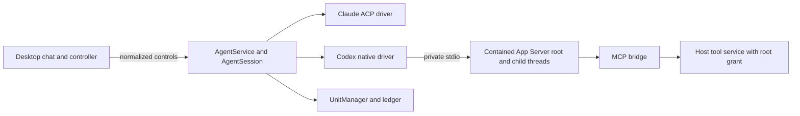
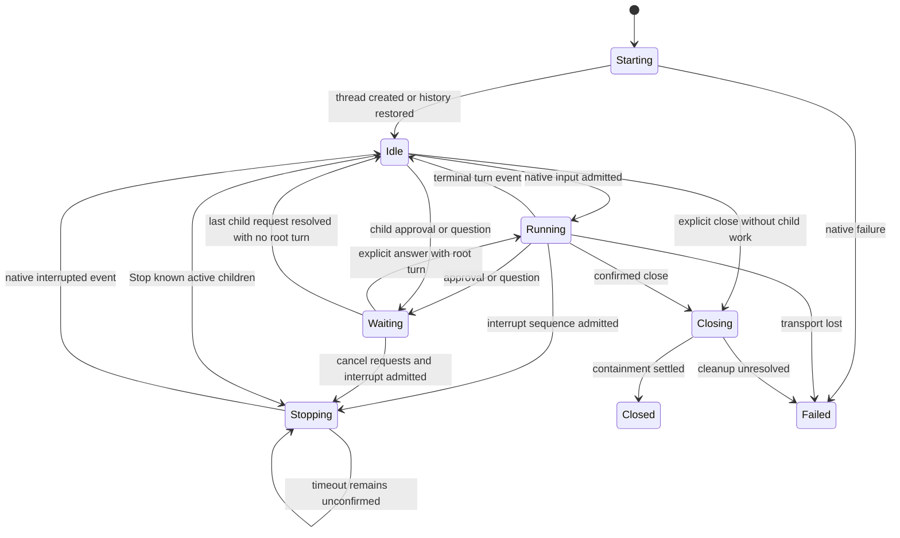
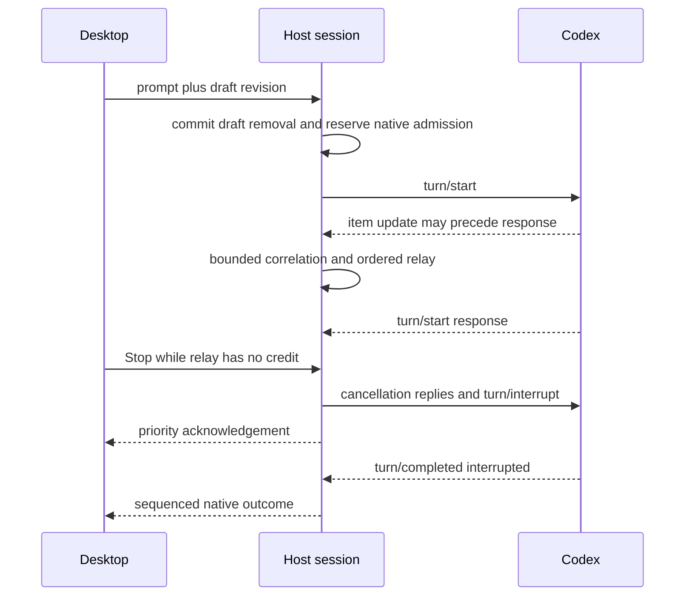
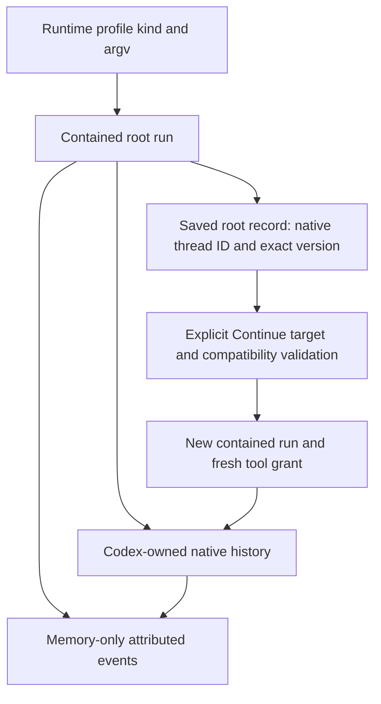

# Design

## Triage

| Trigger | Applies? | Evidence |

|---|---|---|

| T1 Components | Yes | AgentService, new native client, host-protocol and desktop controller have directed relationships |

| T2 State | Yes | Native turn, interaction and child identities; saved record compatibility |

| T3 Concurrency | Yes | Concurrent native requests, streamed events, drafts and containment settlement |

| T4 Boundaries | Yes | Native JSON-RPC and additive desktop-host DTOs; ADR amendment |

| T5 Volume | Yes | Native output, history, child trees and pending requests grow |

| T6 Risk | Yes | Explicit permissions, tool secrets, immutable targets and provider charges |

TIER: FULL

## Context

See proposal.md for scope and approved departure from D6. Code repo and planning repo are `F:/Dev/Orca/Workspace/kumiko`; OpenSpec context reports no referenced stores.

Observed seams on main `1e00c00`: `packages/host/lib/src/agent/agent_service.dart:663` centralizes contained start/Continue, but constructs ACP session requests at :740. `agent_session.dart:72` stores an AcpClient directly. `qualification.dart:15` takes AcpInitialization and assumes ACP advertisements. `runtime_profile_service.dart:75` persists runtime kind as text. `packages/domain/lib/src/profile/profile.dart:116` already carries runtime kind, executable, argv and environment. `packages/desktop/lib/src/agent/runtime_profiles_dialog.dart:286` hard-codes claude-code. `agent_controller.dart:20` has Claude-only sign-in text. `acp/acp_client.dart:148` owns bounded bidirectional RPC, and :185 admits requests; its native vocabulary is ACP-specific. These are implementation changes, not merely another entry in a runtime list.

Read existing `agent-runtimes`, `agent-sessions`, `agent-tool-access` and desktop-host agent requirements in full. All unchanged requirements remain in force, especially draft deletion before dispatch, immutable target admission, sequenced priority control, failed-exit drain, explicit recovery and secret redaction. MODIFIED blocks retain existing scenarios.

### Research and evidence limits

- [OpenAI App Server](https://learn.chatgpt.com/docs/app-server): stdio JSON-RPC, initialize/initialized, thread/start/resume/read, turn/start/steer/interrupt, native requests and item notifications. App Server omits the usual JSON-RPC version member on the wire. Some APIs, including relationship filters, are experimental.

- [Native protocol sources](https://github.com/openai/codex/tree/main/codex-rs/app-server-protocol): version-specific request/event schemas and collaboration records. Protocol data is not an ACP capability advertisement.

- [Codex ACP subagents](https://github.com/agentclientprotocol/codex-acp/blob/v2.5.0/docs/subagent-sessions.md): child sessions are possible through negotiated unstable ACP additions; this is not a reason to claim ACP cannot show subagents.

- Local Tern installation reports codex-acp 2.5.0 and bundled Codex 0.165.0. This identifies a candidate, not a Kumiko qualification result. Orca and T3 local source show direct App Server child-process pipes; they were studied for behavior only. No source, constants, models or implementation structure is copied or ported.

- New official Python SDK uses App Server but adds a Python runtime; TypeScript SDK CLI automation is not the native Dart integration needed here. No external SDK is adopted.

The installed user-selected native executable reports codex-cli 0.166.0 (2026-11-10); minimum supported Codex is 0.166.0. Tern's older bundled runtime is research context only. During apply obtain the exact candidate executable's version and generated schemas, including experimental schema where required, before writing its mappings. Record the tested version and methods in the evidence document; neither binary hashes nor exact-version allowlists gate later versions. If that candidate lacks an essential method, stop that group and report the mismatch rather than silently changing the protocol or lowering the minimum. Upstream main documentation is explanatory, not proof that 0.166.0 implements every method it describes. No provider call is authorized by this planning run.

## Decisions

### D1: Direct Dart client within the execution host

- **Choice:** Native App Server uses private stdio. Define a runtime-driver interface at the AgentService/AgentSession seam for initialize, create, restore, prompt, steer, interrupt, answer and dispose. Drivers emit normalized typed events; session lifecycle stays shared. ACP retains its codec/claims and a Codex driver owns Codex semantics. Extract transport mechanics only when both drivers actually need them; do not route Codex through synthetic ACP methods.

- **Rejected:** Node/Python sidecar SDK, or ACP Codex wrapper. Both add a runtime/translation boundary and hide native features behind another release cycle. Duplicating the whole AgentService would duplicate cleanup and draft rules.

- **Reversal cost:** Medium; runtime driver boundaries localize protocol replacement.

### D2: One App Server per root conversation

- **Choice:** Each root launch reserves the existing unit/channel, revalidates target identity and starts through UnitManager. Native child threads share that unit and root grant; they are not independent Kumiko roots. No process survives root close, app exit or host loss. Foreground root completion does not imply child work ended: known active child work participates in busy/close/quit decisions. Codex may use an internal worktree, but it cannot retarget the root's Kumiko tools.

- **Rejected:** A shared App Server across root conversations; containment would no longer isolate one root's close/crash or immutable workspace authority.

- **Reversal cost:** High if process sharing changes later; requires a new containment ADR.

### D3: Runtime identity and compatible profiles

- **Choice:** Runtime kind selects protocol: claude-code -> ACP, codex -> App Server. Existing stored Claude rows keep their identifiers and meaning; no store migration is expected because kind is already text. Records use adapter identity `codex-app-server` plus verified exact Codex executable version, with native thread ID in nativeSessionId. Continue can select only the saved runtime kind; a missing original profile permits a compatible default or explicit compatible picker. Cross-kind fallback is refused.

- **Identity:** Resolve the exact native executable, query its --version through a separate contained, ledgered probe before spawning the App Server, bound the result and compare initialization's reported version when present. Probe cwd is the owner-only host profile directory, with no workspace config and no tool grant. It uses UnitManager and ledger admission, the selected executable with --version, and only resolution-essential environment. Settle it fully before admitting the App Server unit; timeout or host loss uses ordinary containment cleanup. Unknown, inconsistent or below-minimum version fails before thread creation. A valid newer version runs normally without an allowlist entry, special candidate mode or update to Kumiko. Record actual version, never the wrapper npm package version. The minimum-version schema defines the implemented contract. Codex features use supported fields/methods, explicit configuration and native errors; absence of exact-version evidence never disables them. Unknown additive fields/events are ignored or visibly unsupported, only malformed core contracts fail the run: initialize, thread start/resume, turn start/interrupt/completion, message/command/file items and approval requests. Missing or malformed optional contracts (child/collaboration metadata, steering, structured questions, elicitation, history paging and relationship filters) disable only that feature with a visible reason; child content follows the unknown-child path, and method-not-found disables that feature with its reason. Do not use mutating probes for discovery. Evidence records only what was observed, separately from runtime availability. Missing method errors downgrade the particular feature and remain visible. An empty store chooses Claude first if detected, otherwise Codex; adding Codex never changes an existing default. No fabricated advertised capabilities.

- **Discovery:** PATH native codex/codex.exe, then the user's npm global root's @openai/codex platform package native executable when its package metadata resolves a matching installed platform. Discovery is file-only, within the existing 2-second detection deadline; never run npm or Codex during detection. Read known npm global-root locations from install metadata/PATH shim locations only. Native file existence/executability is checked through the existing resolver. Other installs use explicit profiles. Do not scan Tern/Zed private paths, run .cmd/.bat through a shell, install packages, or overwrite the existing global profile default. Keep one existing global default; each launcher, New session/fresh recovery path and Continue filters by kind and prompts if it is incompatible.

- **Rejected:** Guess runtime from argv, import another application's install or apply the default regardless of kind.

- **Reversal cost:** Medium; durable runtime identity binds recovery, so legacy Claude rows are regression-tested.

### D4: Native turns, controls and drafts

- **Choice:** initialize precedes initialized and thread/start. turn/start returns an accepted turn identity; item and turn notifications determine progress and completion. Events can race responses, so one driver associates them by native thread/turn/item IDs and stages early events within the bounds below. Correlation registration occurs before the write can be observed. No control acknowledgement means native completion. A write failure is terminal even when its request already returned.

- **Stop:** Atomically admit cancellation replies for pending native interactions and turn/interrupt before publishing Stopping; saturation returns busy without partial admission. The shared Stop deadline starts after admission. Keep Stopping on timeout. Aggregate addressed turns into the existing four results: any unknown -> Stop not confirmed; once all end, any error -> Turn ended with an error after Stop, else any interrupted -> Stopped, else Finished before Stop. A late aggregate outcome replaces the timeout with the existing after-deadline suffix. Native interrupted terminal event proves success; a timeout stays visible, and only explicit close invokes containment termination. Root Stop addresses its root turn and known active descendant turns; unsupported descendant interruption is reported as Stop not confirmed with its child reason rather than claiming all work stopped.

- **Interactions:** Recognize command/file/additional-permission approvals, tool/requestUserInput and MCP elicitation only where candidate schema supports them. Preserve native decision values in opaque run-scoped tokens. For an ordinary command approval whose optional `availableDecisions` is absent or null, expose only the native one-shot `accept` and `cancel` choices, requiring an explicit user answer. Ordinary means `kind` absent or `command`, with `networkApprovalContext` and `additionalPermissions` absent or null; other command approval kinds and permission contexts do not use this fallback. File-change approvals carry no decision list in the minimum schema and are outside this command-only clarification; their existing native response semantics are not modified by it. Optional policy proposals never add persistent choices to the command fallback. An explicit nonempty valid command decision list remains authoritative, preserving its values and order exactly. A command decision list that is empty, is not a list, exceeds the shared permission-option bound or contains an entry that is neither a string nor a JSON object, and an absent or null list on a non-ordinary command approval, is visibly unavailable: reply native `decline` once, show a bounded notice, grant nothing and keep the run. This optional decision field is an explicit exception to D3's malformed-core failure rule; malformed required approval identity fields still fail the run. Well-formed decision values unknown to Kumiko in an explicit list are preserved verbatim. Never invent other allow/always choices or derive a persistent grant from the command fallback. Existing run/thread/turn/request fencing and lifecycle cancellation still apply. Structured questions get typed question/options/answer DTOs. Async questions carried as agent items are shown as forms only when schema/mapping is supported; their answers steer their originating turn, never a newer one. Retire interactions on native cancellation, turn completion, close or loss. Unknown server requests get method-not-found with a bounded visible notice and no automatic grant.

- **Approval clarification (owner-approved 2026-11-11):** The minimum native schema makes `availableDecisions` optional. The ordinary-command baseline above is native one-shot semantics, not permission to infer session-wide or policy-amending approval. The expanded approval scenario remains red until its absent/null, explicit-list and refusal cases pass after this amendment's design review. This amendment authorizes no additional real-runtime walk.

- **Complete decision display (owner-approved planning amendment 2026-11-11):** Attempt 6 identified option-name loss (406 bytes against the existing 256-byte cap), with no preview or envelope loss. For an explicit command decision list containing JSON objects, keep string decision names unchanged and give each object a neutral bounded label `Native option N`, where N is its one-based position in the original list. Append one `Native decisions: ` line containing the complete JSON-encoded ordered decision array to the existing command/cwd/reason preview. JSON encoding escapes embedded newlines; native strings/objects remain data, never rendered markup or interpreted commands. The desktop renders permission titles, previews and option names as plain selectable text with no fence or markup interpretation; no displayed byte is dropped or reinterpreted. This applies to permission display only, not transcript formatting. The preview and names pass through existing live/revoked-secret redaction before display. Opaque run-scoped tokens still hold the exact original response values and order, including unknown object shapes; never return the redacted display copy. Labels do not imply one-shot or persistent scope. JSON-object decisions are published with kind allow_always (the conservative persistent-scope classification), never allow_once; this changes no response value or grant. String decisions keep their existing kind mapping. Tests assert the kind of every object entry. If a redacted string name collides with a generated object label, refuse the entire request visibly with native cancel rather than show ambiguous buttons. No option is dropped, merged, shortened or selected automatically. String-only lists, ordinary absent/null defaults, file-change approvals and additional-permission requests retain their existing mapping. Keep title 4096 bytes, preview 16384 bytes, name 256 bytes, options 16 and encoded control 64 KiB. The unchanged final fidelity guard cancels with a bounded notice if the complete redacted display does not fit; a long string name still refuses. This is a layout change, not an increase in approval authority.

- **Qualification answer fence:** The helper must recognize the appended decision line without relaxing its exact canary/Stop command, cwd, root title, operation, no-truncation and one-answer checks. Parse only the canonical final JSON-array line, verify its ordered entries correspond one-to-one to displayed options (unchanged string names or indexed object names), reject extra/ambiguous lines and malformed layouts, and require exactly one literal string `accept` with the existing allow_once kind. Never select a JSON-object/policy/session decision by index or kind. Preserve the original strict two/three-line parser for string-only requests without the new section. Redacted, multiline or otherwise ambiguous data that prevents exact matching refuses visibly. No new prompts, commands, native approval policy, retries or persistent grants are authorized.

- **Steering:** Publish runId and native turnId in sequenced Running state before enabling Steer. Add agent/steer with runId, expectedTurnId, text and the existing draft revision/synced fields. It shares the existing serialized draft-removal/admission transaction, retains newer edits, commits one canonical user event only after native admission, and reports refusal without a new-turn fallback. Once native admission occurs, timeout/loss means outcome unknown: never automatically resend steering or a prompt. Ordinary Send remains idle-only. An explicit Steer action is available only with a real claim; it is not Enter's implicit behavior.

- **Rejected:** Treating turn/start response as completion, transcript polling, automatic retries, or replacing Stop with process kill.

- **Reversal cost:** Medium; shared DTOs are additive and capability-gated.

### D5: Native restoration and MCP are scoped to the run

- **Choice:** Saved panes launch nothing. Continue validates the saved root target and runtime compatibility, prepares a fresh MCP grant, initializes App Server, attaches the desktop event stream, and resumes the original thread. Read history through the candidate's supported native history API, preferring bounded paging when available. Non-paged replies must obey native line/display limits; oversize means resume unavailable with saved identity retained. Replay markers bracket history. Buffer live events during snapshot within the same relay budget, deduplicate native item IDs and then release live delivery. If a supposedly saved root is actively running, refuse continuation rather than adopt unknown work.

- **MCP:** Configure `mcp_servers.kumiko` only through a supported private stdin config request with the secret confined to that entry's env. The App Server's own environment, argv, on-disk config and unrelated child commands MUST NOT contain the secret. Read effective configuration before adding the entry: if a user/workspace already defines `kumiko`, or the candidate cannot prove its absence and isolated entry-env semantics, refuse tool delivery with a visible conflict/unavailable reason and revoke the unused grant. No merge-by-key overwrite. If safe runtime config is unsupported, chat can start with tools unavailable; never use a secret environment/argv/file fallback. Verify both that the bridge gets its secret and that an unrelated model-run command and another MCP entry do not. Entry env contains KUMIKO_TOOL_ENDPOINT, KUMIKO_TOOL_SECRET and KUMIKO_UNIT. After fixture runs and the separately approved real Windows walk, scan the files Codex wrote during the run (its home session, log and state files) and Kumiko's profile for the run secret. A match is a tool-delivery failure for that version: record it and refuse that configuration path. Fixture canaries check authored behavior; real-runtime scans establish Codex persistence behavior. Never log the secret or scan results containing it. `connected` still requires a successful host tool call. Native thread-start binding uses the existing creation deadline for pending grants; failed binding revokes the grant without a second thread/start.

#### Qualification audit budget (owner-approved 2026-11-11)

- **Manifest:** The default remains 16 MiB/file and 32 MiB total; the only opt-in preset is `large-native-home`, 256 MiB/file and 512 MiB total. Both keep 4096 files, four confined roots and the existing 4096-entry native-home metadata traversal bound. Preparation records `scan.auditProfile` (`default` or `large-native-home`), exact `scan.maxFiles`, `scan.maxFileBytes`, `scan.maxTotalBytes` and `scan.roots`. Top-level `profile` remains the Kumiko host profile directory, never a budget name. Omitting the prepare-only `--audit-profile` option records `default`; validate the option before creating workspace/profile artifacts and print the preset and all limits beside the manifest hash. A schema-2 manifest without `scan.auditProfile` is legacy and accepts only the original default numbers. Before consuming an attempt or starting host/provider work, reject unknown presets, changed/mismatched limits or roots inconsistent with the declared workspace/profile/native home. After validation, pass `scan.roots` itself to the scanner. `--walk` accepts no budget option; its sole budget authority is the exact owner-approved manifest.
- **Host binding:** `test/codex.audit.prepare` binds `auditProfile` once before any agent run or scan; omission means `default`. Unknown names, late changes and repeated preparation are refused. Legacy fixture scans without preparation retain the immutable default. `test/agent.stats` accepts no preset, numeric limit or budget override and must reject such keys rather than silently ignore them. Preparation echoes effective `auditProfile`, `maxFiles`, `maxFileBytes` and `maxTotalBytes`; the helper validates that echo before agent startup or content I/O and refuses a missing/mismatched echo. Every scan result repeats these effective fields. The helper compares every echo with the approved manifest; a missing/mismatched field makes the audit incomplete and `kumiko tool call` unverified, preserving any canary-match failure. Release hosts expose no audit/budget RPC or capability, even when test-preset environment variables or budget-bearing requests are supplied.
- **Reads and memory:** Use at most 1 MiB chunks plus a carry of canary length minus one byte, with peak scanner storage one chunk plus carry and constant-sized pattern/accounting state. Each request is at most the minimum of the chunk size, remaining per-file allowance and remaining aggregate allowance. Reserve before I/O; retain the full reservation when a read throws without a returned count. Report stable `scannedBytes`, returned `readBytes` and conservative `chargedBytes` separately, always satisfying `scannedBytes <= readBytes <= chargedBytes <= maxTotalBytes`. Read bytes of unstable files still consume allowance. Confirm EOF with unchanged post-read metadata and a zero-byte result from a read only when allowance remains. Exact-boundary stable completion needs no probe beyond the limit. A pre-read size above the per-file maximum is unread and incomplete; a file above the remaining aggregate allowance is read only to that allowance and incomplete for its outstanding bytes. After exhaustion, continue bounded metadata enumeration: stable empty files remain accounted without content I/O; nonempty or unknown-size candidates are outstanding and incomplete. This is a per-scan-call byte budget; the qualification walk issues exactly one actual scan and never retries it. It is not a time deadline; the existing request API has no scan deadline.
- **Matching and traversal:** A match in any chunk increments `matchedFiles` for that file even if the file later changes, throws or exhausts allowance. Reset carry at each file: a prefix and suffix in different files must not match. Match the ASCII canary's UTF-8 bytes; re-encoded copies such as UTF-16 are outside this detector. All roots preserve confinement and no-link-following rules. Directory entries are metadata-only traversal containers, not content files. Any link, junction or other non-regular leaf entry in any root adds an error and is never followed. Missing, unknown, unreadable or unstable bytes remain incomplete; no exclusions make a result clean. Concurrent writers in the shared native home may legitimately cause instability.
- **Verification seam and scope:** An internal stat/open/read seam in `tool_file_audit.dart` is injectable only by offline tests, never through RPC. Use owned synthetic files and deterministic faults for reservation failures, short reads and post-read instability. Preparing/reviewing this amendment and verifying fixtures authorizes no native-file content scan, provider walk or authentication experiment. A later walk requires separate approval of the exact manifest, stating the larger limits and that native history/state contents up to those limits are read in chunks without printing them. Preserve every prior manifest and failed/incomplete observation. No grants, approval policies, prompts, deadlines, retries, authentication settings or scan exclusions change.

- **Explicit native coverage (owner-approved planning amendment 2026-11-11):** Audit selection is independent of auditProfile and byte limits. Add prepare-only `--native-selection` and manifest `scan.nativeSelection`, with exactly `legacy` and `changed-artifacts-v1`. Omission records legacy; an old schema-2 manifest missing this field also means legacy, never broader coverage. Unknown/non-string values or --walk overrides fail before attempt claim, host/provider work or native content reads. Legacy keeps the existing known session/log/state selection and unknown-change errors exactly. Only a separately approved manifest explicitly naming changed-artifacts-v1 enables the following wider native-home metadata/changed-content scope. Print the selection with the limits and hash. Bind it once alongside auditProfile through test/codex.audit.prepare, with a closed two-key allowlist; echo nativeSelection at preparation and every scan, validate it before startup and in results, reject late/repeated bindings and all stats overrides. Legacy fixture defaults remain legacy. Release hosts expose no selection control or audit RPC. This extends the earlier Host binding paragraph with selection, not with an environment override or another budget.

- **Changed-artifact selection:** In changed-artifacts-v1, take bounded before/after no-follow metadata inventories of all ordinary native-home directories, including otherwise unclassified directories. Use iterative traversal, deduplicated confined paths and a global 4096-entry admission ceiling per inventory, including directories, files and duplicate candidates; at most 4096 retained metadata records. Stop upstream enumeration at the bound and report incomplete; no recursive stack or unbounded pending list. Before any App Server or prompt, preparation echoes baselineComplete and baselineErrorCount; the helper requires a complete, zero-error baseline for this mode, otherwise aborts before provider work without falling back to legacy. This preflight runs after the durable attempt claim and reads real native-home metadata only under that exact-manifest approval. An incomplete baseline consumes that approval, starts no App Server, prompt or provider work, and records an INCOMPLETE receipt with content-free baseline counters, the baseline-preflight stage and explicit no-provider/no-content-scan indicators. A further attempt needs a fresh exact-manifest approval; never move the metadata read ahead of approval or silently reuse the claim. A large shared home may legitimately fail this preflight: this amendment raises no metadata cap and promises no real qualification pass. Directory metadata is a container observation, never content or a reason to ignore descendants. Select each new/changed regular file by type/size/mtime/ctime comparison, including models_cache.json and descendants of formerly unclassified directories even when their parent's metadata is unchanged. Retain the legacy always-scan selection and additionally always scan .sqlite, -wal and -shm regular files at every depth (except protected leaves), as a deduplicated union, even when metadata compares equal. These are filename-family rules, not content-based database discovery. Unchanged ordinary files outside the always-scan union need no content read under the stated metadata-equality detector assumption. A directory metadata change adds no error by itself only after its full bounded descendant inventory is accounted for; removed entries, missing data, inventory instability, errors or truncation remain incomplete. Revalidate directory metadata around enumeration so concurrent membership changes cannot silently establish completeness.

- **Protected and unaccounted data:** In changed-artifacts-v1, leaves whose basename is auth.json or config.toml (Windows case-insensitive, elsewhere exact) are metadata-only at every depth, including if they would match an always-scan rule. A new/changed/removed protected entry remains an explicit incomplete error; do not read it, silently exclude it as clean or fall back to another selection. Other new/changed regular-file contents, including caches and files under unclassified directories, may contain private data and require explicit disclosure in the later exact-manifest approval. For changed-artifacts-v1, preparation prints a fixed disclosure beside the selection, limits and hash: all native-home metadata is inventoried; only the enumerated protected basenames are metadata-only; every other new/changed regular file, including caches and any other credential-bearing store, plus the always-scan union, is read in chunks into host memory and never printed; metadata-equality and ASCII/UTF-8 detector limits apply. The manifest scan.nativeScope carries this canonical disclosure and the helper checks it before claim; legacy retains its existing scope text and never prints the wider-mode disclosure. Before implementation, the minimum-version research record must list any other known credential/configuration filenames with exact-version evidence, and add each to the closed protected set and its tests. The current two-name list is the starting minimum, not a claim that no other credential stores exist. Update the canonical disclosure to enumerate the effective protected set; no RPC or CLI argument may supply arbitrary protected names. No implementation or real read may proceed on an unresolved known credential/configuration filename; research uses documentation/installed protocol material, never the real native-home contents in this planning step. No contents, arbitrary names, paths or hashes are printed. Keep finite content-free category counters; selected changed artifacts are accounted for by the same single scanner and unchanged read/charged/match rules. Unknown entries become accounted for only by complete inventories and stable selected reads, never by exclusion other than the stated metadata-equality assumption for ordinary files outside the always-scan union. Record this detector limit with the result alongside the existing ASCII/UTF-8-only matching limit; do not claim complete persistence detection for metadata-preserving writes to those other files. Byte exhaustion, oversize, symlink/junction/nonregular entries and unstable files still refuse completeness. This mode cannot retroactively clear attempt 6's two errors or any earlier result. Planning/review authorizes no metadata inventory of the real native home, content scan, provider call or authentication experiment.
- **Normal-home selection (owner-approved amendment 2026-11-12):** Attempts 7 and 8 showed that changed-artifacts-v1 cannot complete for the owner's normal native home. Attempt 8's content-free categories were 1 metadataLimit and 7 nonRegular. An owner-approved count-only listing found 13,116 non-link entries (3,956 directories) and 7 links/junctions. The 4096-entry inventory bound was inherited from the older file audit and was never measured against a real home. Add a third manifest value, `changed-artifacts-v2`; v1 keeps its exact recorded meaning for the consumed manifests. v2 is identical to v1 except for three points:
  1. The per-inventory admission ceiling and the retained metadata records are 65,536 entries, still counting directories, files, links and duplicate candidates. Storage is bounded by a counted string budget, not by an estimate per record. Every retained string is charged at its UTF-8 length: relative paths, deduplication keys, pending directory paths and link target text. The budget is 16 MiB per inventory, and both inventories together are capped at 32 MiB, because the baseline stays live while the after-run inventory is built. One relative path or link target over 4096 UTF-8 bytes is unadmitted. Exhausting either budget stops enumeration upstream and records a content-free `metadataStorage` error, so the audit is incomplete. Fixed per-record state (type, size, two timestamps, link kind) is at most 65,536 records per inventory and is not otherwise charged. v1 keeps its recorded 4096-entry bound and has no string budget. The scanner's 4096-file limit, its four roots and every byte limit are unchanged, and the content scanner still reads only selected files.
  2. In the native-home root only, a symlink or junction is recorded as a no-follow leaf. Its record holds its own type, its own metadata and its link target text. The target text is compared in host memory and never printed, persisted or hashed into output. A link that is present and identical in both inventories is accounted for. An added, removed or changed link, including a retarget or a type or metadata change, is an incomplete error. Links are never followed or read. Other non-regular entries (devices, pipes, sockets, unknown types) remain incomplete errors. Workspace and profile roots keep refusing every link.

     Link observation is a separate operation on the inventory I/O seam, `observeLink(path)`. Tests can inject it; it is never reachable through a host request. It returns the link kind (symlink or junction), its own attributes, its own creation and last-write times, and its target text, all without following the link.
     - **Windows:** the entry's own find-data record (attributes, times and reparse tag). Only the symlink and mount-point (junction) reparse tags are supported. Other reparse tags (for example app-execution aliases or cloud placeholders) are unsupported non-regular entries. The target text is the link's stored target.
     - **Other operating systems:** the no-follow observation is not implemented in this change, so every native-home link there stays an incomplete `nonRegular` error.
     - An observation that is unavailable, fails, returns an unsupported kind, or differs when observed again immediately after reading the target records a content-free `linkObservation` error. No exception text, path or target text is emitted.
     - A transition between link, file and directory at the same path is a changed entry.
  3. The disclosure adds two detector limits. Traversal through an unchanged link is excluded, so the link's target gets no coverage merely because the link is present; a target that is also reachable through an ordinary path inside the native home is still inventoried there. Link equality is established at the two observation times only, so a retarget restored between them is not detected. Other processes that write the native home during the walk, such as other Codex sessions, are not distinguishable from the walked run. Their changed files are read under the same rules, and their churn can make the audit incomplete. The approval must state that the owner pauses other Codex sessions for the walk. A canary match is still a failure wherever it came from.

  A protected link basename stays protected: a link named like a protected leaf is metadata-only and gets the same added/removed/changed rule. The `--native-selection` and `nativeSelection` values admit legacy, v1 and v2. Echoes, once-only binding, release denial, baseline preflight and the INCOMPLETE receipt are unchanged and apply to v2. The manifest's canonical v2 disclosure differs from v1's, and the helper checks it before the claim.

- **Socket entries (owner-approved amendment 2026-11-12):** Attempt 9 (v2) stopped at the baseline with only 2 `nonRegular` errors. An owner-approved metadata-only diagnostic found them to be two Unix-domain sockets (`.sock`, one folder below the native-home root). On Windows an AF_UNIX socket is a reparse point with the AF_UNIX tag; Dart lists it as a link and types it `unixDomainSock` without following links. Sockets have no readable contents, so there is nothing to scan. Add a fourth manifest value, `changed-artifacts-v3`. v2 keeps its recorded meaning for the consumed attempt-9 manifest. v3 is identical to v2 except:
  1. On Windows, in the native-home root only, an entry typed `unixDomainSock` is observed through the same `observeLink` seam. It is supported only when its own find-data record has the reparse-point attribute and the AF_UNIX reparse tag. Its record holds its own attributes and creation and last-write times, with no target. It is never opened, connected to, followed or read, and it charges only its relative path against the string budget; v3 keeps v2's 65,536-entry bound and retained-string budget. Acquisition reads the find-data record, never a target, then reads it again immediately; an unavailable, failed, non-AF_UNIX or differing observation is a content-free `linkObservation` error. Other operating systems keep every socket a `nonRegular` error.
  2. A socket present in both inventories with identical metadata is accounted for (`socketsAccounted`). A socket added, removed or with changed metadata is counted in a content-free `socketsChanged` selection counter and does not make the audit incomplete, because a socket carries no bytes a canary could be in. Nothing about it (name, path, extension) is emitted.
  3. A socket at a protected leaf name follows the protected rule: unchanged is metadata-only, added, removed or changed is a `protectedEntry` error. A transition between a socket and a file, directory or link at the same path is a changed entry and an incomplete error.
  4. Windows acquisition is verified against a real AF_UNIX socket the test binds itself in an owned short temporary folder (Dart's `ServerSocket.bind` with a Unix address works on Windows when the path is at most about 108 bytes; a test-only native binding helper is allowed if it does not). If the machine cannot bind one, the test records a skip and the Windows acquisition coverage stays unverified; injected find-data records alone never satisfy it.
  5. The disclosure adds: Unix-domain sockets in the native home are recorded without being opened, and an added, removed or changed socket is counted but not scanned, because it has no contents. Pipes, devices and unknown types stay `nonRegular` errors.

  The `--native-selection` and `nativeSelection` values admit legacy, v1, v2 and v3. Echoes, once-only binding, release denial, baseline preflight and the INCOMPLETE receipt apply to v3 unchanged; the helper checks v3's canonical disclosure before the claim.

- **Removed entries and approval-match diagnostic (owner-approved amendment 2026-11-12):** Attempt 10 (v3) had a complete baseline. Launch, streaming and tool activity passed, and the scan found 0 canary matches. It stayed incomplete for two reasons. First, 5 `removedEntry` errors: baseline entries gone after the run, most likely the native runtime's own temporary or lock files. Second, the helper refused the canary command approval as `outside-approved-request`. Its diagnostic could not say which check failed.
  1. Add a fifth manifest value, `changed-artifacts-v4`. v3 keeps its recorded meaning for the consumed attempt-10 manifest. v4 is identical to v3 except that an entry present in the baseline and absent after the run is counted in a content-free `removedEntries` selection counter and does not make the audit incomplete, when it is not protected. This applies to a file, directory, link or socket. Protected means a file, link or socket at a protected leaf name. A removed entry has no bytes left on disk, so it cannot persist a canary. A canary moved elsewhere is caught there, because the destination is a new or changed file and is scanned, or a protected leaf and an error. A removed protected entry stays a `protectedEntry` error. Removal never hides another error: a traversal, metadata, storage or admission error that leaves entries out of the after-run inventory is still recorded in its own category and keeps the audit incomplete. The disclosure adds: a removed non-protected entry is counted but not scanned, because no content remains, and a removed protected entry still makes the audit incomplete. Every other v3 rule, bound and detector limit is unchanged.
  2. The qualification helper's command-approval refusal diagnostic gains one boolean per match check, still with no text, path, command, option name or decision value. The checks are: valid operation; configured command is a string without CR or LF; preview present; preview layout of two or three lines plus at most one decisions line; command line equals the approved command; working directory equals the manifest workspace; optional reason line well formed; decisions line valid JSON in canonical form; decisions consistent one-to-one with the options; exactly one `accept` option of kind allow_once. Where the command differs, it also records whether the observed command line contains the approved command and whether it starts with it. It records the preview line count and option count as small integers. The existing title and truncation fields stay. The diagnostic is observational only and never takes part in option selection. The match rule itself is unchanged: a request that fails any check is still refused, and no check is relaxed by this diagnostic.

  The `--native-selection` and `nativeSelection` values admit legacy, v1, v2, v3 and v4, with the same echo, binding, release denial, baseline preflight, INCOMPLETE receipt and canonical-disclosure check.

- **Rejected:** Replaying prompts, persisting transcript text, inheriting stale grant credentials or putting secrets on the command line.

- **Reversal cost:** Medium; retain existing native history and root identity instead of inventing a history format.

### D6: Child identity now, full browser later

AgentSession publishes a bounded delegated-activity summary (active child count, waiting child requests, incomplete flag) in sequenced agent/state. Close confirmation, exit-dialog membership and labels, and Stop availability read only that state, never the event channel. The Codex driver supplies child facts; AgentSession is the sole summary publisher. An incomplete registry cannot imply no delegated work; it keeps the close/quit warning conservative until native evidence or root settlement resolves it. Keep the existing per-grant bridge connection cap; do not assume Codex shares one MCP client across threads.

- **Choice:** Add optional root/child/parent native IDs to the normalized event envelope and a child lifecycle event. Native item keys include thread ID. Maintain one per-root child registry from authoritative collaboration/source metadata; never infer parentage from names. Before relationship metadata, bounded output is held for attribution; if metadata cannot be obtained, emit an unknown-child notice, withhold unattributable content and keep processing control. Render a root delegated-activity card with child task/status and omission notices. Preserve attributed child content in the bounded live event stream/model for later presentation, but do not build child panes, a tree browser, child prompts, targeted child Stop or child history persistence now.

- **Restoration:** Rebuild child relationships from native history/metadata only as available. Missing/evicted history yields incomplete/disconnected, not fabricated completion. The future browser can query native child threads; it must not depend on Kumiko storing transcripts. Child tools retain root role and immutable target, never claim child-specific authority. Child approvals/questions appear in the root with child identification.

- **Rejected:** Flatten all child output into root text; lose identity now and later parse display text. Also rejected: shipping the complete subagent viewer within this first runtime integration.

- **Reversal cost:** High for identity if omitted now; low for later UI layout.

### D7: Qualification and rollout

- **Choice:** Keep Claude qualification rows/checks unchanged. Add `docs/qualification/codex-app-server.md`, with one recorded section per protocol/name/exact version/OS. Required observations are launch/streaming, tool activity, command approval, Stop, close/descendant containment, `kumiko tool call`, and auth-required (pass with observed signature or explicitly unverified). Optional observations are recovery, steering, structured question and child attribution; every claimed optional observation needs its own result. The checker requires all required rows in each recorded section and rejects missing rows, invented passes, unsigned auth classifications or conflicting failure text. It prints `CODEX OBSERVATIONS: <version> <OS>: PASS | INCOMPLETE | FAIL`, never a Codex ACCEPTED/QUALIFIED admission claim. PASS means all required observations pass; unverified required items yield INCOMPLETE; failures yield FAIL. At M2 close, a Windows section for the then-installed version must have all required observations passing; this milestone evidence requirement does not impose a runtime allowlist or disable later installed versions.
- **Failure diagnostics:** A literal `toolDeliveryFailures` entry for (`codex-app-server`, exact version, observed text) starts that version's tools unavailable with its reason. A later observed successful call still wins, as in ADR 0013. It is not a runtime-admission allowlist. The generic tool-delivery spec requires a call row for every recorded Codex evidence section, preserving the existing Claude rules. Extend the checker with backward-compatible Claude parsing and native observations, not semver qualification ranges.
- **Rollout:** Fixture coverage uses ordinary production services through the existing test-host extension; release builds cannot accept candidate overrides. A separately approved real Windows walk records observations. Missing observations remain unverified and do not disable supported runtime features. Linux/macOS remain unproven until observed. Confirmed auth signatures apply to every admitted Codex version; version metadata identifies the observation, not a sign-in-guidance gate. Never reuse Claude's classifier.

- **Rejected:** Copy Claude qualification claims, allow semver ranges, or call passing fixture tests real Codex qualification.

- **Reversal cost:** Low for evidence tooling, medium for new claims.

## Diagrams (FULL)

### T1: Components

### T2: Turn state

Child activity is orthogonal to root turn state: the close/quit busy predicate includes known running children even while the root is Idle.

### T3: Concurrent native control and output

### T4: Durable references and recovery

## State & Ownership (FULL)

| State | Owner (sole writer) | Lifetime | Invalidation / rebuild | Authoritative copy |

|---|---|---|---|---|

| Profile kind, argv and default | RuntimeProfileService | Durable | Explicit edit/remove | Local store |

| Saved root identity | AgentService | Durable | Never retarget; explicit new record | Local store |

| Native thread and history | Codex | Runtime-owned durable history | Native retention/failure | Native store |

| Native correlation/write admission | Runtime driver | One live run | Failure/close invalidates all IDs | Host memory |

| Root state, sequence and requests | AgentSession | One run | Native terminal/loss retires requests | Host memory |

| Delegated-activity summary | AgentSession (fed by Codex driver) | One run | Recomputed from child registry; reset on loss | Host memory |
| Child relationships and item keys | Codex driver | One run/replay | Rebuild from native facts; mark unknown | Host memory |

| Transcript and child events | Desktop controller | One pane run | Bounded eviction, visible omission | Host event order; desktop display copy |

| Drafts | Existing DraftStore worker | Until send/clear | Existing revision/reset rules | drafts.sqlite |

| Per-run bridge grant | ToolService | One run | Revocation on settlement/loss | Host memory |

| Evidence claims | Checked-in qualification records | Version/OS-specific | New evidence, never inferred | Reviewed evidence plus registry |

## Failure & Visibility (FULL)

| Component | Fails / dies mid-operation | Recovery | Retry safe? | Who finds out |

|---|---|---|---|---|

| Discovery/version probe | Missing, hung, inconsistent or below-minimum identity | Probe is ledgered and killed/settled on timeout; unresolved cleanup refuses launch via existing gate | Explicit retry after cleanup | Launcher diagnostic |

| Native transport | EOF, malformed known message, write error | Fail run; shared drain/settlement | No auto resend | Failed pane with bounded redacted error |

| Unsupported method/request | Missing optional method or unknown privileged request | Feature unavailable; deny unknown request | Explicit only | Notice/control error |

| Thread creation succeeds, record write fails | Native orphan ID may exist | Settle unit; do not prompt; report start failure | New session can leave native empty history | User; no fake saved record |

| History restoration | Missing history, oversize or timeout | Keep immutable record; settle failed run | Explicit Continue only | Resume unavailable |

| MCP configuration/bridge | Cannot apply safe run environment or bridge fails | Tools unavailable, revoke unused grant | Explicit new run | Tools status with reason |

| Child discovery | Unknown relation or overflow | Incomplete/unknown notice | Native fact refresh only | Root activity card |

| Desktop/host | Connection loss or crash | Existing containment and next-start reconciliation | Continue only after cleanup gate | Saved/unknown and cleanup UI |

| Draft worker | Timeout or commit failure | Existing unavailable/reset flow | Refuse before native send | Composer reason |

## Resource Bounds (FULL)

The existing architecture/ADR 0012 bounds remain normative for shared facilities; do not duplicate them in a new transport. In particular use the same event encoding/display limits, native-line/large-line gate, pending-control/write budgets, control latency contract, channel credit, transcript eviction, stderr redaction ring, unit/workspace admission and settlement deadlines. Codex cannot allocate independent unbounded buffers behind these limits.

| Queue / buffer / cache / transfer | Bound | At the bound | Timeout | At 10x / 100x |

|---|---|---|---|---|

| New version probe | Separate UnitManager agent unit in owner-only host profile directory, no workspace cwd/config, profile environment stripped to executable resolution needs, no tool grant; settle before App Server launch; 1 per start; 4 KiB combined retained output; counted in start admission | Refuse oversize or saturation | 5 seconds | Unit admission limits concurrent probes |

| Native pending requests | 32 per run, aggregate serialized bytes charged to existing native write bound | busy before mutation | 60 active seconds for startup/history; 10 seconds for steer/interaction acknowledgements | No growing request list |

| Root model turn | One foreground turn per root | Send disabled; explicit steer only | No arbitrary model-generation deadline | Same admission at all volumes |

| Early native correlation | 64 messages and 256 KiB per root, charged to relay budget | Fail malformed/unresolvable flood visibly | 5 seconds after native response deadline | Cannot accumulate orphan events |

| Child registry | 64 children per root; identity strings use existing identity bound | Mark delegated visibility incomplete; withhold extra child content | Run lifetime | Work may continue natively, UI never claims full coverage |

| Unknown child attribution | 32 messages and 256 KiB per root, charged to relay | Unknown-child notice, withhold content; do not reassign | 5 seconds | Memory bounded; control keeps working |

| Kumiko bridge connections per root grant | Existing 4 authenticated connections (`tool_service.dart:14`) | Further bridges refused busy; root shows child-tools-unavailable notice without changing root tools status | Run lifetime | No per-child unbounded connections |
| Pending user interactions | 16 per root including children, total encoded payload charged to existing control budget | Reply unavailable/cancel natively and show capacity notice; untracked-child approvals are refused with child ID and unknown attribution, never reassigned or granted | User may wait; native ack bound above | Bounded state even for request floods |

| History and child refresh | One read in flight per root; at most 50 items/page where supported; native reply bounded by shared line cap | Backpressure or visible resume unavailable | Startup/history active deadline above | Page lazily; no all-history collection |

| Item deduplication | 4096 keys per root including child thread IDs | Evict oldest with replay/display truncation marker; never replay already emitted snapshot boundary | Run lifetime | Bounded window; snapshot cursor prevents duplicate pages |

| Test-only retained-grant file audit | Per scan: default 16 MiB/file, 32 MiB total; explicit large-native-home 256 MiB/file, 512 MiB total; 4096 files and four confined roots; native-home metadata traversal 4096 entries (legacy and changed-artifacts-v1) or 65,536 entries with a 16 MiB per-inventory and 32 MiB combined retained-string budget (changed-artifacts-v2, v3 and v4). Content storage: one <=1 MiB chunk plus canary-length-minus-one carry and constant pattern/accounting state; no whole-file allocation. Host preset bound once and echoed before use and in results | Pre-read per-file oversize is unread/incomplete; remaining aggregate allowance bounds partial reads; exact-boundary stable completion succeeds; outstanding bytes/errors are incomplete; observed match always fails; remaining metadata enumeration stays bounded | Byte bounds only; no scan-request deadline. One scan per approved walk, no automatic scan retry | No content I/O beyond selected allowance; larger or unstable data stays incomplete, never relabeled clean |

At protocol response saturation, application acknowledgements still follow existing control bounds. A stalled native pipe cannot guarantee remote completion. Codex JSON-RPC shares one native stream: once its output reader is paused behind transcript credit, later native responses can be delayed. Stop admission/desktop acknowledgement must remain independent; remote timeout is honest. Tests must distinguish those guarantees.

## Flow & State Gaps (FULL)

- Start/Continue has one owner through the existing reservation path. Duplicate Continue is refused synchronously; record persistence happens after native ID validation and before exposing a usable pane.

- Recheck the resolved exact executable before version probe and spawn; if it changed, refuse rather than qualify one executable and run another. The initial implementation checks file identity/metadata, not a security guarantee against a malicious same-user replacement.

- Do not let native completion before turn/start response race a second turn: correlation commits the active turn once, records terminal state once and ignores duplicate/stale outcomes. Unknown thread notifications cannot mutate another root.

- Control notices include run identity and sequence; delayed events from a prior run cannot resurrect controls or modify the replacement transcript. Snapshot/live merge uses item identities and a native-history boundary; fail visibly if the candidate cannot supply a trustworthy boundary.

- Rejected native input admission leaves the root Idle and draft intact. A late draft commit that exceeded its deadline follows existing draft recovery; it never dispatches the abandoned input.

- Native prompt or steer timeouts after admission never retry automatically. Tell the user the outcome is unknown and preserve evidence; avoid claiming safe retry if a tool may have run.

- Root terminal event can coexist with running children. Retain child interactions/activity and include them in exit confirmation; Stop is available while known descendant work exists even with no active root turn.

- Only known native child relationships inherit this root grant. Native child worktree paths are informational, not authorization. Child-root confusion cannot change the host ToolGrant target.

- On leader exit retire interactions immediately, then use shared accepted-event drain and final event count before release. Close during drain dismisses data through the existing path; unresolved descendants retain cleanup ownership.

- Root close cancels controls, revokes grants and settles the unit, including active descendants. Native child completion never proves process settlement.

- Existing Claude profile IDs, qualification evidence, saved rows and draft ownership remain valid. An unavailable Codex capability never disables Claude or terminals.

## Mechanism Ledger (FULL)

| Mechanism | Built? | Why | Evidence that would change the call |

|---|---|---|---|

| Runtime driver seam | Yes | Existing AgentSession stores AcpClient; native semantics otherwise leak everywhere | No second protocol would remove need |

| Shared bounded wire mechanics | Only concrete reusable subset | Two codecs need framing/admission, not a plugin framework | Duplication proven in implementation |

| Root run/turn/request fencing | Yes | Replies race completion and Continue, causing wrong-turn writes | Required shared/security interface |

| Child IDs and composite item keys | Yes | Later viewer cannot recover identity from root strings | Expensive shared contract to omit |

| Child browser/control UI | No | User agreed foundations and later viewing | Separate scoped proposal |

| Automatic runtime install/update | No | Native setup user-owned | Separate owner decision |

| Whole-schema Dart generator | No | Large maintenance task beyond required methods | Repeated manual schema drift would justify tooling |

| Schema contract checks | Yes | Native protocol has version-specific shapes | Minimum-version contract and forward-compatibility tests |

| Automatic native retries | No | Prompt/steer may execute side effects | Proven idempotent operation only |

| Transcript persistence in Kumiko | No | Native history is authoritative; privacy contract forbids it | Separate approved storage decision |

## Risks / Trade-offs

- Native protocol evolution -> candidate schema and negative fixtures, a minimum version and runtime feature handling, explicit unsupported diagnostics.

- No turnkey Dart SDK -> own a narrow typed client; use existing containment/admission lifecycle and authored mappings, never port another app's client.

- Subagent details can be incomplete -> stable attribution, unknown/omitted states and future native-history reads; no completeness claim without evidence.

- Shared native output can delay native interruption completion -> bound buffers and distinguish local control acknowledgement from observed remote result.

- Safe per-run MCP environment may differ by candidate -> validate config schema and environment behavior before claiming tools; no secret argv fallback.

- Windows-first evidence -> retain synthetic cross-platform tests and label real Linux/macOS results unverified.

## ADRs

In force: ADR 0001 containment/ledger, 0002 protocol bounds, 0003 persistence, 0004 runtime identity, 0005 authorization, 0012 transport/qualification, 0013 tool bridge and 0014 drafts. Their unchanged decisions continue to apply.

To record during apply: `docs/adr/0015-native-codex-app-server-and-child-identity.md`, Status proposed until its reviewed decision is recorded, then accepted with date. Supersedes ADR 0004's Codex-through-ACP/runtime-family choice only; refines ADR 0012's initialization and process wording and supersedes its exact-version admission/feature-gating rule for Codex only, following the owner's 2026-11-10 minimum-version decision. Refines ADR 0005 decision 2 and ADR 0013 decisions 7/8/12 for native private configuration and thread-start grant binding, retaining entry-only secret isolation. Amends ADR 0014 decision 1 to include known active children in close/quit affected work. It preserves immutable targets, truthful version-specific observations and containment. Claude exact-version capability gating remains unchanged. Accepted ADR files remain byte-identical.

The ADR's Context is the approved native integration and future child inspection requirement. Its Decision is D1-D7 above: direct Dart/stdin-stdout, one contained process per root, explicit protocol identity and qualification, native controls/history, root-scoped MCP, and retained child attribution. Consequences are SDK independence at the cost of owning native compatibility, with medium reversal cost for drivers and high cost for root identity/process-sharing changes. Rejected alternatives are ACP Codex, external SDK sidecar and shared App Server. The same task updates the architecture component graph, contracts, resource rows and ADR index with this limited supersession; retain ADR 0004/0012 rows annotated with their still-in-force scope.

The architecture document remains unchanged during planning, as required by the installed design schema; the new decision and its complete scope are reviewed here before the apply task records it.

## Implementation sequence amendment (2026-11-10)

The owner approved revising task order and reviewing this amendment before
implementation resumes. Inspection found that `_AgentIO` constructs `AcpClient`
and `AgentSession` directly consumes ACP notifications and prompt results.
Shared Codex startup therefore depends on the driver seam, runtime-kind routing,
native mapping and negotiated peer gates together. A standalone contained-client
test cannot establish shared startup admission or channel release.

Preserve completed group 1 and its task IDs. The remaining dependency order is:

1. Bounded native wire client and reusable mechanics, tested independently of
   production startup. No production Codex launch is exposed by this group.
2. Additive protocol DTOs and refusal gates before any Codex spawn. Codec and
   Connection-pair tests establish gates and stale-control rejection without
   claiming successful native startup or complete end-to-end scenarios.
3. Shared host integration: test-host scripting, contained version probe,
   profile detection/routing, native driver mapping and root controls. Test
   startup failure, unit/channel release and probe cleanup through AgentService,
   not a parallel test-only start path. Implement these interdependent foundations
   in one group, with failing tests before each corresponding behavior.
4. Desktop launcher, compatible profile choices, native guidance, forms and
   explicit steering after the host path is usable. Host profile filtering is
   checked in the previous group; UI selection is checked here; full Continue
   history is checked with recovery in the next group.
5. Native recovery and isolated MCP delivery, then child attribution/lifecycle,
   then qualification and the separately approved real Windows walk.

This changes sequencing and task boundaries only. D1-D7, every scenario, resource
bound and refusal remains in force. Test-map rows remain red until their full
named verification passes; an earlier codec or primitive test cannot turn a
later end-to-end row green. Keep the test-only/release capability fence from the
first fixture addition. Until safe MCP delivery is established, use the reviewed
tools-unavailable behavior without minting or leaking a usable bridge secret.
Known child work must follow the reviewed attribution/refusal rules as soon as
its native events can arrive; the later child group completes registry, summary
and lifecycle behavior, never authorizes flattening or automatic approval during
the earlier root-only work. The release fixture fence and peer gates cannot wait
for later UI or qualification work.

## Open Questions

No unresolved product or architecture choice. Candidate API spelling/config validation, probe outcomes and real qualification results are bounded implementation checks with explicit refusal behavior above, not permission to change scope or claim success. A missing required candidate API reopens the affected decision before implementation continues.

