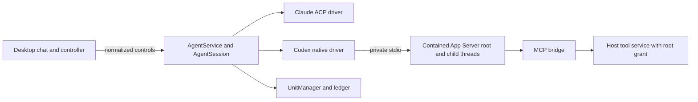
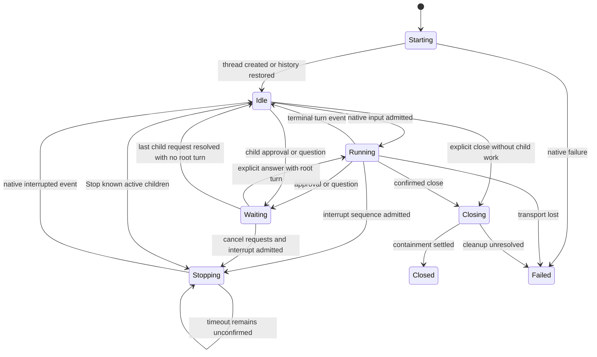
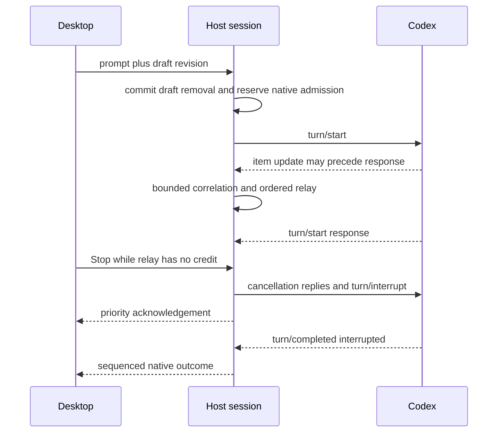
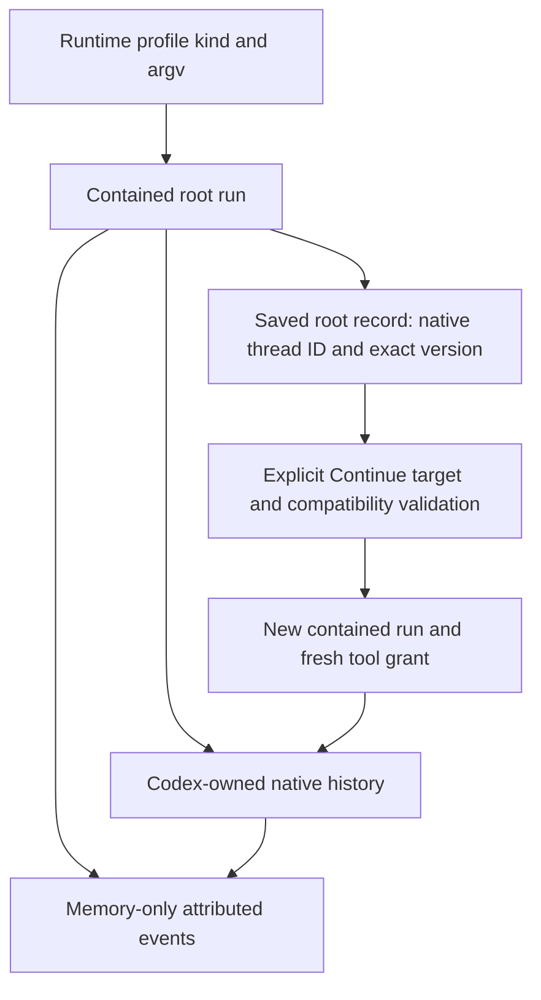

# Design

## Triage

| Trigger | Applies? | Evidence |

|---|---|---|

| T1 Components | Yes | AgentService, new native client, host-protocol and desktop controller have directed relationships |

| T2 State | Yes | Native turn, interaction and child identities; saved record compatibility |

| T3 Concurrency | Yes | Concurrent native requests, streamed events, drafts and containment settlement |

| T4 Boundaries | Yes | Native JSON-RPC and additive desktop-host DTOs; ADR amendment |

| T5 Volume | Yes | Native output, history, child trees and pending requests grow |

| T6 Risk | Yes | Explicit permissions, tool secrets, immutable targets and provider charges |

TIER: FULL

## Context

See proposal.md for scope and approved departure from D6. Code repo and planning repo are `F:/Dev/Orca/Workspace/kumiko`; OpenSpec context reports no referenced stores.

Observed seams on main `1e00c00`: `packages/host/lib/src/agent/agent_service.dart:663` centralizes contained start/Continue, but constructs ACP session requests at :740. `agent_session.dart:72` stores an AcpClient directly. `qualification.dart:15` takes AcpInitialization and assumes ACP advertisements. `runtime_profile_service.dart:75` persists runtime kind as text. `packages/domain/lib/src/profile/profile.dart:116` already carries runtime kind, executable, argv and environment. `packages/desktop/lib/src/agent/runtime_profiles_dialog.dart:286` hard-codes claude-code. `agent_controller.dart:20` has Claude-only sign-in text. `acp/acp_client.dart:148` owns bounded bidirectional RPC, and :185 admits requests; its native vocabulary is ACP-specific. These are implementation changes, not merely another entry in a runtime list.

Read existing `agent-runtimes`, `agent-sessions`, `agent-tool-access` and desktop-host agent requirements in full. All unchanged requirements remain in force, especially draft deletion before dispatch, immutable target admission, sequenced priority control, failed-exit drain, explicit recovery and secret redaction. MODIFIED blocks retain existing scenarios.

### Research and evidence limits

- [OpenAI App Server](https://learn.chatgpt.com/docs/app-server): stdio JSON-RPC, initialize/initialized, thread/start/resume/read, turn/start/steer/interrupt, native requests and item notifications. App Server omits the usual JSON-RPC version member on the wire. Some APIs, including relationship filters, are experimental.

- [Native protocol sources](https://github.com/openai/codex/tree/main/codex-rs/app-server-protocol): version-specific request/event schemas and collaboration records. Protocol data is not an ACP capability advertisement.

- [Codex ACP subagents](https://github.com/agentclientprotocol/codex-acp/blob/v2.5.0/docs/subagent-sessions.md): child sessions are possible through negotiated unstable ACP additions; this is not a reason to claim ACP cannot show subagents.

- Local Tern installation reports codex-acp 2.5.0 and bundled Codex 0.165.0. This identifies a candidate, not a Kumiko qualification result. Orca and T3 local source show direct App Server child-process pipes; they were studied for behavior only. No source, constants, models or implementation structure is copied or ported.

- New official Python SDK uses App Server but adds a Python runtime; TypeScript SDK CLI automation is not the native Dart integration needed here. No external SDK is adopted.

The installed user-selected native executable reports codex-cli 0.166.0 (2026-11-10); minimum supported Codex is 0.166.0. Tern's older bundled runtime is research context only. During apply obtain the exact candidate executable's version and generated schemas, including experimental schema where required, before writing its mappings. Record the tested version and methods in the evidence document; neither binary hashes nor exact-version allowlists gate later versions. If that candidate lacks an essential method, stop that group and report the mismatch rather than silently changing the protocol or lowering the minimum. Upstream main documentation is explanatory, not proof that 0.166.0 implements every method it describes. No provider call is authorized by this planning run.

## Decisions

### D1: Direct Dart client within the execution host

- **Choice:** Native App Server uses private stdio. Define a runtime-driver interface at the AgentService/AgentSession seam for initialize, create, restore, prompt, steer, interrupt, answer and dispose. Drivers emit normalized typed events; session lifecycle stays shared. ACP retains its codec/claims and a Codex driver owns Codex semantics. Extract transport mechanics only when both drivers actually need them; do not route Codex through synthetic ACP methods.

- **Rejected:** Node/Python sidecar SDK, or ACP Codex wrapper. Both add a runtime/translation boundary and hide native features behind another release cycle. Duplicating the whole AgentService would duplicate cleanup and draft rules.

- **Reversal cost:** Medium; runtime driver boundaries localize protocol replacement.

### D2: One App Server per root conversation

- **Choice:** Each root launch reserves the existing unit/channel, revalidates target identity and starts through UnitManager. Native child threads share that unit and root grant; they are not independent Kumiko roots. No process survives root close, app exit or host loss. Foreground root completion does not imply child work ended: known active child work participates in busy/close/quit decisions. Codex may use an internal worktree, but it cannot retarget the root's Kumiko tools.

- **Rejected:** A shared App Server across root conversations; containment would no longer isolate one root's close/crash or immutable workspace authority.

- **Reversal cost:** High if process sharing changes later; requires a new containment ADR.

### D3: Runtime identity and compatible profiles

- **Choice:** Runtime kind selects protocol: claude-code -> ACP, codex -> App Server. Existing stored Claude rows keep their identifiers and meaning; no store migration is expected because kind is already text. Records use adapter identity `codex-app-server` plus verified exact Codex executable version, with native thread ID in nativeSessionId. Continue can select only the saved runtime kind; a missing original profile permits a compatible default or explicit compatible picker. Cross-kind fallback is refused.

- **Identity:** Resolve the exact native executable, query its --version through a separate contained, ledgered probe before spawning the App Server, bound the result and compare initialization's reported version when present. Probe cwd is the owner-only host profile directory, with no workspace config and no tool grant. It uses UnitManager and ledger admission, the selected executable with --version, and only resolution-essential environment. Settle it fully before admitting the App Server unit; timeout or host loss uses ordinary containment cleanup. Unknown, inconsistent or below-minimum version fails before thread creation. A valid newer version runs normally without an allowlist entry, special candidate mode or update to Kumiko. Record actual version, never the wrapper npm package version. The minimum-version schema defines the implemented contract. Codex features use supported fields/methods, explicit configuration and native errors; absence of exact-version evidence never disables them. Unknown additive fields/events are ignored or visibly unsupported, only malformed core contracts fail the run: initialize, thread start/resume, turn start/interrupt/completion, message/command/file items and approval requests. Missing or malformed optional contracts (child/collaboration metadata, steering, structured questions, elicitation, history paging and relationship filters) disable only that feature with a visible reason; child content follows the unknown-child path, and method-not-found disables that feature with its reason. Do not use mutating probes for discovery. Evidence records only what was observed, separately from runtime availability. Missing method errors downgrade the particular feature and remain visible. An empty store chooses Claude first if detected, otherwise Codex; adding Codex never changes an existing default. No fabricated advertised capabilities.

- **Discovery:** PATH native codex/codex.exe, then the user's npm global root's @openai/codex platform package native executable when its package metadata resolves a matching installed platform. Discovery is file-only, within the existing 2-second detection deadline; never run npm or Codex during detection. Read known npm global-root locations from install metadata/PATH shim locations only. Native file existence/executability is checked through the existing resolver. Other installs use explicit profiles. Do not scan Tern/Zed private paths, run .cmd/.bat through a shell, install packages, or overwrite the existing global profile default. Keep one existing global default; each launcher, New session/fresh recovery path and Continue filters by kind and prompts if it is incompatible.

- **Rejected:** Guess runtime from argv, import another application's install or apply the default regardless of kind.

- **Reversal cost:** Medium; durable runtime identity binds recovery, so legacy Claude rows are regression-tested.

### D4: Native turns, controls and drafts

- **Choice:** initialize precedes initialized and thread/start. turn/start returns an accepted turn identity; item and turn notifications determine progress and completion. Events can race responses, so one driver associates them by native thread/turn/item IDs and stages early events within the bounds below. Correlation registration occurs before the write can be observed. No control acknowledgement means native completion. A write failure is terminal even when its request already returned.

- **Stop:** Atomically admit cancellation replies for pending native interactions and turn/interrupt before publishing Stopping; saturation returns busy without partial admission. The shared Stop deadline starts after admission. Keep Stopping on timeout. Aggregate addressed turns into the existing four results: any unknown -> Stop not confirmed; once all end, any error -> Turn ended with an error after Stop, else any interrupted -> Stopped, else Finished before Stop. A late aggregate outcome replaces the timeout with the existing after-deadline suffix. Native interrupted terminal event proves success; a timeout stays visible, and only explicit close invokes containment termination. Root Stop addresses its root turn and known active descendant turns; unsupported descendant interruption is reported as Stop not confirmed with its child reason rather than claiming all work stopped.

- **Interactions:** Recognize command/file/additional-permission approvals, tool/requestUserInput and MCP elicitation only where candidate schema supports them. Preserve offered native decision values in opaque run-scoped tokens; never manufacture allow/always choices. Structured questions get typed question/options/answer DTOs. Async questions carried as agent items are shown as forms only when schema/mapping is supported; their answers steer their originating turn, never a newer one. Retire interactions on native cancellation, turn completion, close or loss. Unknown server requests get method-not-found with a bounded visible notice and no automatic grant.

- **Steering:** Publish runId and native turnId in sequenced Running state before enabling Steer. Add agent/steer with runId, expectedTurnId, text and the existing draft revision/synced fields. It shares the existing serialized draft-removal/admission transaction, retains newer edits, commits one canonical user event only after native admission, and reports refusal without a new-turn fallback. Once native admission occurs, timeout/loss means outcome unknown: never automatically resend steering or a prompt. Ordinary Send remains idle-only. An explicit Steer action is available only with a real claim; it is not Enter's implicit behavior.

- **Rejected:** Treating turn/start response as completion, transcript polling, automatic retries, or replacing Stop with process kill.

- **Reversal cost:** Medium; shared DTOs are additive and capability-gated.

### D5: Native restoration and MCP are scoped to the run

- **Choice:** Saved panes launch nothing. Continue validates the saved root target and runtime compatibility, prepares a fresh MCP grant, initializes App Server, attaches the desktop event stream, and resumes the original thread. Read history through the candidate's supported native history API, preferring bounded paging when available. Non-paged replies must obey native line/display limits; oversize means resume unavailable with saved identity retained. Replay markers bracket history. Buffer live events during snapshot within the same relay budget, deduplicate native item IDs and then release live delivery. If a supposedly saved root is actively running, refuse continuation rather than adopt unknown work.

- **MCP:** Configure `mcp_servers.kumiko` only through a supported private stdin config request with the secret confined to that entry's env. The App Server's own environment, argv, on-disk config and unrelated child commands MUST NOT contain the secret. Read effective configuration before adding the entry: if a user/workspace already defines `kumiko`, or the candidate cannot prove its absence and isolated entry-env semantics, refuse tool delivery with a visible conflict/unavailable reason and revoke the unused grant. No merge-by-key overwrite. If safe runtime config is unsupported, chat can start with tools unavailable; never use a secret environment/argv/file fallback. Verify both that the bridge gets its secret and that an unrelated model-run command and another MCP entry do not. Entry env contains KUMIKO_TOOL_ENDPOINT, KUMIKO_TOOL_SECRET and KUMIKO_UNIT. After fixture runs and the separately approved real Windows walk, scan the files Codex wrote during the run (its home session, log and state files) and Kumiko's profile for the run secret. A match is a tool-delivery failure for that version: record it and refuse that configuration path. Fixture canaries check authored behavior; real-runtime scans establish Codex persistence behavior. Never log the secret or scan results containing it. `connected` still requires a successful host tool call. Native thread-start binding uses the existing creation deadline for pending grants; failed binding revokes the grant without a second thread/start.

- **Rejected:** Replaying prompts, persisting transcript text, inheriting stale grant credentials or putting secrets on the command line.

- **Reversal cost:** Medium; retain existing native history and root identity instead of inventing a history format.

### D6: Child identity now, full browser later

AgentSession publishes a bounded delegated-activity summary (active child count, waiting child requests, incomplete flag) in sequenced agent/state. Close confirmation, exit-dialog membership and labels, and Stop availability read only that state, never the event channel. The Codex driver supplies child facts; AgentSession is the sole summary publisher. An incomplete registry cannot imply no delegated work; it keeps the close/quit warning conservative until native evidence or root settlement resolves it. Keep the existing per-grant bridge connection cap; do not assume Codex shares one MCP client across threads.

- **Choice:** Add optional root/child/parent native IDs to the normalized event envelope and a child lifecycle event. Native item keys include thread ID. Maintain one per-root child registry from authoritative collaboration/source metadata; never infer parentage from names. Before relationship metadata, bounded output is held for attribution; if metadata cannot be obtained, emit an unknown-child notice, withhold unattributable content and keep processing control. Render a root delegated-activity card with child task/status and omission notices. Preserve attributed child content in the bounded live event stream/model for later presentation, but do not build child panes, a tree browser, child prompts, targeted child Stop or child history persistence now.

- **Restoration:** Rebuild child relationships from native history/metadata only as available. Missing/evicted history yields incomplete/disconnected, not fabricated completion. The future browser can query native child threads; it must not depend on Kumiko storing transcripts. Child tools retain root role and immutable target, never claim child-specific authority. Child approvals/questions appear in the root with child identification.

- **Rejected:** Flatten all child output into root text; lose identity now and later parse display text. Also rejected: shipping the complete subagent viewer within this first runtime integration.

- **Reversal cost:** High for identity if omitted now; low for later UI layout.

### D7: Qualification and rollout

- **Choice:** Keep Claude qualification rows/checks unchanged. Add `docs/qualification/codex-app-server.md`, with one recorded section per protocol/name/exact version/OS. Required observations are launch/streaming, tool activity, command approval, Stop, close/descendant containment, `kumiko tool call`, and auth-required (pass with observed signature or explicitly unverified). Optional observations are recovery, steering, structured question and child attribution; every claimed optional observation needs its own result. The checker requires all required rows in each recorded section and rejects missing rows, invented passes, unsigned auth classifications or conflicting failure text. It prints `CODEX OBSERVATIONS: <version> <OS>: PASS | INCOMPLETE | FAIL`, never a Codex ACCEPTED/QUALIFIED admission claim. PASS means all required observations pass; unverified required items yield INCOMPLETE; failures yield FAIL. At M2 close, a Windows section for the then-installed version must have all required observations passing; this milestone evidence requirement does not impose a runtime allowlist or disable later installed versions.
- **Failure diagnostics:** A literal `toolDeliveryFailures` entry for (`codex-app-server`, exact version, observed text) starts that version's tools unavailable with its reason. A later observed successful call still wins, as in ADR 0013. It is not a runtime-admission allowlist. The generic tool-delivery spec requires a call row for every recorded Codex evidence section, preserving the existing Claude rules. Extend the checker with backward-compatible Claude parsing and native observations, not semver qualification ranges.
- **Rollout:** Fixture coverage uses ordinary production services through the existing test-host extension; release builds cannot accept candidate overrides. A separately approved real Windows walk records observations. Missing observations remain unverified and do not disable supported runtime features. Linux/macOS remain unproven until observed. Confirmed auth signatures apply to every admitted Codex version; version metadata identifies the observation, not a sign-in-guidance gate. Never reuse Claude's classifier.

- **Rejected:** Copy Claude qualification claims, allow semver ranges, or call passing fixture tests real Codex qualification.

- **Reversal cost:** Low for evidence tooling, medium for new claims.

## Diagrams (FULL)

### T1: Components

### T2: Turn state

Child activity is orthogonal to root turn state: the close/quit busy predicate includes known running children even while the root is Idle.

### T3: Concurrent native control and output

### T4: Durable references and recovery

## State & Ownership (FULL)

| State | Owner (sole writer) | Lifetime | Invalidation / rebuild | Authoritative copy |

|---|---|---|---|---|

| Profile kind, argv and default | RuntimeProfileService | Durable | Explicit edit/remove | Local store |

| Saved root identity | AgentService | Durable | Never retarget; explicit new record | Local store |

| Native thread and history | Codex | Runtime-owned durable history | Native retention/failure | Native store |

| Native correlation/write admission | Runtime driver | One live run | Failure/close invalidates all IDs | Host memory |

| Root state, sequence and requests | AgentSession | One run | Native terminal/loss retires requests | Host memory |

| Delegated-activity summary | AgentSession (fed by Codex driver) | One run | Recomputed from child registry; reset on loss | Host memory |
| Child relationships and item keys | Codex driver | One run/replay | Rebuild from native facts; mark unknown | Host memory |

| Transcript and child events | Desktop controller | One pane run | Bounded eviction, visible omission | Host event order; desktop display copy |

| Drafts | Existing DraftStore worker | Until send/clear | Existing revision/reset rules | drafts.sqlite |

| Per-run bridge grant | ToolService | One run | Revocation on settlement/loss | Host memory |

| Evidence claims | Checked-in qualification records | Version/OS-specific | New evidence, never inferred | Reviewed evidence plus registry |

## Failure & Visibility (FULL)

| Component | Fails / dies mid-operation | Recovery | Retry safe? | Who finds out |

|---|---|---|---|---|

| Discovery/version probe | Missing, hung, inconsistent or below-minimum identity | Probe is ledgered and killed/settled on timeout; unresolved cleanup refuses launch via existing gate | Explicit retry after cleanup | Launcher diagnostic |

| Native transport | EOF, malformed known message, write error | Fail run; shared drain/settlement | No auto resend | Failed pane with bounded redacted error |

| Unsupported method/request | Missing optional method or unknown privileged request | Feature unavailable; deny unknown request | Explicit only | Notice/control error |

| Thread creation succeeds, record write fails | Native orphan ID may exist | Settle unit; do not prompt; report start failure | New session can leave native empty history | User; no fake saved record |

| History restoration | Missing history, oversize or timeout | Keep immutable record; settle failed run | Explicit Continue only | Resume unavailable |

| MCP configuration/bridge | Cannot apply safe run environment or bridge fails | Tools unavailable, revoke unused grant | Explicit new run | Tools status with reason |

| Child discovery | Unknown relation or overflow | Incomplete/unknown notice | Native fact refresh only | Root activity card |

| Desktop/host | Connection loss or crash | Existing containment and next-start reconciliation | Continue only after cleanup gate | Saved/unknown and cleanup UI |

| Draft worker | Timeout or commit failure | Existing unavailable/reset flow | Refuse before native send | Composer reason |

## Resource Bounds (FULL)

The existing architecture/ADR 0012 bounds remain normative for shared facilities; do not duplicate them in a new transport. In particular use the same event encoding/display limits, native-line/large-line gate, pending-control/write budgets, control latency contract, channel credit, transcript eviction, stderr redaction ring, unit/workspace admission and settlement deadlines. Codex cannot allocate independent unbounded buffers behind these limits.

| Queue / buffer / cache / transfer | Bound | At the bound | Timeout | At 10x / 100x |

|---|---|---|---|---|

| New version probe | Separate UnitManager agent unit in owner-only host profile directory, no workspace cwd/config, profile environment stripped to executable resolution needs, no tool grant; settle before App Server launch; 1 per start; 4 KiB combined retained output; counted in start admission | Refuse oversize or saturation | 5 seconds | Unit admission limits concurrent probes |

| Native pending requests | 32 per run, aggregate serialized bytes charged to existing native write bound | busy before mutation | 60 active seconds for startup/history; 10 seconds for steer/interaction acknowledgements | No growing request list |

| Root model turn | One foreground turn per root | Send disabled; explicit steer only | No arbitrary model-generation deadline | Same admission at all volumes |

| Early native correlation | 64 messages and 256 KiB per root, charged to relay budget | Fail malformed/unresolvable flood visibly | 5 seconds after native response deadline | Cannot accumulate orphan events |

| Child registry | 64 children per root; identity strings use existing identity bound | Mark delegated visibility incomplete; withhold extra child content | Run lifetime | Work may continue natively, UI never claims full coverage |

| Unknown child attribution | 32 messages and 256 KiB per root, charged to relay | Unknown-child notice, withhold content; do not reassign | 5 seconds | Memory bounded; control keeps working |

| Kumiko bridge connections per root grant | Existing 4 authenticated connections (`tool_service.dart:14`) | Further bridges refused busy; root shows child-tools-unavailable notice without changing root tools status | Run lifetime | No per-child unbounded connections |
| Pending user interactions | 16 per root including children, total encoded payload charged to existing control budget | Reply unavailable/cancel natively and show capacity notice; untracked-child approvals are refused with child ID and unknown attribution, never reassigned or granted | User may wait; native ack bound above | Bounded state even for request floods |

| History and child refresh | One read in flight per root; at most 50 items/page where supported; native reply bounded by shared line cap | Backpressure or visible resume unavailable | Startup/history active deadline above | Page lazily; no all-history collection |

| Item deduplication | 4096 keys per root including child thread IDs | Evict oldest with replay/display truncation marker; never replay already emitted snapshot boundary | Run lifetime | Bounded window; snapshot cursor prevents duplicate pages |

At protocol response saturation, application acknowledgements still follow existing control bounds. A stalled native pipe cannot guarantee remote completion. Codex JSON-RPC shares one native stream: once its output reader is paused behind transcript credit, later native responses can be delayed. Stop admission/desktop acknowledgement must remain independent; remote timeout is honest. Tests must distinguish those guarantees.

## Flow & State Gaps (FULL)

- Start/Continue has one owner through the existing reservation path. Duplicate Continue is refused synchronously; record persistence happens after native ID validation and before exposing a usable pane.

- Recheck the resolved exact executable before version probe and spawn; if it changed, refuse rather than qualify one executable and run another. The initial implementation checks file identity/metadata, not a security guarantee against a malicious same-user replacement.

- Do not let native completion before turn/start response race a second turn: correlation commits the active turn once, records terminal state once and ignores duplicate/stale outcomes. Unknown thread notifications cannot mutate another root.

- Control notices include run identity and sequence; delayed events from a prior run cannot resurrect controls or modify the replacement transcript. Snapshot/live merge uses item identities and a native-history boundary; fail visibly if the candidate cannot supply a trustworthy boundary.

- Rejected native input admission leaves the root Idle and draft intact. A late draft commit that exceeded its deadline follows existing draft recovery; it never dispatches the abandoned input.

- Native prompt or steer timeouts after admission never retry automatically. Tell the user the outcome is unknown and preserve evidence; avoid claiming safe retry if a tool may have run.

- Root terminal event can coexist with running children. Retain child interactions/activity and include them in exit confirmation; Stop is available while known descendant work exists even with no active root turn.

- Only known native child relationships inherit this root grant. Native child worktree paths are informational, not authorization. Child-root confusion cannot change the host ToolGrant target.

- On leader exit retire interactions immediately, then use shared accepted-event drain and final event count before release. Close during drain dismisses data through the existing path; unresolved descendants retain cleanup ownership.

- Root close cancels controls, revokes grants and settles the unit, including active descendants. Native child completion never proves process settlement.

- Existing Claude profile IDs, qualification evidence, saved rows and draft ownership remain valid. An unavailable Codex capability never disables Claude or terminals.

## Mechanism Ledger (FULL)

| Mechanism | Built? | Why | Evidence that would change the call |

|---|---|---|---|

| Runtime driver seam | Yes | Existing AgentSession stores AcpClient; native semantics otherwise leak everywhere | No second protocol would remove need |

| Shared bounded wire mechanics | Only concrete reusable subset | Two codecs need framing/admission, not a plugin framework | Duplication proven in implementation |

| Root run/turn/request fencing | Yes | Replies race completion and Continue, causing wrong-turn writes | Required shared/security interface |

| Child IDs and composite item keys | Yes | Later viewer cannot recover identity from root strings | Expensive shared contract to omit |

| Child browser/control UI | No | User agreed foundations and later viewing | Separate scoped proposal |

| Automatic runtime install/update | No | Native setup user-owned | Separate owner decision |

| Whole-schema Dart generator | No | Large maintenance task beyond required methods | Repeated manual schema drift would justify tooling |

| Schema contract checks | Yes | Native protocol has version-specific shapes | Minimum-version contract and forward-compatibility tests |

| Automatic native retries | No | Prompt/steer may execute side effects | Proven idempotent operation only |

| Transcript persistence in Kumiko | No | Native history is authoritative; privacy contract forbids it | Separate approved storage decision |

## Risks / Trade-offs

- Native protocol evolution -> candidate schema and negative fixtures, a minimum version and runtime feature handling, explicit unsupported diagnostics.

- No turnkey Dart SDK -> own a narrow typed client; use existing containment/admission lifecycle and authored mappings, never port another app's client.

- Subagent details can be incomplete -> stable attribution, unknown/omitted states and future native-history reads; no completeness claim without evidence.

- Shared native output can delay native interruption completion -> bound buffers and distinguish local control acknowledgement from observed remote result.

- Safe per-run MCP environment may differ by candidate -> validate config schema and environment behavior before claiming tools; no secret argv fallback.

- Windows-first evidence -> retain synthetic cross-platform tests and label real Linux/macOS results unverified.

## ADRs

In force: ADR 0001 containment/ledger, 0002 protocol bounds, 0003 persistence, 0004 runtime identity, 0005 authorization, 0012 transport/qualification, 0013 tool bridge and 0014 drafts. Their unchanged decisions continue to apply.

To record during apply: `docs/adr/0015-native-codex-app-server-and-child-identity.md`, Status proposed until its reviewed decision is recorded, then accepted with date. Supersedes ADR 0004's Codex-through-ACP/runtime-family choice only; refines ADR 0012's initialization and process wording and supersedes its exact-version admission/feature-gating rule for Codex only, following the owner's 2026-11-10 minimum-version decision. Refines ADR 0005 decision 2 and ADR 0013 decisions 7/8/12 for native private configuration and thread-start grant binding, retaining entry-only secret isolation. Amends ADR 0014 decision 1 to include known active children in close/quit affected work. It preserves immutable targets, truthful version-specific observations and containment. Claude exact-version capability gating remains unchanged. Accepted ADR files remain byte-identical.

The ADR's Context is the approved native integration and future child inspection requirement. Its Decision is D1-D7 above: direct Dart/stdin-stdout, one contained process per root, explicit protocol identity and qualification, native controls/history, root-scoped MCP, and retained child attribution. Consequences are SDK independence at the cost of owning native compatibility, with medium reversal cost for drivers and high cost for root identity/process-sharing changes. Rejected alternatives are ACP Codex, external SDK sidecar and shared App Server. The same task updates the architecture component graph, contracts, resource rows and ADR index with this limited supersession; retain ADR 0004/0012 rows annotated with their still-in-force scope.

The architecture document remains unchanged during planning, as required by the installed design schema; the new decision and its complete scope are reviewed here before the apply task records it.

## Open Questions

No unresolved product or architecture choice. Candidate API spelling/config validation, probe outcomes and real qualification results are bounded implementation checks with explicit refusal behavior above, not permission to change scope or claim success. A missing required candidate API reopens the affected decision before implementation continues.

