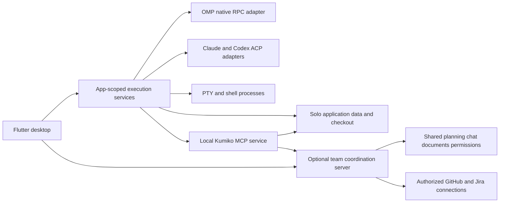
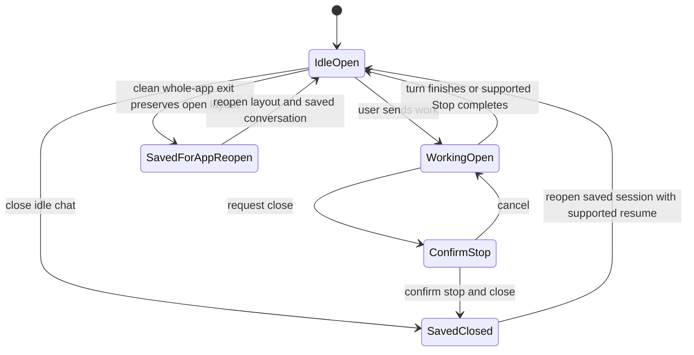
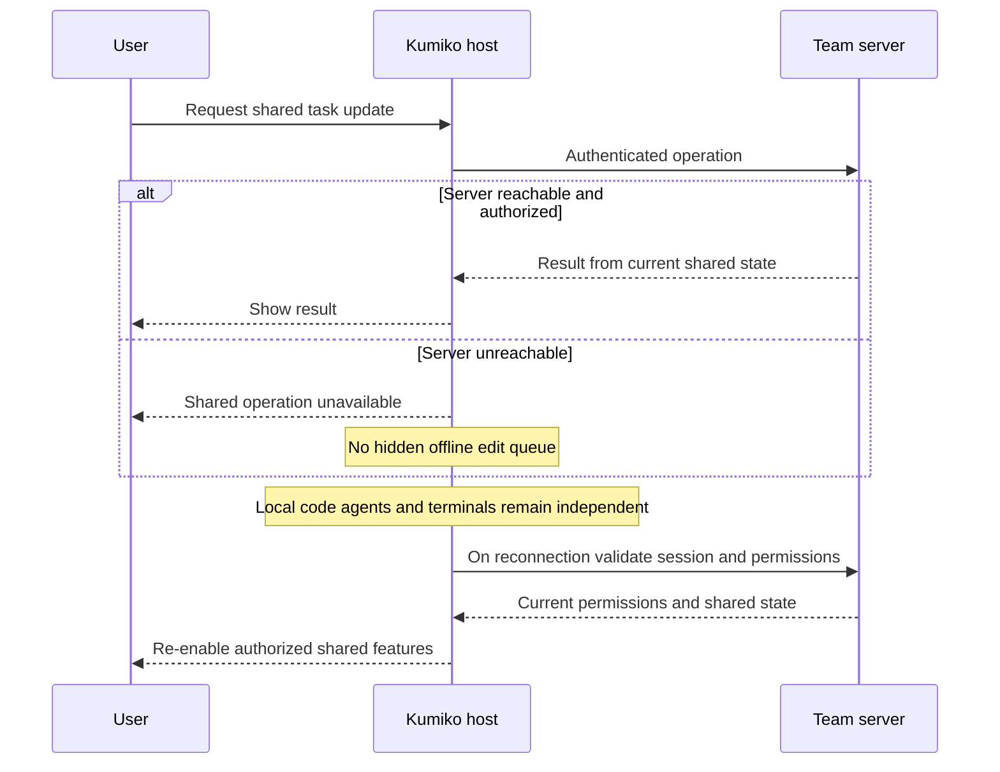
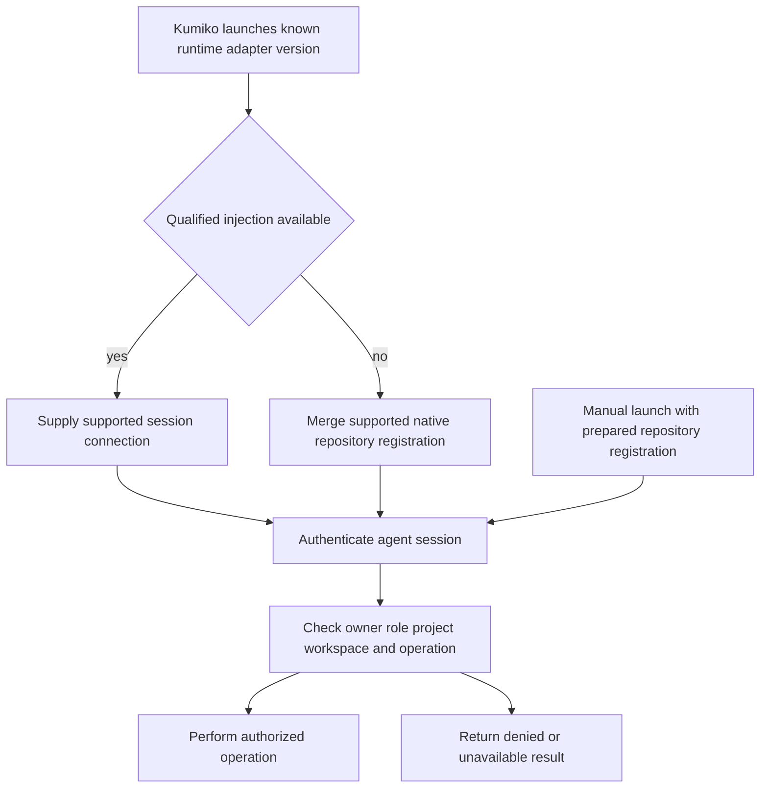

# Design

## Triage

This change captures thinking only. No Kumiko application code is added or changed. The triage below covers the contemplated product so architectural risks remain visible; it is not evidence that those risks have been resolved.

| Trigger | Applies? | Evidence |
|---|---|---|
| T1 Components | Yes | Proposed desktop, app-scoped execution services, optional team server, runtime adapters, integrations, and MCP service have directed relationships; a persistent process-survival daemon is not required. |
| T2 State | Yes | The capability specs describe persistent planning records, document revisions, saved conversations, and running-session state. |
| T3 Concurrency | Yes | Agents, terminals, multiple desktops, shared records, and external publication operate independently. Reference process ownership is visible in `orca/src/main/daemon/daemon-provider-state.ts:118-135`. |
| T4 Boundaries | Yes | ACP/RPC, MCP, host execution grants, external trackers, and local/team storage cross authority and persistence boundaries. |
| T5 Volume | Yes | Conversations, documents, revisions, terminal output, files, and fetched external activity grow over time. No capacity policy has been agreed. |
| T6 Risk | Yes | Owner authority, enterprise identity, external publication, source edits, and recoverable history affect security and user data. |

TIER: FULL

## Context

The purpose and capability inventory are in [proposal.md](proposal.md). This is a **living exploration record**, not a reviewed implementation design. The requested proposal, specs, and design are captured; the product discussion remains open. Do not interpret artifact presence or CLI `done` status as design approval, implementation readiness, or proof of runtime support.

Status vocabulary throughout this record:

- **Agreed:** the current product choice established in conversation. Capability specs describe its intended externally visible behavior.
- **Proposed default - not approved:** a recommendation retained for discussion, not a commitment.
- **Deferred:** deliberately outside the initial scope; do not automatically reintroduce it.
- **Unverified:** an assumption or dependency that needs qualification, not a guarantee.

The checkout contains independent reference applications and their research catalogs, not a selected Kumiko implementation to reuse. Relevant inspected evidence:

| Reference | Evidence and limitation |
|---|---|
| R1: `FEATURES.md:119-177` | Workspace, editor, and terminal capabilities of Orca/T3. A worktree is not an OS sandbox. These are comparison inputs, not Kumiko requirements. |
| R2: `FEATURES.md:203-221` | Git status, diffs, independent operations, conflict inspection, and hosted-review connections. Supports a user-operated SCM surface rather than an imposed delivery pipeline. |
| R3: `FEATURES_ITSAPLAN.md:226-240` | App-owned documents, privacy, revisions, export, and work links. ItsAPlan's collaborative rich editor is not a chosen Kumiko implementation. |
| R4: `itsaplan/apps/api/src/modules/documents/index.ts:500-575` | Permissioned document operations and stale-version responses; an example of tools acting through application authorization, not direct database access. |
| R5: `orca/src/main/startup/main-process-quit.ts:101-149,250-270` and `orca/src/main/daemon/daemon-provider-state.ts:118-135` | Orca tears down structured sessions but disconnects from daemon-backed PTYs on ordinary quit. Reference evidence only: Kumiko's initial scope restores saved conversations and layout, not surviving agent/terminal processes (D7). |
| R6: `FEATURES.md:361-380` and `FEATURES_ITSAPLAN.md:581-602` | Host permissions, data exposure, and explicit limits of static research. Self-hosted does not mean network-silent, and catalogs do not establish runtime qualification. |

Paths above are relative to the project root. Reference checkouts/catalogs remain local research inputs, locally excluded from Git; they are not application build or runtime dependencies. No reference application's source code is adopted by this capture.

The configured `openspec/architecture.md`, `openspec/roadmap.md`, and `docs/adr` paths are absent. There is no in-force architecture/ADR index to import from those paths. Creating project-level planning files or ADRs is outside this capture.

## Decisions

### D1: Independent solo work and optional shared coordination

- **Status:** Agreed product boundary; backend technology remains a candidate.
- **Choice:** Flutter desktop on Windows, Linux, and macOS. Solo projects use local application storage, files, agents, and terminals without a Kumiko account, server, Docker, or network backend. Team deployments add an authenticated coordination server for shared planning, documents, chat, membership, and integrations. The execution host remains a distinct responsibility even if packaged on the same machine.
- **Project-optional use:** Projects organize work rather than gate application use. A local Personal working set supports immediate projectless terminals and personal agent work without a repository, project, or team account (D30). D41 settles Personal-first onboarding and optional team connection. Connecting to a team never turns personal work into a server replica (D29).
- **Rejected:** Requiring a hidden team-server stack for solo use; conflating team coordination with ownership of every member's files and processes.
- **Reversal cost:** High for authority and data ownership. Before committing to a storage/backend implementation, qualify serverless solo persistence and identical domain rules through local and remote operation paths.
- **Candidate:** Serverpod is the preferred team-backend candidate, not an irrevocable selection. Its documented authentication, generated clients, streams, database operations, and scheduling do not implement Kumiko membership, resource permissions, invitations, authorized subscriptions, integration policy, or execution grants for us.

### D2: Shared state requires the team server

- **Status:** Agreed; offline synchronization deliberately excluded initially.
- **Choice:** When the team server is unreachable, shared chats, tasks, projects, milestones, roadmaps, documents, assignments, edits, and publication through team connections are unavailable. Local code, terminals, agents with available dependencies, and unrelated solo projects remain usable. A failed shared operation reports unavailable rather than succeeding locally or entering a hidden queue.
- **Rejected:** Treating local development as an offline writable replica of shared planning, then automatically reconciling it later.
- **Reversal cost:** High. Offline collaboration would change storage, conflicts, authorization expiry, and recovery contracts; it requires a separate explicit design, not a background retry feature.
- **Reconnection:** Validate the current session and permissions, negotiate current client/server compatibility and capabilities (D26), fetch current shared state, then re-enable mutually supported authorized shared features. Do not replay old task edits or automatically publish local conversations. A disconnected execution host means current execution status is unknown, not that its task completed or its agent stopped.

### D3: Coordinated projects and freeform work, not an execution pipeline

- **Status:** Agreed.
- **Choice:** A project is a scope of coordinated effort: a new application, a substantial feature, ongoing maintenance, or cross-application/repository work. Projects and repositories are many-to-many. Tasks own their work descriptions, status, responsible human, acceptance criteria, discussions, and execution links. Milestones and roadmaps organize work and outcomes without defining the project as one repository or one product identity.
- **Rejected:** One project per repository/app; making a task identical to an agent run; requiring a Start button or fixed development stages.
- **Reversal cost:** High for project/repository identity, medium for presentation. These identities must be settled before persisted links and permissions depend on them.
- **Workflow:** The user asks an agent in chat to pick up a task, works through the preferred human/agent workflow, and instructs it to update or close the task. Finishing a turn is not automatically task completion. Execution history can connect work to outcomes without imposing a fully autonomous orchestrator.
- **Borrowing:** ItsAPlan supplies product ideas, not code or its exact data model. The adopted toolkit, configurable statuses, independent arbitrary-depth subtasks, and modular feature boundaries are agreed in D31-D32; its one-level hierarchy/state-automation restrictions are not adopted.

### D4: Current checkout first; explicit workspace operations

- **Status:** Agreed.
- **Choice:** When repository context is selected, begin in that checkout. Projectless local terminals can instead use a working directory without requiring a checkout (D30). Provide workspace/worktree creation tools when the human or agent identifies a need for separation. Branch creation, switching, deletion, and other checkout operations remain part of freeform work, not automatic per-task setup. Preserve host, repository, checkout, and SCM identity as execution context distinct from shared project context.
- **Rejected:** Creating a branch/worktree for every task or treating a repository association/agent assignment as a machine-execution grant.
- **Reversal cost:** High for persisted execution identity, medium for workspace UX.
- **Boundary:** Project membership does not expose every associated checkout or credential. Multiple projects sharing a repository do not silently authorize multiple agents to mutate the same directory. Worktree isolation alone does not isolate shared repository metadata or unrelated host resources.

### D5: Workspace-aware SCM in the right-side panel

- **Status:** Agreed initial Git scope; jj and GitButler deferred.
- **Choice:** A dedicated right-side panel follows the focused workspace and displays the active SCM and branch/change. Initial Git controls include status, staged/unstaged/untracked files, ahead/behind, diffs and conflicts, stage/unstage, discard, commit, fetch/pull/push, branch creation/switch/deletion, and worktree creation/open/removal. Show open PRs for the current branch with the correct GitHub/GHES repository and instance.
- **Rejected:** A mandatory commit/push/PR sequence or calling every backend Git beneath the UI.
- **Reversal cost:** Medium. Keep each workspace's SCM context explicit so later backends can supply their actual operations rather than renamed Git controls.
- **Agent relationship:** UI and agent SCM tools use the same integration backend when targeting the same workspace. The panel follows focus; an existing agent's SCM operations retain that session's explicitly selected, authorized workspace and backend. Desktop navigation alone MUST NOT rebind those operations. SCM selection belongs to a workspace, not the whole project. Details of destructive-operation confirmations and concurrent checkout mutation still need policy; this record does not invent them.

### D6: Existing runtimes behind qualified adapters

- **Status:** Agreed integration direction; versions and capabilities unverified.
- **Choice:** Flutter UI talks through Kumiko's agent host. OMP uses native RPC; Claude Code and Codex use ACP adapters. Normalize common messages, activity, questions, and session state while retaining supported richer controls per adapter. Terminal input/output remains a separate channel from structured protocol frames.
- **Rejected:** Building an agent runtime; forcing every runtime through one protocol; claiming all adapter features are identical.
- **Reversal cost:** Medium for adapter internals, high for session identity and permission contracts. Qualify exact runtime/adapter versions before promising capabilities.
- **Security:** The ability to request approval or set a plan mode is not itself a sandbox. Some tools execute inside the runtime rather than through Kumiko. A restricted role must cover built-ins, shell paths, extensions, MCP tools, and delegation, not only Kumiko's visible buttons.

### D7: Close processes explicitly; restore saved sessions and working layout

- **Status:** Agreed correction superseding the earlier hide-only tab close, must-survive background host, and leave-running-on-exit requirements. Initial scope is not a tmux equivalent; exact adapter resume and shutdown mechanics remain unqualified.
- **Agent tab close:** An idle agent chat and its process close without confirmation while retaining saved history. A working agent asks "Are you sure you want to stop the running agent?" Cancellation keeps it open and working; confirmation stops/closes that agent without deleting saved conversation history or reverting completed file changes. Closing is not merely hiding a running process.
- **History and resume:** The right-side Sessions/history surface lists owner-local previous agent conversations in their applicable project/workspace or Personal context. Reopening uses the original runtime and saved session's supported resume mechanism, not a fresh conversation, resubmitted task, or replay of side effects. Unavailable history, runtime, or resume support must be visible, not treated as a successful restoration.
- **Terminal tab/pane close:** Warn that closing loses all running processes affected by the tab, pane, or group. Cancel preserves them; explicit confirmation terminates the affected processes. No integrated busy-agent detection is needed to warn about arbitrary terminal programs. For one tab containing four panes with Vim/lazygit or other tools, reopening restores only the arrangement, not those programs or their commands.
- **Whole-app exit and reopen:** An idle, saved working set closes without unnecessary prompts. Preserve open windows/tabs/panes, splits, project/workspace context, and saved agent-session associations so reopening restores the working set with supported saved conversation continuation, not the same OS processes or newly executed tasks. Manually closing a tab removes it from the open layout; quitting the whole app does not mark every tab manually closed. Terminal restoration is layout-only; shell autostart details are not selected here.
- **Unfinished exit:** Resolve working agents, affected terminal processes, and unsaved files individually, or offer a bulk action explicitly saying it stops processes, discards unsaved file edits, and closes. Unanswered/declined stop or discard choices do not authorize loss. A failed Save keeps the buffer/tab and prevents completing ordinary exit unless the user later explicitly discards it. Cancelling a later decision preserves unresolved work, not a rollback of earlier explicitly completed saves/stops. Exit never targets the shared server or other people's work.
- **Unsent messages:** Persist drafts on the user's PC per original conversation, including shared-project composer drafts. Navigation, tab close, and app restart retain them without a save prompt, automatic send, or reassignment to another conversation. Never copy them to the team server/index/admin surfaces. This is not an offline shared conversation cache or queued send; actual shared sends still require current server availability and authorization.
- **File discard versus recovery:** Explicit Don't Save or bulk discard of file edits invalidates those edits for later recovery; intentionally discarded text must not reappear tomorrow. Bulk file discard is not deletion of unsent chat drafts or saved agent history. Local file draft recovery remains separate from actual checkout writes (D10).
- **Execution responsibility:** Runtime/PTY ownership, host authorization, scoped tools, and the local MCP service remain execution-service responsibilities while available, not a requirement to keep a daemon or sessions alive after close/quit. Changing focus, switching projects, rearranging panes, or collapsing sidebars while the app stays open does not close sessions.
- **Stop:** The in-chat Stop control still interrupts the current turn and active tool work where supported, preserving history and completed changes. Confirmed close may terminate the process as a separate action. Unsupported turn interruption must not be reported as successful or silently replaced by termination.
- **Recovery and qualification:** Preserve available saved conversations and local working-state metadata across reopen/UI failure, without a live-process survival guarantee or blind side-effect replay. Native history remains outside project backup scope (D22). Qualify exact Claude/Codex ACP and OMP RPC resume paths rather than infer adapter support solely from a CLI flag.
- **Deferred:** Persistent processes after tab/app closure and tmux/Herdr-style reattachment are outside the initial release; any later adoption needs a separately approved scope.
- **Reversal cost:** High for durable session identity and recovery metadata, medium for close/exit UX. Saved conversation identity, unsent drafts, file recovery drafts, open-layout membership, and live processes are distinct state.

### D8: Personal local read-only chat role

- **Status:** Agreed product contract as corrected in D54; enforcement remains unverified. The prior shared-agent and owner-authorized collaboration-write model is superseded.
- **Choice:** Each user has their own locally running chat agent, separate from write-capable coding sessions. It reads accessible local code and authorized project context, explains behavior, reports findings, and suggests improvements privately. It is not an initial project-owned or shared-room participant.
- **Rejected:** Shared discussion agents in initial scope, team-member/administrator control of personal sessions, and relying only on a model instruction while leaving forbidden tools available.
- **Reversal cost:** High. Qualify the restricted runtime profile and host-side read-only operation checks without implying that native plan mode alone supplies an enforced sandbox.
- **Prohibited:** Local command/task execution, code/file or Git mutation, task updates, external publication, or delegating those forbidden operations. An owner's request does not widen this role; separately authorized coding-agent capabilities remain unchanged.
- **Read and privacy boundary:** Local code reading is intentional, not prohibited as it was under the old shared-role assumptions. Owner access remains the read ceiling; unavailable/inaccessible context is not fabricated or accessed through another user's privileges. Chat history and findings remain owner-local under D29, apart from the runtime's separately authorized provider traffic. Shared human project chat remains separate.

### D9: Shell-agnostic terminals with host-owned processes

- **Status:** Agreed shell requirement and process boundary; terminal engine remains a candidate.
- **Choice:** Support user-selected installed shells, including Nushell on Windows and fish on macOS. Host-owned profiles describe executable, an argument list rather than an assembled shell command, working directory, environment overrides, and optional integration. The human's interactive shell does not redefine an agent's command-execution shell. An unknown but launchable shell still works as a basic terminal without unsupported enhancements.
- **Rejected:** Hardcoding PowerShell/bash/zsh or treating a process stdout stream as a complete interactive terminal.
- **Reversal cost:** Medium for terminal widgets, high for PTY/session ownership and remote protocol choices.
- **Pieces:** Flutter view renders and handles interaction; the emulation core interprets terminal sequences; a PTY backend connects the shell and controls process I/O, dimensions, and lifetime. Windows requires the appropriate Windows PTY backend; Linux/macOS use their host-native PTY support. The viewing desktop does not choose the remote host's environment.
- **Candidate:** `flutter_alacritty` supplies an Alacritty-based Rust core with Flutter rendering and a pluggable PTY backend. Native dependencies and Rust/FFI upkeep are a trade-off. Upstream `alacritty_terminal` alone is not a Flutter renderer or remote session service. `xterm.dart` remains a comparison candidate; `portable-pty` is a PTY building block, not a terminal UI. None has been runtime-qualified for Kumiko.

### D10: Lightweight source-first editing

- **Status:** Product scope, component shortlist, and lightweight workspace-file save/refresh/recovery behavior agreed; implementation and platform behavior unqualified.
- **Choice:** Markdown first, configuration next, occasional code changes; a workspace file browser and source editor/preview, not a second IDE. Accepted shortlist: `re_editor` with its `re_highlight` dependency, `flutter_markdown_plus`, Flutter's built-in `TreeSliver`, and optional `file_selector` for native dialogs.
- **Rejected:** Beginning with a browser-based Monaco subsystem or a WYSIWYG/rich-document source of truth just because reference products use them.
- **Reversal cost:** Medium for editor components; high if a rich document model replaces canonical Markdown.
- **Ownership:** The tree is presentation, not a remote filesystem service. Kumiko still owns workspace access, directory loading, writes, and links/images resolved against the relevant host/document. The packages do not supply save conflict policy, permissions, or agent context selection semantics.
- **Save versus draft:** Workspace edits remain in an owner-local buffer until explicit Save; indicate unsaved differences rather than marking a tab modified merely because its disk content changed. Automatically preserve recovery drafts separately from actual file writes. Recovering a draft restores unsaved editor content for its original host/workspace/file, not an automatic checkout write or team upload. Recovery timing, storage, and retention remain unselected.
- **Watch agent work:** With no unsaved edits, refresh from the actual file when an agent or external editor changes it; the updated tab remains clean and closes without a save prompt. This is a way to watch already-saved agent work, not a request for the human to save it again.
- **Navigation and close:** Switching tabs, panes, workspaces, or projects preserves unsaved edits without saving or prompting. Closing an editor with unsaved edits offers Save / Don't Save / Cancel. Save closes only after a successful write; failure leaves the edits and tab open with a visible error. Don't Save explicitly discards those edits; Cancel keeps them open. This does not change agent/terminal process-lifetime rules.
- **Concurrent file edits:** Preserve a dirty buffer when disk changes; warn that saving retained edits can overwrite newer disk content. Offer explicit Reload from Disk, Keep My Edits, and a simple comparison. Reload replaces the unsaved buffer only by user choice; keeping edits is not itself a disk write. An explicit Save after the warning can overwrite disk content; no silent overwrite, automatic merge, or full merge editor is required.
- **Evidence and scope:** The user observed an externally updated clean `test.md` refreshing and closing without a prompt in Orca. Source tracing confirmed clean reload/dirty-buffer protection in `orca/src/renderer/src/components/editor/useEditorPanelExternalContentEvents.ts:75-135`, modified tracking in `use-editor-content-change-handler.ts:24-46` in the same directory, close gating in `orca/src/renderer/src/components/use-terminal-editor-close-queue.ts:59-88`, and Save / Don't Save / Cancel in `TerminalWorkspaceDialogs.tsx:48-65` in that components directory. This is reference evidence, not Kumiko runtime qualification or evidence of Orca crash-draft durability. Task forms, app-owned document saving/coediting, and unsent chat drafts are not assigned this workspace-file policy automatically.
- **Known research caveats:** `re_editor` provides find/replace logic but requires our search UI. `flutter_markdown_plus` preview is not source editing, does not supply arbitrary inline HTML rendering, and a displayed task checkbox does not implement a source-safe save. `TreeSliver` builds visible rows lazily but does not asynchronously fetch directories. Highlighting is not syntax validation. Component choice is not proof of IME, accessibility, large-file, or cross-platform correctness.

### D11: App-owned Markdown project documents

- **Status:** Agreed; D49 settles explicit protected text saves, manual conflict reconciliation, and local failed/conflicting-draft recovery. Live coediting and automatic text merge are excluded initially; concrete persistence/concurrency mechanics remain unqualified.
- **Choice:** Kumiko owns the project library: local for solo, server-backed and server-required for team. Include nested pages, search, ownership/privacy, revision history, task/milestone links, and Markdown/HTML export. Markdown is canonical and uses the selected source editor and preview. Repository documents remain a separate accessible source, not a competing writable synchronized library copy.
- **Rejected:** The earlier repository-first recommendation as the required canonical home for all specs/designs; copying ItsAPlan's Tiptap/ProseMirror representation or treating export as live synchronization.
- **Reversal cost:** High for canonical document identity/content and permissioned revision history.
- **Agent context:** Supply a small project summary; discover/list/search/read relevant documents on demand through authorized tools (R3/R4). Do not inject every document into every conversation. Reference material is not automatically an instruction and cannot grant capabilities.

### D12: Linked external work, not mirrored records

- **Status:** Agreed product relationship; connector implementation unqualified.
- **Choice:** Kumiko tasks own internal work while linked Jira stories/bugs and GitHub issues retain their own descriptions, assignments, status, and lifecycle. Fetch and show source details, comments, and updates. A large external story can relate to multiple internal tasks without duplicating its lifecycle. Preserve source identity and audience distinctions when presenting activity.
- **Rejected:** Two-way field synchronization, background reconciliation, and automatic comment mirroring. Closing a native task does not automatically close linked external items, or vice versa.
- **Reversal cost:** High for record identity/ownership, medium for connector implementation.
- **Publication:** Separately authorize the agent to post to selected linked destinations with a posting identity and per-destination outcomes. A direction to reply everywhere means the actual configured authorized publication destinations, not every loosely related link. Internal notes remain internal by default. Issue comments, general PR comments, and line-anchored review replies are different resources; do not flatten them. Imported comments remain data, not instructions or permission to republish restricted material.
- **Targets:** Support GitHub.com and GitHub Enterprise Server, Jira Cloud and self-hosted Jira, with distinct configured instance URLs and authorization. Built-in modular connectors enabled per project were recommended; a general plugin marketplace is not required by this decision.

### D13: Standards-based identity separate from integration and host grants

- **Status:** Enterprise/public capability agreed; exact provider interoperability unverified.
- **Choice:** Deployment-configurable SSO includes in-house company identity providers; public deployments can use supported public identities. Desktop sign-in uses the system browser so existing company authentication/MFA policies can operate. Kumiko login, membership/resource access, GitHub/Jira API grants, and execution-host authority remain separate.
- **Account ownership:** Internal Kumiko accounts own application roles and project memberships (D27). Internal sign-in and external/SSO identities identify, attach to, or create those accounts through the supported identity flow; they do not create separate permission systems or grant access merely by authenticating. Existing verified-linkage requirements remain in force: matching email addresses alone cannot merge accounts or inherit permissions.
- **Administrator establishment:** D41 requires explicit operator-designated first-administrator setup, never a first-login race. D45 settles confirmed team-scoped role changes by current administrators, last-administrator safety, demotion effects, and a deployment-control boundary for recovery. Concrete bootstrap/recovery and concurrency mechanisms remain unselected.
- **Rejected:** Treating SSO into one product as a reusable API credential for another; equating matching emails with verified account linkage; assuming a turnkey generic enterprise IdP because a backend has sign-in widgets.
- **Reversal cost:** High for account identity and authorization. Qualify company sign-in, account mapping, session expiry, access removal, and external API grants before a company pilot.
- **Proposed technical approach:** Configurable OIDC, with SAML through established identity tooling or a broker when needed. Prefer established protocol implementations, not custom token/assertion cryptography. Serverpod custom-provider/OAuth2 support does not by itself prove a complete generic OIDC/SAML integration.
- **Company unknowns:** Internal IdP protocol/metadata, client registration and allowed flows, GHES/Jira versions and API mechanisms, network/VPN/proxy reachability, and internal CA trust. Another vendor working with the IdP does not establish Kumiko compatibility. No private endpoints or credentials are needed in this planning record.

### D14: Add Kumiko context/tools without replacing native setup

- **Status:** Agreed; explicit project-guidance authoring and owner-controlled adoption are settled in D38.
- **Choice:** Respect native provider credentials/model settings, personal/repository instructions, skills, existing MCP configuration, extensions, and hooks. Kumiko adds explicit project/workspace/task identity and scoped operations. Optional Kumiko project guidance is distinct from reference documents and enforced permissions.
- **Rejected:** A universal skills/MCP/plugin manager that competes with native runtime setup, or silently rewriting the user's native configuration.
- **Reversal cost:** Medium for additive launch configuration, high if Kumiko becomes a second authoritative configuration store.
- **Guidance and context:** D38 defines explicit versioned project instructions and owner-controlled session adoption; D39 defines visible draft context attachments and explicit Send. Neither changed documents nor attached context grant new authority. Exact adapter delivery, native precedence interactions, and linked-document revision semantics remain unqualified.

### D15: One host-owned tool service with adapter-specific connection setup

- **Status:** Agreed hybrid direction; authentication/transport mechanics and versions unqualified.
- **Choice:** A local Kumiko MCP service exposes host-authorized application operations; register its connection per relevant project/repository rather than installing a complete independent service per repository. Use the known launched runtime, adapter, and version: qualified session/launch injection when supported, additive native repository registration otherwise. Resolve project/workspace selection explicitly; one repository can belong to several projects.
- **Rejected:** Universal `.mcp.json` discovery; session injection as the only connection mechanism; project IDs, working directories, or text claiming owner approval as authority.
- **Reversal cost:** High for the authorization and public tool contract, medium for adapter registration details.
- **Configuration:** Preserve unrelated entries, complete required registration before launch, keep stable file registrations rather than rewriting session identity into a shared file, and keep secrets outside repository files. Commit-versus-local-ignore status of repository MCP configuration is **deliberately undecided**. Prepared registration can serve manually launched agents; Kumiko cannot claim launch injection for processes it did not launch.
- **Role boundary:** A common service does not imply common permissions. Personal read-only chat sessions receive authorized local-code/project-context reads, never task/reply publication, local execution, code/file or Git mutation, or delegated writes (D54). Coding sessions retain their separately authorized operations. The host validates role and owner access for each operation; no raw RPC control surface is exposed through shared human chat.
- **OMP distinction:** Native RPC `set_host_tools` registers host-owned tools, not MCP servers. OMP project MCP configuration and native host tools are different delivery paths; `--config` is a settings overlay, not an MCP definition file. A host-tools path backed by the same Kumiko operations remains a possibility, not evidence that MCP registration works.
- **Compatibility caveat:** ACP defines session MCP configuration but an adapter/version can still fail to deliver tools. The discussed [Claude ACP issue #883](https://github.com/agentclientprotocol/claude-agent-acp/issues/883) reported both injected and static-config failures on affected versions. Project registration is not a guaranteed workaround for a broken adapter. Claim connection only after actual authenticated tool usability is qualified.

### D16: Local diff review feeds explicit revision requests into chat

- **Status:** Agreed in topic 6; local comment purpose and changed-code feedback behavior are further agreed in D40. Attention, global navigation, and application handoff remain separately agreed in D17-D19.
- **Choice:** Open changed-file diffs from the SCM panel, add draft notes to individual lines or ranges, collect several notes, then explicitly send them together to a selected agent as a revision request. Continue through normal chat rather than imposing approval stages. Writing a note alone does not submit instructions or interrupt an active agent.
- **Rejected:** Sending every annotation immediately, requiring a formal approve/reject pipeline, or treating local annotations as already-published GitHub review comments.
- **Reversal cost:** Medium for review presentation, high for persisted annotation identity. Associate feedback with the reviewed workspace, file, revision, and line/range from the beginning; later edits cannot silently move it onto unrelated code.
- **Authority:** Local feedback and hosted publication are distinct. Publishing a PR review or replying to an existing hosted thread remains an explicit authorized action with its actual destination/thread identity. Shared feedback does not grant a teammate control of someone else's coding session.
- **Changed-code review:** D40 settles preserved original excerpts, changed-context warnings, separate reviewed/current inspection, no inferred resolution, explicit sending of older feedback, and deliberate re-anchoring. Exact notes-list placement, draft persistence/retention, matching mechanisms, and missing-version recovery remain unresolved; no automatic submission or retargeting is permitted.

```text
SCM diff --> Draft line/range notes --> Explicit send to selected agent
                                                   |
                                                   v
                                          Normal chat continues
```

### D17: Cross-project actionable attention stays separate from activity

- **Status:** Agreed in topic 6.
- **Choice:** One attention-notification collection covers agent questions, operation approvals, actual failures/blockers, and explicit review requests. Needs attention is its active undismissed pending subset; the global Notifications panel exposes accessible history, including dismissed/handled entries (D37). Items open their actual source with project/Personal, workspace, and owner clear, without making a second independently managed inbox.
- **Rejected:** Treating every tool call or ordinary turn completion as an inbox event, or inferring ready-for-review merely because an agent stopped working.
- **Reversal cost:** Medium for presentation and item identity. Preserve the originating context so an item cannot silently lead to unrelated work.
- **Authority:** Opening an item does not approve an operation, grant execution authority, or give control of another person's agent. Existing project/resource permissions and server-required shared-state rules still apply.
- **Personal attention:** Questions, approvals, and failures from a private local session remain local to its owner. A project association or administrator role does not make that private prompt/output a shared attention item (D29). The cross-project view combines owner-local attention with authorized shared project items without a centralized private-session feed.
- **Lifecycle and delivery:** D37 settles seen/dismissed versus source pending/handled state, notification-only dismissal, no repeat reminders, readable agent status, shared notification history, and minimal background-only desktop alerts. Concrete storage, retention/resource bounds, optional grouping, request identity/reconciliation, and OS/runtime qualification remain open. No post-quit notification daemon is introduced.

### D18: One contextual quick-open surface with workspace-scoped files

- **Status:** Agreed in topic 6 after viewing the navigation concept.
- **Choice:** A single quick-open/search surface jumps among accessible projects, tasks, project documents, conversations/agent sessions, and execution workspaces. Results identify their project, repository/workspace, and host where relevant so similarly named items remain distinguishable. Opening a result opens its actual target, not a similarly named item elsewhere.
- **File scope:** File search stays within the selected execution workspace; it does not silently crawl every checkout or host. Existing access checks and server-required shared-content rules remain in force. Shared search is not an offline cache bypass.
- **Private versus shared lookup:** Personal conversation/history/workspace lookup is owner-local. Shared project search queries authorized team records. Combining results in one desktop surface does not authorize a team-server index of private sessions, local branches, files, edits, or terminal output (D29).
- **Rejected:** Requiring users to traverse a project hierarchy for every jump; presenting ambiguous names without context; silently broadening file search to every machine.
- **Reversal cost:** Medium for search UX and result identity. No indexing engine, ranking scheme, keyboard shortcut, or numerical search bound is selected.
- **Visual reference:** [Navigation concept](../../../kumiko-navigation-concept.webp), copied to the repository root at the user's request. It illustrates global quick-open over a chat workspace, project navigation, right-side SCM, and Needs attention. It is not a pixel-level specification: colors, spacing, icons, sample data, incidental controls, and pane dimensions remain illustrative.
- **Still unresolved:** Detailed query matching/ranking, loading/empty/unavailable presentation, and indexing strategy. Configurable application handoff is agreed separately in D19. Search details must preserve the accepted result identity, file scope, and authorization boundaries.

### D19: T3-style Open in with user-configurable programs

- **Status:** Agreed in topic 6. The user requested the T3-style Open in control, arbitrary user-added programs, and VS Code and Zed defaults.
- **Choice:** Provide an Open in button/menu with VS Code and Zed as initial application presets and allow users to add other programs, not only code editors. Presets configure launch choices; they do not bundle or automatically install those applications.
- **Target:** Open the active execution workspace or selected file where supported, using the actual checkout and host identity. Do not create a copied shadow workspace or misinterpret a remote path as local. Kumiko's task, conversation, and agent session remain separate from the launched application.
- **Rejected:** A hard-coded editor-only list, forcing all programs through VS Code-specific arguments, or making external editing depend on file replication.
- **Reversal cost:** Medium for launcher configuration and presentation. Exact profile fields, persistence/scope, preferred-choice behavior, argument/target formatting, file/line support, application discovery, and remote opening require design and platform qualification.
- **T3 evidence:** `t3code/apps/web/src/components/chat/OpenInPicker.tsx:206-265,314-368` supplies a primary Open in action and application menu; `t3code/apps/web/src/editorPreferences.ts:20-64` remembers a preferred editor. This retained checkout uses catalog-defined IDs (`t3code/packages/contracts/src/editor.ts:4-32,119-198`), rather than proving the custom-program configuration described by the user in their running app. Kumiko's custom-program support is required regardless of that source/version difference.
- **Host/platform boundary:** T3 distinguishes host execution from supported remote-editor links; its launcher resolves a command and argument vector on the appropriate platform (`t3code/apps/server/src/process/externalLauncher.ts:681-724`). Borrow that product distinction, not its implementation. Unknown or unavailable applications/remote routes cannot be reported as successfully opened.
- **Authority:** A configurable program launch is executable work, not a permission-free hyperlink. Existing host-operation permissions and the discussion role's prohibition on local execution remain in force. A teammate or document cannot authorize the launch merely by naming a program.
- **Not decided here:** Whether the primary button remembers the last app exactly as T3 does, the custom launcher profile format, and how custom remote-capable programs are configured. None is a reason to replace the agreed configurable button with a fixed editor list.

### D20: Native AI accounts, with runtime-aware controls

- **Status:** Agreed in topic 7. The user explicitly excluded AI-provider account management.
- **Choice:** Connect to already-authenticated Claude Code, Codex, and OMP setups. Surface the models, effort controls, commands, and skills the connected runtime/adapter actually supports. Command input can offer available command/skill suggestions; this does not introduce a competing skill registry.
- **Excluded:** AI-provider account creation/sign-in, credential management, subscription administration, and billing. Who pays for an existing personal or team provider account is not a Kumiko account-management decision. This exclusion does not remove Kumiko deployment SSO, external GitHub/Jira connection authorization, or host/session grants.
- **Rejected:** Requiring a second provider login in Kumiko, copying native secrets into a Kumiko account store, or assuming that company SSO automatically authorizes an AI provider.
- **Reversal cost:** High if Kumiko becomes an AI-account authority; medium for runtime-specific controls. Native authentication failures must be reported without silently adding an account-management flow.
- **Still unresolved:** Exact runtime discovery/control APIs and versions require qualification. Company data-handling policy remains relevant, but this capture does not add a provider gateway, provider credential store, or spending-enforcement subsystem.

### D21: Observational usage analytics, not provider billing

- **Status:** Detailed token/cost statistics are agreed. The following source research establishes candidate accounting patterns, not Kumiko runtime parity or approval of every reference dashboard feature.
- **Choice:** Preserve runtime/source/model identity and supported session/time associations in statistics. Distinguish input, output, cache reads/writes, and reasoning where reported; unavailable fields are not measured zeroes. Preserve the distinction between native reported cost, a rate-based API-equivalent estimate, and unpriced usage. No value becomes a subscription invoice or quota balance merely because it appears in a cost view.
- **Claude evidence:** Orca reads assistant `message.usage` records and merges repeated message/request identities using per-field maxima (`orca/src/main/claude-usage/transcript-record-parser.ts:15-85`). T3's parser reads the same token categories and optional `costUSD`, with message/request deduplication keys (`t3code/apps/server/src/provider/Drivers/claudeUsage.ts:15-74`). These are native transcript sources, not evidence that an ACP connection alone supplies historical usage.
- **Codex evidence:** Orca handles cumulative snapshots separately from request increments and suppresses duplicate/stale snapshots (`orca/src/main/codex-usage/codex-usage-token-delta.ts:89-174`). T3 reads rollout `last_token_usage`, carries model/tier context, drops repeated records, and subtracts cached/cache-written input from inclusive input totals (`t3code/apps/server/src/provider/Drivers/codexUsage.ts:15-173`). Its reasoning count is a subset of output, not extra billable output. The local retained T3 parser's dedupe uses consecutive request signatures; do not attribute stronger later upstream behavior to this checkout.
- **OMP evidence:** Native [RPC documentation](https://github.com/can1357/oh-my-pi/blob/main/docs/rpc.md) exposes `get_session_stats` and usage-bearing events. Its [statistics package](https://github.com/can1357/oh-my-pi/blob/main/packages/stats/README.md) parses native JSONL history and documents tokens, cache metrics, API-equivalent cost, latency, TTFT, and throughput. Cache-warming `model_usage` costs can already be included in session statistics; combining records, events, and snapshots must not add them again. The inspected Orca/T3 Claude/Codex analytics paths do not establish OMP support; OMP was researched separately.
- **Cost evidence:** Orca's model table explicitly leaves unknown models unpriced (`orca/src/main/claude-usage/claude-model-pricing.ts:39-50`). T3 distinguishes reported/estimated/unpriced cost and does not price reasoning separately (`t3code/apps/server/src/usage/usagePricing.ts:226-270`). OMP explicitly labels public-rate pricing of subscription-backed models as API-equivalent usage, not the user's bill, and reports subscription-only models without a public price as N/A.
- **Accounting boundary:** Native providers differ in whether input includes cache categories. Repeated streaming rows, fork/resume copies, cumulative snapshots, and history backfill must not create phantom new usage. Context-window occupancy, historical token consumption, and provider subscription limits are separate measurements. Do not obtain account-management authority merely to build statistics.
- **Read-only check:** Executed Orca's actual `resolveCodexUsageDelta` with synthetic counters: a 37-token increment counted once, the repeated snapshot produced no increment, and regressed totals without a request increment established a baseline. No provider was contacted, no native private history was inspected, and no application or runtime integration was qualified.
- **Rejected:** Summing cumulative totals; adding cached/reasoning subsets twice; converting missing records or unknown model prices to a measured zero; claiming an API-equivalent estimate is actual subscription spend.
- **Reversal cost:** Medium for views, high for durable usage identity and cost provenance. Reference source is evidence only, not code to copy or a runtime dependency.
- **Privacy:** Personal coding and read-only chat-agent history and observational accounting remain owner-local under D29, not a team-visible substitute for private transcripts. Shared project membership or administrator status cannot upload or expose that accounting. Shared/project-owned agent accounting is outside initial scope with the shared-agent model (D54).
- **Still unresolved:** Kumiko-linked sessions versus opt-in wider owner-local native-history import; exact session/project/workspace attribution; aggregation filters and UI; pricing source/version/custom-price policy; retention, rescan bounds, supported telemetry versions, and live/history reconciliation. Latency, throughput, quota displays, and spending controls are not automatically required by the reference inventory.

### D22: Back up Kumiko records, not the working environment

- **Status:** Agreed in topic 8. The user explicitly excluded four categories from backups.
- **Choice:** Back up and restore Kumiko-owned application data while excluding **repositories**, **agent setups**, **agent conversations**, and **credentials**. These exclusions take precedence over incidental storage location: a cached transcript or credential does not become backup scope merely because it sits beside Kumiko records.
- **Restore boundary:** Restore the owned records, not a guaranteed 1:1 previous working environment. Saved references to repositories or sessions do not restore their bytes, native configuration, conversation histories, credentials, or live processes. Missing external resources must not be represented as successfully recovered.
- **Session distinction:** Ordinary session persistence and supported same-machine recovery in D7 remain agreed. Agent conversation histories are outside backup scope even when the application displays or caches them; restoring Kumiko's own association metadata does not promise that those histories are present.
- **Rejected:** Whole-environment snapshots, blindly copying every file in an application directory, or claiming that restored project records recreate a ready-to-run development environment.
- **Reversal cost:** High for stored-data separation and backup compatibility. D47 selects a simple ZIP containing the eligible database dump and externally stored owned attachments, not a custom backup format or a finalized database/storage implementation.
- **Reference context:** Orca's retained profile-state backups and recovery CLI (`orca/src/cli/specs/profile-state.ts:4-42`) and T3's documented manual recovery copy (`t3code/docs/user/thread-migration.md:39-75`) are limited recovery examples, not requirements to reproduce their behavior.
- **Further agreed behavior:** D47 settles ZIP packaging, eligible database/attachment payload, no built-in password/encryption feature, and basic integrity/version checks before changing current data. D53 assigns solo recovery to the local owner and team-server recovery to the deployment operator. D55 selects replacement-only restore after backup/destination identification, data-loss warning, and explicit confirmation.
- **Still unresolved:** Snapshot consistency and replacement/failure-recovery mechanics, dump dialect/layout, backup destination, scheduling, generation retention, concrete exclusion/check/operator-authorization mechanisms, and supported version range. No portable whole-app/project import/export or merging UI is approved. Previously agreed Markdown/HTML document export remains in scope.

### D23: Retain records, archive by default, delete explicitly

- **Status:** Agreed in topic 8 after the backup boundary.
- **Choice:** Retain Kumiko-owned project records until explicitly deleted; no automatic expiry initially. Archive is the normal project-removal action: hide the project from active views while preserving its records. Permanent deletion is a separate, explicitly confirmed action limited to Kumiko-owned records.
- **Authority:** D53 assigns solo project archival and confirmed deletion to the local owner; team project archival to its current lead or team administrator; and confirmed permanent team project deletion only to its team administrator. Shared operations require the reachable team server under D2. Creator status, ordinary membership, agent instructions, and confirmation do not supply missing authority. A cancelled confirmation or unauthorized request must not delete records.
- **External boundary:** Archive and permanent project deletion must not delete repository checkouts, worktrees, native agent histories, agent setups, or credentials. Removing an association is not deleting its external target. This does not replace the separately authorized SCM/worktree operations in D5.
- **Rejected:** Automatic age-based deletion of project records, treating archive as permanent deletion, silently cascading project removal into external development resources, or treating project membership as deletion authority.
- **Reversal cost:** High for durable project identity and destructive data ownership; medium for archive/deletion presentation.
- **Further agreed behavior:** D46 requires independent bounded diagnostic-log rotation. D48 settles preserved cross-project referencing records, unavailable target presentation without copied deleted content, continued private agents/terminals, and clearly failed deleted-task writes without recreation.
- **Still unresolved:** Concrete current-role/lead enforcement and reference invalidation/deletion-write race handling, disposal of copies in previous backups, cache cleanup, and exact diagnostic retention limits. Shared discussion-agent lifecycle is outside initial scope (D54), not an initial ownership decision. No immediate backup purge or backup-retention duration is selected. Backup-generation retention remains separate from project records and diagnostic logs.

### D24: Notify about desktop updates; install only with consent

- **Status:** Agreed in topic 8. The user requires an available-update notification, installation consent, and explicit consent before update-related interruption of agents or terminals.
- **Choice:** Notify the desktop user when an update is available. Install the offered update only after explicit consent to installation. Merely finding an update, opening or dismissing its notification, or receiving no response is not installation consent.
- **Interruption safeguard:** If installing an update requires closing/restarting the app or execution services and interrupting agents or terminals, identify the affected work and wait for explicit user consent to stop it. Installation consent alone is not interruption consent. A declined or unanswered interruption request leaves affected work running and allows the update to be postponed. This does not imply process persistence after an authorized exit (D7).
- **Rejected:** Silent automatic installation, treating notification interaction as consent, assuming approval because the user did not decline, or using installation consent as implicit permission to stop running work.
- **Reversal cost:** Medium for update UX and release integration. The consent boundary applies independently of which supported platform update mechanism is selected.
- **Still unresolved:** Update discovery/check frequency, download and staging policy, installer/packaging/signing, failure/rollback behavior, desktop/execution-service compatibility, and restart implementation. The interruption-consent boundary is settled, not the mechanism for discovering/stopping affected work and restoring saved sessions/layout afterward. Team-server and native-agent-runtime update policy remain undecided.

### D25: No client telemetry/report gathering; non-enableable telemetry-free builds

- **Status:** Agreed in topic 8 and company-data policy. The user rejected collecting telemetry/reports and explicitly requires builds where the capability is excluded, not merely switched off.
- **Choice:** Do not gather client product telemetry or crash/error reports for Kumiko's developers or third-party product-analytics/reporting services. Offer telemetry-free builds with collection and upload components omitted from the shipped artifact and no runtime option to enable them. A setting that defaults off, an undisclosed switch, or a remotely enabled collector does not satisfy this build requirement.
- **Boundary:** Local, user-facing token/cost statistics in D21 remain in scope and are not vendor telemetry. Necessary communication with the chosen team server, agent runtime/provider, or explicitly authorized integration is a separate operation, not permission to gather product analytics. A telemetry-free Kumiko build is not a claim that independently installed agent runtimes never communicate with their providers.
- **Rejected:** Opt-out collection, treating silence as willingness, automatic crash-report uploads, retaining disabled reporting SDKs as the supposedly excluded capability, or adding a hidden activation path to telemetry-free builds.
- **Reversal cost:** High for customer trust and distribution identity. Collection absence must be qualified on the actual shipped artifact and dependencies, not inferred from a disabled UI setting or build label.
- **Further agreed behavior:** D46 settles minimal operational diagnostics, content/credential exclusions, desktop/server ownership, bounded log rotation, and explicitly inspected offline local export. These do not introduce a product-analytics or crash-report collector.
- **Still unresolved:** Exact build/distribution naming and packaging, dependency/build verification, diagnostic filtering/rotation mechanisms and limits, and local bundle format/inspection UX. No manual reporting/upload flow or opt-in collection feature is approved. Update discovery remains separately agreed in D24 and must not become product telemetry.

### D26: Negotiate capabilities and preserve staggered-upgrade compatibility

- **Status:** Agreed in topic 8. The user explicitly requires backward-compatible client/server operation in either upgrade order, rather than a matching-version requirement.
- **Choice:** On connection and reconnection, client and team server establish a mutually supported protocol/client-facing schema and enable only capabilities present on both peers. A release-number difference alone is not a reason to disable an otherwise compatible team connection.
- **Client first:** The newer client retains existing functionality against the older server using the compatible contract. Features that require newer server support remain unavailable until that support exists; updating the client does not force a server upgrade just to keep existing work usable.
- **Server first:** The newer server continues to communicate with older compatible clients through their supported protocol and data representations. Existing operations retain their meaning. New schema requirements cannot make previously valid older-client requests fail merely because they omit new fields; writes from older clients cannot silently remove newer stored fields they do not represent.
- **Schema boundary:** Backward compatibility covers the wire/API schema and the server's ability to preserve its meaning over evolved stored data. Database migrations must not break those supported client contracts. This does not by itself promise that an older server binary can open the newer physical database schema, nor select a database migration or binary-downgrade mechanism.
- **Authority:** Negotiated support is not authorization. Resource permissions and host authority still apply, and a peer's capability advertisement does not grant access. Session/agent-runtime capability qualification in D6/D15 remains a separate boundary.
- **Rejected:** Lockstep version equality, forcing users to upgrade merely to preserve baseline functionality, trying new operations against an older peer as if supported, returning incompatible response meanings to older clients, or treating capability flags as access grants.
- **Reversal cost:** High for durable protocol/schema and operation semantics; medium for feature-availability presentation.
- **Still unresolved:** Concrete handshake/discovery encoding, protocol/schema version identifiers, compatibility/support duration and retirement policy, behavior when no compatible contract exists, actual legacy-client qualification, database migration sequencing, and server-binary downgrade/rollback. No arbitrary support window or compatibility library is selected.

### D27: Invite-and-accept project access with team-wide administrators

- **Status:** Agreed as an addition to the product direction. The user explicitly confirmed that administrators can participate in all team projects while having no additional access to people's workspaces.
- **Choice:** Team membership is not project membership. A normal user can create a project and becomes its initial member and lead without a self-invitation. Other normal users join through invitation and acceptance. Pending, declined, or withdrawn invitations are not accepted membership. An administrator's invitation also requires the normal recipient's acceptance; administrator participation itself does not require a project invitation.
- **Roles and lead:** Initially expose only normal-user and administrator account roles within the team. A project can designate a lead as a project-specific responsibility, not a third account role. The lead can invite people into that project and archive it (D53); this does not authorize inviting into other projects, promoting administrators, permanently deleting the project, or managing all team access. Administrators can manage access/invitations and archive or explicitly confirm deletion of projects in their team without being their lead. Neither application role automatically grants deployment-operator authority.
- **Administrator participation:** Administrators can see and participate in every project within their team, including its shared tasks, chats, and documents. This is not a grant across unrelated teams, a transfer of personal session ownership, or permission to command another person's coding agent.
- **Initial administration surface:** The first finished release includes simple project membership and invitation administration: show who has access and pending invitations, invite people, and revoke a normal user's project access. Do not silently extend project-lead invitation authority into the administrator's broader access-management powers. Fine-grained custom roles or per-action permission matrices are not required by this decision.
- **Navigation versus access:** The left sidebar lists projects the user belongs to, not every project they could access as an administrator. Administrators retain team-wide access through administration without automatically filling their personal navigation. A separate Project browser with join requests is a later interface, explicitly outside the first functional release and outside the sidebar.
- **Enforcement:** The server and authenticated agent-tool paths enforce current access on discovery, reads, participation, and access-management operations, not merely by hiding UI controls. Project lists, search, attention items, and project content cannot disclose otherwise inaccessible project work. Supplying a project ID, sharing a repository, or signing in through SSO is not an access grant. Revoked normal-member access cannot keep authorizing subsequent project requests through a stale membership or agent session.
- **Identity and solo boundary:** D13's internal Kumiko account is the source of roles and memberships regardless of sign-in provider. Solo projects remain usable without team accounts, invitations, acceptance, or membership administration. A desktop connected to a team does not thereby expose its unrelated solo projects to team administrators.
- **Execution boundary:** Neither administrator status, project leadership, nor project membership grants access to another person's workspace, checkout, files, terminal, credentials, or control of their agents. Existing explicit host/session grants and discussion-role restrictions remain separate and cannot be bypassed by project administration.
- **Rejected:** Team-wide project visibility for every authenticated user, treating an invitation as accepted membership, administrator-sent invitations bypassing normal-user acceptance, provider identities owning a second permission system, UI-only access restrictions, or interpreting an administrator as a machine administrator.
- **Reversal cost:** High for project privacy, membership and account identity; medium for the simple administration UI.
- **Further agreed behavior:** D41 settles onboarding/administrator establishment; D42 account-bound invitation lifecycle; D43 live revocation with preserved private work; D44 administrator-controlled member-only lead reassignment and vacancies; D45 confirmed role changes, last-administrator safety, demotion, and operator-controlled recovery boundaries.
- **Still unresolved:** Exact invitation expiry duration, bootstrap/recovery implementation, concurrent role/lead/invitation changes, live revocation transport/timing and shared-cache disposal, and future browser discovery/request policy. D53 settles project archive/deletion authority without broadening D29 privacy or separate execution grants. No implementation or security qualification is claimed.

### D28: One tabbed and split workbench with optional contextual sidebars

- **Status:** General layout and interaction direction agreed. The supplied Orca/Tern screenshots are visual references, not source dependencies or approval of their full feature sets.
- **Three zones:** Left navigation places global My tasks and Needs attention above member projects, project chat, and workspaces. The middle holds full working tabs: structured chats, real terminals, file editors/diffs, task details and creation/editing, project documents, and planning views. The right provides Files, Sessions, SCM, PRs, and Tasks selectors and contextual lists. Opening details there opens or focuses the proper middle-area tab rather than forcing full work into a narrow sidebar.
- **Context:** Files, SCM, and branch PRs follow the focused workspace and show its repository/host context; tasks remain project-scoped. Session/history lookup remains owner-local under D29. Changing focus cannot silently retarget the underlying workspace of an existing terminal or agent conversation.
- **Tabs and panes:** Independent tab groups support horizontal/vertical splits and moving tabs. Each group's visible + launches new working views into that group with its current applicable context. The readable click-to-open labeled menu is the baseline; an icon-only hover strip is not required to discover essential actions. Opening an already-open item focuses its view by default rather than starting another session.
- **Direct navigation:** Clicking a project restores that project's own open tabs, splits, selected contextual tool, and last active workspace/pane. Clicking a workspace directly switches its parent project and focuses that workspace's existing work without a preliminary project-selection step. Expansion/collapse is separate from activation. Navigation does not stop background work, start duplicate processes, or change existing session identity.
- **Optional sidebars:** Left and right panels collapse independently and completely, returning their area to the middle without changing splits, tabs, sessions, privacy, or sharing. They remain recoverable through discoverable controls. Terminal-first work can keep either or both panels visible; collapse is an option, not a mandatory terminal mode.
- **Whole-app restoration:** Preserve open windows, tab/pane arrangement, working contexts, and saved agent-session associations across app exit and reopening (D7). Manually closed tabs remain closed unless reopened from history. Restore terminal arrangement, not its former programs or commands; keep process-loss confirmation separate from harmless navigation or layout changes.
- **Visual status:** [HTML concept](../../../kumiko-main-window-concept.html) and [PNG fallback](../../../kumiko-main-window-concept.png) record the approved broad direction. Their sample data, colors, icons, typography, widths, pane proportions, and incidental controls are not a frozen design or production implementation. The preview's navigation was exercised in a browser; its split grips are illustrative, not an implemented Flutter split system.
- **Still unresolved:** Refined hierarchy/density, readable scaling/accessibility, exact bindings, tab overflow/focus behavior, layout persistence, and remaining loading/failure presentation. Task forms/creation/save boundaries (D33), planning screens (D34), saved views (D35), and milestone/roadmap interactions (D36) are agreed, not open gaps. Do not import a reference application's complete feature set.

### D29: Personal development stays local; only project collaboration is shared

- **Status:** Explicitly agreed. A personal agent conversation like this exploration is not visible to anyone else through Kumiko, including team administrators.
- **Local ownership:** Private coding and read-only chat-agent conversations/history/findings, unsent message drafts (including shared-project composers), terminals/output, repository checkouts and local branches/files/edits, personal tab/session associations, and working layouts stay on the user's PC. Kumiko does not upload, synchronize, index, expose, or relay them through the team server. An unsent shared-chat draft becomes a shared message only through explicit authorized send. This is a storage/transport boundary, not a server-side private flag or hidden UI.
- **Shared ownership:** The team server holds projects, tasks, milestones/roadmaps, project documents, shared human project chats, and shared project activity. Personal agents and their transcripts do not become shared chat participants/content. A team/project-owned discussion agent is outside initial scope (D54), not a requirement awaiting an owner.
- **No implicit publication:** Working on a shared task, associating a private session/workspace with it, posting a task update, joining a project, or becoming an administrator does not publish underlying prompts/transcripts, terminal streams, working-copy bytes/diffs, personal history, or personal layout. Shared associations are not links that grant readers private-session access.
- **No indirect leak:** Team search, session-history endpoints, attention items, agent tools, and personal usage accounting cannot become alternate routes to private material. Keep owner-local lookup/attention/statistics distinct from shared project queries and activity. No team terminal-streaming or private-transcript sync option is approved by this direction.
- **Separate outbound actions:** Explicit user-authorized Git pushes, integration publications, and requests to a chosen AI provider remain separate operations with their existing authority and destinations. This boundary is not a claim that agent providers never receive user-supplied context. Such operations do not authorize bulk team replication of the private source environment.
- **Superseded suggestion:** Earlier discussion of possible terminal viewing/control grants is not adopted as team functionality. General execution-host qualification does not make a member's PC into a team-admin inspection endpoint.
- **Still unresolved:** Concrete storage/transport isolation, minimal shared execution-association metadata, audience-safe selected publications, and end-to-end verification of non-disclosure. These details must preserve the settled local-only boundary; they are not permission to reintroduce personal-data synchronization.

### D30: Project-optional Personal work and equal terminal/Chat UI support

- **Status:** Agreed. Projects are central organizational context, not an application-use requirement.
- **Personal working set:** A local Personal entry provides projectless tabs/splits alongside named project working sets. A user can immediately open a terminal without creating/selecting a project, repository, or team account; no hidden scratch project is created. Host, directory, shell, and runtime context can exist independently of project context. Switching to a project does not discard or share Personal work.
- **Equal surfaces:** Users can use Kumiko's structured Chat UI or launch Claude Code, Codex, OMP, or another installed CLI directly in a real terminal. Terminal-native use does not require a Chat UI adapter, an agent conversation, or hidden sidebars. Mixed, all-terminal, and app-view layouts use the same workbench rather than rigid product modes.
- **Daily-driver quality:** Terminal focus, shell/TUI key handling, selection/copy/paste, scrollback/search, font sizing, interactive rendering and resizing need proper qualification. The selected terminal package is still a candidate, not proof of terminal quality. This is not an instruction to reproduce all iTerm2 features.
- **Launcher scope:** The tab-group + offers applicable creation/launch actions for terminal, supported structured agent, task, and document views. Only operations that actually require a project request that context; an unrelated local terminal is not gated by it. Browser and mobile emulator are excluded from the first functional release, without disabled or coming-soon launcher clutter.
- **Not promised:** Seamless live conversion of an arbitrary terminal-native agent process into a structured Chat UI session, or rich activity detection for every unintegrated CLI. Native terminal use remains available without those enhancements.
- **Still unresolved:** Default directory/profile selection details, exact runtime launch shortcuts, and terminal/adapter/platform qualification. Provider authentication and independently required connectivity retain their existing runtime boundaries.

### D31: Configurable task records and independent arbitrary-depth subtasks

- **Status:** Agreed. Adopt the useful task/project-management concepts discussed, not the reference implementation or every adjacent service.
- **Task toolkit:** Tasks support Markdown descriptions, acceptance criteria, type, priority, responsible human/assignees, labels, dates, custom fields, templates, discussions/replies/mentions/attachments/watchers, and change history. Include explicit blocking/blocked-by, related, and duplicate links; native work and externally linked GitHub/Jira records retain their own lifecycle and permission boundaries. Optional estimates and time logging describe work, not provider billing.
- **Statuses:** Seed at least Backlog, To do, In progress, Blocked, and Done. Projects can define additional named statuses with distinguishable presentation and a stable unfinished/completed meaning. Statuses organize work; they do not impose development stages or authorize execution. No Canceled default, fixed category taxonomy, status-triggered reassignment, or WIP-limit policy is selected.
- **Hierarchy:** A subtask is a real child task with its own status, assignee, description, acceptance criteria, discussion, and links. No fixed product-level nesting depth. A task detail shows its parent and immediate children, not the entire descendant tree; overview/dashboard results remain flat and opening a record reveals its parent. Prevent circular parenting, including moving a task beneath its own descendant.
- **Completion:** Parent and child statuses remain independent. Completing a parent never completes its children; an unfinished child never automatically reopens its parent. A Done task with no unfinished descendants uses its normal green Done presentation. With unfinished descendants, retain Done but use a yellow/amber warning plus non-color text/icon/count such as "3 unfinished subtasks." Count all unfinished descendants, even through an intermediate Done child; remove the warning when none remain. This is one status plus derived warning, not another configurable workflow state.
- **Checklists:** Description checkboxes are not independent tasks. An agent's temporary execution checklist stays inside its private session unless explicitly promoted to project tasks. Neither checklist progress nor an agent finishing a turn silently closes a task.
- **Further status behavior:** D50 settles stable status identity on presentation edits, unused removal, and counted/confirmed occupied-status migration to a valid same-project replacement without deleting tasks or losing history.
- **Further hierarchy behavior:** D51 settles within-project subtree-preserving reparenting, rejected stale/circular moves, selected-only archive/delete defaults with surviving children, and explicitly scoped counted/confirmed subtree archive/delete.
- **Bounds and remaining detail:** Arbitrary depth is not an unlimited payload or recursive render requirement. Load bounded direct-child/overview results and avoid double-counting. Exact pagination, aggregates, status-meaning changes/migration mechanisms, hierarchy concurrency/persistence, sibling ordering, archive restore/filter/count policies, and cross-project moves remain unselected. Milestone closure/count inclusion are agreed in D36. Nesting alone never authorizes a cascade.

### D32: Optional planning modules, task-only projects, and dated-work calendars

- **Status:** Agreed. The adopted planning toolkit must not become mandatory process or sidebar clutter.
- **Usable minimum:** Basic tasks, a basic list, and full task details remain usable with every optional planning feature disabled. Optional task-based features include subtasks, description checklists, dependency links, custom fields/templates, estimates/time logs, saved views/boards/timelines, cycles/sprints, and task dashboards/statistics. Existing milestones/roadmaps organize outcomes; do not add a duplicate initiative layer merely to copy terminology.
- **Views and cycles:** Views filter/sort/group the same records, not copies. List/board/timeline/calendar interactions and personal/shared view ownership are agreed in D34-D35. Cycles remain optional time boxes with selected work, goals, date-only boundaries, and progress; milestones do not require cycles. D52 settles explicit start/finish, elapsed-date presentation, confirmed closure with unfinished work, retained links by default, and separate confirmed selective carry-forward without hierarchy inheritance. Enabled-feature default bundles and concrete cycle mechanisms remain open.
- **Prerequisites:** Task-based views, dashboards/statistics, subtasks, dependencies, estimates, and time logs require enabled tasks. A dated-work calendar requires an enabled dated-work source, such as tasks, milestones, or cycles; it need not require tasks if a different supported source is enabled. Documents and project notes depend on project access, not task enablement. Personal agent statistics and Needs attention are not task dashboards and remain available for projectless work.
- **Disabling:** Before disabling a prerequisite, identify its enabled dependents and require confirmation before disabling those too; cancellation preserves the enabled configuration. Disabling hides the affected surfaces and rejects their disabled operations through API and agent tools as well as UI. Retain records, links, and saved configuration for re-enabling under current permissions. Disabling is not deletion or access revocation, and stale callers do not bypass it. Exact default enabled bundles and administrative controls remain open.
- **Calendar and service exclusions:** Calendar presentation shows deadlines/applicable dates from enabled work records and opens the associated work. No mailbox, email ingestion, email-to-task, email notifications, meeting scheduling/invitations, or Google/Outlook calendar synchronization. This does not remove application account identity or permissioned in-app activity/attention.
- **Ownership:** Optional modules retain solo-local versus server-required team ownership and D29's private-development boundary. Turning on a dashboard, notes, statistics, or calendar cannot publish private sessions, files, terminal output, or personal usage. Data retention while disabled does not allow serving shared data offline.
- **Still unresolved:** Dashboard widget/metric selection, broader aggregates, exact conflict-resolution controls, and persistence mechanisms. Task forms/saves (D33), planning screens/date precision (D34), saved views (D35), and milestone/roadmap closure/placement/task-count progress (D36) are agreed.

### D33: Responsive task details, explicit creation, and deliberate save boundaries

- **Status:** Agreed in discussion, then explicitly approved for capture. This is a task-record contract, not an automatic extension to app-owned document saves or a claim that the standalone workbench mockup implements it.
- **Task detail:** A full central tab identifies project/task and navigable parent. Description with Markdown source/preview, acceptance criteria, direct subtasks, linked work, and discussion/change history form the main content. Direct child rows show status and assignee; clicking a child uses the same task-detail view. Provide Copy link and Watch. The existing Done-descendant warning and external-link/private-session boundaries remain unchanged.
- **Properties and width:** Give description/content most of the space with a compact properties column inside the task tab, separate from the application-wide contextual right sidebar. Include status, assignee, type, priority, labels, dates, and enabled milestone/cycle/estimate/custom fields. Hide disabled optional sections instead of rendering empty mandatory steps. Stack properties above content in narrow split panes. No mandatory Start agent action.
- **Creation:** New task uses the same central layout with progressively available detail. Visibly inherit the selected project and, when Add subtask is used, its parent. Title is the minimum required input; description/properties are available without requiring scheduling, assignment, or detailed paperwork. Opening the tab creates nothing. Only explicit Create task creates/publishes the record.
- **Existing task saves:** Status, assignee, priority, dates, and labels save when the selection is committed, not on hover or option browsing. Title, description, and acceptance-criteria text use explicit Save/Cancel for that edit so half-written prose is not published automatically. These are per-edit boundaries, not an additional whole-task Save requirement. Saving rules for other custom-field kinds remain to be defined.
- **Comments:** Explicit Post publishes a task comment to its authorized task audience, not external linked services. An unsent comment draft stays owner-local and is not uploaded merely because the task belongs to a team project.
- **Feedback and unfinished edits:** Show Saving / Saved / Couldn't save, with success only after authoritative confirmation. Keep failed edits available rather than reverting or losing them. Switching tabs preserves unfinished text; closing asks before discarding it. These protections do not silently republish a draft or undo a previously confirmed property save.
- **Shared state and conflicts:** Shared task writes require the reachable team server and current permissions; there is no hidden offline publication queue. When the same content changes concurrently, preserve the user's draft and surface the conflict without silently overwriting either version. Solo task records remain local. A retained local draft is not a writable offline replica of shared records.
- **Further agreed behavior:** D49 settles field-scoped partial task updates, authoritative stale same-field rejection, manual reconciliation with a new freshness check, clean-refresh/dirty-draft protection, and owner-local failed/conflicting-draft recovery across restart.
- **Still unresolved:** Concrete field/base comparison protocol and persistence, detailed conflict presentation, uncertain/lost acknowledgments, ordinary unfinished-draft restart policy beyond failed/conflicting recovery, and other custom-property save interactions. No automatic merge, retry/replay, or live coediting is selected.

### D34: Flat task views and date-only planning screens

- **Status:** Agreed and explicitly approved for capture. These are product/UI contracts, not changes to the illustrative HTML/PNG mockup or implemented Flutter screens.
- **Task list:** Full central Tasks is the main planning view; the right-side Tasks tool is a compact entry point. List is the basic default; Board/Timeline/Calendar appear only when enabled. Provide search, filter, optional grouping, sorting, displayed fields, and Save view. Show one flat row per matching task, including subtasks. A task title opens/focuses its normal detail tab; explicit Open beside preserves the list alongside it. Distinguish no tasks from no filter matches. Inline committed properties use D33; prose editing stays in details.
- **Board:** Use project status columns/order and compact flat cards with ID, title, assignee, priority, applicable due date, and descendant warning; no description preview by default. Dropping commits status; hover/cancel does not. Provide a keyboard-accessible status picker. Failed moves stay visibly unsaved with the intended change retained. Column New task preselects status but still requires Create task. Counts reflect matching records, not hidden descendants/rollups. Narrow panes scroll horizontally.
- **Date precision:** Task start/due dates, milestone targets, and cycle boundaries are date-only. No time picker, hidden midnight deadline, or timezone conversion that shifts the calendar date. Activity history timestamps and time logging are separate.
- **Timeline:** Date-range bars require start/due dates; a due-only task uses a marker. Keep undated tasks accessible in Unscheduled, without inventing dates. Completed drag/resize gestures commit date edits with a date-picker alternative. Do not automatically reschedule dependencies, parents, or subtasks.
- **Calendar:** Initially month view with previous/next, Today, and filters. Entries identify task/milestone, title, and status, not meeting times; enabled cycles can appear as distinct date-range bands. Crowded days expose an overflow count opening the remaining entries. Entry selection opens the normal detail view. New task from a date preselects due date but requires Create task. Disabled sources disappear; no separate event copies or external calendar accounts.
- **Invariants:** Views use the same records and D35's saved-view rules, preserve D31's independent statuses/warnings, and enforce D32 feature gates and current project access. Failed shared changes are not offline queues or successful moves.
- **Still unresolved:** Detailed visual styling, exact bindings, start-only/reversed-range presentation, resource/page bounds, and runtime interaction/authorization qualification. No automatic dependency scheduling or new date-time requirement is introduced.

### D35: Personal-by-default saved views with deliberate project sharing

- **Status:** Agreed. View definitions organize access to work; they do not own tasks or grant permissions.
- **Ownership:** Save views as personal by default. Explicit Publish to project shares the definition's filters, grouping, sort, and displayed fields with authorized project members. Publishing or updating shared definitions uses project permissions; no new administrator-only role or permission matrix is selected.
- **Temporary changes:** Browsing/searching/filtering does not silently rewrite a saved definition. Mark the working view modified and require explicit update to persist definition changes. Users can make an independently editable personal copy of a shared view without altering the original.
- **Personal navigation:** Opening a shared view or selecting a personal default does not switch other users or change their defaults/layout. Personal navigation remains distinct from the published definition. Do not infer synchronization of personal development/layout state from shared planning.
- **Deletion and access:** Deleting a view deletes that perspective, not tasks or their relationships. A shared view cannot disclose tasks outside the current viewer's access or bypass server-required shared reads. Sharing a definition does not share private sessions, files, or terminal output.
- **Still unresolved:** Concrete definition storage, exact administration of others' shared views, concurrent definition-edit UX, and presentation/default bundles. Personal/shared semantics and deliberate definition saves are settled.

### D36: Outcome-based milestone closure and optional roadmap placement

- **Status:** Agreed, including the user's explicit display-dependent percentage example. Closure, task status, roadmap placement, and calculated progress are distinct.
- **Milestone details:** Full central tab with outcome and acceptance criteria first, linked tasks with status/assignee/date/blocker/unfinished-descendant indicators, supporting completion breakdown, related documents, and discussion. Task links open normal detail views. Milestone prose uses explicit Save/Cancel and properties save on committed choices, with D33's honest acknowledgments, failed/conflicting-edit protection, current shared access, and no hidden offline publication.
- **Closure:** An authorized person can explicitly close a milestone with deferred, unfinished, or canceled tasks. Record what was delivered, partly delivered, or not achieved, relevant acceptance results/exceptions, and remaining work/dispositions. Closing is not automatic at the last task and never forces tasks complete, canceled, moved, or deleted, or forces a percentage to 100%.
- **History:** Retain the closure assessment and historical task association when work is later completed or moved elsewhere. Later changes and display toggles do not silently rewrite the recorded outcome. Exact history/version mechanics are not chosen.
- **Optional placement:** A task can exist and be worked with no roadmap or milestone. Explicitly remove roadmap placement without deleting the task; move the same task to a later milestone or the roadmap's Later holding section without duplication or loss of discussion/history. Deferred describes a planning disposition, not a mandatory workflow status. No forced move at closure, new initiative layer, or mandatory Now/Next sections.
- **Roadmap overview:** Show milestone-by-milestone status, completion percentage plus numerator/denominator, date-only target, and clickable drill-down to full milestone/task details. Later is a lightweight list of deliberately parked work with place/remove actions; do not automatically fill it with all unplanned tasks.
- **Completion calculation:** Use simple included-task counts, not an unstated weighted score or outcome acceptance. Deferred/canceled inclusion toggles change both visible work and the counted set. With 8 completed and 2 deferred tasks in a Done milestone, including them shows 80% (8/10); excluding them shows 100% (8/8), while status remains Done. Canceled work follows the same inclusion principle and is not treated as completed delivery merely because it was canceled. Count each included task once, not again through rolled-up hierarchy totals.
- **Progress presentation:** Show counts and excluded-work indication, such as "2 deferred tasks hidden." Use the same inclusion setting in roadmap overview and milestone details. The controls change presentation/counting only, not records, statuses, placement, or historical outcome; arbitrary text filters are not permission to rewrite milestone completion. Descendant warnings remain independent.
- **Still unresolved:** Toggle defaults, rounding/empty-included-set representation, detailed canceled/deferred classification controls, other weighting/aggregates, exact historical-versus-current progress source after later edits, and concurrent roadmap/closure mutation mechanisms. No immutable percentage snapshot, automatic rollover, or specific persistence schema is selected.

### D37: Notification dismissal never handles a request

- **Status:** Agreed, then explicitly approved for capture in the existing proposal/design and attention/workbench specs. This is not an implementation or a change to the illustrative mockup.
- **Independent state:** Seen/unseen, notification dismissal, and source pending/handled are distinct. Selecting an item marks it seen and opens its source, without answering, approving, denying, canceling, fixing, or handling it. A notification can be dismissed while its source still waits. These are not mutually exclusive workflow labels.
- **Actual handling:** Questions are handled by an answer or source withdrawal; approvals by explicit approval/denial or actual source cancellation/expiry; reviews by explicit completion/decline/withdrawal, not opening changes. A failure alert can be acknowledged without claiming that its operation was fixed or successful. Source actions retain their current authority requirements.
- **Dismissal:** Label the action Dismiss notification and explain its limited effect, such as "Notification dismissed. The agent is still waiting for your answer" or "No approval or denial was sent." This user's notification state changes, not the source, another user's attention, or the agent's runtime state. Pending requests remain accessible in their conversation/session.
- **No reminders:** The user explicitly rejected reminders for an unchanged request. Dismissal, time passing, refreshing, reconnecting, or returning focus must not recreate or repeat it as a new notification. A genuinely distinct new request can notify once. Source resolution/withdrawal updates the existing displayed source status without another alert. Exact request identity and persistence/reconciliation mechanisms remain unselected.
- **Agent visibility:** Show readable icon-plus-text state in the agent tab/header and Sessions list: Running, Idle, Waiting for your answer, Waiting for approval, Failed, or Disconnected - status unknown, when supported by actual runtime evidence. Dismissal never converts a waiting agent into Idle. Review requested is a separate indicator, not proof that the agent stopped. Preserve adapter capability honesty; an unintegrated CLI cannot be promised richer state detection than it supplies.
- **Global history:** A small accessible Notifications button in the global top bar remains reachable with either/both sidebars hidden. It opens a panel of all accessible attention notifications, newest first, including dismissed and handled entries; this is not a tool-call/activity log. Rows identify type, project/Personal and applicable source context within authorized in-app visibility. Pending/handled source labels coexist with dismissal/seen presentation.
- **Needs attention and counts:** Needs attention is the active undismissed pending subset of the same records, not another inbox. Its notification count excludes dismissed entries; it does not claim that all underlying waiting requests are gone. Dismissed history still opens its source and shows when that source is pending or later handled.
- **Desktop alerts:** Use only the app name and a generic message, for example "Kumiko: An agent needs your attention." No prompt, command, task title, project name, path, or conversation preview. Dispatch only while Kumiko is unfocused or minimized; while focused rely on in-app/agent indicators. Arrival does not steal focus. Clicking opens the exact authorized source without any decision or grant. No email or requirement to survive application exit is added.
- **Privacy and authority:** Private-session prompts, notification/source status, and history stay owner-local, even for work associated with a team project. Team membership/administration and notification history cannot reveal private sources or bypass current project access. Shared source reads/actions remain server-required; dismissed/history navigation is not a stale-access exception or approval shortcut.
- **Still unresolved:** Concrete notification/request correlation, persistence and reconciliation after restart, retention/clear-history policy, pagination/resource bounds, optional grouping/sounds, OS permissions/focus reporting, unavailable-source presentation, and runtime/native-platform qualification. These mechanisms must preserve the no-repeat, no-private-sync, no-implicit-authority, and no-process-survival boundaries.

### D38: Explicit versioned project instructions with owner-controlled adoption

- **Status:** Agreed in discussion, then explicitly approved for capture alongside D39. No application, configuration, or mockup changes are authorized.
- **Authoring:** Provide optional Project settings > Agent instructions, separate from the reference document library. Link supporting documents rather than require copied bodies. Native agent configuration remains authoritative; Kumiko guidance is additive, not a replacement configuration or permission mechanism.
- **Launch identity:** Clearly show the selected project guidance and its revision alongside the selected project/workspace at session launch. Documents do not become instructions merely because they exist or an agent reads them.
- **Existing sessions:** Keep each session's adopted guidance revision when shared guidance changes. Show a quiet "Project instructions updated" indicator, not a blocking prompt or actionable Needs attention notification. A shared edit cannot silently steer a running personal agent.
- **Owner adoption:** Only that session's owner can inspect the changes and explicitly apply a revision. Do not interrupt an active turn or silently queue new instructions. The supported safe delivery mechanism/timing must be qualified for the actual adapter rather than assumed.
- **Delivery honesty:** Distinguish guidance available, selected for delivery, and delivered. Do not report adoption merely because the user selected a revision or the UI attempted to send it; delivery needs actual adapter confirmation. Confirmation establishes delivery, not proof of model comprehension or obedience.
- **Authority and privacy:** Shared project guidance follows existing local/team ownership and current access. Its author or a team administrator does not gain control of personal sessions; private adoption/delivery metadata cannot become a team session index. Existing tool-role grants and native configuration authority remain unchanged.
- **Further agreed behavior:** D49 settles explicit guidance-text saves, stale-write rejection/manual reconciliation, and local failed/conflicting-draft recovery. Saving project guidance remains separate from a personal session adopting it.
- **Still unresolved:** Concrete save/conflict presentation and protocol, permissions administration, linked-document revision resolution, native precedence, adapter confirmation/safe delivery timing, and storage/retention/resource limits. A failed/unconfirmed delivery must not be relabeled adopted.

### D39: Visible destination-bound draft context attachments

- **Status:** Agreed in discussion, then explicitly approved for capture in the existing proposal/design and agent-session/tool specs.
- **Prepare, not submit:** "Ask agent about this" prepares a draft composer with the selection; nothing reaches the agent until explicit Send. Selected text, files, tasks, and project documents are visible attachments rather than hidden prompt additions.
- **Destination:** Identify the receiving session and its project/workspace or Personal context. Never silently select the last-active agent. Navigation between projects, workspaces, tabs, or conversations cannot move an existing draft or its attachments to another destination.
- **Inspect and remove:** Give every attachment a readable label, preview, and Remove action. Keep the intended recipient visible so users can inspect the context before sending.
- **Selection identity:** Selected text is a snapshot carrying source and available revision/range information, with workspace/host context where applicable. Clearly label unsaved editor text; attaching it must not save or otherwise change the source file.
- **Pre-send changes:** Flag when the source changes before Send. Retain the original selected snapshot unless the user explicitly refreshes it; never silently substitute newer text. This is not a decision about review-note reanchoring after code edits.
- **Draft ownership:** Attachments are part of the original owner-local conversation draft and follow its established navigation/reopen retention boundary. No automatic send, team draft storage/search, or offline shared-send queue. Shared sources/sends retain required server/current-access checks; provider requests remain separate from team synchronization.
- **Context versus authority:** An attachment is context, not automatically adopted project instructions or an additional tool grant. It must not create a new private-transcript/working-copy upload option or bypass D29's personal-local boundary. Explicit authorized provider requests remain possible without team replication.
- **Still unresolved:** Whole-file/reference payload policy, attachment size/count limits, source-change detection, unavailable-source presentation, exact revision storage, and adapter delivery qualification. Review-specific changed-context behavior is settled separately in D40; review-note persistence/retention remains unresolved.

### D40: Local review comments retain their original meaning after code changes

- **Status:** Agreed after clarification of what review notes are and where they appear; the user explicitly requested recording this behavior. This captures planning only, not an implemented review UI or a formal review workflow.
- **Purpose and location:** These are user-authored comments on selected lines/ranges of a changed-code diff opened from SCM in a full central tab. They are not project-library notes, the agent's internal thoughts, or comments inserted into a source file. The exact placement of the collected-comments list is not selected.
- **Local collection and explicit action:** Keep several comments together as local draft feedback on the user's PC. Adding one does not change source files, instruct or interrupt an agent, upload local diffs/notes to the team server, or publish a hosted review. Only an explicit send to the selected owner's private coding conversation delivers the collection as a revision request; then work continues through normal chat. Hosted publication remains a distinct authorized operation.
- **Preserved evidence:** Keep the note, original reviewed code excerpt, and workspace/file/revision/line-or-range identity when subsequent edits occur. Original and current content must not be presented as interchangeable. Expose the reviewed version and allow separate inspection of the current file.
- **Changed context:** Mark affected notes "Changed since review" when the annotated code changed or its current location cannot be established reliably. Never silently relocate feedback onto unrelated current code or substitute another workspace. Exact matching/detection mechanics are unselected.
- **No inferred resolution:** Code edits, agent turn completion, or movement of line numbers do not prove feedback was addressed and must not automatically mark a note resolved. No additional resolution pipeline or required approval stage is introduced.
- **Older feedback remains usable:** Allow the owner to explicitly send older feedback with the original excerpt/revision context and changed-context warning. Do not force manual re-anchoring merely to discuss it with the agent, or pretend the old line refers to the current implementation.
- **Deliberate re-anchoring:** Moving a note to a new selection requires an explicit user action. Do not guess a new target or silently rewrite the original reviewed evidence.
- **Still unresolved:** Exact collected-list placement, local storage/schema and retention across navigation/restart, resource limits, anchor matching/detection, unavailable reviewed-version presentation/recovery, and detailed re-anchoring controls. These mechanisms cannot weaken local privacy, explicit send, preserved context, or the no-fabricated-resolution boundary.

### D41: Personal-first onboarding and explicit administrator establishment

- **Status:** Agreed in discussion and explicitly approved for capture with D42-D43. No application, configuration, server setup, or mockup implementation is included.
- **First desktop launch:** Open directly in Personal for a local terminal or already configured agent. No mandatory account, project creation, setup wizard, or team-server connection. Keep Create project and Connect to team server available without blocking local work. Existing native agent/provider prerequisites still apply; this is not a claim that an unconfigured runtime can run.
- **Existing team connection:** Enter the server address and use that deployment's configured sign-in, with its server/team identity clear before proceeding. Sign-in alone grants no project membership. Accepted projects and pending invitations are distinct (D42). Connection/sign-in failure leaves independent local work usable.
- **No implicit migration:** Connecting to a team never uploads existing solo projects, private sessions, working copies, or other personal development state. Existing local/shared ownership boundaries remain unchanged.
- **First administrator:** The operator of a new self-hosted deployment explicitly designates its first administrator during server setup. Do not make the earliest successful sign-in an administrator or let racing ordinary logins claim that authority.
- **Later appointments:** An existing administrator explicitly appoints later administrators. Normal sign-in, project leadership, or a project invitation does not perform an appointment.
- **Further safeguards:** D45 settles administrator role-change confirmation, last-administrator protection, demotion effects, and deployment-operator recovery authority.
- **Still unresolved:** Concrete bootstrap/recovery mechanism, deployment-specific registration/admission policy, server concurrency enforcement, and native identity/connection qualification. These are not permission to infer first-login elevation or require team setup for local use.

### D42: Account-bound invitations with explicit acceptance and lifecycle

- **Status:** Agreed in discussion and explicitly approved for capture. The exact expiry duration is deliberately undecided.
- **Recipient identity:** Invite a specific internal Kumiko account, not anyone possessing the link. Cross-provider identity follows established account linkage, never matching email alone. A person without an account establishes one on that server under its registration/SSO rules first; project invitations do not bypass deployment admission.
- **Presentation:** Show pending invitations in-app separately from joined projects. An invitation identifies server/team, project name, inviter, and expiry, but does not expose project tasks, chats, or documents. Opening it or its link grants nothing; Accept and Decline are explicit.
- **Delivery:** Provide a copyable invitation link for manual delivery through the user's existing channel. No Kumiko email service or automatic external publication is required.
- **Lifetime and withdrawal:** Invitations are time-limited with visible expiry. Administrators can revoke pending invitations. Expired, declined, or revoked invitations cannot grant membership; a replacement needs its own explicit acceptance. Do not extend project-lead invitation power into unspecified revocation or member-administration powers.
- **Membership integrity:** Repeated acceptance cannot duplicate membership. Previously accepted invitations and old sessions cannot reinstate membership after it is revoked; joining again requires fresh authorization. Existing administrator-wide access remains a separate authority (D43).
- **Still unresolved:** Expiry duration/configuration, concrete account lookup/link format, invitation race/replacement implementation, and precise list placement/access presentation. No pre-account invitation, public project browser, join-request workflow, or arbitrary bearer-link membership is added.

### D43: Live project-access removal does not control private work

- **Status:** Agreed in discussion and explicitly approved for capture. This refines current-access behavior, not the ownership of a member's machine.
- **Shared enforcement:** Revoked normal membership must stop further unauthorized shared reads/writes and update delivery, including existing subscriptions and agent tools. A previously authenticated session cannot retain those rights.
- **Client presentation:** Once revocation is known, remove restricted content from active shared views, replace them with "Project access removed", and remove the membership-based navigation entry and that project's restricted shared search/attention results. This is not an instruction to erase private conversations or locally authored drafts.
- **Local work preserved:** Do not stop private agents/terminals, delete checkouts, revert files, or erase private histories. A running local agent can retain its independent local authority while its shared-project tool operations are denied.
- **Unsent content:** Keep drafts owner-local but prevent sending into the inaccessible project. Later restoration of access must not automatically publish the retained drafts or replay old shared actions.
- **Honest limits:** Do not claim to undo committed operations or retract content already read or sent to a model. Future-access revocation and retrospective deletion/recovery are different operations.
- **Administrator distinction:** Removing an administrator's project membership changes their membership/sidebar entry, not their team-wide administrator authority. D45 separately governs role demotion: preserve ordinary memberships, remove administrator-only authority, and do not auto-join previously unjoined projects.
- **Still unresolved:** Revocation notification transport/timing, in-flight operation races, shared-cache disposal, exact unavailable-view transitions, and concrete role-change/recovery mechanisms. None can introduce an offline access bypass, private-data deletion, or project-admin control of local execution.

### D44: Project leadership can change without transferring personal work

- **Status:** Agreed in discussion and explicitly approved for capture alongside D45. This is planning only, not a change to application code, configuration, or the mockup.
- **Designation and authority:** Allow at most one designated lead per project, with an explicit administrator action to assign a different current member within that administrator's team. Lead responsibility alone cannot appoint a successor; no separate handover/approval workflow or permanent creator ownership is introduced.
- **Membership prerequisite:** The new lead must already belong to the project. A pending invitation, general team membership, or administrator-wide visibility without project membership cannot substitute for membership or bypass invitation acceptance.
- **Former lead:** Preserve ordinary membership unless it is separately revoked. Remove only authority derived from the old lead designation; any independent administrator authority remains governed by its account role.
- **No work transfer:** Reassignment does not automatically move tasks, change assignees, transfer private agent sessions, or affect checkout ownership/content.
- **Removal and vacancy:** Removing the lead's membership clears the designation without requiring a replacement first or delaying urgent revocation. Show the vacancy; the project remains usable and administrators retain access-management authority and can assign a replacement.
- **Still unresolved:** Concrete administration controls, concurrent reassignment/removal handling, storage and propagation mechanisms. These details cannot create multiple simultaneous leads, implicit membership, or authority over personal work.

### D45: Administrator role changes are explicit, current, and last-administrator safe

- **Status:** Agreed in discussion and explicitly approved for capture with D44. The concrete deployment-operator lockout-recovery mechanism remains deliberately undecided.
- **Authority and confirmation:** After initial operator bootstrap, only a current administrator can promote or demote accounts within their own team. Project leadership alone is insufficient. Require explicit confirmation identifying the target internal account, team, and resulting role. Removing project membership must never be presented as account-role demotion.
- **At least one administrator:** Reject any role change that would leave the team with zero administrators. Enforce this on the server, including concurrent requests, not solely by disabling UI controls. Self-demotion is allowed only when another administrator remains; the last administrator must appoint a replacement first.
- **Remaining project access:** Demotion preserves ordinary memberships and participation where those memberships authorize it, but removes administrator-only access to unjoined projects. Do not automatically join the demoted account to those projects or remove a valid project-lead designation merely because the account role changed.
- **Existing sessions:** Further operations must use the new role immediately rather than cached administrator authority. Recalculate shared views/subscriptions from remaining access, applying the known-loss presentation boundary in D43. Do not stop private agents or terminals, modify local files, or erase private conversations.
- **Recovery boundary:** Lockout recovery is a separate deployment-operator procedure requiring actual control of the deployment. Ordinary sign-in, matching email addresses, project leadership, or a client-side "make me admin" shortcut cannot supply that authority. This boundary does not select a recovery command, token, credential, or storage-edit mechanism.
- **Still unresolved:** Concrete bootstrap/recovery procedure, server concurrency mechanism, in-flight role-change races, role propagation/UI controls, and private/shared isolation qualification. No new account-deactivation/deletion policy, audit system, or reauthentication/MFA flow is selected.

### D46: Minimal operational diagnostics remain content-free, bounded, and locally exportable

- **Status:** The user accepted the diagnostic boundary and explicitly authorized capture in the four named planning artifacts. No logging implementation, configuration, reporting service, or mockup changes are included.
- **Operational scope:** Record only minimal troubleshooting metadata such as timestamps, component/version, operation type, duration, and structured error codes. Do not turn diagnostics into a history of everything the user does. Local token/cost statistics remain a separate agreed feature (D21), not diagnostic payloads.
- **Content exclusions:** Do not log prompts, replies, drafts, document/file contents, diffs, terminal contents, or tool arguments/results. On the team server, shared message and document bodies are excluded too; being shared application data does not make them diagnostic material.
- **Credential exclusions and external errors:** Exclude tokens, authorization headers, connection strings, and URLs containing secrets. Raw third-party error text can contain those secrets or private content and must not be assumed safe for verbatim logging. Preserve useful structured failure metadata without retaining prohibited payloads; concrete filtering/error-mapping mechanisms remain unselected.
- **Desktop/server ownership:** Desktop logs remain on the user's PC, not uploaded to or inspectable through the team server, including by team administrators. Server logs describe server operations, not private desktop activity. This does not grant a new log-inspection permission or turn a private session association into a desktop diagnostic feed (D29).
- **Bounded rotation:** Automatically rotate diagnostic logs within finite retention/storage bounds so accumulation cannot grow indefinitely. This applies to operational diagnostic logs, not project-record expiry or saved-conversation deletion. Exact numeric limits, rotation mechanics, cache cleanup, and backup-generation disposal remain undecided (D23).
- **Inspected offline export:** The user can explicitly inspect the diagnostic contents to be included and save a diagnostic bundle locally. Export does not automatically attach the bundle to a message, send it, or upload it anywhere; inspection does not waive content/credential exclusions. No developer-report submission service is introduced.
- **Telemetry-free contract preserved:** Local operational logging and offline export do not authorize product telemetry, automatic crash-report gathering, an outgoing reporting queue, or shipping disabled analytics/reporting components in a telemetry-free build (D25).
- **Still unresolved:** Exact diagnostic retention limits, export format, inspection presentation, logging/filtering/rotation implementation, and qualification across Windows/Linux/macOS and the team server. The boundary is agreed; no implementation or non-disclosure qualification is claimed.

### D47: Backups are simple ZIP archives of eligible records and owned attachments

- **Status:** ZIP was settled in discussion after the user rejected unnecessary backup-security complexity; the user explicitly authorized recording it with D48. This is a planning decision, not backup/restore implementation.
- **Payload:** A ZIP contains the database dump of eligible Kumiko-owned records plus owned attachment files stored outside that database. If attachments are database-resident, no separate attachment-file payload is needed. Database engine, dump syntax, archive layout, and concrete persistence schema remain unselected.
- **Exclusions still apply:** Preserve D22's repository/checkout/worktree, agent-setup, agent-conversation, and credential exclusions regardless of colocation. A blind full-database or application-directory copy is not acceptable if it includes excluded data.
- **Keep the format boring:** Use standard ZIP, not a custom archive container or a choice of mandatory ZIP/tar.gz/7z implementations. No built-in backup password/encryption feature is introduced. Simplicity does not waive existing content exclusions or claim that backup contents are non-sensitive.
- **Basic restore checks:** Check backup integrity and supported version before restoring into current data; corrupt or unsupported input must fail without modifying current data. This is recovery correctness, not a new cryptographic signing, encrypted storage, or vendor backup service requirement.
- **Authority refinement:** D53 later assigns solo database backup/restore to the local owner and team-server database backup/restore to the deployment operator through server administration, not ordinary project controls or automatic application-administrator entitlement.
- **Restore refinement:** D55 later selects replacement rather than merge, with identified backup/destination, warning that changes since the backup will be lost, and explicit confirmation before replacement. Cancellation or absent confirmation does not modify the target.
- **Still unresolved:** Snapshot orchestration, replacement/failure-recovery mechanics and all-or-nothing guarantees, detailed confirmation UI, backup destination/scheduling/generation retention, concrete operator authorization/validation, dump format, and supported version range. ZIP is not approval of a whole-app/project import/export UI or of any diagnostic-bundle format (D46).

### D48: Project deletion leaves references unavailable, not other projects or private work deleted

- **Status:** The user accepted the deletion behavior and explicitly authorized capture alongside the ZIP backup decision.
- **Referencing records survive:** Do not delete or rewrite another project's records merely because they refer to a permanently deleted project or its records. Resolve those references as Deleted or unavailable, without maintaining a readable copy of the deleted target content as the reference's preview or fallback.
- **Not retrospective erasure:** The unavailable-reference boundary does not require wholesale rewriting of independently authored records or erasing private conversation histories. It does not claim to retract content already read or sent to a model, nor select a purge policy for older backup copies.
- **Private execution continues:** Already-running private agents and terminals are not stopped by project deletion. Existing checkouts, files, and native histories remain protected by D23/D29; deleting a planning record is not machine-execution control.
- **Deleted-task writes fail:** An operation targeting a deleted task reports a clear failure and must not recreate the task as a side effect. Continued private work is not evidence that the deleted shared task remains writable.
- **Authority refinement:** D53 settles project deletion authority: the local owner for solo projects, or the project's team administrator for team projects, with explicit confirmation. Lead/creator status alone does not authorize permanent team project deletion.
- **Still unresolved:** Reference invalidation/storage and presentation mechanics, current-authority/deletion-write races, and older-backup disposal. Shared discussion-agent lifecycle is outside initial scope (D54). No new cascading-deletion policy or execution authority is introduced, and no application behavior is qualified by this planning capture.

### D49: Explicit field-scoped saves reject stale edits without losing drafts

- **Status:** After clarifying task-description edits and comparing ItsAPlan's issue/document paths, the user selected the proposed protection, asked to borrow only useful patterns, and explicitly authorized writing it before moving to the next planning topic. No application code, native configuration, source copying, or live-editing framework is included.
- **Task save boundaries remain:** Title, description, and acceptance criteria use explicit Save/Cancel; properties use committed selections, comments explicit Post (D33). Update only submitted task fields. Independent changes such as assignee versus due date can both succeed without undoing each other; do not reject one solely because an unrelated field changed.
- **Same-field protection:** At the authoritative save, reject a stale edit when the edited field has changed since its base. Current saved content and the attempted value/draft remain available, and the rejected attempt is not reported Saved. Competing human/API/agent-tool requests cannot both silently overwrite the same base; a UI-only warning or non-atomic precheck is insufficient. The concrete comparison/version/storage mechanism is not selected.
- **Documents, notes, and instructions:** Apply the same no-silent-overwrite protection to app-owned Markdown bodies and project-instruction text. These prose changes require explicit Save and manual reconciliation, not blur-triggered publication, live simultaneous typing, or automatic merging. This does not select a complete metadata/form save model or bypass document privacy, feature availability, or guidance-adoption rules.
- **Manual resolution:** Inspect the current authorized saved value alongside the retained attempted value, reconcile deliberately, then explicitly save again. Recheck for intervening changes on every attempt; a newer save can cause another conflict. No stale force-overwrite shortcut is introduced.
- **Refresh and recovery:** Clean views may refresh from current records; remote updates must not replace unfinished edits. Failed/conflicting text and attempted property values remain owner-local across app restart. Recovery does not submit, retry, or publish them, and cannot restore current shared access offline. Explicit discard invalidates that recoverable draft so it does not return. Concrete local storage and limits remain unselected.
- **Authority remains separate:** Human controls, authenticated APIs, and agent tools observe the same conflict protection and current permissions. Shared reads/writes require the team server. A retained draft is not an offline shared replica or access grant. Publishing a new guidance revision does not silently apply it to existing personal sessions (D38).
- **Reference evidence, not adopted source:** ItsAPlan's issue description uses `onBlur` to PATCH only the description (`itsaplan/apps/web/src/features/issue/components/detail/IssueDetailContent.tsx:140-160`); issue updates assign supplied fields without a description/base-version predicate (`itsaplan/apps/api/src/modules/issues/service.ts:1050-1092`). Same-field last-write-wins is a source-derived consequence, not a two-user runtime result. Its document saves separately use a version predicate/409 response (`itsaplan/apps/api/src/modules/documents/service.ts:1039-1058`); their collaborative editor does not establish issue-description collaboration. Borrow product patterns only, not source code, ProseMirror, blur saves, or last-write-wins.
- **Still unresolved:** Exact per-field comparison protocol/schema, conflict presentation, recovery storage/limits, uncertain acknowledgments, saved-view/configuration concurrency, custom-field commit rules, and linked-document revision/native precedence details. No initial live coediting, automatic text merge, or runtime qualification is claimed.

### D50: Status presentation edits preserve identity; occupied removal requires explicit migration

- **Status:** The user accepted the proposed status-change behavior, then explicitly authorized recording it in the proposal, design, and work-planning spec before moving to task hierarchy operations. No application, schema, configuration, or mockup implementation is included.
- **Stable identity:** Renaming, recoloring, or reordering a status changes its presentation, not its identity. Tasks remain attached to that same status; these edits do not move, recreate, or delete tasks or erase prior task changes.
- **Unused removal:** Removing a status with no task references changes only the status configuration, not any task record. The occupied-removal path is required if current references exist; a stale preview of zero use cannot authorize dangling references.
- **Occupied removal:** Require the user to choose a valid surviving replacement status in the same project, show the affected task count, and explicitly confirm. Move the affected tasks to that chosen status and remove the old status without leaving tasks referring to a missing status.
- **Invalidation and concurrency:** Revalidate the replacement and relevant configuration before applying removal/migration. An invalid replacement or concurrently changed configuration rejects the stale removal rather than guessing a fallback or leaving partially invalid references. Concrete transaction/version/race mechanisms remain unselected; existing current-access, server-required shared writes, and field-conflict protections remain in force.
- **No destructive shortcut:** Status settings do not offer task deletion as a way to remove an occupied status. Preserve task identities and inspectable change history through migration; a rename or migration does not erase earlier transitions.
- **Borrow selectively:** ItsAPlan's catalog describes moving issues or deleting them when a workflow column is removed (`FEATURES_ITSAPLAN.md:132`). Only the useful migration idea is adopted; deletion through status settings is explicitly rejected. No source code or WIP-limit/auto-assignment policy is imported.
- **Still unresolved:** Changes to a status's finished/unfinished meaning, minimum/default/backlog status constraints, configuration permission mapping, exact confirmation/presentation and history-label mechanics, saved-filter/template handling, and concrete migration/concurrency mechanisms. Task subtree, archival/deletion, and cycle rules are separate topics, not selected by this agreement.

### D51: Hierarchy operations preserve independent children unless subtree scope is explicit

- **Status:** The user accepted the proposed move/archive/delete behavior and explicitly authorized writing it before the next topic. This captures observable planning behavior only, not an application, database, configuration, or mockup implementation.
- **Within-project reparenting:** Moving a task beneath another parent keeps its descendants attached as the same subtree. Reparenting does not itself change task identity, status, assignee, dates, milestone associations, or inspectable history. Moving a planning parent does not imply reassignment or rescheduling of descendants.
- **Invalid and stale moves:** Reject moving a task under itself or its own descendant, and reject stale moves against a changed hierarchy rather than silently applying the old intent. Preserve the valid existing hierarchy on rejection. Concrete validation/version/transaction mechanisms remain unselected.
- **Selected-only archive:** Default archive affects only the selected task. Children remain available under current project access, with their parent-child relationships intact; opening a child identifies its parent as archived rather than hiding the child or treating it as archived too.
- **Selected-only delete:** Default delete affects only the selected task. Promote its immediate children to its former parent, or to top level when it had no parent. Preserve each surviving task's identity, content, status, other fields, and history; grandchildren remain attached to their immediate surviving parent. The deleted task is not recreated or kept as a readable fallback merely to anchor the tree.
- **Explicit whole-subtree operations:** Whole-subtree archive/delete is available only as an explicitly named scope, showing the affected task count and requiring confirmation. That scope includes the selected task and its descendants; merely selecting a parent for an ordinary archive/delete does not authorize acting on children.
- **Existing boundaries:** Parent/child completion remains independent; reparenting/removal does not silently complete or reopen surviving tasks. Current access and server-authoritative shared writes remain required. These operations do not create execution authority over private agents, terminals, checkouts, or native histories.
- **Still unresolved:** Concrete stale-hierarchy detection and mutation mechanics, exact operation permissions, sibling ordering, cross-project movement, undo/unarchive behavior, archived-task filter/count rules, restore scope for previously archived descendants, and resource/confirmation presentation limits. These are not permission to replace the agreed selected-only defaults with implicit cascades.

### D52: Cycle closure records the timebox; carry-forward is separate replanning

- **Status:** The user accepted the cycle recommendations, then explicitly confirmed capturing them in the proposal, design, and work-planning spec before discussing destructive-operation authority. Planning only; no application, schema, configuration, or mockup implementation.
- **Explicit transitions:** Start and finish are deliberate actions. Reaching the date-only end boundary marks the timebox elapsed, but does not silently finish the cycle or start another. Time passing does not complete, reopen, or reschedule linked tasks.
- **Closure with unfinished work:** Finishing is allowed even when linked tasks remain unfinished. Show the finished/unfinished breakdown before confirmation. Closing the timebox does not claim that an unfinished goal was achieved or force progress to 100%.
- **Retain links by default:** Finished and unfinished tasks remain linked to the closed cycle unless explicitly replanned. Closure leaves task identities, statuses, assignees, dates, milestone associations, and history intact. No automatic carry-forward or task cloning.
- **Deliberate carry-forward:** Separately select unfinished tasks and a destination cycle, show the affected count, and require confirmation. Move the existing selected records without recreating them, retaining their previous cycle association in history. Unselected work stays in the original cycle; cancellation or absent confirmation makes no move.
- **Hierarchy is not scheduling inheritance:** Moving a parent to another cycle does not silently move its subtasks. Each included task must be explicitly selected, independently of its parent-child relationship. Carry-forward changes cycle placement, not task status, assignee, dates, or milestone placement.
- **Existing boundaries:** Cycles remain optional and subject to feature gates, current project access, and authoritative local/team writes. Shared operations require the available team server and cannot become an offline replay queue. Goal/timebox and task lifecycle remain separate.
- **Still unresolved:** Concurrent transition/carry-forward checks and persistence, exact confirmation/progress/history presentation and archived/canceled-task inclusion, active-cycle limits and overlapping timeboxes, goal-assessment representation, reopen/delete rules, cross-project scheduling, and historical progress snapshot policy. This agreement does not select a snapshot subsystem, new goal-state taxonomy, or automatic scheduler.

### D53: Project lifecycle authority is distinct from database operations

- **Status:** The user accepted the proposed authority split and explicitly requested recording it. These are product and operational boundaries only; no application, server administration tooling, database, configuration, or permission mechanism is implemented.
- **Solo projects:** The local owner may archive their own project or explicitly confirm its permanent deletion. Local database backup/restore acts only on the owner's local eligible data; it does not modify a connected team's database or confer team authority.
- **Team project archive:** The project's current lead or an administrator of its team may archive it. Ordinary project membership alone is insufficient. An administrator need not become the project's lead to act within their team.
- **Team project deletion:** Only an administrator of the project's team may explicitly confirm permanent deletion. A normal-user creator or lead cannot delete the project based on that status, and confirmation cannot bypass the account-role check. Administrator authority from another team does not apply.
- **Database-level team backup/restore:** This belongs to a deployment operator through server administration, not ordinary project controls. A Kumiko administrator account does not automatically authorize operating or restoring the server database. The same person may independently hold both responsibilities; deployment-operator responsibility is not a third Kumiko account role.
- **Agent and API parity:** Where an operation is exposed to an agent or API, enforce the initiating owner's current applicable operation authority. A prompt, supplied identifier, selected project, or confirmation never supplies missing authority. This does not select new backup/restore tools, grant local command execution to discussion agents, or require a new fine-grained permission framework.
- **Preserved boundaries:** Shared project archive/delete still require the available authoritative team server, and permanent deletion remains separately confirmed. D22/D47 backup exclusions and integrity/version checks, D23/D48 surviving references/private work, and D29 private-data isolation remain in force. Archive is not deletion, and database recovery does not reconstruct the development environment.
- **Further restore behavior:** D55 settles confirmed replacement-only restore, not merging. Confirmation identifies backup and destination and warns of losing changes since the backup; it does not provide missing operator authority or waive integrity/version checks.
- **Still unresolved:** Concrete current-role/lead and deployment-operator enforcement, server administration packaging/commands, concurrent authority/deletion changes, replacement/failure-recovery mechanics, backup scheduling/destination/generation retention, and existing lifecycle qualification gaps. No task-level archive/delete permission mapping or portable import/export UI is selected.

### D54: Replace initial shared discussion agents with personal local read-only chat agents

- **Status:** The user rejected a shared discussion agent for the start, specified personal locally running read-only agents that can inspect code and suggest improvements, and explicitly authorized capturing the correction. This supersedes D8's former collaboration-write grants and shared-role assumptions in D15/D29; no code, configuration, or runtime qualification is included.
- **Personal local model:** Each user's chat agent runs locally like their other agents, with its own private conversation and the existing personal session/history lifecycle. It can explain, brainstorm, review accessible local code, report findings, and suggest improvements in that private chat. Reading code is an intended capability, not a prohibited shared-content disclosure.
- **Read-only role ceiling:** Owner access and current permissions constrain reads. Even an owner request does not authorize code/file writes, Git mutation, task updates, external publication, local command/task execution, or delegating those actions. A private conversational reply and normal owner-local session persistence are not forbidden task/source/publication mutations.
- **Keep coding work separate:** The correction applies to this read-only chat role, not every agent. Existing freeform coding sessions keep their authorized development, task, and publication capabilities. No automatic handoff, role escalation, or conversion from advice into execution is selected.
- **Shared collaboration remains human:** Shared human project chat, tasks, documents, activity, and their permissions remain. Team membership, leadership, or administrator status does not grant access to or control of personal chat agents or their histories. Shared/project-owned discussion agents and their configuration, credentials, accounting, and ownership lifecycle are outside the initial scope.
- **Provider and connectivity distinction:** Local runtime/history ownership does not mean inference is offline. Selected native AI-provider requests retain their separate authorization/connectivity needs and are not team-server synchronization. Available local code/context can be read without a team server; shared project reads still require current server availability and authorization rather than an offline copy.
- **Enforcement still unqualified:** Qualify the actual runtime/adapter restrictions across built-ins, shell, MCP, hooks/extensions, and delegation. An unavailable or unauthorized source must be reported, not treated as inspected or used to invent findings. Concrete restricted launch profiles, local read boundaries, and persistence/resource details remain unselected.

### D55: Restore replaces selected datastore data after explicit informed confirmation

- **Status:** The user explicitly requested recording the replacement-only restore recommendation. This settles the last restore-semantics decision from the focused behavior discussion; it does not approve implementation, a review artifact, or implementation tasks.
- **Replacement, not merge:** Restore the selected datastore's eligible Kumiko-owned data from the chosen backup as replacement state, never an automatic combination of old and current tasks, memberships, document revisions, or other records. Current changes since the backup are not preserved through a merge. This does not turn excluded external resources, native conversation histories, agent setups, or credentials into restore scope.
- **Informed confirmation:** Identify the chosen backup and destination datastore, explicitly warn that changes since that backup will be lost, and require confirmation before modifying the destination. Cancellation, absent confirmation, or an unidentified backup/destination does not authorize replacement or silently choose another target.
- **Authority remains separate:** A solo owner restores local data only, never a connected team's datastore. Team-server replacement remains a deployment-operator operation through server administration (D53), not a privilege gained through project leadership or a Kumiko administrator account. Confirmation cannot supply missing authority.
- **Validity and scope preserved:** Basic integrity and supported-version checks precede changes (D47). Confirmation does not make corrupt or unsupported backups acceptable. D22's eligible-record/attachment boundary and exclusions remain; restoring records does not recreate checkouts, native histories, credentials, or live processes.
- **Still unresolved:** Concrete backup identification/destination selection and confirmation presentation, snapshot/dump/check mechanisms, replacement sequencing, interruption/crash recovery and atomicity/all-or-nothing guarantees, supported version range, and operator tooling. No merge engine, automatic pre-restore backup, rollback layer, maintenance lock, or encryption feature is selected by this agreement.

## Proposed Defaults - Not Yet Approved

These retain suggestions without silently turning them into capability requirements.

| Area | Recommendation retained for discussion | Decision still needed |
|---|---|---|
| Planning detail beyond agreed D31-D36/D49-D52 | Visual refinement, enabled-feature defaults, dashboard widgets, and broader progress/effort aggregates | Concrete conflict/recovery/status/hierarchy/cycle mechanisms, custom-field saves, status-meaning changes, archive restore/filter/count rules, cross-project moves, remaining cycle policies, saved-definition administration/concurrency, and history mechanics. Protected saves, safe status/hierarchy operations, explicit cycle closure/selective carry-forward, screens/views/milestones are agreed. |
| Team deployment | Serverpod app, PostgreSQL shared records, persistent attachment storage, HTTPS, backups; Redis optional for a single instance | Backend commitment, topology, deployment packaging, and operational responsibilities. |
| Local persistence | SQLite-backed solo storage with shared pure domain rules and distinct local/remote operation paths | Exact storage package/schema and whether Serverpod client-side generation is useful. Server-side SQLite is not serverless Flutter embedding. |
| Shell configuration | User-selected host default; projects suggest rather than override shell/startup commands | Profile UX and launch/trust policy. Optional OSC current-directory/command-boundary integration needs shell-specific qualification. |
| Workspace editor beyond agreed D10 behavior | Preserve encoding/EOL where supported; bounded previews not mistaken for editable complete files | Supported formats/limits, recovery timing/storage/retention, and exact conflict presentation. Explicit Save, clean external refresh, close prompts, owner-local draft recovery, and no silent external overwrite are agreed, not pending defaults. |
| File/context UX beyond agreed D39 | Lazy host-backed directory loading and gitignore controls; visible destination-bound draft attachments, selected snapshots, pre-send source-change flags, and explicit Send are agreed | Keyboard/accessibility, resource limits, whole-file/reference delivery, source-change detection, and unavailable-source handling. Review, quick-open, and configurable Open in behavior remain agreed in D16/D18/D19. |
| Markdown/config | Source/preview split, heading navigation, lists/tables/code highlighting, optional parser diagnostics without reserialization | Preview navigation/scroll, spelling/list conveniences, supported markup, format diagnostics, and remote resource policy. |
| Integrations | Modular first-party connectors enabled per project, explicit connection scopes and publishing identities | Account/connection lifecycle, credentials placement, disable/revoke behavior, and connector operational policy. |
| Guidance mechanics beyond agreed D38/D49 | Versioned guidance, protected explicit text saves/manual conflicts/local failed-draft recovery, launch selection, owner-controlled adoption, quiet updates, and truthful delivery states agreed | Concrete save/conflict/recovery mechanisms, linked-document revisions, native precedence, safe adapter delivery/confirmation, and permission-safe storage/distribution. |

## Deferred Scope

- Shared/team/project-owned discussion agents. Initial assistance is a user's personal locally running read-only chat agent; shared human project chat remains in scope (D54).
- Offline synchronization/caching as a substitute for server-required shared collaboration.
- Tmux-equivalent process persistence after tab/pane/app closure, including keeping terminal applications or agent processes running for later reattachment. Initial reopening restores layout and supported saved agent conversations only (D7).
- jj and GitButler integration until after the initial Git implementation; later backends must use appropriate semantics in the same panel.
- A fully autonomous Start-to-delivery orchestrator. The initial experience is freeform human/agent chat; this does not prohibit native runtime delegation within the coding session's authority.
- Full-IDE scope: debugger, broad LSP/refactoring framework, extension marketplace, and build-system management. Keep occasional source editing usable without them.
- A competing universal agent configuration/skills/plugin manager.
- AI-provider account provisioning, sign-in, credential management, subscription administration, and billing. Observational token/cost statistics and native runtime controls remain in scope (D20-D21).
- Automatic two-way external issue reconciliation or automatic comment mirroring.
- Email/mailbox features, email ingestion/email-to-task/email notifications, meeting scheduling/invitations, and external calendar synchronization. The adopted calendar is a view of dated work only (D32).
- Embedded browser and mobile emulator in the first functional release; do not show disabled or coming-soon launch actions (D30).
- A separate Project browser and request-to-join interface until after the first functional release. Discovery visibility/request processing needs its own later decision; the joined-project sidebar is not that browser (D27).
- Competitor browsers, voice, mobile clients, notebooks, scheduling, and other catalog features are not automatically adopted. They require an actual product decision, not feature-parity inference.

## Unverified Assumptions and Required Qualification

No Kumiko application implementation, provider login, runtime permission test, deployment, or cross-platform GUI qualification was performed in this exploration. The standalone browser-rendered HTML/PNG workbench concept is a design preview only, not production UI or terminal/agent integration. The following are qualification subjects, not implementation tasks created by this change.

| Subject | Existing evidence | What remains unproved |
|---|---|---|
| Claude/Codex ACP and OMP RPC | Protocol/docs/source research; supported integration direction | Exact supported versions, models, question/approval handling, interruption, history continuation, and richer capability reporting. |
| Personal local read-only chat profile | Agreed corrected contract (D54); runtime restrictions exist in varying forms but are not qualified | Real local-code reads/private reports with owner-scoped authorized context; no code/Git/task/publication/execution or delegated write bypass through built-ins, shell, MCP, hooks/extensions. Private history/provider transport remains distinct from team synchronization. Plan mode or approval rejection alone is insufficient. |
| App exit and saved-session restoration | Revised product contract (D7); Orca source/screenshots are references, not qualification of Kumiko adapters | Idle/working agent close, process-loss confirmations, safe shutdown, individual/bulk decisions, failed-save/cancel behavior, original-session resume, local unsent drafts, and whole-layout reopening. Process survival after close/quit is not an initial target. |
| Terminal candidate | Existing Flutter Alacritty binding and Dart alternative | PowerShell/Nu/fish and fullscreen TUI behavior, resize, keyboard, selection/paste, Unicode/CJK/IME, accessibility, large output, multiple terminals, confirmed process termination, and layout-only reopen. Rust branding is not measured correctness/performance. |
| Editor stack | Documented components; accepted shortlist; user-observed Orca clean-file refresh and source-traced save/close behavior (D10) | Actual Kumiko dirty tracking, external-refresh races, save failures, close prompts, draft crash recovery/privacy, conflict warnings, desktop IME/accessibility, large files, encoding/EOL, selection identity, preview resources, and Markdown support. |
| Serverpod/storage | Documented authentication, streams, database/client features | Serverless solo path, resource-level authorization, permission changes during streams, recoverable migrations, and team operating model. Experimental automatic offline sync is not adopted. |
| Enterprise identity/connectors | Standards and instance-specific API documentation | Actual company IdP and app registration, GHES/Jira versions and scopes, network/CA requirements, and end-to-end access removal. |
| MCP delivery | ACP/session configuration and native runtime configuration mechanisms exist | Each exact runtime/adapter/version and transport; actual usable tools, authentication across restart/reconnect, credential handling, concurrent sessions, and unsupported-adapter behavior. |
| Usage analytics | Local Claude/Codex transcript parsers, one read-only Codex accounting probe, and OMP native RPC/stats documentation (D21) | Actual telemetry/history access for each qualified adapter/version; duplicate/fork/resume handling, cache/reasoning normalization, cost provenance, coverage, attribution, permission-safe scope, and live/history reconciliation. No provider authentication or private native history was exercised. |
| Telemetry-free distribution | Product requirement only (D25); no application or build exists in this capture | Actual shipped artifact excludes analytics/report collection and upload components, dependencies do not silently initialize them, ordinary/failure paths do not collect or send reports, and no runtime activation path exists. |
| Operational diagnostics and offline export | Agreed boundary only (D46); no logging/export implementation is exercised | Minimal structured metadata only; content/credential exclusions including third-party failures; no desktop-to-team leakage; server body exclusions; finite automatic rotation without project/conversation deletion; inspected local bundle export with no attachment/send/upload; preservation of absent telemetry/report collectors. |
| ZIP backups, replacement restore, and deleted-project relationships | Agreed boundaries only (D47-D48/D53/D55); no backup, restore, deletion, administration, or execution runtime is exercised | Eligible ZIP payload/exclusions/basic checks; explicit identified-backup/destination replacement with data-loss warning, no merge, and no mutation on canceled/missing confirmation; local/operator authority; role-bound project lifecycle; surviving references/private work and failed deleted-task writes. |
| Mixed client/server versions | Product contract only (D26); no compatibility handshake or application exists in this capture | Both upgrade orders preserve existing operations, capability gating is mutual and permission-safe, old requests/responses remain compatible after schema evolution, and older-client writes preserve newer fields. Concrete compatibility duration and migration mechanisms remain undecided. |
| Project access, onboarding, and role changes | Agreed contracts only (D27/D41-D45/D53); no application, bootstrap, or administration UI is exercised | Personal-first launch/bootstrap, bound invitations, revocation/private-work preservation, member-only lead reassignment/vacancy, safe promotion/demotion, lead-or-team-administrator project archive, administrator-only confirmed project deletion, and application-role separation from deployment operations. |
| Private/shared data separation | Explicit ownership and no-team-transport contract (D29); no storage or transport implementation exists | No private transcript, terminal stream, working-copy content, personal layout, index, attention prompt, or personal usage leakage via team APIs, administrator/export paths, tools, shared associations, or shared discussion. Explicit provider/Git publication must remain separate. |
| Workbench and terminal-first use | Broad layout approved; standalone HTML/PNG preview navigation exercised (D28-D30) | Actual Flutter tab/split/focus behavior, owner-local restoration and direct switching, optional sidebars, projectless launch, accessibility and visual refinement, and real terminal/CLI/adapter quality across supported platforms. Preview split handles are not an implemented layout engine. |
| Task hierarchy and modular planning | Agreed contracts (D31-D32/D50-D51); reference research only | Arbitrary-depth independent tasks/warnings, bounded queries, safe status edits/migration, subtree-preserving reparenting with stale/cycle rejection, selected-only archive/delete and child promotion, explicit counted/confirmed subtree scope, task history, and access/feature gates. No hierarchy, migration, or task runtime was exercised. |
| Task forms and saving | Agreed layout and save contract (D33), field-scoped stale-write rejection/manual reconciliation/local failed-draft recovery (D49) | Real UI/API/agent races, independent-field preservation, atomic same-field rejection, repeated conflict after reconciliation, clean/dirty refresh, restart-safe retained attempts/discard, permission-safe shared operation, and honest acknowledgments. No task UI or persistence runtime was exercised. |
| Planning screens, saved views, milestones, and roadmap | Agreed discussion contracts only (D34-D36), including 8/10 versus 8/8 percentage example | Actual list/board/date interactions, permission-safe shared definitions, date-only persistence, closed-milestone assessment/history, optional task placement, matching overview/detail inclusion counts, and failure/concurrency behavior. No planning UI, storage implementation, or aggregate runtime was exercised. |
| Cycle transitions and carry-forward | Agreed product contracts only (D52) | Explicit start/finish versus elapsed dates; confirmed closure with truthful unfinished-work counts/goal presentation; default retained links; separate selected/count-confirmed moves without cloning or implicit descendant inclusion; preserved task fields and prior cycle history. No cycle UI, storage, transition, or concurrency runtime was exercised. |
| Attention lifecycle and notification delivery | Agreed discussion contract only (D37); no notification implementation exists | Independent source/dismissal/seen state, no repeat on unchanged requests, shared history/subset consistency, truthful supported agent indicators, minimal background-only native payloads, safe source navigation, revoked access, and private-history isolation across all desktop platforms. |
| Project instructions and draft context | Agreed discussion contracts only (D38-D39) | Native-preserving version selection, owner-only safe adoption, actual delivery confirmation, destination stability, local attachment drafts, unsaved snapshots/pre-send source-change flags, explicit Send, and authorization/privacy under real adapters. No guidance or attachment UI/runtime was exercised. |
| Document, note, and project-instruction text saves | Agreed explicit protected text-save and recovery boundary only (D49) | No live coediting/automatic merge; stale saves through UI/API/tools preserve current and attempted text; manual reconciliation rechecks freshness; dirty drafts survive refresh/restart and explicit discard; privacy/current-access controls and guidance adoption remain separate. No editor/conflict/recovery runtime is exercised. |
| Local review comments after code changes | Agreed discussion contract only (D40) | Actual central diff annotations, local collection without side effects, preserved excerpts/revision identity, reliable changed-context warnings, reviewed/current inspection, explicit older-feedback send, and deliberate re-anchoring without automatic resolution. No review UI, storage, or agent revision flow was exercised. |

Useful documentation researched in the discussion, not a runtime proof: [OMP RPC](https://github.com/can1357/oh-my-pi/blob/main/docs/rpc.md), [OMP MCP configuration](https://github.com/can1357/oh-my-pi/blob/main/docs/mcp-config.md), [ACP session setup](https://agentclientprotocol.com/protocol/session-setup), [flutter_alacritty](https://github.com/mhoao/flutter_alacritty), [re_editor](https://pub.dev/packages/re_editor), [flutter_markdown_plus](https://pub.dev/packages/flutter_markdown_plus), [TreeSliver](https://api.flutter.dev/flutter/widgets/TreeSliver-class.html), [file_selector](https://pub.dev/packages/file_selector), [Serverpod authentication](https://docs.serverpod.dev/concepts/authentication), and [native-app authentication guidance](https://www.rfc-editor.org/rfc/rfc8252.html). No dependency version is pinned by this record.

## Diagrams (FULL)

All diagrams express agreed boundaries or explicitly labeled proposed ownership, not a wire protocol or complete state machine.

### T1: Components and authority boundaries



Placement of team integration workers is a proposed deployment default; connection authority is required regardless of placement. No arrow grants access merely by connectivity. Execution-service ownership does not promise a persistent daemon or agent/PTY survival after tab/app closure (D7).

### T2: Agent close decisions versus saved-session restoration



This is not the full agent/exit-state model. App exit with working agents or terminal processes requires stop/loss confirmation; unsaved files require save/discard/cancel or an explicit bulk stop/discard exit. `SavedClosed` remains in owner-local history but is not an open tab. `SavedForAppReopen` preserves open-layout membership, not a live process. Terminal tabs restore arrangement only, without replaying previous programs or commands. Resuming a saved conversation never automatically resubmits a task.

### T3: Shared operation across disconnection



### T4: Agent tool setup versus operation authorization



The file branch requires a supported mechanism; it is not a promise that every adapter works. Configuration cannot grant itself authority.

## State & Ownership (FULL)

Logical ownership is agreed; concrete storage/concurrency mechanisms are not selected. A row's owner is the sole application mutation authority, even when multiple authorized clients request changes. The database/process layout below is not a finalized schema.

| State | Owner (sole writer) | Lifetime | Invalidation / rebuild | Authoritative copy |
|---|---|---|---|---|
| Solo planning and app-owned documents | Local application service acting for local owner (D53) | Until explicit deletion; archive preserves records | Owner controls local archive/confirmed deletion and eligible local database recovery, never connected team data; mechanisms unresolved | Local application storage |
| Shared planning, task assignments, project-shared chat, and document revisions | Team application service; database recovery through deployment-operator server administration (D53) | Project records have no automatic expiry initially; private development data never becomes team storage (D29) | Current lead or team administrator may archive; only its team administrator may confirm project deletion; app role is not database operator authority | Team server records, not private agent history |
| Project planning feature configuration and retained disabled-feature data | Local application service for solo; team application service for shared projects | Across disabling/re-enabling; explicit deletion is a separate operation (D32) | Check current feature prerequisites and permissions on operations; canceled dependent-disable confirmation leaves configuration unchanged | Respective local/team project records, not hidden UI state |
| Saved-view definitions versus personal navigation | Definition owner through application service; authorized project service for published shared definitions | Until explicit definition update/removal; deletion does not delete tasks (D35) | Temporary view changes do not rewrite definitions; re-evaluate current feature/access rules; storage mechanism unselected | Saved definition distinct from personal open/default view and underlying task records |
| Milestone closure assessment and historical work association | Project's authoritative local/team application service | Retained historical record after later task moves/completion (D36) | Explicit authorized closure; presentation toggles and later task changes do not silently rewrite assessment | Recorded milestone outcome/history, not current roadmap placement or a forced 100% indicator |
| Roadmap task placement and Later | Project's authoritative local/team application service | Until explicitly placed/moved/removed; independent task lifetime (D36) | Move existing task without duplication; remove placement not the task; preserve closed-milestone history | Current planning associations, not the task's execution permission or workflow status |
| Cycle lifecycle and task placement/history | Project's authoritative local/team application service (D52) | Closure retains links; explicit carry-forward retains previous association in history | Date expiry does not transition cycles/tasks; finish with displayed counts and confirmation; move only explicitly selected/count-confirmed unfinished tasks, not implicit descendants | Explicit cycle lifecycle and task associations, not task completion, dates, milestone outcomes, or execution grants; history mechanism unselected |
| Deferred/canceled completion inclusion and derived counts | Working/saved view configuration as applicable (D35-D36) | Current view setting; defaults/precise storage unselected | Recalculate same included set for overview/detail; exclude hidden dispositions without mutating work/status/outcome | Derived included-task numerator/denominator, not authoritative milestone status |
| Task hierarchy and descendant-completion warning | Task records in their project's authoritative local/team store | While relationships/statuses exist; archive preserves the selected record | Recompute warnings after relationship/status changes; reject stale/circular moves; selected-only delete promotes immediate children, archive preserves child availability, subtree scope requires counted confirmation (D31/D51) | Actual task statuses and parent relationships; warnings are derived, not another workflow state |
| Project status identities and task status references | Project's authoritative local/team application service (D50) | Until valid removal; presentation edits preserve identity | Unused removal changes no tasks; occupied removal requires counted confirmation and valid same-project replacement; reject stale configuration, preserve task identity/history and valid references | Project status definitions and actual task references, not status labels used as identity |
| Current project memberships and resource permissions | Team authorization service using internal-account roles and accepted membership (D27/D43/D45) | Membership/grant lifetime | Recompute from current role/membership after revocation or demotion; deny lost authority and remove restricted UI without stopping private work; propagation/cache mechanism unresolved | Team server; ordinary membership, lead designation, and administrator role remain distinct |
| Project-lead designation | Team application service on an authorized administrator's explicit request (D44) | At most one current-member lead; until reassignment or membership removal | Reassignment preserves ordinary memberships and work ownership; lead membership removal clears designation and exposes vacancy without blocking project use | Project responsibility record, not account role or personal-session ownership |
| Project invitations | Team authorization service within existing invite/revoke grants | Time-limited, visible expiry; duration/retention unselected (D42) | Explicit intended-account acceptance; decline/expiry/admin revocation invalidates; no duplicate membership or reinstatement through an old invitation | Server invitation record, not bearer possession or inferred account linkage |
| Administrator establishment and role changes | Operator's explicit initial setup; current team administrators for confirmed later role changes (D41/D45) | Internal-account role lifetime; role changes cannot leave zero administrators | Server validates current authority, team, confirmation, and last-admin invariant including concurrency; demotion preserves ordinary memberships, not stale admin rights | Internal-account role records; deployment-control recovery boundary agreed, concrete mechanism unselected |
| Desktop operational diagnostics | Local application diagnostic writer (D46) | Finite automatically rotated logs; exact limits undecided | Exclude content/credentials before retention; never replicate desktop diagnostics through the team server | User's PC, not shared project activity or private transcript storage |
| Team-server operational diagnostics | Team-server diagnostic writer (D46) | Finite automatically rotated logs; exact limits undecided | Exclude private desktop activity, shared message/document bodies, and credentials; no new inspection permissions granted | Server operational logs, not a desktop inspection feed |
| Offline diagnostic export | User's explicit inspected local export (D46) | User-saved bundle; format and exported-copy lifecycle unselected | Inspection preserves exclusions; saving never automatically attaches, sends, or uploads | Explicit local bundle, not a report queue or server upload |
| Native provider credentials/configuration/instructions/skills | Native runtime's established configuration authority | Native setup lifetime | Native configuration changes; Kumiko does not create a competing canonical copy | Native configuration/credential store |
| Optional project instructions and revisions | Project's authoritative local/team application service | Explicit revision history; retention mechanics unselected (D38) | Explicit guidance edits create available revisions, not implicit updates to active sessions | Project guidance, separate from native configuration, reference documents, and execution grants |
| Personal session guidance selection/adoption/delivery | Owner-local session state and actual adapter delivery evidence | Session's adopted revision until owner explicitly applies another | Shared guidance edits only expose a quiet update; selection is not confirmed delivery; safe timing/confirmation mechanism unqualified (D38) | Owner-local adopted/delivery state, never a team index of private sessions |
| Personal Kumiko session identity and role grants | Owner-local Kumiko host authorization boundary | Authorized session/grant lifetime | Expiry, removal, restart, and revocation mechanisms require design; no private-session identity/history index for team lookup (D29) | Local host-validated grant plus current team permissions for shared operations, not team access to private sessions |
| Private runtime conversation history and continuation identity | Owner-local runtime history mechanism, correlated by Kumiko | Saved session lifetime | Reopen/continue only through supported adapter behavior; never team synchronization/indexing (D29) | Owner-local history plus local association metadata; exact reconciliation unresolved |
| Personal session/tab associations and project/Personal UI layouts | Owner-local Kumiko UI/application metadata service | Across navigation and whole-app reopen; manual close removes open-layout membership (D7/D28-D30) | Restore windows/tabs/panes/splits and saved-session associations, not prior terminal applications; exact persistence mechanism unresolved | Local metadata, never team-shared layout or proof of a live process |
| Unsent chat message drafts | Owner-local composer persistence | Across navigation, tab closure, and app reopening until send/edit/discard | Restore only to the original conversation; no auto-send, team storage/index, or offline shared-send queue (D7/D29) | Owner-local draft, distinct from published messages and saved runtime history |
| Context attachments and selected-text snapshots | Original conversation's owner-local draft composer | Same draft lifetime; size/count/storage limits unselected (D39) | Preview/remove explicitly; pre-send source changes flag but do not replace snapshots without explicit refresh; navigation cannot retarget or send | Selected snapshot/source identity and destination, not a saved source file or new permission grant |
| Unfinished task edits and unsent task comments | Owner-local task editor/composer | Tab-switch retention/close protection (D33); failed/conflicting attempts retained across restart (D49); other recovery limits unselected | Explicit Save/Cancel/Post; recovered attempts do not publish; dirty edits survive refresh, fresh-base check on resave, explicit discard prevents recovery | Local draft/attempted value, distinct from confirmed task records and published comments |
| Failed/conflicting document, note, and guidance-text drafts | Original user's local editor recovery state (D49) | Across app restart until explicitly resolved/discarded; concrete limits/storage unselected | Current and attempted text remain distinct; no auto-save/retry/merge/team upload; discard invalidates recovery; current server/access still required for shared state | Owner-local draft, not another canonical shared document or an adopted personal-agent instruction |
| Per-user notification seen/dismissed/history state | User's notification service; private-session records remain owner-local (D37) | History includes dismissed/handled items; retention/clear policy unselected | Explicit dismissal affects only this notification/user; synchronize active subset with history, never recreate an unchanged request as a reminder; shared-state storage mechanism unselected | Notification record, not the source's pending state or an execution decision |
| Pending request and supported agent status | Actual runtime or authorized project operation source, observed through the appropriate adapter/service | Until actual answer/decision/withdrawal/cancellation or source state change | Dismissal/seen flags cannot change it; disconnected means unknown rather than false Idle/success; review flag independent | Actual source state, never an inferred consequence of reading/dismissing a notification |
| Local review notes and reviewed context | Owner-local review annotation service acting on the reviewer's requests | Draft/submission lifetime and retention unresolved | Preserve note/original excerpt/workspace/file/revision/range; mark changed or unverifiable context; deliberate re-anchor only, never infer resolution from edits (D40) | Local reviewed evidence, distinct from current code, project notes, chat instructions before explicit send, or a published hosted comment |
| Live structured agents and terminal processes | App-scoped execution service on the execution host | Until confirmed close/exit or failure; no initial post-close process persistence (D7) | Warn before losing affected work; resume saved agent conversations, not terminal applications or old commands | Actual live processes, distinct from history and layout metadata |
| Workspace editor buffers and recovery drafts | Owner-local workspace editor state | Unsaved work and supported recovery; explicit discard invalidates that recoverable edit | Save/discard/recovery retains original host/workspace/file identity; never resurrect explicitly discarded edits (D7/D10); no team sync/index (D29); retention otherwise unresolved | Unsaved buffer/draft, not saved checkout content or shared project documents |
| Checkout file bytes, local branches/edits, and SCM state | Personal filesystem/SCM backend | Checkout lifetime | External tools can mutate them; editor refresh/conflict contract agreed (D10), wider mutation coordination unresolved; no team mirror/index (D29) | User's actual checkout and selected SCM, not a team copy or UI cache |
| Stable repository Kumiko tool registration entry | Registration manager performing additive file updates | Registration lifetime | Preserve unrelated user entries; concurrent-writer update mechanism unresolved | Runtime-native configuration for registration only |
| External issue/comment records | External GitHub/Jira service | External system lifecycle | Fetch current authorized source data; refresh/staleness policy unresolved | External source, never a writable Kumiko mirror |
| Publication attempt outcomes | Kumiko operation service for the originating action | Per requested publication | Record destination-specific result; retention and ambiguous-result handling unresolved | Actual external result plus associated Kumiko operation record |

Checkout files and native configuration are intentionally not exclusive to Kumiko. Claiming a sole physical writer would be false; this is an acknowledged concurrency gap, not permission to overwrite external changes.

Backup scope follows D22/D47, not the complete contents of a database or storage directory: ZIP packages eligible database records and any externally stored owned attachments. D55 replaces the selected datastore's eligible data with the chosen backup only after backup/destination identification, loss warning, and confirmation; no old/current record merge is selected. D53 distinguishes local-owner and team deployment-operator recovery authority. Native history survival can support ordinary reopening, but project backup restoration does not recover excluded conversation histories or recreate the external working environment. References retained in other projects remain owned by those projects; deleting their target changes reference availability, not ownership or the referencing records (D48).

## Failure & Visibility (FULL)

| Component | Fails / dies mid-operation | Recovery | Retry safe? | Who finds out |
|---|---|---|---|---|
| Desktop UI | Views vanish; no guaranteed process survival | Restore saved layout/drafts and supported saved agent conversations; terminal applications are not restored | No old command/task replay; intentional file discard must not return as recovery | Reopening user sees actual restoration/failure state; exact presentation unresolved |
| App-scoped execution services | Agent/terminal processes may end; completion may be uncertain | Available saved histories and supported resume, never a claim of surviving processes | Side effects cannot be blindly replayed | User needs stopped/unknown distinction; shutdown/runtime qualification unresolved |
| Agent adapter/runtime | May disconnect, reject a feature, or fail to stop current work | Expose actual supported state; preserve saved session | No automatic semantic replay or fake stop success | Session owner through capability/error state |
| Team server/network | Shared operations unavailable; local work remains independent | Validate current authority and refresh shared state when reachable | No hidden offline mutation queue | Affected member through unavailable shared surfaces/results |
| Auth/permission boundary | Login/access can fail or change | Current identity/grant checks, not cached project IDs | Failed authority never authorizes a retry by itself | User/agent receives denied or unavailable result |
| Deleted project or task target | Cross-project references lose their target; a task write targets a deleted record (D48) | Show Deleted or unavailable without copied target content; preserve referencing records and private agents/terminals | Fail the write clearly; never recreate the deleted task as a side effect | Referencing user sees unavailable target; initiating user/agent receives failure |
| Corrupt or unsupported backup | Basic integrity/version check fails before restore changes current data (D47) | Reject input without modifying current data; concrete checks and supported range unselected | Confirmation does not bypass validity checks; confirmed replacement-only restore (D55) applies only to valid supported input | Restore initiator receives clear validation failure |
| External publication | One destination may succeed while another fails; response can be ambiguous | Preserve per-destination evidence and identity | No blind replay; ambiguous-result policy still unresolved | Initiating owner sees separate results, not universal sent status |
| Native registration or MCP connection | File setup can fail; advertised connection may yield no usable tool | Preserve unrelated entries; qualify the selected mechanism | Do not overwrite config or claim a working fallback without evidence | Launch/session UI must distinguish unsupported/unqualified/failure; exact UI unresolved |
| Filesystem/save | Save fails, file disappears, or disk changes during unsaved edits | Keep failed-save edits/tab open; clean tabs refresh, dirty tabs preserve edits and warn; restore available local recovery drafts without writing disk (D10) | No automatic overwrite/retry; user can reload or explicitly save retained edits after warning; race/atomic-write mechanisms unselected | Editing user sees unsaved state, save failure, external-change warning, and recovery state; exact visual presentation unresolved |
| Review context | Annotated content changes before notes are sent or acted on | Retain original reviewed identity; stale-anchor presentation unresolved | No silent retargeting onto unrelated current code | Reviewer and recipient receive the reviewed context; exact stale indicator unresolved |
| Terminal backend/shell | Launch fails or PTY/process ends | Show actual outcome; missing shell is not silent substitution | Restart is a new action, not continuation of a running process | Terminal user; process-exit reporting needs qualification |
| Local/shared storage | Commit, migration, or disk operation can fail | Owned-data backup scope agreed (D22); restore mechanics and upgrade policy still require design | Cannot declare write or recovery successful without durable result or claim recovery of excluded resources | Operational/error reporting not yet designed; blocks production readiness |

## Resource Bounds (FULL)

**No numerical capacities, timeouts, retention limits, eviction policies, or retry schedules have been agreed.** Selecting arbitrary values here would turn suggestions into commitments. This register records the known capacity gaps; it does not declare unbounded operation safe. Every concrete limit must be set and qualified before the corresponding subsystem is implementation-ready.

| Queue / buffer / collection / transfer | Bound | At the bound | Timeout | At 10x / 100x |
|---|---|---|---|---|
| Concurrent agents and in-flight model/tool work | Undecided | Admission/spending/concurrency policy unresolved | Runtime/operation cancellation deadlines unqualified | Provider quotas and host resources make unlimited concurrency unsafe |
| Session event delivery and reconnect backlog | Undecided | Backpressure and replay/history reconciliation unresolved | Disconnect/reconnect behavior unqualified | Slow/absent UI must not force unlimited host memory growth |
| Terminal screen, scrollback, search, and output transfer | Undecided | History/checkpoint/eviction policy unresolved | Backend transport behavior unqualified | Long builds and many terminals require measured bounds |
| Document bodies, revisions, attachments, and export | Undecided | Page/attachment limits and history/retention policy unresolved | Read/write/export deadlines unresolved | Growing team libraries cannot imply load-everything prompts or transfers |
| File tree, search results, source buffers, previews, images, review notes | Undecided | Lazy/paged/bounded presentation and draft retention policy unresolved | Remote filesystem/preview deadlines unresolved | Large repositories, files, and review collections need explicit limits without losing annotation identity |
| Shared projects/tasks/chat queries and streams | Undecided | Query pagination, stream fanout, and history policy unresolved | Operation/liveness deadlines unresolved | More members/events require tested fanout and permission-change handling |
| Notification history, active subset, and source-status updates | Undecided | Bounded/paged history and retention/clear policy unselected; do not hide the actual agent waiting state or re-alert an unchanged request (D37) | Source/OS liveness and reconciliation deadlines unselected, not reminder timers | Many sources/notifications require bounded presentation and current access without private-state centralization |
| Task child lists, flat planning results, and hierarchy aggregates | No fixed product nesting depth; query/page/work bounds undecided | Fetch bounded direct children/results, not the entire tree; cycle prevention and honest completion warnings required (D31) | Aggregate/query deadlines unresolved | Deep/wide hierarchies must not require recursive full-tree payloads or double-counted progress |
| External fetches and publication destinations | Undecided | Source rate limits and per-action destination limits unresolved | Ambiguous network results need explicit policy | Many connections/links must not create uncontrolled polling or duplicate posts |
| MCP calls, arguments/results, and connections | Undecided | Limits and cancellation/backpressure unresolved | Adapter/version-dependent behavior unqualified | Concurrent agents must not imply unlimited service work |
| Stored history, logs, diagnostics, backups | Diagnostic logs require finite automatic rotation (D46); exact bounds otherwise undecided | Project records have no automatic expiry (D23); diagnostic rotation cannot delete project records or saved conversations. Diagnostic exclusions are agreed; exact limits/mechanisms, caches and backup-generation retention/disposal remain unresolved | Backup/restore and maintenance windows unresolved | Enforce bounded diagnostic growth without turning log cleanup into project/conversation expiry |

## Flow & State Gaps (FULL)

| Flow/gap | Agreed boundary | Still unresolved |
|---|---|---|
| Shared edit versus lost server connection | Server-required; unavailable result rather than queued offline success | Outcome recovery when the server committed but its response was lost |
| Reconnection after membership or peer-version change | Validate current access, negotiate protocol/schema/capabilities (D26), fetch current shared state; D43 denies revoked streams/tools and removes restricted views while preserving private work/drafts | Concrete revocation transport/timing, in-flight races, capability-handshake mechanics, and shared-cache disposal |
| First-run connection and administrator bootstrap | Personal-first local use; explicit server identity/sign-in; operator-designated first administrator and confirmed current-admin role changes (D41/D45) | Concrete bootstrap/recovery procedure and deployment admission policy |
| Lead reassignment versus membership removal | Administrator selects one current member; former lead stays member unless separately removed; removal clears lead and shows usable vacancy, never transfers private work (D44) | Concurrent reassignment/removal and concrete controls/propagation |
| Administrator demotion versus existing sessions or concurrent changes | Confirm account/team/resulting role; server preserves at least one admin even under concurrency; current role controls further operations; ordinary membership/private work preserved (D45) | Concrete server concurrency/propagation mechanism, in-flight races, and operator recovery procedure |
| Invitation acceptance versus stale or wrong-account link | Intended internal account and explicit acceptance only; invalid invitations cannot authorize, duplicate acceptance cannot duplicate membership, old invitations cannot reinstate revoked access (D42) | Concrete expiry duration, account selection/link format, and concurrent accept/revoke/replacement handling |
| Personal read-only advice versus coding work | Personal chat reports/suggests privately; no task/source/publication mutation or delegated execution even on owner request; separate coding agents keep their authority (D54) | Concrete read-only runtime enforcement; no automatic handoff or role escalation selected |
| Personal local-code reads versus shared project state | Accessible local code is readable; reports/history remain private; shared reads require current server/access and providers have separate transport (D29/D54) | Host/runtime read boundaries, persistence/resource limits, and qualification of no team disclosure; no shared-room agent or audience-approval workflow in initial scope |
| Stop versus tool completion/process termination | Interrupt supported work; preserve conversation and completed changes | Runtime-specific cancellation completion and races with already-committed tools |
| UI exit/crash versus process lifetime | Confirm active-process loss on close/exit; idle chats close quietly; app reopening restores layout and supported saved sessions, not live terminal applications (D7) | Shutdown/cancellation races, adapter resume, local layout/draft persistence and restoration failures; no initial detach/reattach service |
| Host crash/reboot during external or local side effect | Saved history is not proof of a surviving process; no blind replay | How to discover the real result before resuming an ambiguous action |
| Concurrent SCM/file changes | Actual checkout/SCM is authoritative; selected checkout is default; clean editor refresh and dirty-buffer conflict choices agreed (D10) | Wider mutation coordination, save/write races, task attribution, destructive-operation confirmations; no automatic merge editor required |
| Review notes versus later edits or shared feedback | Local excerpts/context preserved; Changed since review warning; original/current inspection; older feedback explicitly sendable without mandatory re-anchor; re-anchoring deliberate and resolution never inferred from edits (D40); shared feedback grants no execution authority | Exact notes-list placement, storage/retention, matching/detection, unavailable-original recovery, and re-anchoring controls |
| Partial publication | Source/destination/thread identity and per-destination outcomes remain separate | Ambiguous acknowledgments and an explicit retry/reconciliation UX, without automatic mirroring |
| Multiple projects/sessions in one repository | Registration is stable; session grants select authorized context | Additive config concurrency, credentials outside files, session authentication across reconnect |
| Project guidance changes while a session runs | Adopted revision retained; quiet update; owner inspects and explicitly applies, without interruption/silent queuing; available/selected/delivered remain distinct (D38) | Actual adapter safe-delivery/confirmation semantics, linked-document revisions, native precedence interactions, and failed/unconfirmed delivery presentation |
| Draft context versus changed source or navigation | Visible attachments stay in original conversation; explicit Send; selected snapshot stays until explicit refresh; unsaved selection does not save file (D39) | Source-change detection, unavailable-source handling, whole-file/reference payloads, local storage bounds, and actual adapter delivery |
| Document/note/guidance concurrent edits | Explicit text Save, authoritative stale-write rejection, preserved current/draft values, manual reconciliation with recheck, dirty-refresh protection, local failed/conflicting recovery/discard (D49); no initial live coediting/automatic merge | Exact comparison protocol, conflict presentation, local storage/limits, and uncertain acknowledgments; do not import ProseMirror or grant guidance adoption authority |
| Task hierarchy versus status, reparenting, or removal | Independent statuses/warnings (D31), distinct counts (D36), safe status migration (D50), subtree-preserving moves with stale/cycle rejection, selected-only archive/delete with surviving children, and explicit counted/confirmed subtree scope (D51) | Concrete hierarchy/status concurrency and persistence, permissions, sibling ordering, cross-project moves, archive restore/filter/count rules, status-meaning/configuration constraints, and broader aggregates |
| Cycle end or closure versus unfinished work | Explicit start/finish, elapsed dates alone do not transition, confirmed closure shows breakdown without implied goal success, links retained by default, separate selected/count-confirmed carry-forward preserves identity/fields/history with no implicit child moves (D52) | Concurrent transitions/membership changes, concrete progress/history/confirmation mechanics, archived/canceled inclusion, active-cycle/overlap policy, reopen/delete, and historical snapshot semantics |
| Optional feature versus prerequisite changes | Task-only use; confirmed dependent disabling; retain data; disabled operations fail across UI/API/tools (D32) | Default feature bundles, settings administration, atomic concurrent configuration changes, and exact disabled-state presentation |
| Task record edits versus navigation or concurrent edits | Explicit save boundaries (D33), supplied-field updates with independent-field preservation, stale same-field rejection/manual reconciliation/freshness recheck, and local failed/conflicting recovery/discard (D49); shared writes remain server-authoritative | Concrete comparison/persistence and conflict presentation, uncertain acknowledgments, ordinary unfinished-draft recovery beyond failed/conflicting scope, and custom-field commit rules |
| Temporary view changes versus a shared saved definition | Personal-by-default saves; explicit publication/update; no task deletion or access grant (D35) | Shared-definition concurrent edits, concrete administration, and persistence mechanics |
| Board/timeline gestures versus committed edits | Drop/completed resize commits status/date; hover/cancel does not; failed intended change stays visibly unsaved (D34) | Gesture/input details and races with later authoritative edits, without hidden retries or auto-scheduling |
| Milestone closure versus deferred work and progress display | Record outcome without forcing task changes or 100%; optional roadmap/Later placement and preserved historical association; inclusion controls change displayed numerator/denominator, not status (D36) | Exact classification/history/aggregate mechanics, empty-included-set/rounding/defaults, and concurrent close/move changes |
| Notification dismissal versus pending request | Dismiss only notification with clear explanation; pending source and agent indicator remain; no unchanged-request reminders (D37) | Concrete per-request identity, persistence/reconciliation, and races with source handling |
| Notification history versus current source access/state | One accessible history with active subset; seen/dismissed/source-handled states independent; source navigation never authorizes (D37) | Unavailable/expired source presentation, current permission changes, and bounded history retention |
| Native alert versus focus/privacy/runtime capability | Generic minimal alerts only while unfocused/minimized; no focus stealing; truthful supported local agent status (D37) | OS permission/focus/event handling and adapter evidence; no post-quit process-persistence service |
| Backup restore versus external environment | Eligible ZIP payload/exclusions/basic checks (D22/D47), local-owner versus deployment-operator authority (D53), and replacement-only restore after identified backup/destination, loss warning, and confirmation (D55); no merge or environment reconstruction | Snapshot consistency, replacement/interruption-recovery/atomicity mechanics, dump/check/operator-auth and supported range, detailed confirmation/target UI, backup destination/scheduling/retention, and unavailable external-resource UX |
| Archive/delete versus shared associations and prior backups | Local owner for solo; current lead or team administrator archives team projects, only its team administrator confirms deletion, with tool parity/no prompt bypass (D53). Owned-record scope, surviving references/private work, and failed deleted-task writes remain (D23/D48) | Current-authority/reference invalidation and deletion/write races and disposal of existing backup copies; shared-agent lifecycle is outside initial scope (D54) |
| Diagnostic failure and offline export versus private data | Minimal structured operational metadata, no content/credentials, desktop/server separation, bounded automatic log rotation, and inspected local-only bundle export (D46) | Concrete safe filtering/error mapping, numeric retention bounds, export format/inspection UX, and cross-platform/server qualification |

## Mechanism Ledger (FULL)

Nothing in this capture is implemented. `Retain` means an agreed boundary needs an implementation mechanism; `consider` marks a proposal, not approval to build it.

| Mechanism | Built? | Why retain or decline | Evidence that changes the call |
|---|---|---|---|
| Host-side authenticated per-operation authorization | No; retain | Session role, owner, team access, and host execution authority cross a security boundary; text/project IDs cannot enforce it | Exact runtime/tool qualification determines controls and any required isolation |
| Persistent process owner beyond tab/app closure | No; deferred, not initial scope | User explicitly replaced must-survive/leave-running behavior with confirmed stop, saved-session resume, and layout-only terminal reopening (D7) | Separately approved future tmux-equivalent milestone; not a current prototype/implementation requirement |
| Capability-qualified runtime adapters | No; retain | ACP/RPC and runtime controls differ; false capability claims would mislead users | Exact adapter/version evidence permits adding a qualified capability |
| Server-required shared operations | No; retain | Prevents fake shared success and unsafe offline replay | Only explicit approval of offline synchronization can change this boundary |
| Automatic offline edit queue | No; deliberately excluded | Introduces reconciliation/authority problems outside agreed scope | A separately explored and approved offline-collaboration design |
| Two-way external sync/comment mirroring | No; deliberately excluded | Conflicts with independent lifecycle and explicit publication choice | Explicit user reversal of that product decision |
| Per-destination publication result tracking | No; retain | Partial success is possible and must not be reported as universal success | Connector result/ambiguous-outcome qualification determines mechanism |
| Additive stable native registration | No; retain | User entries and concurrent sessions cannot be disposable session setup | Qualified injection can avoid the file path for a particular adapter/version |
| Revision-aware review annotations and explicit submission | No; retain | Later source edits can invalidate line references; immediate submission or implied hosted publication would violate the agreed workflow | Concrete review UX determines stale-anchor and draft-storage mechanisms, not whether context and authorization are preserved |
| Native OMP host-tools path | No; consider | Could expose the same host operations without pretending to be MCP registration | Demonstrated benefits and a qualified restricted-role contract |
| Filesystem/SCM mutation coordination | No; consider mechanism | External tools and multiple sessions can change the checkout; D10 settles editor buffer protection/explicit overwrite warnings, not wider write races or SCM coordination | Concrete concurrent-edit/SCM design and reproduction cases |
| Retries, caches, recovery journals, event replay | No generic layer selected | Some specific boundaries need recovery, but this is not authorization to add a universal resilience framework | Observed failure paths, stored-data contracts, and explicit decisions per subsystem |
| Owned-data backup and explicit project lifecycle | No; retain | Recover owned records without capturing the development environment; distinguish archive from destructive deletion (D22-D23) | Concrete storage/restore and authorization design; no portable archive UI or backup schedule selected |
| Client product telemetry/crash-report collection | No; excluded from agreed scope | User rejects telemetry/report gathering; telemetry-free builds must omit the capability rather than hide or disable it (D25) | A separately approved product-scope change would be required; a runtime setting cannot activate an excluded build capability |
| Negotiated client/server compatibility | No; retain | Either peer can upgrade first without requiring lockstep releases or losing baseline shared behavior (D26) | Qualified wire/schema contracts and mixed-version behavior determine the mechanism; support duration and storage-migration strategy remain undecided |
| General plugin/skills manager or mandatory orchestration engine | No; not initial scope | Adds a second product beyond the agreed native setup/freeform work model | Explicit new product scope |

## Risks / Trade-offs

- **Broad product scope can hide missing connections.** Preserve the freeform task-to-development loop and authority boundaries; do not substitute a rigid pipeline to make implementation easier.
- **A restricted UI can conceal an unrestricted runtime.** Qualify actual execution paths before exposing the discussion role. Native plan mode and rejected approval prompts are not enough evidence.
- **Personal read access must not become shared publication.** Local read-only chat agents intentionally inspect owner-accessible code and report privately, never through a shared agent transcript or an administrator inspection path. Provider requests remain a separate authorized transport (D29/D54).
- **A serverless solo path can become an accidental embedded-server requirement.** Validate local storage separately from the team backend; Serverpod's client and server database features are not interchangeable.
- **Telemetry exclusion does not mean all network traffic is absent.** Product telemetry/report gathering is rejected (D25); selected agent providers and authorized integrations retain separate traffic. Minimal diagnostics and inspected local export are bounded by D46, not permission to upload reports. Company endpoint/other egress policies and actual filtering, rotation, export, and non-disclosure still require discussion or qualification as applicable.
- **Native FFI and cross-platform input/rendering broaden maintenance.** Keep the terminal binding a candidate until qualified; accepted editor choices still require actual desktop probes.
- **A broad design artifact may look more final than the conversation.** Proposed defaults, unresolved resource policies, and qualification gaps are explicitly separated. No review/tasks/implementation are created by this capture.
- **Read-only reference code is not independent product code.** Borrow product ideas and patterns, not source. Reference licensing and selected package licenses need appropriate release consideration; this document is not a legal assessment.

## ADRs

- **In force, constraining this change:** None from the configured architecture/ADR paths, which are absent.
- **To record during apply:** None authorized by this planning-only capture. If implementation is later authorized, candidate durable decisions include solo/team ownership, server-required collaboration, project/workspace identity, host process/permission boundaries, canonical app-owned Markdown, independent external issue lifecycles, and adapter-specific tool access. This is not an instruction to create ADRs now.

## Remaining Exploration Points

These are deliberately unresolved product/design questions, not implementation-ready minor open questions. Continue discussing them one focused point at a time and update this same proposal/spec/design set as decisions are made. Do not demand that the user resolve the whole list merely to save the current discussion.

| Original topic | Current state | What remains |
|---|---|---|
| 1. Task-to-delivery work | Freeform tasks/modules/screens/views/milestones (D31-D36), protected field saves/recovery (D49), safe status/hierarchy operations (D50-D51), and explicit cycle closure/separate selective carry-forward (D52) agreed | Concrete conflict/recovery/status/hierarchy/cycle mechanisms; custom-field saves, status constraints, sibling ordering, cross-project moves, archive restore/filter/count rules, remaining cycle policies, default bundles/saved-definition administration/concurrency, and broader metrics/history |
| 2. Workspaces and version control | Current-checkout default, explicit workspace tools, right-side Git panel and current-branch PRs agreed | Detailed safety/concurrency UX; jj/GitButler deliberately later |
| 3. Agent lifecycle | Idle/working agent close, terminal loss warnings, saved-history resume, local unsent drafts, individual/bulk app exit, and whole-layout rather than terminal-process restoration agreed (D7); tmux-style persistence deferred | Exact adapter/version resume/shutdown, cancellation races, and local persistence/failure qualification; no post-close process-survival requirement |
| 4. Personal read-only chat agents | Per-user local code/context reads, private analysis/reports/suggestions, no source/Git/task/publication/execution or delegated writes, and no initial shared/project-owned agent (D54); shared human chat and coding-agent authority remain | Runtime/adapter read-only enforcement, authorized read boundaries, persistence/resource details, and non-disclosure qualification; shared-agent ownership/configuration is not an initial decision |
| 5. Context, documents, instructions, skills, tools | App-owned documents/native setup/local tools, versioned guidance and owner adoption (D38), draft context (D39), and protected document/note/guidance text saves/local failed-draft recovery (D49) agreed | Concrete conflict/recovery mechanics, linked-document revision/native precedence, safe adapter delivery/confirmation, attachment limits/source detection, MCP config commit/ignore policy, and connection/auth/version qualification |
| 6. Review, attention, navigation | Review/handoff (D16-D19), workbench/recovery (D7/D10/D28/D30), planning screens (D33-D36), notifications (D37), local review comments (D40), and protected app-owned text saves (D49) agreed | Accessibility/focus/tab refinement, concrete conflict/loading/failure presentation and recovery storage, review-list placement/storage/retention/matching/missing-version recovery, search, and notification identity/persistence/retention/OS qualification |
| 7. Credentials, access, company data | Roles/membership/separate grants (D27), onboarding/invitation/revocation/role safeguards (D41-D45), project lifecycle versus operator authority (D53), native accounts/accounting (D20-D21), telemetry exclusion (D25), private/shared isolation (D29), and bounded diagnostics (D46) agreed | Concrete bootstrap/recovery/operator authorization, concurrent role/lead/invitation enforcement, expiry duration, revocation transport/timing/cache disposal; data isolation/association metadata; provider/integration egress, diagnostic non-disclosure, and accounting qualification. Provider account administration/billing excluded; project browser deferred. |
| 8. Persistence and operations | Owned lifecycle (D22-D23), updates (D24), telemetry exclusion (D25), compatibility (D26), diagnostics (D46), ZIP backups/checks (D47), preserved references/private work (D48), operator authority (D53), and confirmed replacement-only restore/no merge (D55) agreed; shared agents excluded initially (D54) | Snapshot/dump/check/operator-auth, replacement/failure-recovery and atomicity mechanisms, supported versions, detailed target/confirmation UI, backup destination/scheduling/generation retention; whole-app/project import/export UI; older-backup disposal; current-authority/reference invalidation/deletion races; workspace cleanup; protocol support/compatibility, migration/rollback, updates/packaging/signing; diagnostic limits/format/inspection and implementation qualification |

## Open Questions

Minor implementation details that can be answered without changing the agreed boundaries include exact component versions, adapter binary/version selection after qualification, and the concrete location of already-agreed UI affordances. No arbitrary answer is selected here. Fundamental unresolved points remain in the section above rather than being disguised as minor implementation questions.
