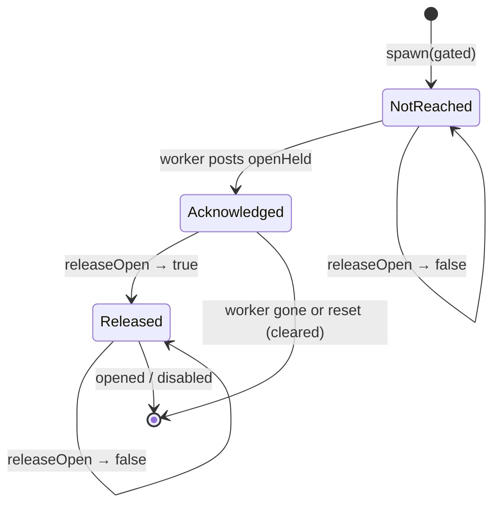
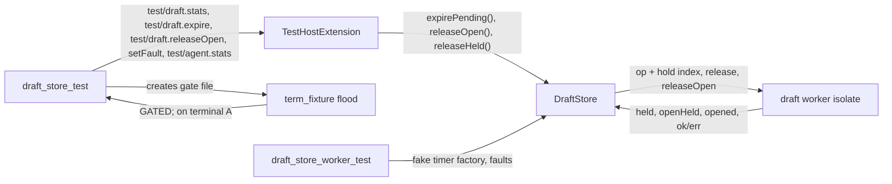
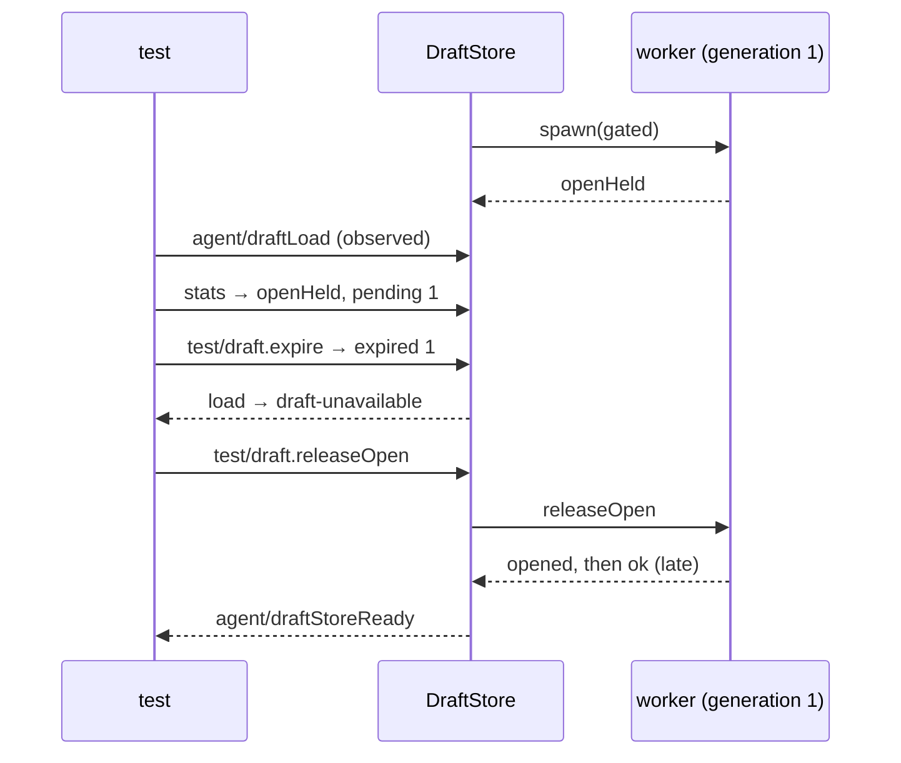

# Design

## Triage

| Trigger | Applies? | Evidence |
|---|---|---|
| T1 Components (new component, or 3+ with directed relationships) | yes | No new component. The change runs through five existing ones: test → test hooks (`packages/host/lib/src/test_hooks/test_hooks.dart:277-279`) → `DraftStore` (`packages/host/lib/src/agent/draft_store.dart:44`) → its worker isolate (`draft_store.dart:383`, `:460`), plus the terminal fixture (`packages/host/test/it/fixtures/term_fixture.dart:247-264`). |
| T2 State (persistent state, caches, 3+ state machine) | yes | Nothing is persisted, and the phases of `DraftPhase` (`draft_store.dart:13-26`) are unchanged. But the open gate has three observable states (not reached, acknowledged and unreleased, released), and `releaseOpen`'s answer depends on which one holds (D4). |
| T3 Concurrency (background work, workers/isolates, async, retries) | yes | The change touches the per-operation deadline timer (`draft_store.dart:219-227`), the worker's commit hold (`draft_store.dart:647-653`), its open (`draft_store.dart:515`) and worker replacement (`draft_store.dart:273-293`). |
| T4 Boundaries (data format, migration, shared interface, IPC, external) | yes | The host↔worker messages change in both directions. Today the worker sends `opened`, `disabled`, `ok` and `err` (`draft_store.dart:521-530`, `:597-615`), and the host sends ops, `release` and `exit` (`draft_store.dart:170`, `:228-235`, `:334`). This change adds `held` and `openHeld` from the worker and `releaseOpen` to it. The test-hook RPC surface gains methods and stats keys (`test_hooks.dart:277-279`, `agent_service.dart:1650-1657`). |
| T5 Volume (grows without a fixed bound) | no | At most one commit is held per worker, because `_drain` awaits each op before it takes the next (`draft_store.dart:592-617`). Pending ops stay bounded by `maxPending` = 16 (`draft_store.dart:55`, `:213`). |
| T6 Risk (security, money, data loss, unrecoverable user data) | no | Drafts are user data, but the new worker paths are gated on test-only inputs. The commit hold runs only when the op carries a hold index ≥ 0, and that happens only under the `draftCommitHangs` fault (`draft_store.dart:233`, `:650-651`). The open gate runs only with the new `draftOpenHeld` option, which only the test host's environment sets (D4), and only for the first worker. The release host builds `const HostOptions()` (`host.dart:64-65`), so it gets the production defaults (`host_options.dart:34-35`). |

TIER: FULL

## Context

What the change has to work with, beyond proposal.md:

- **Deadline.** `DraftStore._run` arms `Timer(deadline, …)` per operation. When the timer fires, the operation is marked timed out, `_timedOut` is incremented and the caller gets `draft-unavailable` (`draft_store.dart:219-227`). While `_timedOut > 0` the store is *not responding* (`draft_store.dart:84`), and every new operation is refused before it is admitted or posted (`draft_store.dart:210-212`). A timed-out op stays in `_pending` until its late reply. That reply decrements `_timedOut`, and when the count reaches zero while the phase is available, availability is announced (`draft_store.dart:249-258`). The other way out is `_failAll`, on worker failure or disposal, which clears every pending op, timed out or not (`draft_store.dart:174-179`, `:238-246`, `:315-328`).
- **Deadline values.** The release host builds `const HostOptions()` (`host.dart:64-65`), whose `draftDeadline` defaults to `defaultDraftDeadline` = 5 s (`host_options.dart:34`, `:75`), and passes it to the store (`host.dart:322-326`). `DraftStore` keeps its own literal default of 5 s as well (`draft_store.dart:48`). Test hosts take `KUMIKO_TEST_DRAFT_DEADLINE_MS`, else the production default (`test_hooks.dart:136-137`). `draft_store_test.dart` sets 1000 ms as `quick` (`draft_store_test.dart:37`) or 800 ms (`:626`) for the whole host. The worker unit tests' `open` helper defaults to a real 5 s (`draft_store_worker_test.dart:44-56`), including for the 128-save fill (`:271-291`).
- **Commit hold.** `draftCommitHangs` makes `_run` post the hold index `_releases` (`draft_store.dart:233`). The worker's `_commit` begins an immediate transaction, applies the change, then waits until its own `_released` passes the index (`draft_store.dart:647-653`). The hold therefore keeps the write transaction open, which is why the host must know when the worker has reached it. Turning the fault off calls `onDraftRelease` (`host_faults.dart:93-95`, `:165`), which is `releaseHeld`: it increments `_releases` and posts `release` (`host.dart:329`, `draft_store.dart:168-171`). `_releases` lives on the store and survives worker replacement, while each new worker starts at `_released = 0` (`draft_store.dart:482`). After a release in one generation, the next generation's commit therefore needs two releases. Nothing tells the host that the worker reached the hold: `test/draft.stats` reports only phase, notResponding, pending, workersSpawned, disabledReason and pragmas (`agent_service.dart:1650-1657`).
- **Open hold.** `KUMIKO_TEST_DRAFT_OPEN_HOLD_MS` (`test_hooks.dart:138`) becomes `openHold`. Every spawn passes it to its worker, including the one a reset starts (`draft_store.dart:277-286`, `:158`). The worker sleeps that long before opening the file (`draft_store.dart:515`), and it handles messages while it waits: `exit` waits on `_open` (`draft_store.dart:493-496`).
- **Terminal output path.** The terminal reader parks while a chunk is written to the output channel, so at most one chunk is held beyond the channel window (`terminal_service.dart:499-505`). The window is `channelWindow` = 256 KiB (`frame_codec.dart:13`, `connection.dart:95`, `fair_writer.dart:74`, `:94`). Kumiko passes size `0` to `CreatePipe` and hands the pipes to `CreatePseudoConsole` (`windows_unit.dart:282-299`). So the channel window does not bound end to end the output that was already produced. `flood` writes numbered lines in batches of 256 and flushes after each batch (`term_fixture.dart:247-262`).
- **Agent backpressure.** An agent relay pauses once its queue and reservations reach 1 MiB (`agent_service.dart:221-224`), and `test/agent.stats` reports `paused` per session (`agent_service.dart:423-432`). The saturated row instead waits for the fixture's `blockedWrite` report (`draft_store_test.dart:182-199`).
- **The tests.** Timing sites in `packages/host/test/it/draft_store_test.dart`:
  - `_ackBound` of 250 ms (`:16`), asserted on Stop and permission replies (`:723-724`);
  - fixed sleeps standing in for "nothing happened": 500 ms (`:116`), 300 ms (`:480`), 100 ms (`:705`) and 200 ms (`:754`);
  - deadline windows: 900–3000 ms (`:521`, `:733`) and 700–3000 ms (`:650`);
  - "at once" caps: under 250 ms (`:529`, `:790`) and under 1000 ms (`:580-584`);
  - shutdown under 15 s (`:765`). The row ends the session with `quit()` (`:757`), which closes the host's stdin while the desktop stays alive. It stands in for connection loss; it is not the desktop kill in the spec's scenario. Its outer wait is the launcher default, given through `Desktop.start(quitTimeout:)` (`harness.dart:214-226`). The host's own cleanup then runs under `shutdownDeadline` (`host.dart:553-558`), 30 s by default (`host_options.dart:19`, `:51`), which a test host can override with `KUMIKO_TEST_SHUTDOWN_DEADLINE_MS` (`test_hooks.dart:117`);
  - `killHost` waits for the loss with `hostLossBound * 3` = 6 s (`draft_store_test.dart:78-82`, `launcher.dart:16`);
  - the saturated row's `worst ≤ defaultDraftDeadline` (`:228`). Its hold synchronisation waits only for `pending == 1` and then for any byte (`:238-247`);
  - `waitFixture` returns any matching report, including one already present (`agent_support.dart:155-161`). The commit-failure row retries with the same prompt text as the refused send (`draft_store_test.dart:475-493`). A report's `prompt` is the ACP content-block list, not a string, and `receivedPrompts` returns those lists unchanged (`draft_support.dart:199-203`). The disabled-store row checks an immediate empty list, then accepts any prompt (`draft_store_test.dart:585-588`);
  - `settledSave` and `settledLoad` retry around the short deadline (`draft_support.dart:83-97`, `:99-109`). The tests call them at `:130-141`, `:233`, `:513`, `:538-540`, `:658`, `:777`, `:800-801` and `:809-822`. The row at `:805-824` exists only to show that `settledSave` waits out a slow commit.
- **The worker tests.** In `packages/host/test/agent/draft_store_worker_test.dart`:
  - "at once" caps of 200 ms (`:305-308`), 100 ms (`:343`) and 100 ms (`:419-424`);
  - a deadline window of 380–1500 ms (`:336`);
  - an admitted save that waits through a 500 ms open and succeeds, asserted as at least 450 ms (`:379-387`);
  - an admitted load that expires during a 1500 ms open against a 300 ms deadline, with recovery after (`:390-409`);
  - an fsync median asserted under 100 ms (`:491`);
  - "the default deadline is 5 s" checks only the two constants (`:317-324`).
- **Polling.** The harness `eventually` polls every 25 ms, for 20 s by default (`harness.dart:57-67`). The worker test has its own copy that polls every 20 ms, also for 20 s (`draft_store_worker_test.dart:496-504`).
- **Spec.** `desktop-host-protocol` still states elapsed bounds for the saturated save, control during a held commit and cleanup after desktop loss (`openspec/specs/desktop-host-protocol/spec.md:280-295`). S3 keeps them. Proving them on real time is left to the later qualification slice of #28.

## Decisions

### D1: Inject the deadline timer into `DraftStore`, with one default

- **Choice:**
  - `DraftStore` takes an optional `Timer Function(Duration, void Function())` (default `Timer.new`) and creates every deadline timer through it.
  - Its `deadline` default becomes `HostOptions.defaultDraftDeadline`, so the store and the release host share one authoritative value.
  - A unit test passes a hand-written fake that records each armed duration and callback, and fires them on demand.
- **Rejected:** `package:fake_async` (or a `Zone` that intercepts `createTimer`). It fakes every timer and the microtask queue of the test, but these tests need real isolate delivery from the worker and fake control of only the operation timer. An injected factory gives exactly that, with no change to how the rest of the test runs.
- **Reversal cost:** low
- **Important:** no
- **Chosen by:** agent

### D2: The worker acknowledges each stage; the store reports the gate state

- **Choice:**
  - **Worker → host messages,** sent only under a test fault:
    - `['held', opId]` when `_commit` is about to wait for a release;
    - `['openHeld']` when the worker is about to wait at its open gate (D4).
  - **What the store records:**
    - `_heldOp`: one nullable op id, because at most one commit is held per worker (Triage T5). It is set on `held` from the current generation and cleared by that op's reply, by `_failAll`, or by worker replacement.
    - `_openGate`: true from `openHeld` until the store sends `releaseOpen`, or until `opened`, `disabled` or worker replacement.
  - **`test/draft.stats`** gains `heldCommit` (the id or null) and `openHeld`.
  - **Meaning of the fields:** `heldCommit` means "reached the hold and not yet answered". The worker cannot answer a held commit until it is released, so a test that sees `heldCommit` set and has not yet released knows the commit is waiting.
  - **Release rules:**
    - In a test that expires a held op, the expiry comes before the release.
    - A commit may be released without any expiry (D6, and the release after a successful save) once `held` was seen.
    - Expiry fails the caller only: the worker keeps waiting, with its transaction open, until the release.
- **Rejected:**
  - Inferring the hold from `pending == 1`, as the current row does. That cannot tell "posted" from "waiting inside the transaction" (#26).
  - A counter in `HostFaults` written by the worker. The worker is another isolate, so it can reach the host only through the store's messages.
- **Reversal cost:** low
- **Important:** yes, binds future changes: it extends the host↔worker message set and the test-hook stats that later slices of #28 will use.
- **Chosen by:** agent

### D3: `test/draft.expire` fires the pending deadlines now

- **Choice:**
  - **The store side:** `_Op` gains the operation's `kind`. Today the timer body logs `draft-deadline` with `code: kind` from `_run`'s scope (`draft_store.dart:217-227`, `:368-374`), so moving the body out needs the kind on the op. `_run`'s timer body moves into `_expire(op)`, which logs `op.kind`, and the timer calls it. `DraftStore.expirePending()` calls `_expire` for every pending op that has not already timed out, cancels their timers and returns how many it expired. An expired op stays in `_pending` until it is retired, as a timed-out op does today, and it is never counted again. It is retired in one of two ways: by the worker's late reply, which decrements `_timedOut` (`draft_store.dart:249-258`), or by `_failAll` when the worker fails or the store is disposed, which clears `_pending` and the timed-out count together (`draft_store.dart:174-179`, `:238-246`, `:315-328`).
  - **The hook:** `test/draft.expire` calls `expirePending()` and returns `{expired: n}`. The release host routes every `test/` method to the test extension, which it does not have (`host.dart:515-528`). `release_contract_test.dart` (`:258-315`) gains `test/draft.expire` and `test/draft.releaseOpen` among the methods it proves are refused.
  - **Test order:** start the op and keep its future observed; prove it was admitted (`pending` counts it) and reached its stage (`heldCommit` or `openHeld`); expire and assert `expired == 1`; assert the refusal; only then release (S1).
- **Rejected:**
  - A fault-scoped short real deadline (the S1 alternative).
  - A desktop-side cancel: it tests a path the product never takes.
- **Reversal cost:** low
- **Important:** yes, binds future changes: it is the pattern later slices of #28 follow for host deadlines.
- **Chosen by:** user (S1)

### D4: Gate the first open until released, replacing the open-hold duration

- **Choice:**
  - `KUMIKO_TEST_DRAFT_OPEN_HELD=1` becomes `HostOptions.draftOpenHeld` (bool). It replaces `draftOpenHold` and `KUMIKO_TEST_DRAFT_OPEN_HOLD_MS`.
  - The gate applies to the first worker generation only: `_spawn` passes it when `generation == 1`. A reset's successor opens at once, so a reset never waits for a release.
  - A gated worker posts `['openHeld']`, then waits for a `{'releaseOpen': true}` message before it opens the file.
  - `releaseOpen` is one-shot:
    - `DraftStore.releaseOpen()` posts the message only while `_openGate` is set, that is once the first-generation gate was acknowledged. It then clears the flag and returns true.
    - There are three observable outcomes: before the acknowledgement it returns false; the first call while the gate is acknowledged and not yet released returns true; every later call returns false. On an ungated successor it always returns false.
    - A worker that is not gated ignores the message.
  - The test hook `test/draft.releaseOpen` returns `{released: bool}`.
- **Rejected:** Keeping the duration and expiring the deadline during it (D3 alone). The open would still end on a real timer, so "refused while the open is still held" would hold only on a fast enough runner.
- **Reversal cost:** low. A test-only option; its users are listed in Context.
- **Important:** no
- **Chosen by:** agent

### D5: Align commit releases across worker generations

- **Choice:** `_spawn` resets `_releases` to 0 when it starts a worker, so the host's hold index and the new worker's `_released` count from the same origin.
- **Rejected:**
  - Passing the current `_releases` to the worker at spawn. That adds a spawn argument for the same effect.
  - Leaving it as it is: a test that resets and then holds a commit would need two releases.
- **Reversal cost:** low
- **Important:** no
- **Chosen by:** agent

### D6: Fresh output after the hold is proven by a gate marker

- **Choice:**
  - **The fixture:** `flood N` takes an optional gate path, `flood N <gate>`. After each batch it checks whether the gate file exists. The first time it does, the fixture writes `GATED;` once and keeps flooding.
  - **The saturated row:**
    - waits for `heldCommit` to be set;
    - creates the gate file;
    - waits until a latch set in A's receive callback shows `GATED;`, while the original save's future is still unsettled. The callback keeps a carry of the last `len('GATED;') - 1` bytes of everything received on A so far (not of the previous chunk alone), searches the carry joined to each new chunk, then updates the carry from that joined text, and sets the latch once. Frames can split the marker across any number of callbacks (`fair_writer.dart:329-350`, `connection.dart:101-135`), so a test of the matcher feeds `GA`, `T`, `ED;` as three callbacks and expects the latch. A marker split across chunks or arriving between polls is therefore never missed;
    - only then releases, and awaits that same original future for revision 21.

    The marker is written only after the test created the file, so it is output produced after the hold began. The old `bytes > before` check after the 20 saves (`draft_store_test.dart:218`) goes away. The marker replaces it, and the fair writer sends control frames before data (`fair_writer.dart:298-315`), so data delivery during that run of replies was never guaranteed.
  - **B's stall:** B's prerequisite becomes `test/agent.stats` reporting B `paused == true`, which is backpressure that actually happened (`agent_service.dart:221-224`), instead of the fixture's 100 ms `blockedWrite` report.
  - **The `worst` bound:** `worst ≤ defaultDraftDeadline` goes away, and the `measured:` print stays.
- **Rejected:** A byte-volume threshold after the hold. The relay holds a chunk beyond the window, and the channel window does not bound the upstream pipes (Context). No volume the code guarantees proves freshness.
- **Reversal cost:** low. Test fixture and test only.
- **Important:** no
- **Chosen by:** agent

### D7: Generous deadlines as hang guards in test hosts and the worker unit tests

- **Choice:**
  - In `TestHostExtension.fromEnvironment`, a missing `KUMIKO_TEST_DRAFT_DEADLINE_MS` gives 2 min. No draft-store test sets the variable any more, so `quick`, the 800 ms setting, `settledSave` and `settledLoad` go away.
  - The row at `draft_store_test.dart:805-824` is retired. It tested the helper. The product behaviour behind it, a late commit landing after a missed deadline, is kept by the released-commit row, which loads `held` after the release.
  - The worker tests' `open` helper defaults to a 2 min deadline.
- **Rejected:** Keeping 5 s in test hosts (the S2 alternative). Incidental draft calls in every suite would still race a real budget.
- **Reversal cost:** low
- **Important:** yes, binds future changes: every test gets a hang-guard deadline, and a test that needs the deadline to fire calls `test/draft.expire`.
- **Chosen by:** user (S2)

### D8: Worker unit tests prove timing on the fake timer and by order

- **Choice:**
  - **The 5 s deadline.** A store is built with `const HostOptions().draftDeadline`, the value the release host passes, and a fake timer. The test asserts the armed duration is 5 s. Firing the timer fails the op with `draft-unavailable` and sets `notResponding`. The next call is refused without arming a timer and without adding a pending op: that is "at once". A second test builds the store with no deadline argument and checks that the constructor default is the same 5 s.
  - **The 16-pending, disabled and not-responding rows** assert the same structural facts (no new timer, `pending` unchanged) instead of milliseconds. The 16-pending row runs on the fake timer factory: its 16 admitted timers are fake and never fired, so its real 30 s deadline (`draft_store_worker_test.dart:297-315`) goes away and all 16 saves succeed after the release.
  - **Both held-open contracts stay, on the gate:**
    - (a) a save admitted during the gate waits; `releaseOpen` without expiry, and the original save succeeds;
    - (b) a load admitted during the gate is expired, and it is refused while `openHeld` is still true; then `releaseOpen`, and the store becomes available and works.
  - **The gate's transitions:**
    - `releaseOpen` returns false before the acknowledgement, true once, and false again after;
    - after a reset, the successor opens without a gate, and the reset completes without any release.
  - **The fsync median** becomes a `measured:` print (S4).
- **Rejected:** Real short deadlines with wider windows. The owner rejects any loosened wall-clock bound.
- **Reversal cost:** low
- **Important:** no
- **Chosen by:** user (S4), mechanism by agent

### D9: "Nothing happened" is proven by a later, exact event on the same ordered stream

- **Choice:**
  - **`:116`.** Wait until stats say `available`, then make one more control round trip. The store calls `onAvailable` inline when the worker reports `opened` (`draft_store.dart:299-308`). That callback sends `agentDraftStoreReady` at once if the peer has the capability (`agent_service.dart:1640-1647`). The server awaits the handler before it queues the reply (`connection.dart:535-551`). Control frames are queued and sent in order on one connection (`connection.dart:262-268`, `:493-505`, `fair_writer.dart:226-240`, `:298-315`), and the desktop reads them in order (`connection.dart:379-399`, `:434-453`, `launcher.dart:254-279`) into what the test observes (`harness.dart:230-243`). The store's `onAvailable` is registered at `agent_service.dart:369`. A notification sent before the later reply would therefore already have arrived.
  - **Prompt texts.** The client sends a prompt as one text block (`acp/acp_client.dart:292-300`). The fixture today reports a prompt only after its busy check (`acp_agent_fixture.dart:484-497`), so a prompt rejected while another turn runs leaves no trace. The fixture gains a `promptReceived` report for every `session/prompt`. It is written before both early returns: the scripted-errors branch (`acp_agent_fixture.dart:430-438`) and the busy check. A new helper, `promptTexts(report)`, decodes the one text block of each `promptReceived`: the payload must be a one-element list whose element is `{type: text, text: ...}`, and anything else fails the test. Every exact barrier compares these texts. An exact list proves the ordered prefix of prompts received, up to and including the retry.
  - **`:480`, a refused send dispatched nothing.**
    - The retry uses distinct text.
    - The test waits until `promptTexts` contains the retry text.
    - It then asserts that `promptTexts` is exactly `[retry text]`.
  - **`:507`, an expired send.**
    - After the release, the late removal returns.
    - The test asserts the late tombstone (load returns no text at the floor) and stores the composer again above it.
    - A later send with distinct text succeeds.
    - The test waits until `promptTexts` contains that text, then asserts `promptTexts` is exactly `[that text]`, so the expired send never dispatched.
  - **`:585-588`, the disabled store.**
    - The retry uses distinct text.
    - The test waits for that text.
    - It then asserts that `promptTexts` is exactly `[retry text]`.
  - **`:705` and `:754`.** Wait for `heldCommit`.
- **Rejected:** Longer sleeps. They break rule 2 and do not prove absence.
- **Reversal cost:** low
- **Important:** no
- **Chosen by:** agent

### D10: Product bounds used as test prerequisites become hang guards

- **Choice:**
  - **The held-commit shutdown row:**
    - It sets `KUMIKO_TEST_SHUTDOWN_DEADLINE_MS` to 90 s, so the host's own cleanup has a hang guard instead of a 30 s budget a slow runner can miss.
    - It sets `KUMIKO_TEST_DRAFT_DEADLINE_MS` to 600000 (10 min), longer than the row's whole 5 min timeout. The held save is neither expired nor released before the connection closes. With the 2-minute default, the save's own deadline could fire inside the row and settle it, so a regression where shutdown waits for the save future would still pass (`draft_store_test.dart:749-767`, `launcher.dart:452-469`). With 10 min, the host can leave on its own only if shutdown does not wait on the save. This is a long hang guard, not a short deadline, so C3 still holds.
    - It starts its desktop with `quitTimeout: 2 min`, longer than that deadline, so the launcher never kills the host first. The row's own test timeout is 5 min, outside both; the suite default is 3 min (`packages/host/dart_test.yaml:1`).
    - It keeps asserting that the host left on its own (`timedOut` false, exit 0), that every unit is gone and that the ledger is empty. It drops the 15 s check.
    - Its name says what it tests: connection loss (stdin closed) while a commit is held.
    - The desktop-kill scenario and its cleanup bound go to the later qualification slice. Release defaults stay unchanged.
  - **`killHost`** waits for the loss with a 60 s guard instead of `hostLossBound * 3`. Loss is not proof that the profile is free: `lost` can complete after a 1 s reap, before the process is gone and its job drained (`launcher.dart:302-311`, `:375-394`). Seeding takes the profile lock and fails while the old host holds it (`draft_support.dart:158-178`, `harness.dart:581-594`). So `killHost` captures the host's PID and start time before the kill, then waits under the same guard until that process identity is gone (`isProcessAlive`, as the durability row already does). Only then does a test touch the profile (`draft_store_test.dart:368-376`, `:630-637`). The same-launcher restart stays as the separate attestation barrier.
  - **Stop and permission during a held commit.**
    - Both acknowledgements arrive while `heldCommit` is still set, and the `_ackBound` checks go away.
    - The Stop outcome is no longer taken from the first `agentStopResult`. A Stop can publish `notConfirmed` after its own 10 s and later `stopped` with `late: true` (`agent_session.dart:1344-1359`, `:660-677`). The test waits, under the hang guard, for an `agentStopResult` whose outcome is `stopped`, late or not, together with the fixture's cancellation report (`acp_agent_fixture.dart:420-426`).

  These rows prove that cleanup and control do not wait on the held commit. They do not prove the elapsed bounds (`launcher.dart:15-19`, `openspec/architecture.md:186`, `:204`), which are three different contracts: `hostLossBound` (2 s) is the desktop detecting a lost host, 35 s is the launcher's quit wait, and the host's cleanup after desktop loss has a 30 s bound. Those bounds and the 250 ms control bound stay in the spec and the architecture, for the later qualification slice of #28.
- **Rejected:** Keeping the product bounds as prerequisites. A slow runner alone could fail them.
- **Reversal cost:** low
- **Important:** no
- **Chosen by:** agent

### D11: AGENTS.md section

- **Choice:** A new `## Tests that run in Windows CI` section after `## Commands`, with #28's introduction, its ten rules verbatim and its closing line. The bullet "Timing rows in the host suite can fail under a loaded machine… Re-run them alone…" (`AGENTS.md:54-59`) is removed.
- **Rejected:** Rewording the rules: the owner asked for them verbatim.
- **Reversal cost:** low
- **Important:** yes, binds future changes
- **Chosen by:** user (S5)

### D14: Incidental cleanup and vacuous assertions leave the draft rows

- **Choice:**
  - **Saturated row cleanup.** The row no longer requires successful `agent/close` notifications or `terminal/exited` after revision 21 (`draft_store_test.dart:249-255`). The host wraps explicit closes in its production `settleDeadline` and can report a close failure instead (`agent_service.dart:1812-1837`, `:1854-1870`, `terminal_service.dart:619-630`, `:756-788`). Closing the two sessions and the terminal moves to teardown, which does not assert their outcome. Dedicated close tests elsewhere keep the close assertions.
  - **Durability row.** The row asserts that `standin.report.jsonl` holds no prompts (`draft_store_test.dart:309-315`). Its stand-in script is `{}`, so it configures no report file, and the check passes whatever happens (`acp_agent_fixture.dart:24-33`, `agent_support.dart:145-153`). The assertion goes away; the row keeps its kill-and-reopen durability proof.
  - **The record row.** "Storing a draft dispatches nothing" moves to the live-fixture record row (`draft_store_test.dart:600-617`), with an exact barrier. After the save, a distinct barrier prompt is sent, the test waits for its `promptReceived`, and `promptTexts` is exactly `[barrier]`. The barrier is a plain `AgentPeer.prompt` with no draft fields, so it neither consumes nor tombstones the canary draft, and the row still loads the canary afterwards (`agent_service.dart:1564-1592`, ADR 0014 decision 11).
- **Rejected:** Configuring a report file for the stand-in. Killing the stand-in's fixture can drop a request it has not read yet, so an empty report would still prove nothing.
- **Reversal cost:** low
- **Important:** no
- **Chosen by:** agent

### D13: Prerequisite deadlines of the draft suite become hang guards

- **Choice:** Through existing overrides, the draft suite turns the deadlines it only needs as setup into hang guards:
  - **Path resolution and attach.** Every draft-suite host sets `KUMIKO_TEST_RESOLVE_TIMEOUT_MS` and `KUMIKO_TEST_ATTACH_TIMEOUT_MS` to 120000. Today the test host keeps the production 5 s and 10 s (`host_options.dart:56-60`, `test_hooks.dart:123-126`). A slow lookup returns `resolve-timeout` (`workspace_service.dart:241-254`). A delay between start and attach closes a healthy terminal or agent (`terminal_service.dart:295-307`, `agent_service.dart:1396-1406`, `:1484-1496`).
  - **Job drain in the held-open row.** The harness's `newLauncher` and `Desktop.start` gain the launcher's existing `jobDrainTimeout`, and the held-open reconciliation row passes 2 min. The launcher completes `session.lost` before it drains the old job and computes the restart attestation, with a 5 s default (`launcher.dart:21-23`, `:375-389`, `:398-414`). A missed drain records `jobTerminated: false`, and the successor then cannot confirm cleanup from the old host's record (`settler.dart:145-169`). The row keeps its attestation and empty-ledger checks.

  - **One environment for every entry point.** The draft suite defines one environment map, `draftSuiteEnv`, and passes it to `desktop()` and to the stand-in it launches directly. The stand-in builds its `HostLauncher` without an explicit environment (`desktop_standin.dart:20-35`, `:87-121`), so its host inherits that environment. The capability-refusal row starts its desktop with `Desktop.start(profile)` directly (`draft_store_test.dart:96-100`); it passes `draftSuiteEnv` too, and keeps its deliberate omission of `Capability.agent`.

  Release defaults are unchanged, and the tests dedicated to those deadlines keep their own settings.
- **Rejected:** Leaving the prerequisites at production values. They fail for reasons unrelated to drafts whenever the runner is slow.
- **Reversal cost:** low
- **Important:** no
- **Chosen by:** agent

### D12: Cleanup's inner settlement budgets stay a known gap

- **Choice:** The connection-loss row keeps its empty-ledger check. Shutdown runs under the host's deadline, but the settlement inside it has fixed budgets of its own:
  - a 5 s wait per Windows termination (`windows_unit.dart:107-108`);
  - a 10 s budget per POSIX marker-scan pass (`marker_scan.dart:70-76`, `:124-128`).

  When one runs out, the unit's ledger row stays (`settler.dart:237-259`). Those budgets belong to process containment and cleanup, so test overrides for them come in a later slice of #28. Until then a slow enough runner can still fail this row, and the gap is recorded on #28.
- **Rejected:** Adding test-host overrides for those budgets now. This change would grow into `process_containment` and the settler.
- **Reversal cost:** low
- **Important:** yes, binds future changes: a later slice of #28 owns the fix.
- **Chosen by:** user (asked after review round 3, answered option 1 through Ormy on 2026-11-23)

### Decision summary

| # | Decision | Choice | Rejected | Reversal cost | Important | Chosen by |
|---|---|---|---|---|---|---|
| S1 | Fire draft deadlines explicitly in tests | Hook fires pending deadlines after the worker reports the hold | Fault-scoped short real deadline | low | yes | user |
| S2 | Test-host deadline and the 5 s proof | Generous test deadline; 5 s on a fake clock | 5 s in test hosts | low | yes | user |
| S3 | Spec change | None; `skip_specs` | Reword draft scenarios to order | low | yes | user |
| S4 | Worker unit tests | In scope; fsync median print-only | Later slice | low | no | user |
| S5 | AGENTS.md rules | New section, ten rules verbatim, rerun bullet removed | Separate docs change | low | yes | user |
| D1 | Deadline clock | Injected timer factory; one default via `HostOptions` | fake_async / Zone interception | low | no | agent |
| D2 | Stage acknowledgements | `held`/`openHeld`; stats `heldCommit`, `openHeld` | Infer from `pending`; counter in `HostFaults` | low | yes | agent |
| D3 | Explicit expiry | `expirePending()` + `test/draft.expire`, expire before release | Fault-scoped real deadline; desktop cancel | low | yes | user |
| D4 | Open gate | First generation gated until `releaseOpen` | Keep duration + expiry | low | no | agent |
| D5 | Release alignment | Reset `_releases` on spawn | Pass count at spawn; leave it | low | no | agent |
| D6 | Fresh-output proof | Gate-file marker from `flood`; B stalled by relay `paused` | Byte-volume threshold | low | no | agent |
| D7 | Hang-guard deadlines | 2 min in test hosts and worker helper; drop helpers and their row | Keep 5 s | low | yes | user |
| D8 | Worker unit timing | Fake timer on the release-host value; both open contracts by order | Wider real windows | low | no | user |
| D9 | Absence proofs | Exact later event on the ordered stream | Longer sleeps | low | no | agent |
| D10 | Product bounds as prerequisites | Hang guards (90 s shutdown deadline inside a 2 min quit wait inside a 5 min test timeout; held save on a 10 min draft deadline outside them all); bounds left to qualification | Keep product bounds | low | no | agent |
| D11 | AGENTS.md | New section after Commands; remove rerun bullet | Reworded rules | low | yes | user |
| D12 | Settlement budgets in the connection-loss row | Known gap for a later #28 slice | Test overrides now | low | yes | user |
| D14 | Incidental cleanup and vacuous checks | Cleanup to teardown; no-dispatch proven on the live record row | Report file for the stand-in | low | no | agent |
| D13 | Prerequisite deadlines | Resolve, attach and job-drain overrides as hang guards in the draft suite | Production values | low | no | agent |

## Assumptions

None. Every claim above is cited.

## Carried constraints

- **C1:** Every draft deadline timer is created through the injected timer factory, and its default deadline is `HostOptions.defaultDraftDeadline`. Kind: invariant. Destination: doc comment: `packages/host/lib/src/agent/draft_store.dart` `DraftStore`
- **C2:**
  - Explicit expiry runs the timer's own `_expire` body.
  - An expired op keeps its pending slot until its late reply or `_failAll` (worker failure or disposal) retires it, and is never expired twice.
  - `held`, `openHeld` and `releaseOpen` exist only for test faults and the first-generation open gate.

  Kind: invariant. Destination: doc comment: `packages/host/lib/src/agent/draft_store.dart` `DraftStore.expirePending`
- **C3:** Test hosts run a 2-minute draft deadline as a hang guard. A test that needs the deadline to fire calls `test/draft.expire` after the stage is acknowledged, and never sets a short `KUMIKO_TEST_DRAFT_DEADLINE_MS`. Kind: rejected alternative. Destination: doc comment: `packages/host/lib/src/test_hooks/test_hooks.dart` `TestHostExtension.fromEnvironment`
- **C4:** "Nothing was dispatched" is proven by an exact later event with distinct text, never by a sleep or by a count over reports that may already exist. Kind: invariant. Destination: doc comment: `packages/host/test/it/draft_store_test.dart` `main` (the `send order` group's comment)
- **C5:** The order assertions prove that control and cleanup do not wait on drafts. The elapsed bounds in the spec are not proven here, and neither is the desktop-kill scenario with its cleanup bound (`openspec/specs/desktop-host-protocol/spec.md:293-295`, `launcher.dart:447-460`): the row here closes the connection instead. Both go to the later automated qualification slice of #28. Kind: deliberate gap. Destination: doc comment: `packages/host/test/it/draft_store_test.dart` `main` (the `the store never delays control or cleanup` group's comment)

- **C6:** The saturated row proves fresh output by the gate marker, and B's stall by the relay's `paused` flag. A byte count or the fixture's timed `blockedWrite` must not come back as proof. Kind: rejected alternative. Destination: doc comment: `packages/host/test/it/draft_store_test.dart` `main` (the saturated-output test's comment)
- **C7:** Only the first worker generation is gated at its open, and every spawn restarts the release count. Kind: invariant. Destination: doc comment: `packages/host/lib/src/agent/draft_store.dart` `DraftStore._spawn`
- **C12:** Every host the draft suite starts, through `desktop()`, a direct `Desktop.start` (the capability-refusal row, which still omits `Capability.agent`) or the stand-in, gets `draftSuiteEnv`, which carries the prerequisite hang guards. A new entry point that bypasses it reintroduces production prerequisite deadlines. Kind: invariant. Destination: doc comment: `packages/host/test/it/draft_store_test.dart` `main` (the `draftSuiteEnv` declaration)
- **C11:** `releaseOpen` is one-shot: false before the acknowledgement, true once, false after it, and always false on an ungated successor. Kind: invariant. Destination: doc comment: `packages/host/lib/src/agent/draft_store.dart` `DraftStore.releaseOpen`
- **C8:** No test fails on elapsed time. A measurement is printed as `measured:` and checked by the later qualification slice, not by a test failure. One example is the draft fsync median and its 100 ms threshold for reopening ADR 0014 decision 12. This amends ADR 0014's Consequences sentence that the test "fails above a 100 ms median". Kind: invariant. Destination: ADR 0017
- **C10:** The connection-loss row's empty-ledger check still depends on settlement budgets: the 5 s Windows termination wait and the 10 s POSIX marker-scan pass. A later slice of #28 adds test overrides for them. Kind: deliberate gap. Destination: doc comment: `packages/host/test/it/draft_store_test.dart` `main` (the connection-loss row's comment)
- **C9:** The draft save and removal latency row prints its median and does not assert it. The 100 ms threshold for reopening ADR 0014 decision 12 is checked by the later qualification slice. Kind: deliberate gap. Destination: doc comment: `packages/host/test/agent/draft_store_worker_test.dart` `main` (the `measured: draft save and removal latency` test's comment)

## Diagrams (FULL)

T2: the first-generation open gate, as `releaseOpen` sees it.



T1: components and directions.



T3 and T4: a held commit expired on demand.

```mermaid
sequenceDiagram
  participant T as test
  participant S as DraftStore
  participant W as worker
  T->>S: setFault(draftCommitHangs)
  T->>S: agent/draftSave (observed, not awaited)
  S->>W: op 7, hold = r
  W-->>S: held 7
  T->>S: test/draft.stats (poll) → pending 1, heldCommit 7
  T->>S: test/draft.expire → expired 1
  S-->>T: save 7 → draft-unavailable; notResponding
  T->>S: agent/draftSave
  S-->>T: draft-unavailable (pending still 1, heldCommit still 7)
  T->>S: setFault off → releaseHeld
  S->>W: release
  W-->>S: ok 7 (late) → heldCommit null
  S-->>T: agent/draftStoreReady
```

T3: the first-generation open gate.



## State & Ownership (FULL)

| State | Owner (sole writer) | Lifetime | Invalidation / rebuild | Authoritative copy |
|---|---|---|---|---|
| `_heldOp` | `DraftStore`, on `held` from the current generation | From `held` until that op's reply | Cleared on reply, `_failAll` and worker replacement | `DraftStore`; stats are a snapshot |
| `_openGate` | `DraftStore` | From `openHeld` until `releaseOpen` is sent, or `opened`/`disabled` | Cleared on those and on worker replacement | `DraftStore` |
| Pending op timers | `DraftStore`, through the timer factory | From `_run` until reply, expiry or `_failAll` | Cancelled by reply, `expirePending` or `_failAll` | `DraftStore._pending` |
| `_releases` (host) and `_released` (worker) | The store and the worker respectively | One worker generation | Both start at 0 on spawn (D5) | The worker's count decides the hold |

## Failure & Visibility (FULL)

| Component | Fails / dies mid-operation → | Recovery | Retry safe? | Who finds out |
|---|---|---|---|---|
| Worker during a held commit or gate | Today, `_onWorkerGone` disables drafts and `_failAll` clears pending work (`draft_store.dart:324-328`, `:238-246`). New: `_failAll` also clears `_heldOp` and `_openGate` | Reset draft storage; the successor is never gated (D4) | n/a | Test: stats phase `disabled`; product unchanged |
| `test/draft.expire` with nothing expirable | Returns `{expired: 0}` | none needed | yes | The test, which asserts `expired == 1` |
| `held` never arrives | `eventually(heldCommit != null)` stops at its hang guard | none | n/a | Test failure naming the reason |
| Fixture never writes `GATED;` | The wait for it stops at its hang guard | none | n/a | Test failure: A stopped while the commit was held |
| A lost `releaseOpen` | The first worker never opens; the store stays `starting` | Host shutdown kills the worker | n/a | Test failure at its hang guard |

## Resource Bounds (FULL)

| Queue / buffer / cache / transfer | Bound | At the bound | Timeout | At 10x / 100x |
|---|---|---|---|---|
| Held commits | 1 per worker (`_drain` is serial) | n/a | None for the hold. The op deadline (2 min in tests, 5 s in production) fails only the caller, and the hold and its transaction last until the release | Unchanged |
| Pending ops and timers | ≤ `maxPending` (16) | The 17th is refused before posting | as above | Unchanged |
| Gate-file checks in `flood` | One `existsSync` per 256-line batch | n/a | n/a | Test fixture only |

## Flow & State Gaps (FULL)

- **Expire and reply race.** Expiry and replies run on the host's event loop, so the caller completes exactly once, through the reply or through the expiry. A timed-out op's slot is retired by the worker's late reply (`draft_store.dart:219-227`, `:249-258`), or by `_failAll` when the worker fails or the store is disposed (`draft_store.dart:174-179`, `:238-246`, `:315-328`). Either way it is retired once. A held op cannot reply before its release. In tests that expire a held op, the expiry comes before the release. Other tests may release without expiring (D2's release rules).
- **Late reply of an expired op.** The existing path takes it (`draft_store.dart:249-258`). The added step clears `_heldOp` if it names that op.
- **Several queued commits.** In the 16-pending row, the worker holds one commit and queues 15. The tests assert `pending` for the queue and `heldCommit` for the hold, never one for the other.
- **Worker replaced while held or gated.** Held id, gate flag and release counts are reset together with pending work. Messages from the old generation are ignored (`draft_store.dart:297-298`). The successor opens ungated (D4).
- **Release before `held`.** A release that reaches the worker first means the commit never waits and never posts `held`. Tests wait for `held` before they release.
- **The gate file appears between batches.** The fixture checks after each flushed batch, so `GATED;` follows the file's creation by at most one batch.

## Mechanism Ledger (FULL)

| Mechanism | Built? | Why (harm nobody catches / expensive later) | Evidence that would change the call |
|---|---|---|---|
| Injected timer factory | yes | The 5 s promise can otherwise be proven only on a real clock (rule 3) | none |
| `held` / `openHeld` acknowledgements | yes | The fix for #26's weak synchronisation | none |
| `expirePending` | yes | Deadline outcomes without a real short budget (S1) | none |
| Gate-file marker in `flood` | yes | No volume bound proves fresh output (D6) | none |
| Release-count alignment on spawn | yes | Otherwise a later-generation hold silently needs two releases | none |
| A generic test clock across host modules | no | Only drafts need it in this slice | Later #28 slices needing the same for other deadlines |
| Retry helpers (`settledSave`/`settledLoad`) | removed | They hid slow-runner failures (rule 8) | none |

## Risks / Trade-offs

- **[Risk] The test path differs from production: expiry is fired by hand.** → `_expire(op)` is the timer's own body. The fake-timer unit test proves that the release host's value arms the timer with 5 s and that the timer runs the same body.
- **[Risk] The 2-minute guard hides a real stall in incidental draft calls.** → A stall still fails the test at its hang guard, with the call's reason. Slowness alone is not a failure (rule 4).
- **[Trade-off] Nothing gates on the `measured:` prints or on the spec's elapsed bounds.** → C5 records the gap. The later qualification slice of #28 owns it (rule 7).

## ADRs

- **In force, constraining this change:**
  - ADR 0014: the draft worker isolate, the 5 s deadline, at most 16 pending ops, and control and cleanup never wait on drafts.
  - ADR 0008: a separate test host entry point, which keeps the test hooks out of the release host.

  Production behaviour is unchanged, and the new hooks and the open gate live in the test host only.
- **To record during apply:** ADR 0017, "Tests never gate on elapsed time". It records rules 1, 3, 4 and 7 of #28 as a project decision. It amends ADR 0014's Consequences, which say the median test fails above 100 ms, without rewriting ADR 0014: the index row in `openspec/architecture.md` names the amendment, as the index does for other amending ADRs. The measurement becomes print-only, and the 100 ms reopening threshold stands, checked in the later qualification slice. The ten rules themselves live in AGENTS.md, as the owner asked. The same task updates the ADR index in `openspec/architecture.md`.
