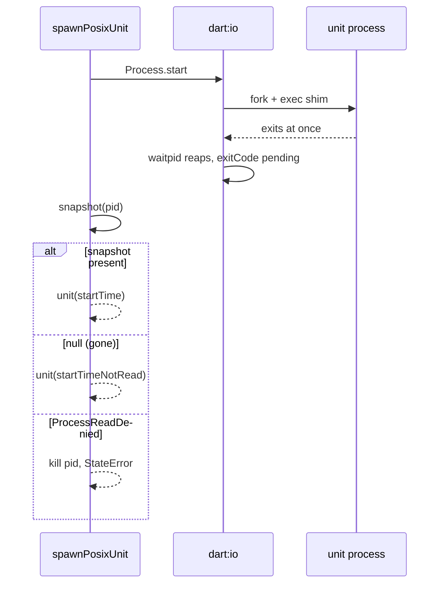
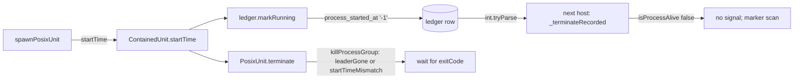

# Design

## Triage

| Trigger | Applies? | Evidence |
|---|---|---|
| T1 Components (new component, or 3+ with directed relationships) | no | One function changes, `spawnPosixUnit` (`packages/process_containment/lib/src/posix_unit.dart:182-281`). Its callers stay as they are |
| T2 State (persistent state, caches, 3+ state machine) | yes | The ledger's `process_started_at` can now hold the "no process" start time (`packages/host/lib/src/ledger.dart:173-178`), and the next host reads it back (`ledger.dart:30`, `packages/host/lib/src/settler.dart:145-158`) |
| T3 Concurrency (background work, workers/isolates, async, retries) | yes | The bug is a race between the start-time read and the reaping of the child by `dart:io` |
| T4 Boundaries (data format, migration, shared interface, IPC, external) | yes | `ContainedUnit.startTime` (`packages/process_containment/lib/src/contained_unit.dart:27-29`) is shared by the host, the settler and the ledger. It gains a value that matches no process |
| T5 Volume (grows without a fixed bound) | no | Nothing grows |
| T6 Risk (security, money, data loss, unrecoverable user data) | yes | Start-time guards stop a reused pid from being signalled (`posix_unit.dart:55-66`). A wrong value there could kill an unrelated process |

TIER: FULL

## Context

See proposal.md for the failures and the CI evidence.

- `spawnPosixUnit` reads the start time once, right after `Process.start` returns (`posix_unit.dart:222`). On the plain path a null read kills the pid and throws `StateError` (`posix_unit.dart:223-229`). On the PTY path the read comes before the status answer (`posix_unit.dart:240-241`), and a null read with an empty status throws the same `StateError` (`posix_unit.dart:257-279`).
- `posixProcessStartTime` turns both a gone process and a refused read into null (`posix_unit.dart:20-26`). The table's `snapshot` tells them apart:
  - On Linux it returns null for `ENOENT`/`ESRCH` and throws `ProcessReadDenied` for any other read error (`packages/process_containment/lib/src/posix_process_table.dart:96-103`).
  - On macOS it returns null for `ESRCH` or an empty answer, and for `EPERM`/`EACCES` goes to `_foreignSnapshot` (`posix_process_table.dart:259-263`). That function throws `ProcessReadDenied` for a process of the current user (`posix_process_table.dart:292-299`).
- A zombie still has a snapshot with its start time: Linux reads it from `/proc` with state `Z` (`posix_process_table.dart:106-120`), and macOS reads `SZOMB` from the BSD info (`posix_process_table.dart:264-276`). So a null snapshot of our own child means `dart:io` has already reaped it, and its exit code is on the way to `Process.exitCode`.
- Real start times are never negative. Linux uses the `starttime` field in clock ticks (`posix_process_table.dart:107-108`), and macOS uses microseconds since the epoch (`posix_process_table.dart:269-271`) or the placeholder 0 for another user's process (`posix_process_table.dart:304-306`).
- Every guard compares the start time for equality:
  - `killProcessGroup` returns `leaderGone` when there is no snapshot, and `startTimeMismatch` when the start time differs (`posix_unit.dart:58-66`).
  - `posixIsProcessAlive` returns false when there is no snapshot or the start time differs (`posix_unit.dart:30-33`).
  - `PosixUnit.terminate` treats both outcomes as "already gone" and waits for the exit (`posix_unit.dart:122-127`).
  - The next host's reconcile returns early when `isProcessAlive` is false (`packages/host/lib/src/settler.dart:195-196`).
- The ledger stores the start time as text and parses it back with `int.tryParse` (`ledger.dart:173-178`, `ledger.dart:30`), so a negative value round-trips.
- The host records the unit's pid and start time once the spawn returns, then watches `exitCode` and ends the unit through the normal path (`packages/host/lib/src/unit_manager.dart:241-264`).
- On the PTY path, the shim's status pipe is close-on-exec: it reaches end of file with nothing written once `execve` succeeds (`packages/process_containment/lib/src/unit_exec.dart:23-28`, `unit_exec.dart:47`).
- Windows reads the start time before it resumes the suspended process, so there is no race (`packages/process_containment/lib/src/windows_unit.dart:434-442`).
- The PTY test options already have a test-only field, `PtyOptions.slavePathForTesting` (`packages/process_containment/lib/src/pty.dart:27-33`).

## Decisions

### D1: Tell "gone" from "refused" with the snapshot itself

- **Choice:** `spawnPosixUnit` reads `PosixProcessTable().snapshot(pid)` directly. A snapshot gives the start time as before. A null snapshot means the process is gone: the unit is returned as already exited (D2). `ProcessReadDenied` keeps today's error: the pid is killed and `StateError` is thrown.
- **Rejected:** Keeping `posixProcessStartTime` and adding a `kill(pid, 0)` probe when it returns null. That is a second system call with its own window for the pid to be reused, and it learns nothing the snapshot did not already say. Treating every null as an exit was also rejected (proposal S2): a refused read is no evidence that the process ended.
- **Reversal cost:** low
- **Important:** no
- **Chosen by:** agent

### D2: An exited-before-read unit carries the start time -1

- **Choice:** Add a named constant `startTimeNotRead = -1` in `posix_unit.dart`. A unit returned under D1 has `startTime == startTimeNotRead`. No real start time is negative (Context), so every equality guard sees "no such process": termination waits for the exit, liveness is false, and the next host's reconcile skips the kill. The value then flows through the existing paths unchanged (`unit_manager.dart:241`, `ledger.dart:173-178`).
- **Rejected:** Making `ContainedUnit.startTime` nullable. That changes the shared interface, the ledger call, the settler and every comparison. A `null` there would also read like "not recorded yet", which the settler already handles as `pending-without-pid` (`settler.dart:158`), and that would wrongly make the workspace unresolved.
- **Reversal cost:** medium. The value is stored in ledgers. A later change to another representation must still read -1 as "no process".
- **Important:** yes. It binds future changes: the meaning of a stored start-time value.
- **Chosen by:** agent

### D3: The PTY path still lets the status pipe decide

- **Choice:** On the PTY path the snapshot is taken where the read is today, before the status wait. When it is null, the spawn still waits for the status answer. An empty status at end of file returns the exited unit with its PTY handles. A non-empty status is still `SpawnFailed` from its stage and errno. A status timeout is still `status-timeout`. Neither failure kills anything: the process is already gone.
- **Rejected:** Returning as soon as the snapshot is null, without waiting for the status: an `execve` failure would then look like a started program that exited 127.
- **Reversal cost:** low
- **Important:** no
- **Chosen by:** agent

### D4: Tests reach the race by waiting for the exit

- **Choice:** Add a test-only parameter to `spawnPosixUnit`, `Future<void> Function(Process)? beforeStartTimeReadForTesting`, in the style of `slavePathForTesting`. When it is set, the spawn awaits it right before the snapshot. The tests pass `(p) => p.exitCode`. When that future completes, `dart:io` has reaped the child, so the snapshot is null on every run (AGENTS.md rule 2: wait for the event).
- **Rejected:**
  - Spawning `exit 5` many times and hoping for the race: that is non-deterministic, and AGENTS.md rule 8 rules it out.
  - A pure decision function tested only with scripted reads: it would not show that a reaped child of `dart:io` really reads as gone on Linux and macOS.
- **Reversal cost:** low
- **Important:** no
- **Chosen by:** agent

### Decision summary

| # | Decision | Choice | Rejected | Reversal cost | Important | Chosen by |
|---|---|---|---|---|---|---|
| S1 | Fix the spawn, not the test | Return an exited unit on both paths | Longer-lived fixture; retrying the spawn | low | yes | user |
| S2 | Scope | Only a read that finds no process changes; Windows and a refused read keep their errors | Treating every failed read as an exit | low | no | agent |
| D1 | Gone or refused | Use the snapshot: null is gone, `ProcessReadDenied` keeps the error | A `kill(pid, 0)` probe after a null read | low | no | agent |
| D2 | Start time of an exited-before-read unit | `startTimeNotRead = -1` | Nullable `startTime` | medium | yes | agent |
| D3 | PTY path | Status pipe still decides; empty status returns the exited unit | Return before the status answer | low | no | agent |
| D4 | Test reach | Test-only hook awaits `exitCode` before the read | Repeating the race; a scripted pure function only | low | no | agent |

## Assumptions

- **A1:** `dart:io` completes `Process.exitCode` only after it has reaped the child with `waitpid`, so once `exitCode` completes the pid no longer exists, unless another process has already reused it. Not checked because it is inside the Dart runtime, not in this repository. Depends on it: D4. Task 1.1 confirms it on Linux before any product code changes, and macOS CI runs the same tests.

## Carried constraints

- **C1:** A unit start time of `startTimeNotRead` (-1) means the unit exited before its start time could be read. It matches no process, and must never be replaced by a value a live process can have. Kind: invariant. Destination: doc comment: packages/process_containment/lib/src/contained_unit.dart `ContainedUnit.startTime`
- **C2:** The spawn tells a gone process from a refused read through `PosixProcessTable.snapshot`. A refused read is not evidence of an exit and keeps the spawn error. Kind: rejected alternative. Destination: doc comment: packages/process_containment/lib/src/posix_unit.dart `spawnPosixUnit`

## Diagrams (FULL)

T3, the race and how the spawn now resolves it:

T2 and T4, where the start time flows and how each consumer reads -1:

## State & Ownership (FULL)

| State | Owner (sole writer) | Lifetime | Invalidation / rebuild | Authoritative copy |
|---|---|---|---|---|
| `PosixUnit.startTime` | `spawnPosixUnit` | the unit object | never changes | the unit object |
| ledger `process_started_at` | `Ledger.markRunning`, called by the unit manager | until the row is settled | removed with the row | the ledger file |

## Failure & Visibility (FULL)

| Component | Fails / dies mid-operation → | Recovery | Retry safe? | Who finds out |
|---|---|---|---|---|
| spawn, snapshot null | unit returned exited; its exit code reaches the caller | none needed | n/a | the caller, through `exitCode` (a terminal shows the exit) |
| spawn, read refused | pid killed, `StateError` as today | the host settles the failed launch (`unit_manager.dart:216-230`) | no: a new launch is a new unit | the caller, as a spawn error |
| host dies after the spawn, before `markRunning` | row stays pending without a pid | existing `pending-without-pid` path (`settler.dart:158`) | n/a | unresolved cleanup, as today |

## Resource Bounds (FULL)

| Queue / buffer / cache / transfer | Bound | At the bound | Timeout | At 10x / 100x |
|---|---|---|---|---|
| PTY status wait | unchanged | unchanged | the existing 5 s `_statusTimeout` (`posix_unit.dart:283`) | unchanged |

Nothing new is buffered or queued.

## Flow & State Gaps (FULL)

- **Pid reused before the snapshot.** If our child is reaped and another process takes its pid before the snapshot, the spawn records that process's start time. That gap already exists. Linux and macOS hand out pids in rising order and wrap around only after the whole range, so the window is the few microseconds between `Process.start` and the read. Not changed here.
- **Pid reused after a -1 unit is recorded.** Every guard compares start times, and -1 never matches, so nothing is signalled (Context).
- **Descendants of an exited-before-read unit.** They are in the unit's session and carry its marker. Termination returns once the exit is seen, and the host's marker scan ends any descendant that is still running, as for any unit whose leader exited.
- **Exit code arrives after the spawn returns.** `exitCode` is the `dart:io` future, so it completes when the runtime delivers it. Callers already await it.

## Mechanism Ledger (FULL)

| Mechanism | Built? | Why (harm nobody catches / expensive later) | Evidence that would change the call |
|---|---|---|---|
| Named constant for -1 | yes | Stored in ledgers: the meaning must be one value, named once | none |
| `kill(pid, 0)` probe | no | The snapshot already separates gone from refused (D1) | a platform where `snapshot` returns null for a live process |
| Await `exitCode` inside the spawn | no | The caller already awaits it, and it is not needed to build the unit | a caller that needs the exit code before the spawn returns |
| Windows change | no | No race there (Context) | a Windows path that reads the start time after resuming |

## Risks / Trade-offs

- [A live unit reads as gone because a platform's `snapshot` returns null wrongly, so it gets -1 and termination never signals it] → The snapshot returns null only for `ENOENT`/`ESRCH` on Linux and `ESRCH` or an empty answer on macOS (Context). The host's marker scan still finds the unit's processes by marker.
- [The test-only parameter is reachable by production callers] → It is named `…ForTesting` like `slavePathForTesting`, and no production caller passes it.

## ADRs

- **In force, constraining this change:** ADR 0001 (the desktop and child execution host: units are contained, recorded and cleaned up).
- **To record during apply:** none. C1 lives in the `ContainedUnit.startTime` doc comment.
