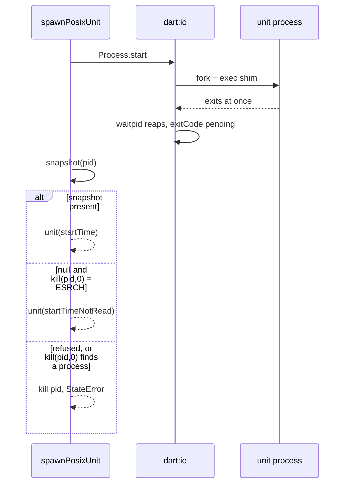
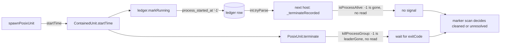

# Design

## Triage

| Trigger | Applies? | Evidence |
|---|---|---|
| T1 Components (new component, or 3+ with directed relationships) | no | `spawnPosixUnit`, `killProcessGroup` and `posixIsProcessAlive` change inside one file (`packages/process_containment/lib/src/posix_unit.dart`). Their callers stay as they are |
| T2 State (persistent state, caches, 3+ state machine) | yes | The ledger's `process_started_at` can now hold the "no process" start time (`packages/host/lib/src/ledger.dart:173-178`), and the next host reads it back (`ledger.dart:30`, `packages/host/lib/src/settler.dart:145-158`) |
| T3 Concurrency (background work, workers/isolates, async, retries) | yes | The bug is a race between the start-time read and the reaping of the child by `dart:io` |
| T4 Boundaries (data format, migration, shared interface, IPC, external) | yes | `ContainedUnit.startTime` (`packages/process_containment/lib/src/contained_unit.dart:27-29`) is shared by the host, the settler and the ledger. It gains a value that matches no process |
| T5 Volume (grows without a fixed bound) | no | Nothing grows |
| T6 Risk (security, money, data loss, unrecoverable user data) | yes | Start-time guards stop a reused pid from being signalled (`posix_unit.dart:58-66`). A wrong value there could kill an unrelated process |

TIER: FULL

## Context

See proposal.md for the failures and the CI evidence.

- `spawnPosixUnit` reads the start time once, right after `Process.start` returns, for both paths (`posix_unit.dart:222`).
  - On the plain path a null read kills the pid and throws `StateError` (`posix_unit.dart:223-229`).
  - On the PTY path the same read is used after the status wait (`posix_unit.dart:240-241` says why it comes first). The failures are checked in this order (`posix_unit.dart:257-280`): a timeout gives `SpawnFailed('status-timeout')`, then an empty status with no start time gives `StateError`, then a non-empty status is parsed into `SpawnFailed`. An empty status with a start time is a success. Before any failure is reported, the unit is terminated, or the pid is killed when there is no start time.
- `posixProcessStartTime` turns both a gone process and a refused read into null (`posix_unit.dart:20-26`). The table's `snapshot` does not always tell them apart:
  - On Linux it returns null only for `ENOENT`/`ESRCH` and throws `ProcessReadDenied` for any other read error (`packages/process_containment/lib/src/posix_process_table.dart:96-103`).
  - On macOS it returns null for every failed `proc_pidinfo` except `EPERM`/`EACCES`, and the foreign-user fallback does the same (`posix_process_table.dart:251-263`, `posix_process_table.dart:288-299`). A null snapshot on macOS is therefore not proof that the process is gone.
- `posixKill(pid, 0)` returns 0 or the errno of `kill` (`posix_process_table.dart:25`). `ESRCH` from `kill` means no process, zombies included, has that pid. Zombies still answer `kill`.
- Real start times are never negative. Linux uses the `starttime` field in clock ticks (`posix_process_table.dart:107-108`), and macOS uses microseconds since the epoch (`posix_process_table.dart:267-271`) or the placeholder 0 for another user's process (`posix_process_table.dart:304-306`).
- Every guard compares the start time for equality, after reading the pid:
  - `killProcessGroup` returns `failed` when the read is refused, `leaderGone` when there is no snapshot, and `startTimeMismatch` when the start time differs (`posix_unit.dart:58-66`).
  - `posixIsProcessAlive` returns true when the read is refused (`posix_unit.dart:30-36`).
  - So a pid that has been reused by a process the host cannot read turns into `failed` or "alive" whatever the recorded start time is.
- The callers of the guards:
  - `PosixUnit.terminate` waits for the exit on `leaderGone`/`startTimeMismatch` and returns `kill-failed` on `failed` (`posix_unit.dart:122-130`).
  - The next host's reconcile returns early when `isProcessAlive` is false and otherwise goes through `killProcessGroup` (`settler.dart:195-203`).
  - A kill failure stays the unit's outcome even when the marker scan is clean (`settler.dart:64-88`). The scan's own failures, a marked survivor or an unreadable process, make the unit unresolved (`settler.dart:109-119`).
- The ledger stores the start time as text and parses it back with `int.tryParse` (`ledger.dart:173-178`, `ledger.dart:30`), so a negative value round-trips.
- The host writes the unit's pid and start time with `markRunning` before it reports the launch, then watches `exitCode` and ends the unit through the normal path (`packages/host/lib/src/unit_manager.dart:241-264`). A failed spawn is settled through the marker scan and is not retried (`unit_manager.dart:216-230`, `unit_manager.dart:330-341`).
- On the PTY path, the shim's status pipe is close-on-exec: it reaches end of file with nothing written once `execve` succeeds (`packages/process_containment/lib/src/unit_exec.dart:23-28`). One setup failure does not use it: when the status descriptor cannot be duplicated, the shim writes to stderr and exits 1 (`unit_exec.dart:43-53`, `unit_exec.dart:115-118`). Its status is then empty.
- Windows reads the start time before it resumes the suspended process, so there is no race (`packages/process_containment/lib/src/windows_unit.dart:434-442`).
- The PTY options already have a test-only field, `PtyOptions.slavePathForTesting` (`packages/process_containment/lib/src/pty.dart:27-33`).

## Decisions

### D1: A unit counts as exited only on positive evidence of absence

- **Choice:** `spawnPosixUnit` reads `PosixProcessTable().snapshot(pid)` directly.
  - A snapshot gives the start time, as before.
  - When the snapshot is null, the spawn asks `kill(pid, 0)`. Only `ESRCH` proves the process is gone (D2).
  - `ProcessReadDenied`, or a null snapshot while `kill(pid, 0)` still finds a process, keeps today's failure.
- **Rejected:**
  - Trusting a null snapshot alone. On macOS it also covers unclassified `proc_pidinfo` errors (Context), so a live unit could be returned as exited, and its leader would then never be signalled.
  - Treating every failed read as an exit (proposal S2): a refused read is no evidence that the process ended.
- **Reversal cost:** low
- **Important:** no
- **Chosen by:** agent

### D2: The start time -1 means "the leader is known to be gone", and the guards act on it without reading the pid

- **Choice:**
  - Add a named constant `startTimeNotRead = -1` in `posix_unit.dart`. A unit returned under D1 has `startTime == startTimeNotRead`.
  - `killProcessGroup` returns `leaderGone` for it before reading or signalling anything.
  - `posixIsProcessAlive` returns false for it before reading anything.
  - `PosixUnit.terminate` then waits for the exit (`posix_unit.dart:122-127`). The next host's reconcile skips the kill (`settler.dart:195-196`). The marker scan still runs for the unit's marker in both, and its outcome decides cleaned or unresolved as for any unit (`settler.dart:64-88`).
  - The value flows through the existing paths unchanged (`unit_manager.dart:241`, `ledger.dart:173-178`).
- **Rejected:**
  - Relying on -1 matching no real start time. A reused pid that the host cannot read still makes `killProcessGroup` return `failed` and `posixIsProcessAlive` return true (Context), and the workspace would then go unresolved for a leader that is known gone (design review round 2).
  - Making `ContainedUnit.startTime` nullable. That changes the shared interface, the ledger call and every comparison. A null there would also read as "not recorded yet", which the settler already handles as `pending-without-pid` (`settler.dart:158`).
- **Reversal cost:** medium. The value is stored in ledgers. A later change to another representation must still read -1 as "the leader is gone".
- **Important:** yes. It binds future changes: the meaning of a stored start-time value.
- **Chosen by:** agent

### D3: The PTY path keeps its failure order, and the gone case adds one success

- **Choice:** The PTY path reads the identity where it does today, before the status wait (D1). After the wait the outcome is decided in this order:
  1. Timeout: `SpawnFailed('status-timeout')`.
  2. Non-empty status: `SpawnFailed` from the reported stage and errno.
  3. Empty status with a start time: the unit, as today.
  4. Empty status with the process proved gone: the exited unit with its PTY handles.
  5. Empty status otherwise (a refused or unproved read): `StateError`, as today.

  Rows 1 and 2 now come before the identity check in every case. Today the same order already holds for a unit without a start time (`posix_unit.dart:273-280`). For a proved-gone unit, the failure rows kill nothing: there is no process left, and a kill could hit a reused pid. A stream error on the status pipe still ends the wait as end of file does (`posix_unit.dart:244-250`).
- **Rejected:**
  - Returning as soon as the process is proved gone, without waiting for the status: an `execve` failure would then look like a started program that exited 127.
  - Fixing the empty status after a failed status-descriptor setup here (Context, `unit_exec.dart:43-53`). That case already reads as a started program whenever the start time is readable, so this change adds no new case. It needs a shim change with its own test seam, and is filed as issue #33 (C3).
- **Reversal cost:** low
- **Important:** no
- **Chosen by:** agent

### D4: Tests force each identity outcome through test-only parameters

- **Choice:** `spawnPosixUnit` gains two test-only parameters, in the style of `slavePathForTesting`:
  - `beforeStartTimeReadForTesting`, a `Future<void> Function(Process)` awaited right before the identity read. The tests pass `(p) => p.exitCode`. When it completes, `dart:io` has reaped the child (A1), so the "gone" branch is taken on every run, without retrying a race.
  - `snapshotForTesting`, a `ProcessSnapshot? Function(int)` used in place of the table's snapshot, so a test can make the read refused.

  Both are awaited or called inside the spawn's failure handling: if either throws, the PTY master is closed and the pid is killed before the error propagates. Each test asserts that its branch was taken (`startTime == startTimeNotRead`, or the expected error), not only the exit code. The tests run on Linux and macOS and are skipped on Windows. Their only real-time limit is the suite's `@Timeout` hang guard.
- **Rejected:**
  - Spawning `exit 5` many times and hoping for the race: that is non-deterministic, and the repository's test rules (issue #26) forbid retrying to get green.
  - A pure decision function tested only with scripted reads: it would not show that a reaped `dart:io` child really reads as gone on Linux and macOS.
- **Reversal cost:** low
- **Important:** no
- **Chosen by:** agent

### Decision summary

| # | Decision | Choice | Rejected | Reversal cost | Important | Chosen by |
|---|---|---|---|---|---|---|
| S1 | Fix the spawn, not the test | Return an exited unit on both paths | Longer-lived fixture; retrying the spawn | low | yes | user |
| S2 | Scope | Only a read that proves the process gone changes; Windows and a refused read keep their errors | Treating every failed read as an exit | low | no | agent |
| D1 | Evidence of absence | Null snapshot and `kill(pid, 0)` = `ESRCH` | A null snapshot alone | low | no | agent |
| D2 | Start time of an exited-before-read unit | `startTimeNotRead = -1`, short-circuited by `killProcessGroup` and `posixIsProcessAlive` | Rely on -1 not matching; nullable `startTime` | medium | yes | agent |
| D3 | PTY outcome order | Timeout, reported failure, readable success, proved-gone success, otherwise `StateError` | Return before the status answer; fix the status-descriptor gap here | low | no | agent |
| D4 | Test reach | Test-only hooks: await `exitCode` before the read; inject the snapshot | Repeating the race; a scripted pure function only | low | no | agent |

## Assumptions

- **A1:** `dart:io` completes `Process.exitCode` only after it has reaped the child with `waitpid`, so once `exitCode` completes, `kill(pid, 0)` answers `ESRCH` unless another process has already reused the pid. Not checked because it is inside the Dart runtime, not in this repository. Depends on it: D4. Task 1.1 checks it on Linux before any product code changes, and macOS CI runs the same tests.

## Carried constraints

- **C1:** A unit start time of `startTimeNotRead` (-1) means the unit's leader exited before its start time could be read and is known to be gone. It matches no process, and must never be replaced by a value a live process can have. Kind: invariant. Destination: doc comment: packages/process_containment/lib/src/contained_unit.dart `ContainedUnit.startTime`
- **C2:** `killProcessGroup` and `posixIsProcessAlive` treat `startTimeNotRead` as gone without reading or signalling the pid: a reused pid the host cannot read must not turn a gone leader into a kill failure. Kind: invariant. Destination: doc comment: packages/process_containment/lib/src/posix_unit.dart `killProcessGroup`
- **C3:** The spawn returns an exited unit only on positive evidence of absence: a null snapshot and `kill(pid, 0)` answering `ESRCH`. On the PTY path, the outcome order is timeout, reported failure, readable success, proved-gone success, otherwise `StateError`. An empty status after a failed status-descriptor setup still reads as a started program (issue #33). Kind: deliberate gap. Destination: doc comment: packages/process_containment/lib/src/posix_unit.dart `spawnPosixUnit`
- **C4:** A failed spawn is never retried: the program may already have run. Kind: rejected alternative. Destination: doc comment: packages/process_containment/lib/src/posix_unit.dart `spawnPosixUnit`
- **C5:** A pid reused between the reaping of the unit and the identity read is not guarded. The spawn then records the other process's start time, or reports the refused-read error. Kind: deliberate gap. Destination: doc comment: packages/process_containment/lib/src/posix_unit.dart `spawnPosixUnit`
- **C6:** Ledger rows may hold `process_started_at = '-1'`. A change to the start-time encoding must keep reading it as "the leader is gone". Kind: invariant. Destination: doc comment: packages/host/lib/src/ledger.dart `Ledger.markRunning`

## Diagrams (FULL)

T3, the race and how the spawn now resolves it:

T2 and T4, where the start time flows and how each consumer reads -1:

## State & Ownership (FULL)

| State | Owner (sole writer) | Lifetime | Invalidation / rebuild | Authoritative copy |
|---|---|---|---|---|
| `PosixUnit.startTime` | `spawnPosixUnit` | the unit object | never changes | the unit object |
| ledger `process_started_at` | `Ledger.markRunning`, called by the unit manager | until the row is settled | removed with the row | the ledger file |

## Failure & Visibility (FULL)

| Component | Fails / dies mid-operation → | Recovery | Retry safe? | Who finds out |
|---|---|---|---|---|
| spawn, process proved gone | unit returned exited; its exit code reaches the caller | none needed | n/a | the caller, through `exitCode` (a terminal shows the exit) |
| spawn, read refused or absence unproved | pid killed, `StateError` as today | the host settles the failed launch through the marker scan (`unit_manager.dart:330-341`) | no: the program may have run (C4) | the caller, as a spawn error |
| test hook throws | master closed, pid killed, error propagates | none | n/a | the test |
| host dies after the spawn, before `markRunning` | row stays pending without a pid | existing `pending-without-pid` path (`settler.dart:158`) | n/a | unresolved cleanup, as today |
| marker scan after a -1 unit leaves a marked process or cannot finish | unit unresolved (`settler.dart:109-119`) | the user's retry or confirm, as for any unit | yes, as today | the user, through unresolved cleanup |

## Resource Bounds (FULL)

| Queue / buffer / cache / transfer | Bound | At the bound | Timeout | At 10x / 100x |
|---|---|---|---|---|
| PTY status wait | unchanged | unchanged | the existing 5 s `_statusTimeout` (`posix_unit.dart:283`) | unchanged |

Nothing new is buffered or queued. The test hook is awaited only in tests, under the suite's hang guard.

## Flow & State Gaps (FULL)

- **Pid reused before the identity read.** If the unit is reaped and another process takes its pid before the read, the spawn records that process's start time, or reports the refused-read error when `kill(pid, 0)` finds it after a null snapshot. That gap already exists, and nothing here bounds its window (C5).
- **Pid reused after a -1 unit is recorded.** `killProcessGroup` and `posixIsProcessAlive` answer for -1 without reading the pid (D2), so nothing is signalled and no read is refused.
- **Descendants of an exited-before-read unit.** They are in the unit's session and carry its marker. Termination returns once the exit is seen. The host's marker scan then ends any descendant still running, and a survivor or an unreadable process leaves the unit unresolved, as for any unit whose leader exited (`settler.dart:64-88`, `settler.dart:109-119`).
- **Exit code arrives after the spawn returns.** `exitCode` is the `dart:io` future, so it completes when the runtime delivers it. Callers already await it.

## Mechanism Ledger (FULL)

| Mechanism | Built? | Why (harm nobody catches / expensive later) | Evidence that would change the call |
|---|---|---|---|
| Named constant for -1 | yes | Stored in ledgers: the meaning must be one value, named once | none |
| `kill(pid, 0)` confirmation after a null snapshot | yes | A null macOS snapshot is not proof of absence; a live unit taken as gone would never be signalled | a snapshot that reports `ESRCH` itself |
| Short-circuit of -1 in the guards | yes | Otherwise a reused, unreadable pid makes a gone leader a kill failure and blocks the workspace | none |
| Await `exitCode` inside the spawn | no | The caller already awaits it, and it is not needed to build the unit | a caller that needs the exit code before the spawn returns |
| Status-descriptor failure report in the shim | no | Not introduced by this change (D3); issue #33 | a CI failure from that path |
| Windows change | no | No race there (Context) | a Windows path that reads the start time after resuming |

## Risks / Trade-offs

- [A live unit is taken as gone] → It needs both a null snapshot and `kill(pid, 0)` answering `ESRCH`, which a live process never gives. The marker scan still finds a unit's processes by marker.
- [The test-only parameters are reachable by production callers] → They are named `…ForTesting` like `slavePathForTesting`, and no production caller passes them.

## ADRs

- **In force, constraining this change:** ADR 0001 (the desktop and child execution host: units are contained, recorded and cleaned up).
- **To record during apply:** none. C1 to C6 live in doc comments.
