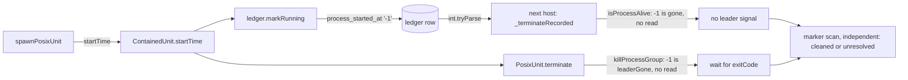

# Design

## Triage

| Trigger | Applies? | Evidence |
|---|---|---|
| T1 Components (new component, or 3+ with directed relationships) | no | `spawnPosixUnit`, `killProcessGroup` and `posixIsProcessAlive` change inside one file (`packages/process_containment/lib/src/posix_unit.dart`), plus the `kill` binding. The host's failed-spawn settlement and its test option change in `unit_manager.dart`, `settler.dart` and `test_hooks.dart`; no new component |
| T2 State (persistent state, caches, 3+ state machine) | yes | The ledger's `process_started_at` can now hold the "no process" start time (`packages/host/lib/src/ledger.dart:173-178`), and the next host reads it back (`ledger.dart:30`, `packages/host/lib/src/settler.dart:145-158`) |
| T3 Concurrency (background work, workers/isolates, async, retries) | yes | The bug is a race between the start-time read and the reaping of the child by `dart:io` |
| T4 Boundaries (data format, migration, shared interface, IPC, external) | yes | `ContainedUnit.startTime` (`packages/process_containment/lib/src/contained_unit.dart:27-29`) is shared by the host, the settler and the ledger. It gains a value that matches no process |
| T5 Volume (grows without a fixed bound) | no | Nothing grows |
| T6 Risk (security, money, data loss, unrecoverable user data) | yes | Start-time guards stop a reused pid from being signalled (`posix_unit.dart:58-66`). A wrong value there could kill an unrelated process |

TIER: FULL

## Context

See proposal.md for the failures and the CI evidence.

Every citation in this section, and every claim about behaviour before this change (such as D1's binding premise), refers to the baseline `640de23`, the branch's merge base with main. The implementation has since moved some of these ranges and changed the `kill` binding.

- `spawnPosixUnit` reads the start time once, right after `Process.start` returns, for both paths (`posix_unit.dart:222`).
  - On the plain path a null read kills the pid and throws `StateError` (`posix_unit.dart:223-229`).
  - On the PTY path the same read is used after the status wait (`posix_unit.dart:240-241` says why it comes first). The failures are checked in this order (`posix_unit.dart:257-280`):
    1. A timeout gives `SpawnFailed('status-timeout')`.
    2. An empty status with no start time gives `StateError`.
    3. A non-empty status is parsed into `SpawnFailed`.

    An empty status with a start time is a success. Before any failure is reported, the unit is terminated, or the pid is killed when there is no start time.
  - A read error on the status pipe completes the same completer as end of file, and `onDone` may then complete it again (`posix_unit.dart:244-250`).
- `posixProcessStartTime` turns both a gone process and a refused read into null (`posix_unit.dart:20-26`). The table's `snapshot` does not always tell them apart:
  - On Linux it returns null only for `ENOENT`/`ESRCH` and throws `ProcessReadDenied` for any other read error (`packages/process_containment/lib/src/posix_process_table.dart:96-103`).
  - On macOS it returns null for every failed `proc_pidinfo` except `EPERM`/`EACCES`, and the foreign-user fallback does the same (`posix_process_table.dart:251-263`, `posix_process_table.dart:288-299`). A null snapshot on macOS is therefore not proof that the process is gone.
- `posixKill(pid, signal)` returns 0 or `errno` (`posix_process_table.dart:25`), but `kill` is not bound as a leaf call (`posix_process_table.dart:14`). The errno accessor is reliable only when the failing call is a leaf call and the accessor was bound before it (`packages/process_containment/lib/src/libc.dart:16-20`).
- Real start times are never negative. Linux uses the `starttime` field in clock ticks (`posix_process_table.dart:107-108`), and macOS uses microseconds since the epoch (`posix_process_table.dart:267-271`) or the placeholder 0 for another user's process (`posix_process_table.dart:304-306`).
- Every guard compares the start time for equality, after reading the pid:
  - `killProcessGroup` returns `failed` when the read is refused, `leaderGone` when there is no snapshot, and `startTimeMismatch` when the start time differs (`posix_unit.dart:58-66`).
  - `posixIsProcessAlive` returns true when the read is refused (`posix_unit.dart:30-36`).
  - So a pid that has been reused by a process the host cannot read turns into `failed` or "alive" whatever the recorded start time is.
- The callers of the guards:
  - `PosixUnit.terminate` waits for the exit on `leaderGone`/`startTimeMismatch` and returns `kill-failed` on `failed` (`posix_unit.dart:122-130`).
  - The next host's reconcile returns early when `isProcessAlive` is false and otherwise goes through `killProcessGroup` (`settler.dart:195-203`).
  - A kill failure stays the unit's outcome even when the marker scan is clean (`settler.dart:64-88`). The scan's own failures, a marked survivor or an unreadable process, make the unit unresolved (`settler.dart:109-119`).
  - The marker scan does not depend on the leader check. It lists processes, matches the marker, and signals each match by that match's own pid and start time (listing and matching: `packages/process_containment/lib/src/marker_scan.dart:114-157`; signalling: `marker_scan.dart:79-83`).
- The ledger stores the start time as text and parses it back with `int.tryParse` (`ledger.dart:173-178`, `ledger.dart:30`), so a negative value round-trips.
- The host writes the unit's pid and start time with `markRunning` before it reports the launch, then watches `exitCode` and ends the unit through the normal path (`packages/host/lib/src/unit_manager.dart:241-264`). A failed spawn with a pending row is settled through the marker scan for its marker, unless the error is a `ProcessException` (nothing ran). A clean scan deletes the row, and a scan failure marks it unresolved. No failed spawn is retried (`unit_manager.dart:216-230`, `unit_manager.dart:330-341`).
- The marker scan skips a pid whose snapshot is null before reading its environment (`marker_scan.dart:139`). On macOS an unclassified read failure is such a null (above), so a clean scan does not prove that such a process is gone.
- A test build can hold the settlement of a running unit with the `terminateHangs` fault (`settler.dart:130-131`), and reads `KUMIKO_TEST_*` options at start (the documented options and the factory that reads them, `packages/host/lib/src/test_hooks/test_hooks.dart:33-57`, forwarded into `HostOptions` at `test_hooks.dart:86-139`). Its `test/unit.launch` method starts a named fixture and returns only the containment id (`test_hooks.dart:230-237`); the fixtures report their pid in a file named after it (`packages/host/lib/src/test_hooks/fixtures.dart:67-79`).
- The workspace gate refuses a launch only while a row of the workspace is `unresolved` (`unit_manager.dart:179-185`). A failed spawn's row stays `pending` until `_settleFailedSpawn` writes it after the marker scan (`unit_manager.dart:330-341`), and the scan awaits and can throw (`marker_scan.dart:125-149`).
- Retry and restart settle a POSIX row without a pid as `pending-without-pid` (`settler.dart:155-158`) and write that reason over the row's earlier one (Retry: `cleanup_service.dart:183-200`). A restart whose settle throws writes `reconcile-failed: <error>` over every row instead (`cleanup_service.dart:60-75`). Confirm deletes the row.
- A failed spawn's cleanup in the host is awaited before the original error is rethrown, so an exception from it replaces that error (`unit_manager.dart:216-230`).
- `Settler.scanFailedSpawn` runs one marker scan; the `killFails` fault only makes its kills fail, it does not make the scan throw (`settler.dart:91-104`, `settler.dart:273-291`).
- On the PTY path the status subscription is neither kept nor cancelled after a timeout (`posix_unit.dart:242-258`); failed-spawn cleanup relied on ending the child to close it.
- A PTY launch through a terminal profile whose program is not executable reports `spawn-failed` with the `exec` stage (`packages/host/test/it/terminal_test.dart:143-162`).
- Live termination of a unit whose leader is gone waits for its exit to be observed (`posix_unit.dart:122-127`); a restarted host has no exit to wait for and skips the leader check (`settler.dart:195-203`).
- On the PTY path, the shim's status pipe is close-on-exec: it reaches end of file with nothing written once `execve` succeeds (`packages/process_containment/lib/src/unit_exec.dart:23-28`). The shim can exit before `execve` without a report: when the status descriptor cannot be duplicated it writes only to stderr (`unit_exec.dart:43-53`, `unit_exec.dart:115-118`), and a report whose write fails is dropped (`unit_exec.dart:101-113`). An empty status at end of file is therefore ambiguous whatever the cause.
- Windows reads the start time before it resumes the suspended process, so there is no race (`packages/process_containment/lib/src/windows_unit.dart:396-408` for the suspended creation, `windows_unit.dart:434-442`).
- The PTY options already have a test-only field, `PtyOptions.slavePathForTesting` (`packages/process_containment/lib/src/pty.dart:27-33`).

## Decisions

### D1: A unit counts as exited only on positive, errno-safe evidence of absence

- **Choice:** `spawnPosixUnit` reads `PosixProcessTable().snapshot(pid)` directly, then decides:
  - A snapshot gives the start time, as before.
  - `ProcessReadDenied` keeps today's failure: the pid is killed and `StateError` is thrown.
  - A null snapshot is followed by `kill(pid, 0)`. Only `ESRCH` proves the process is gone (D2).
  - A null snapshot with any other probe answer means the unit's identity is unconfirmed. The spawn sends no signal to that pid by it: something is there, but nothing shows whether it is our unit, and a live leader whose read keeps failing would also be invisible to the marker scan (Context). On the plain path, and on the PTY path with an empty status, the spawn throws a new error, `SpawnIdentityUnconfirmed` (carrying the pid). On the PTY path a timeout, read error or reported failure still wins (D3), and its `SpawnFailed` carries the same fact in a new optional field, `unconfirmedPid`. The host settles either through D5.

  `kill` is bound as a leaf call, and `spawnPosixUnit` binds the errno accessor before `Process.start`. The probe's errno is then its own (the `libc.dart:16-20` convention). PR #32 makes the same binding change for its kill guard. Whichever merges second keeps one binding.
- **Rejected:**
  - Trusting a null snapshot alone. On macOS it also covers unclassified `proc_pidinfo` errors (Context). A live unit could then be returned as exited, and its leader would never be signalled.
  - Killing the pid when the probe finds a process after a null snapshot, as today's null path does. The probe shows that something is at the pid, not whose it is (design review round 3).
  - Letting a clean failed-spawn scan delete the row in that case. The scan skips a process whose snapshot is null, so it can report clean while our leader still runs (design review round 4).
  - Treating every failed read as an exit (proposal S2): a refused read is no evidence that the process ended.
- **Reversal cost:** low
- **Important:** no
- **Chosen by:** agent

### D2: The start time -1 means "the leader is known to be gone", and the guards act on it without reading the pid

- **Choice:**
  - Add a named constant `startTimeNotRead = -1` in `posix_unit.dart`. A unit returned under D1 has `startTime == startTimeNotRead`.
  - `killProcessGroup` returns `leaderGone` for it before reading or signalling anything.
  - `posixIsProcessAlive` returns false for it before reading anything.
  - `PosixUnit.terminate` then waits for the exit (`posix_unit.dart:122-127`). The next host's reconcile skips the kill (`settler.dart:195-196`).
  - In both, the marker scan still runs for the unit's marker, separately from the leader check (`marker_scan.dart:114-157`). Its outcome decides cleaned or unresolved, as for any unit (`settler.dart:64-88`).
  - The value flows through the existing paths unchanged (`unit_manager.dart:241`, `ledger.dart:173-178`).
- **Rejected:**
  - Relying on -1 matching no real start time. A reused pid that the host cannot read still makes `killProcessGroup` return `failed` and `posixIsProcessAlive` return true (Context). The workspace would then go unresolved for a leader that is known gone (design review round 2).
  - Making `ContainedUnit.startTime` nullable. That changes the shared interface, the ledger call and every comparison. A null there would also read as "not recorded yet", which the settler already handles as `pending-without-pid` (`settler.dart:158`).
- **Reversal cost:** medium. The value is stored in ledgers. A later change to another representation must still read -1 as "the leader is gone".
- **Important:** yes. It binds future changes: the meaning of a stored start-time value.
- **Chosen by:** agent

### D3: The PTY path keeps its failure order, adds a read-error failure, and the gone case adds one success

- **Choice:** The PTY path reads the identity where it does today, before the status wait (D1). The status wait completes once: on end of file, or on a read error, which is recorded as a read error. After the wait the outcome is decided in this order:
  1. Timeout: `SpawnFailed('status-timeout')`.
  2. Status read error: `SpawnFailed('status-read')`. Today a read error counts as end of file.
  3. Non-empty status: `SpawnFailed` from the reported stage and errno.
  4. Empty status with a start time: the unit, as today.
  5. Empty status with the process proved gone: the exited unit with its PTY handles.
  6. Empty status otherwise: `StateError` after a refused read, `SpawnIdentityUnconfirmed` after an unproved one (D1).

  The spawn keeps the status subscription and cancels it on every failure path, and closes the master, before it throws. It never waits for an unsignalled process to exit. On the plain path an unconfirmed spawn closes the child's stdin and cancels or drains its stdout and stderr the same way. The host's `_releaseUnclaimedIo` covers only a returned unit, so a thrown spawn owns this disposal.

  Steps 1 to 3 decide the error thrown, not the cleanup. When the read was unconfirmed, the `SpawnFailed` of steps 1 to 3 carries `unconfirmedPid`, and the spawn's own cleanup sends no signal to that pid, as in step 6.

  Before a failure is reported, the unit is settled as today: terminated when its start time was read, killed after a refused read. A proved-gone or unproved unit gets no signal (D1). The master is closed in every failure.

  An empty status at end of file cannot tell "`execve` succeeded" from a shim that exited before `execve` without reporting, whatever the reason the report is missing (Context). That case already reads as a started program whenever the start time is readable. With this change it also reads that way when the shim was reaped before the read. Fixing it needs a shim change with its own test seam: issue #33, on the owner's answer.

  `SpawnFailed` and `StateError` here describe the spawn's own cleanup: terminate, kill, or no signal. Whether the row is deleted or left unresolved is decided by the host's settlement (D1, Context). The doc comments of `spawnPosixUnit` and `SpawnFailed` say so.
- **Rejected:**
  - Returning as soon as the process is proved gone, without waiting for the status: an `execve` failure would then look like a started program that exited 127.
  - Fixing the status-descriptor report here: the owner deferred it to #33.
- **Reversal cost:** low
- **Important:** no
- **Chosen by:** agent

### D4: Tests force each outcome through test-only parameters and fail on the old code

- **Choice:** Test-only parameters, in the style of `slavePathForTesting`:
  - On `spawnPosixUnit`:
    - `beforeStartTimeReadForTesting`, a `Future<void> Function(Process)` awaited right before the identity read;
    - `snapshotForTesting`, a `ProcessSnapshot? Function(int)` used in place of the table's snapshot;
    - `probeForTesting`, an `int Function(int)` used in place of `kill(pid, 0)`.
  - On `killProcessGroup` and `posixIsProcessAlive`: `snapshotForTesting`.

  If a hook or injected function throws, the spawn's failure path handles it: the master is closed, and the pid is signalled only under the D1 rules.

  The status stream gets one more seam, `statusStreamForTesting`, a `Stream<List<int>> Function(Stream<List<int>>)` applied to the process's stdout before it is listened to. A test can then deliver an error followed by end of file.

  The host reads one more test-build option, `KUMIKO_TEST_SPAWN_IDENTITY`, and passes it to `spawnPosixUnit` as hooks:
  - `reaped`: await the unit's exit before the read;
  - `unconfirmed`: the snapshot returns null while the probe finds the process;
  - `forced-gone`: the snapshot returns null and the probe answers `ESRCH` for a live unit, so the spawn returns a `-1` unit whose exit cannot be observed until something ends it.

  Two more test faults (values of the test-only fault list, set through the existing `test/fault.set`) give the scan a seam:
  - `spawnScanHangs`: `scanFailedSpawn` waits at its start until the fault is released;
  - `scanThrows`: the next marker scan run by the settler (failed-spawn or reconcile) throws.

  One more test-build option, `KUMIKO_TEST_KILL_WAIT_MS`, sets the `killWait` the host passes to `terminate`.

  Every test that spawns registers the started process through the hook before the spawn can fail. Its tear-down then ends it even when no unit was returned.

  The tests run on Linux and macOS and are skipped on Windows. Each one fails on the old code:
  - **Plain and PTY, reaped before the read:** the spawn returns a unit with `startTime == startTimeNotRead`, the probe wrapper records `ESRCH`, and the exit code arrives.
    - The hook is `(p) => p.exitCode.timeout(const Duration(minutes: 2))`. That is a hang guard: if it fires, the spawn's cleanup runs.
    - If a pid is ever reused before the read, the test fails loudly.
  - **PTY, reaped with a reported failure:** a missing program, reaped before the read, raises `SpawnFailed('exec')`. The snapshot wrapper records null and the probe wrapper records `ESRCH`, which shows the proved-gone branch was taken and then overruled by the report.
  - **Refused read:** the injected snapshot throws `ProcessReadDenied`. The spawn throws `StateError`, and the captured process exits by `SIGKILL`.
  - **Unconfirmed, process level:** the injected snapshot returns null for a live sleeper unit, so the real probe finds it. The spawn throws `SpawnIdentityUnconfirmed` with that pid, and the sleeper is still alive afterwards: no signal was sent.
  - **Unconfirmed, host level:** with `KUMIKO_TEST_SPAWN_IDENTITY=unconfirmed`, a launch fails. Its row is `unresolved` with the reason `spawn-identity-unconfirmed:<pid>`, and a new launch against the workspace is refused.
  - **Status read error:** the status seam yields an error then end of file. The spawn raises `SpawnFailed('status-read')` exactly once, with no second completion error, and the unit's process has exited.
  - **Guards:** `killProcessGroup` and `posixIsProcessAlive` with `startTimeNotRead` never call the injected snapshot, and return `leaderGone` and false. With a real start time they still call it.
  - **Live cleanup:** a reaped unit's `terminate()` returns terminated once its exit is observed. A `forced-gone` unit (a live sleeper) with `killWait: Duration.zero` returns the timeout failure without signalling the sleeper, since its exit cannot have been observed. At host level, `forced-gone` with `KUMIKO_TEST_KILL_WAIT_MS=0`: ending the unit leaves its row `unresolved`, and the marker scan ends the sleeper.
  - **Durable write, host level:** a new test fixture, `reportedExit`, writes its report (its own pid) and exits 0; it is one more value of the test-only fixture list (`messages.dart:1453`), with no new field. With `KUMIKO_TEST_SPAWN_IDENTITY=reaped` and `terminateHangs` on, `test/unit.launch` of it is reported. While settlement is held, the row is read: `running`, the pid from the fixture's report file, and `process_started_at = '-1'`. After the fault is released, the row is cleaned.
  - **Unconfirmed, PTY failure mixed in:** with the snapshot returning null and the probe forced to report a process (both injected, so the result does not depend on when the shim exits), and the status seam yielding a read error, the spawn raises `SpawnFailed('status-read')` with `unconfirmedPid` set, and no signal reaches that pid. At host level, `KUMIKO_TEST_SPAWN_IDENTITY=unconfirmed` and a terminal profile whose program is not executable (the existing `exec` route): the open fails with `spawn-failed` stage `exec`, the scan finds nothing, the row is `unresolved` with `spawn-identity-unconfirmed:<pid>`, and a new launch is refused with `cleanup-unresolved`.
  - **Gate during the scan:** with `KUMIKO_TEST_SPAWN_IDENTITY=unconfirmed` and `spawnScanHangs` on, the launch's row is read while the scan is held: `unresolved`. A second launch is refused while it is held. A Confirm while held deletes the row; after the scan is released the row is still absent, so late scan completion does not undo the Confirm. In a second run, Retry while held keeps the reason.
  - **Scan throws:** with `unconfirmed` and `scanThrows`, the launch fails with the spawn's own error, not the scan's, and the row stays `unresolved` with its reason. At restart with `scanThrows` set before reconcile runs (a long `KUMIKO_TEST_RECONCILE_DELAY_MS`), a seeded `spawn-identity-unconfirmed:<pid>` row keeps its reason while other rows get `reconcile-failed`.
  - **Restart, unmarked bystander:** a seeded row with `process_started_at = '-1'` and the pid of a live bystander is cleaned at reconcile, and the bystander is never signalled. Kept separate from the durable-write test.
  - **Restart, marked descendant:** a seeded `-1` row whose marker a live `sleeper` started with that marker carries. Reconcile ends the sleeper through the marker scan and cleans the row; with `killFails` on, the row is unresolved. Either outcome fails if settlement skipped the scan for `-1`.
- **Rejected:**
  - Spawning `exit 5` many times and hoping for the race: that is non-deterministic, and the repository's test rules (issue #26) forbid retrying to get green.
  - A pure decision function tested only with scripted reads: it would not show that a reaped `dart:io` child really reads as gone on Linux and macOS.
- **Reversal cost:** low
- **Important:** no
- **Chosen by:** agent

### D5: The host gates the workspace before it scans for an unconfirmed spawn

- **Choice:**
  - `_settleFailedSpawn` reads the unconfirmed pid from `SpawnIdentityUnconfirmed.pid` or `SpawnFailed.unconfirmedPid`.
  - With one, it first marks the row unresolved with the reason `spawn-identity-unconfirmed:<pid>` and calls `onUnresolved`. The workspace is gated from then on (Context).
  - Then it runs the failed-spawn marker scan only to end what carries the marker. It does not write the row afterwards, whatever the scan finds or throws: the earlier write is the only one. An exception from the scan is caught and logged, and the launch fails with the spawn's own failure: a `SpawnFailed` (or `ProcessException`) is rethrown as it is and reaches the terminal API's existing mapping, so a PTY `exec` failure with `ENOENT` is `executable-not-found` and any other stage is `spawn-failed`; a plain `SpawnIdentityUnconfirmed` is wrapped as `internal-error`, as every other spawn error is (`unit_manager.dart:228-229`).
  - Retry and restart keep that reason for a row without a pid whose reason starts `spawn-identity-unconfirmed:`, instead of writing `pending-without-pid` over it, so the pid stays shown for the user's confirmation. The restart handler that writes `reconcile-failed` over every row after a thrown settle skips such rows too (`cleanup_service.dart:60-75`).
  - The pid in the reason is a diagnostic for the user only. It is never written as the row's pid, so no leader check or Retry can signal it. Confirm deletes the row, as for any unresolved row, and is the only action that clears it.
  - A Retry or Confirm that runs while the scan still runs touches only the unresolved row, and the scan writes nothing after it, so there is no second writer.
  - Every other failed spawn is settled as today.
  - Out of scope, filed by the owner's decision: gating the workspace while a spawn whose identity is already in doubt still waits for its PTY status, or when the unresolved write itself fails (#34); a thrown scan while ending a live unit (#35).
- **Rejected:**
  - Marking the row after the scan (round 5): a second launch passes the gate while the scan runs, and a scan exception leaves the row `pending`.
  - Gating every failed spawn before its scan: a wider behaviour change than #18 needs; the same window for other failed spawns is unchanged.
  - Writing the pid with a placeholder start time so Retry can read it: Retry would then treat the row as a recorded leader and could signal the unconfirmed pid.
- **Reversal cost:** low
- **Important:** no
- **Chosen by:** agent

### Decision summary

| # | Decision | Choice | Rejected | Reversal cost | Important | Chosen by |
|---|---|---|---|---|---|---|
| S1 | Fix the spawn, not the test | Return an exited unit on both paths | Longer-lived fixture; retrying the spawn | low | yes | user |
| S2 | Scope | Only a read that proves the process gone changes; Windows and a refused read keep their errors | Treating every failed read as an exit | low | no | agent |
| D1 | Evidence of absence | Null snapshot and leaf `kill(pid, 0)` = `ESRCH`; unproved: `SpawnIdentityUnconfirmed`, no signal, row unresolved | A null snapshot alone; killing an unproved pid; deleting the row after a clean scan | low | no | agent |
| D2 | Start time of an exited-before-read unit | `startTimeNotRead = -1`, short-circuited by `killProcessGroup` and `posixIsProcessAlive` | Rely on -1 not matching; nullable `startTime` | medium | yes | agent |
| D3 | PTY outcome order | Timeout, read error, reported failure, readable success, proved-gone success, otherwise the refused or unconfirmed error; a failure carries `unconfirmedPid` | Return before the status answer; fix the status-descriptor gap here (#33) | low | no | agent |
| D4 | Test reach | Test-only hooks on the spawn and the guards, a host test option and a `reportedExit` fixture; tests fail on the old code | Repeating the race; a scripted pure function only | low | no | agent |
| D5 | Unconfirmed spawn settlement | Mark unresolved before the scan, never write after it; Retry and restart keep the reason; Confirm clears | Marking after the scan; gating every failed spawn first | low | no | agent |

## Assumptions

- **A1:** `dart:io` completes `Process.exitCode` only after it has reaped the child with `waitpid`. So once `exitCode` completes, `kill(pid, 0)` answers `ESRCH`, unless another process has already reused the pid; the test then fails loudly (D4). Not checked because it is inside the Dart runtime, not in this repository. Depends on it: D4. the A1 check task in tasks.md checks it on Linux before any product code changes, and macOS CI runs the same tests.

## Carried constraints

- **C1:** A unit start time of `startTimeNotRead` (-1) means the unit's leader exited before its start time could be read and is known to be gone. It matches no process, and must never be replaced by a value a live process can have. Kind: invariant. Destination: doc comment: packages/process_containment/lib/src/contained_unit.dart `ContainedUnit.startTime`
- **C2:** `killProcessGroup` and `posixIsProcessAlive` treat `startTimeNotRead` as gone without reading or signalling the pid. A reused pid the host cannot read then never turns a gone leader into a kill failure. The marker scan does not depend on this check. Kind: invariant. Destination: doc comment: packages/process_containment/lib/src/posix_unit.dart `killProcessGroup`
- **C3:** When the start time cannot be read, the spawn returns an exited unit only on positive evidence of absence: a null snapshot and a leaf `kill(pid, 0)` answering `ESRCH`, with errno bound before `Process.start`. A null snapshot with a process still at the pid fails the spawn with `SpawnIdentityUnconfirmed`, or a `SpawnFailed` carrying `unconfirmedPid` on the PTY path, without signalling by that pid. Kind: invariant. Destination: doc comment: packages/process_containment/lib/src/posix_unit.dart `spawnPosixUnit`
- **C4:** A failed spawn is never retried: the program may already have run. Kind: rejected alternative. Destination: doc comment: packages/process_containment/lib/src/posix_unit.dart `spawnPosixUnit`
- **C5:** A pid reused between the reaping of the unit and the snapshot is not guarded: the spawn then records the other process's start time. After a refused read the spawn still kills the pid, as before this change. Kind: deliberate gap. Destination: doc comment: packages/process_containment/lib/src/posix_unit.dart `spawnPosixUnit`
- **C6:** Ledger rows may hold `process_started_at = '-1'`. A change to the start-time encoding must keep reading it as "the leader is gone". Kind: invariant. Destination: doc comment: packages/host/lib/src/ledger.dart `Ledger.markRunning`
- **C7:** On the PTY path the outcome order is timeout, status read error, reported failure, readable success, proved-gone success, otherwise the refused or unconfirmed error. Three cases stay distinct:
  - a reported shim failure (non-empty status): a failure;
  - a read error on the pipe (`status-read`): a failure;
  - a shim that exited before `execve` without a report, for any reason (empty status, issue #33): reads as a started program.

  The thrown error and the cleanup evidence are separate: an unconfirmed identity travels on whichever error wins.

  Kind: deliberate gap. Destination: doc comment: packages/process_containment/lib/src/posix_unit.dart `spawnPosixUnit`
- **C8:** A successful spawn never awaits the unit's exit. A terminal must open, and a piped caller must get its endpoints, while the unit runs; waiting for the exit happens only in the test hook. Kind: invariant. Destination: doc comment: packages/process_containment/lib/src/posix_unit.dart `spawnPosixUnit`
- **C9:** From its unresolved write on, a failed spawn whose identity was not confirmed, whichever error carries it, has its row marked unresolved before the marker scan and never written after it; Retry and restart (a thrown settle included) keep its reason, and Confirm alone clears it. The scan cannot see a process whose snapshot reads null, and a scan error never replaces the spawn's error. The pid in the reason is diagnostic only and is never recorded as the row's leader identity. Kind: invariant. Destination: doc comment: packages/host/lib/src/unit_manager.dart `_settleFailedSpawn`
- **C10:** A failed spawn releases what it opened on every failure path, plain or PTY, without waiting for an unsignalled process: it closes stdin and stops reading stdout and stderr, and on the PTY path it cancels the status subscription and closes the master. A status stream that throws on listen or cancel, or a throwing termination, does not skip this or replace the classified error, so an unconfirmed spawn's error still carries its pid. Kind: invariant. Destination: doc comment: packages/process_containment/lib/src/posix_unit.dart `spawnPosixUnit`
- **C11:** Before the unresolved write, a spawn whose identity is already in doubt does not gate its workspace: while the PTY status is awaited, and when the unresolved write itself fails, a second launch can pass the gate (issue #34). C9 starts at that write. Kind: deliberate gap. Destination: doc comment: packages/host/lib/src/unit_manager.dart `_settleFailedSpawn`
- **C12:** A marker scan that throws while a live unit is ended leaves its row as it was and its workspace open (issue #35); the start-time -1 scenario covers only a scan that reports. At restart a thrown scan marks every row `reconcile-failed`, except a row left by an unconfirmed spawn, which keeps its pid-bearing reason (C9). Kind: deliberate gap. Destination: doc comment: packages/host/lib/src/settler.dart `Settler.settle`

## Diagrams (FULL)

T3, the race and how the spawn now resolves it:

```mermaid
sequenceDiagram
    participant S as spawnPosixUnit
    participant IO as dart:io
    participant U as unit process
    S->>IO: Process.start
    IO->>U: fork + exec shim
    U-->>IO: exits at once
    IO->>IO: waitpid reaps, exitCode pending
    S->>S: snapshot(pid)
    alt snapshot present
        S-->>S: unit(startTime)
    else null and kill(pid,0) = ESRCH
        S-->>S: unit(startTimeNotRead)
    else ProcessReadDenied
        S-->>S: kill pid, StateError (as today)
    else null and kill(pid,0) finds a process
        S-->>S: SpawnIdentityUnconfirmed, no signal; host scans, row unresolved
    end
```

T2 and T4, where the start time flows and how each consumer reads -1:



## State & Ownership (FULL)

| State | Owner (sole writer) | Lifetime | Invalidation / rebuild | Authoritative copy |
|---|---|---|---|---|
| `PosixUnit.startTime` | `spawnPosixUnit` | the unit object | never changes | the unit object |
| ledger `process_started_at` | `Ledger.markRunning`, called by the unit manager | until the row is settled | removed with the row | the ledger file |
| unconfirmed row and its `spawn-identity-unconfirmed:<pid>` reason | `UnitManager._settleFailedSpawn` writes it once, before the scan; Retry and restart only keep it; Confirm deletes it | from the failed launch until the user confirms | none: the failed-spawn scan never writes it after the first write (D5) | the ledger file |

## Failure & Visibility (FULL)

| Component | Fails / dies mid-operation → | Recovery | Retry safe? | Who finds out |
|---|---|---|---|---|
| spawn, process proved gone | unit returned exited; its exit code reaches the caller | none needed | n/a | the caller, through `exitCode` (a terminal shows the exit) |
| spawn, read refused | pid killed, `StateError` as today | the host settles the failed launch through the marker scan (`unit_manager.dart:330-341`) | no: the program may have run (C4) | the caller, as a spawn error |
| spawn, null read but a process at the pid | no signal by that pid, `SpawnIdentityUnconfirmed` or `SpawnFailed` with `unconfirmedPid` | the host marks the row unresolved, then its marker scan ends whatever carries the marker; nothing is written after the scan (D5, C9) | no (C4) | the caller, as a spawn error, and the user, through unresolved cleanup |
| PTY status read error | `SpawnFailed('status-read')`, unit settled per D3 | as for any `SpawnFailed` | no (C4) | the caller |
| test hook, injected read or status stream throws | master closed, stdio released, nothing signalled, error propagates (C10) | none | n/a | the test |
| host dies after the spawn, before `markRunning` | row stays pending without a pid | existing `pending-without-pid` path (`settler.dart:158`) | n/a | unresolved cleanup, as today |
| ending a -1 unit: live exit not observed in time, or a scan that reports a marked survivor, an unlistable table, an unreadable process or a timeout (live or at restart) | unit unresolved (`settler.dart` `Settler._scanFailure`, `Settler.settle`) | the user's retry or confirm, as for any unit | yes, as today | the user, through unresolved cleanup |
| ending a -1 unit: the scan throws | live: out of scope, row left as it was (C12, #35); restart: every row `reconcile-failed` except an unconfirmed spawn's, which keeps its reason (`cleanup_service.dart` `_reconcile`) | restart: the user's retry or confirm | yes, as today | restart: the user, through unresolved cleanup |

## Resource Bounds (FULL)

| Queue / buffer / cache / transfer | Bound | At the bound | Timeout | At 10x / 100x |
|---|---|---|---|---|
| PTY status wait | unchanged | unchanged | the existing 5 s `_statusTimeout` (`posix_unit.dart`, unchanged since `640de23:posix_unit.dart:283`) | unchanged |

Nothing new is buffered or queued. The test hook runs only in tests, under its own minutes-long hang guard.

## Flow & State Gaps (FULL)

- **Pid reused before the snapshot.** If the unit is reaped and another process takes its pid before the snapshot, the spawn records that process's start time. That gap already exists, and nothing here bounds its window (C5).
- **Pid reused between the snapshot and the probe.** The probe finds a process, so the spawn fails without signalling it (D1).
- **Pid reused after a -1 unit is recorded.** `killProcessGroup` and `posixIsProcessAlive` answer for -1 without reading the pid (D2), so nothing is signalled and no read is refused.
- **Descendants of an exited-before-read unit.** The guarantee is the marker, as for any unit (ADR 0001).
  - Termination returns once the exit is seen. The host's marker scan then ends every process still carrying the unit's marker.
  - A marked survivor or an unreadable process leaves the unit unresolved (`settler.dart:64-88`, `settler.dart:109-119`).
  - A descendant that has cleared the marker is out of reach, as for any unit.
- **Exit code arrives after the spawn returns.** `exitCode` is the `dart:io` future, so it completes when the runtime delivers it. Callers already await it.

## Mechanism Ledger (FULL)

| Mechanism | Built? | Why (harm nobody catches / expensive later) | Evidence that would change the call |
|---|---|---|---|
| Named constant for -1 | yes | Stored in ledgers: the meaning must be one value, named once | none |
| `kill(pid, 0)` confirmation after a null snapshot, leaf-bound | yes | A null macOS snapshot is not proof of absence, and a live unit taken as gone would never be signalled. A non-leaf errno read could misreport the probe | a snapshot that reports `ESRCH` itself |
| Short-circuit of -1 in the guards | yes | Otherwise a reused, unreadable pid makes a gone leader a kill failure and blocks the workspace | none |
| Status read error as its own failure | yes | Today it can pass as an empty status, so a failed handshake would become a started unit | none |
| Await `exitCode` inside the spawn | no (C8) | A terminal or piped caller needs the unit while it runs | a caller that needs the exit code before the spawn returns |
| Unresolved row after an unconfirmed spawn | yes | A clean scan cannot prove a null-snapshot leader gone; deleting the row would open the workspace gate | a snapshot that never returns null for a live process |
| `KUMIKO_TEST_SPAWN_IDENTITY` host option | yes | The only way to observe the durable `-1` write and the unconfirmed settlement through a real launch | none |
| Status-descriptor failure report in the shim | no | The ambiguity predates this change, which extends it to reaped shims (D3); issue #33 | a CI failure from that path |
| Windows change | no | No race there (Context) | a Windows path that reads the start time after resuming |

## Risks / Trade-offs

- [A live unit is taken as gone] → It needs both a null snapshot and a leaf `kill(pid, 0)` answering `ESRCH`, which a live process never gives. The marker scan still finds a unit's processes by marker.
- [An unproved spawn failure leaves our own live unit unsignalled by pid] → The host's failed-spawn marker scan tries to end it by marker, and the row stays unresolved until the user confirms (C9).
- [The test-only parameters are reachable by production callers] → They are named `…ForTesting` like `slavePathForTesting`, and no production caller passes them.

## ADRs

- **In force, constraining this change:** ADR 0001 (the desktop and child execution host: units are contained, recorded and cleaned up).
- **To record during apply:** none. C1 to C9 live in doc comments.
