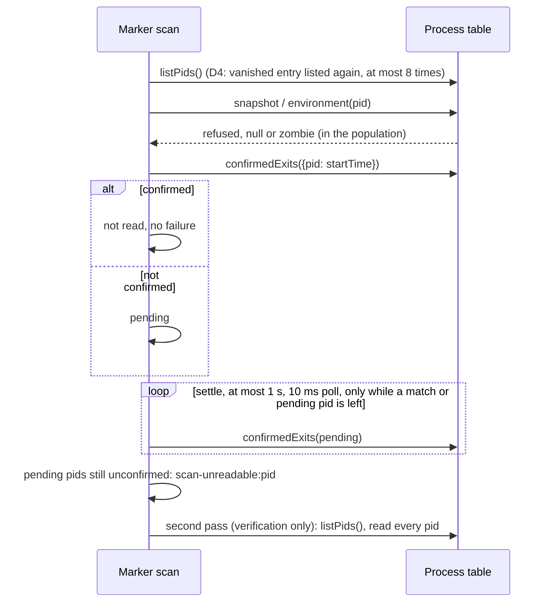
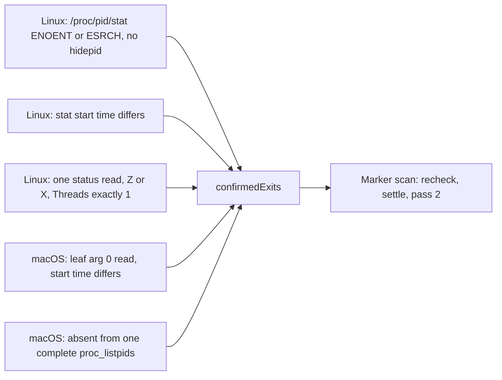

# Design

## Triage

| Trigger | Applies? | Evidence |
|---|---|---|
| T1 Components (new component, or 3+ with directed relationships) | no | Existing modules change: the marker scan, the process table and its host wrapper (`packages/process_containment/lib/src/marker_scan.dart:70-197`, `packages/process_containment/lib/src/process_table.dart:47-65`, `packages/host/lib/src/settler.dart:306-325`) |
| T2 State (persistent state, caches, 3+ state machine) | no | No stored state. The pending pids will live for one scan, next to today's per-pass record (`packages/process_containment/lib/src/marker_scan.dart:59-64`) |
| T3 Concurrency (background work, workers/isolates, async, retries) | yes | The defect is a race with processes that exit concurrently with the scan, and the listing fix retries |
| T4 Boundaries (data format, migration, shared interface, IPC, external) | yes | `ProcessTable` is a shared interface that the host wraps (`packages/host/lib/src/settler.dart:306-325`), and the new exit check reads two kernel interfaces (Linux `/proc`, XNU `proc_pidinfo`) |
| T5 Volume (grows without a fixed bound) | no | Pending pids are at most the pids of one listing, and the listing retry is bounded (D4) |
| T6 Risk (security, money, data loss, unrecoverable user data) | no | The change decides when a process the scan could not read fails it. It does not widen what is killed |

TIER: FULL

## Context

**The scan** (`marker_scan.dart`), design D9 of the cleanup change: at most two passes (`packages/process_containment/lib/src/marker_scan.dart:66-69`).
- A pass lists the pids (`packages/process_containment/lib/src/marker_scan.dart:114-119`), then reads each one's snapshot and environment, checking its 10 s timeout between pids (`packages/process_containment/lib/src/marker_scan.dart:121-128`).
- A refused snapshot marks the pass unreadable at once (`packages/process_containment/lib/src/marker_scan.dart:132-137`).
- A null snapshot or a zombie is skipped (`packages/process_containment/lib/src/marker_scan.dart:139`).
- A failed environment read is rechecked with `_stillThere`, which treats null, a zombie or another start time as gone (`packages/process_containment/lib/src/marker_scan.dart:144-151`, `packages/process_containment/lib/src/marker_scan.dart:166-173`).
- The first pass's matches are killed. With no matches, the scan ends with the first pass's result (`packages/process_containment/lib/src/marker_scan.dart:79-94`). Otherwise it settles for up to 1 s and runs a second pass whose matches are survivors (`packages/process_containment/lib/src/marker_scan.dart:96-104`, `packages/process_containment/lib/src/marker_scan.dart:176-188`).
- Failures become `scan-unlistable`, `scan-timeout`, `scan-unreadable:<pid>` and `marked-survivor:<pid>` (`packages/process_containment/lib/src/marker_scan.dart:42-49`). The host gives a containment termination failure precedence over the scan's reason (`packages/host/lib/src/settler.dart:109-112`, `packages/host/lib/src/settler.dart:136-145`).

**Snapshots.**
- **Linux** reads `/proc/<pid>/stat`, then `/proc/<pid>/status`. ENOENT or ESRCH gives null. Zombie means state `Z` or `X` of the thread-group leader (`packages/process_containment/lib/src/posix_process_table.dart:127-154`).
- **macOS** calls `proc_pidinfo(PROC_PIDTBSDINFO)` with `arg` 0. Any failure other than EPERM/EACCES gives null, ESRCH or not. It falls back to the short info, which refuses one of our own processes that is not a zombie (`packages/process_containment/lib/src/posix_process_table.dart:309-372`, `packages/process_containment/lib/src/posix_process_table.dart:243-252`).
- `proc_pidinfo` is bound as a leaf call, whose errno accessor is bound first. A leaf call must not wait (`packages/process_containment/lib/src/posix_process_table.dart:14-24`, `packages/process_containment/lib/src/posix_process_table.dart:224-228`).
- `ProcessSnapshot.zombie` is documented as "nothing of it runs" (`packages/process_containment/lib/src/process_table.dart:19-20`). On Linux it is the leader's state only.

**The environment read.** Linux maps any error other than ENOENT/ESRCH to `ProcessReadDenied` (`packages/process_containment/lib/src/posix_process_table.dart:108-112`). macOS maps ESRCH/EINVAL to `ProcessGone` and the rest to `ProcessReadDenied`, and retries the buffer read only on ENOMEM. The sysctl errno is read without a leaf binding (#31; `packages/process_containment/lib/src/posix_process_table.dart:380-412`).

**The Linux listing** maps any `FileSystemException` from `Directory('/proc').listSync` to `ProcessTableUnlistable` (`packages/process_containment/lib/src/posix_process_table.dart:115-124`).

**The shutdown budget.** `shutdown` waits up to 5 s for launches, then ends the units within the remaining deadline (`packages/host/lib/src/unit_manager.dart:504-519`). The architecture's 30 s figure allows two scan passes of at most 10 s (`openspec/architecture.md:204`).

**Reproduction.** On WSL Ubuntu, the real scan ran in a loop for 60 s while two shell loops started and ended processes.
- 7031 scans: 56 were `scan-unlistable` and 1 was `scan-unreadable`.
- The unreadable process was in state R, with vsize and RSS 0, and stat flags including `PF_EXITING`: exiting, not yet a zombie.
- In a separate 40 s run, `listSync` failed 29 times with ENOENT on a `/proc/<n>` path, and our own processes in state R or D refused `environ` with EACCES.

## Decisions

### D1: A process the first pass cannot settle is pending, and only a confirmed full exit clears it

- **Choice:** In the first pass, a pid is *pending* when the scan can neither read its environment nor confirm its full exit (D2). That covers:
  - a refused snapshot;
  - a null snapshot whose exit is not confirmed (macOS answers null for a process in exit);
  - a zombie snapshot whose exit is not confirmed (a Linux zombie leader with live threads), when the snapshot does not exclude it from the population;
  - a failed environment read whose recheck does not confirm the exit.

  The population filter runs before a snapshot makes a pid pending: a readable snapshot (zombie or not) with another uid, or a known start time before the window, is skipped as today. The macOS short info's placeholder start time 0 is not a known start time, so it excludes nothing.

  A null snapshot gives no uid. On macOS every zombie of every user answers null (its `arg` 0 read fails), so without more evidence any zombie on the machine would fail the scan. When `confirmedExits` does not confirm a null-snapshot pid, the table is asked whether it can show that the pid belongs to another user (`foreignPids`, D2). A pid it names is outside the population and is not pending. Our own zombies are not named, so they stay pending. A named pid still counts as *not read*: a pid reaped between the two listings is absent from our user's listing too, so naming it is no evidence that it never belonged to us (pre-ship review F1).
  - **macOS:** the pids absent from one complete `proc_listpids(PROC_UID_ONLY, <our uid>)` listing, made after the exit check. A zombie keeps its credentials until it is reaped, so our own zombie is listed (A3).
  - **Linux:** none. A null Linux snapshot means `/proc/<pid>` is gone, which `confirmedExits` judges.

  Every exit check runs at the pid's own failed read, inside the pass's iteration for that pid: first `confirmedExits` for the pid, then, for a null snapshot it does not confirm, `foreignPids`. No check is deferred to the end of the pass, so on the final pass a process that is alive at its failed read and exits while later pids are read is not cleared (pre-ship review F2), and the pass clock covers every check (F3).

  A pid whose exit the recheck confirms is not pending, but it still counts as *not read*. With any pending pid, any not-read pid or any match, the scan settles, so the second listing always comes after the exit evidence. The settle waits, up to its existing 1 s, until every killed match is gone and every pending pid has a **confirmed full exit**.
  - A pending pid confirmed during the settle contributes no failure.
  - A pending pid not confirmed by the end of the settle is `scan-unreadable:<pid>`.
  - The second pass then runs, as today after a match. It is verification only: in it, a pid that cannot be read and whose exit is not confirmed is `scan-unreadable`, and a marked process is a survivor. Nothing becomes pending, and nothing is killed.
- **Why it is safe:** a confirmed full exit means no thread of the process remains. So every process it started is already in the table when the second listing starts, and the second pass reads each of those still present and in the population. The confirmation is made before that listing. A pending process that merely disappears later, during the second pass, clears nothing. The one race left is the subject of D6.
- **Rejected:**
  - **The kernel's exit-in-progress flag (round 1).** It is per thread on Linux, and on macOS a held thread may still finish a spawn already in the kernel.
  - **Clearing a pid that is gone or readable on the second pass (round 2).** A process can start a child after the second listing and then exit, and a readable snapshot says nothing about the environment.
  - **Re-reading until a new deadline.** The settle's existing 1 s bound is the only wait.
  - **A third pass, or killing in the second.** The scan is bounded at two passes (D9).
- **Reversal cost:** low. It is local to `runMarkerScan` and one table method.
- **Important:** yes. It decides when a process the scan cannot read fails the cleanup guarantee.
- **Chosen by:** user (round-2 escalation, option A; round-3 escalation: the ordering also applies to first-pass rechecks)

### D2: The table answers one question: has this process fully exited?

- **Choice:** `ProcessTable` gains `Set<int> confirmedExits(Map<int, int?> pids)`. It takes pids with their start times where known, and returns those whose full exit it confirms: kernel evidence that no thread of the process remains, or that the pid now belongs to another process. Every other answer, including a refused or failed read, leaves the pid out. Taking a set lets one sweep share one listing (macOS, below). Snapshots and their callers do not change. No call can wait.
  - **Linux**, per pid:
    - `/proc/<pid>/stat` answers ENOENT or ESRCH, when `/proc` is not mounted with `hidepid` (below), or
    - its start time differs from a known start time, or
    - one read of `/proc/<pid>/status` shows `State:` `Z` or `X` and `Threads:` exactly 1, or that read answers ENOENT or ESRCH when `/proc` is not mounted with `hidepid`.

    `State:` and `Threads:` come from the same read, which is one task. A sibling's `exec`, which takes over the leader's pid, therefore cannot pair a dead leader's state with a live leader's count (A2). The stat state is not used. A count of 0 is not accepted: one read of a leader that the kernel still counts must show 1.

    **`hidepid`.** With `/proc` mounted with `hidepid` other than `0` or `off`, a live process of the same user can turn invisible (ENOENT) when it becomes non-dumpable (A2). The check reads `/proc/self/mountinfo` on each call, and if the `proc` mount at `/proc` has such an option, ENOENT and ESRCH confirm nothing. A mountinfo that cannot be read or parsed is treated the same way.
  - **macOS**, per call. No errno is taken as evidence (a listing that fails reads it only for its diagnostic), and no call waits:
    - For each pid with a known start time, the existing leaf `proc_pidinfo(PROC_PIDTBSDINFO)` with `arg` 0 succeeds with another start time: the pid was replaced.
    - For the pids not confirmed so, one fresh `proc_listpids(PROC_ALL_PIDS)` listing is made after those reads. It lists live and zombie processes, so a pid absent from it has been reaped (A3). The listing must be complete: the existing sized listing, which retries a full buffer and throws when it cannot complete. A listing that throws confirms nothing.
    - Anything else is not confirmed. In particular, a zombie that its parent has not yet reaped is not confirmed. The cost is stated in D3: such a pid stays scan-unreadable after the 1 s settle.
  - `ProcessTable` also gains `Set<int> foreignPids(Set<int> pids)`, the population evidence for null snapshots described in D1. It names a pid only on evidence that it belongs to another user, never waits, and names nothing when its listing fails.
  - The doc comment of `ProcessSnapshot.zombie` is corrected: on Linux it reports the leader's state, not that no thread runs. Callers keep their behaviour.
- **Rejected:**
  - **A field on `ProcessSnapshot`.** It would change the snapshot that the kill guard, spawn and unit listing use for identity. The round-1 review found that leaks unknown identities.
  - **macOS `arg` 0 failure or ESRCH as proof.** It answers ESRCH from the moment exit begins (`P_REF_DEAD`), while threads are only held (A3).
  - **The zombie-aware macOS call (`arg` 1, round 4).** It can sleep in `proc_find_zombref` with no stated bound, on the isolate that owns the shutdown deadline. By the owner's decision, an unreaped macOS zombie stays unconfirmed instead.
  - **The stat state with a second read of `Threads:`.** An `exec` between the two reads can mix two tasks (round-3 finding).
  - **`Threads:` at most 1.** A count of 0 does not belong to a leader the kernel still counts (round-4 finding).
  - **Trusting ENOENT under `hidepid`.** A live process can be hidden (round-4 finding).
  - **A listing per pid on macOS.** It makes a sweep quadratic in the process count (round-4 finding).
  - **Reading a macOS zombie's uid directly.** `proc_pidinfo` with `arg` 1 and `sysctl` `kern.proc.pid` both reach a zombie only through `proc_find_zombref`, which can wait (A3).
- **Reversal cost:** low. One method; the host wrapper forwards it.
- **Important:** yes. `ProcessTable` is shared with the host.
- **Chosen by:** user (round-2 escalation: Linux thread count, macOS confirmed absence; round-3 escalation: one status read, absence from the listing; round-4 acceptance: no waiting call, a start-time difference or listing absence only)

### D3: The settle and pass bounds are unchanged, and their real cost is stated

- **Choice:** Pending pids share the settle's 1 s bound and its 10 ms poll. The settle's expiry is never an outcome in itself. It turns an unconfirmed pending pid into the unreadable failure that the first pass gave before this change.
  - A first pass that times out still kills the matches it already collected and then returns `scan-timeout`, with no settle and no second pass (`packages/process_containment/lib/src/marker_scan.dart:79-91`). Its pending pids are dropped: the timeout already fails the scan.
  - An unreaped zombie on macOS is not confirmed (D2), so it stays pending to the end of the settle and becomes `scan-unreadable`. A parent that reaps within 1 s clears it.
  - The bounds table states the real overrun.
  - The architecture's shutdown row is amended to say that its limits are checked between synchronous reads, not inside them.
- **Rejected:** A longer settle. It would lengthen shutdown, and an exit not confirmed in 1 s fails closed, as it always did.
- **Reversal cost:** low
- **Important:** no
- **Chosen by:** agent

### D4: The Linux listing is retried, at most 8 times, only when an entry vanished

- **Choice:** `listPids` lists `/proc` again when the failure is ENOENT or ESRCH on a `/proc/<digits>` path, making at most 8 attempts. Any other failure, or a failure on all 8, throws `ProcessTableUnlistable`, as today.
  - The retry is a pure helper with the listing injected.
  - At the observed rate (29 failures in 40 s of listing as fast as possible), 8 in a row are not expected. If they happen, the answer is today's fail-closed one.
- **Rejected:**
  - **The async `Directory.list`.** `listPids` is synchronous for its callers (`packages/process_containment/lib/src/marker_scan.dart:116`, `packages/process_containment/lib/src/unit_processes.dart:249`, `packages/process_containment/lib/src/unit_processes.dart:282`).
  - **An FFI `readdir`.** It needs the `dirent` layout for each architecture, for a failure that a retry handles.
- **Reversal cost:** low
- **Important:** no
- **Chosen by:** agent

### D5: The environment errno handling stays as it is (#31)

- **Choice:** Both errno mappings and the macOS sysctl errno read stay unchanged.
  - After an environment read throws, `ProcessGone` and `ProcessReadDenied` are handled alike: only `confirmedExits` decides.
  - The ENOMEM retry inside the read still depends on the errno, as today.
- **Rejected:** A leaf sysctl binding here; #31 owns it.
- **Reversal cost:** low
- **Important:** no
- **Chosen by:** agent

### D6: The race after the final listing is left to OS grouping (ADR 0001, #9)

- **Choice:** A process can start a child after a pass lists the processes, and then vanish before the scan reads it. When that pass is the final one, the scan does not see the child, and nothing in the scan closes that.
  - This applies to any pid that vanishes between the final listing and its read, readable or not. It predates this change.
  - It is the descendant race that ADR 0001 leaves to OS-provided grouping (#9). No scan bounded to two passes can close it.
- **Rejected:** Failing the scan on any pid not read on the final pass. Busy machines would fail often (56 of 7031 reproduced scans had a vanished entry), which defeats this change.
- **Reversal cost:** low. #9 replaces the race, not this code.
- **Important:** yes. It is a documented limit of the cleanup guarantee.
- **Chosen by:** user (round-3 escalation)

### Decision summary

| # | Decision | Choice | Rejected | Reversal cost | Important | Chosen by |
|---|---|---|---|---|---|---|
| S1 | Fix the scan's handling of processes that exit during it | A process the first pass cannot read is cleared only by a confirmed full exit seen before the second listing | Exit flag; gone or readable in pass 2; deadline retry; serial tests; unreadable as gone | low | yes | user |
| S2 | Vanished-entry listing in the same change | Fix here | Separate issue | low | no | agent |
| D1 | When a pid the scan cannot read fails it | Population filter first (macOS null snapshots: `foreignPids`); pending in pass 1; any not-read pid triggers pass 2; confirmed exit before the second listing clears it; pass 2 verifies only | Exit flag; clear in pass 2; new deadline; a third pass | low | yes | user |
| D2 | Evidence of a full exit | `confirmedExits`: Linux gone (no `hidepid`), replaced, or one status read with `Z`/`X` and exactly 1 thread; macOS replaced (leaf `arg` 0 read) or absent from one complete `proc_listpids` per call. No waiting call, no errno | Snapshot field; macOS errno or `arg` 0 failure; zombie-aware `arg` 1; split stat/status reads; at most 1 thread; ENOENT under `hidepid`; a listing per pid; waiting for a zombie's uid | low | yes | user |
| D3 | Settle and pass bounds | Unchanged; real cost stated, including an unreaped macOS zombie staying unreadable | Longer settle | low | no | agent |
| D4 | Linux listing | Retry at most 8 times on a vanished `/proc/<n>` | Async list; FFI readdir | low | no | agent |
| D5 | Environment errno | Unchanged (#31) | Leaf sysctl now | low | no | agent |
| D6 | Race after the final listing | Left to OS grouping (ADR 0001, #9) | Fail on any unread pid of the final pass | low | yes | user |

## Assumptions

- **A1:** The macOS CI failure `scan-unreadable:10938` is a process in exit that the scan could not read. Not checked: no macOS machine is available, and the log names only the pid. D1 does not depend on it. Depends on it: only the expectation that macOS CI turns green. The macOS CI runs of this change and of #29 are the check.
- **A2:** Linux facts, from the kernel's documented behaviour, not checked against kernel source here:
  - `/proc/<pid>` stays while any thread of the group lives, because the leader is reaped last.
  - A zombie leader stays counted in `Threads:` until it is reaped, so a count of 1 means no other thread.
  - One read of `/proc/<pid>/status` is produced from one task. An `exec` by a sibling replaces the task behind the pid with a live one, so the `Z` in that read belongs to the same task as its count.
  - A pid is reused only after its process is reaped.
  - With `/proc` mounted with `hidepid` other than `0`/`off`, `/proc/<pid>` is hidden from a reader that may not ptrace the process, so a live process of the same user can answer ENOENT once it becomes non-dumpable. The mount options are visible in `/proc/self/mountinfo`.

  Depends on it: D2 (Linux), task 1.x. The WSL reproduction is consistent with it.
- **A3:** XNU facts, from apple-oss-distributions/xnu (`bsd/kern/proc_info.c`, `bsd/kern/kern_exit.c`, `bsd/kern/kern_proc.c`; read only, no code taken). Not checked against this repository, because the source is external:
  - `exit1` holds every other thread and only then sets `P_LEXIT`. `proc_prepareexit` then marks the proc `P_REF_DEAD`, after which `proc_find` fails. `task_terminate_internal` follows, and the last thread to terminate calls `proc_exit`, which sets `p_stat` to `SZOMB`.
  - With `arg` 0, `proc_pidinfo` uses `proc_find` only and does not wait. With a non-zero `arg` it falls back to `proc_find_zombref`, which can sleep while another caller holds the zombie. This design does not use that path.
  - `proc_listpids(PROC_ALL_PIDS)` walks `allproc` and then `zombproc`, the list a proc joins when it is marked `P_REF_DEAD`. A pid absent from both has been reaped. It stops early only when the buffer is full, so a listing shorter than the buffer is complete.
  - `PROC_UID_ONLY` filters on the proc's credentials (`kauth_cred_getuid`, skipping `NOCRED`). A zombie keeps its credentials until `reap_child_locked`, so it is listed under its user until it is reaped. `sysctl` `kern.proc.pid` reaches zombies through `proc_find_zombref`, as `arg` 1 does.

  Depends on it: D2 (macOS), task 2.x.
- **A4:** In the WSL experiment, Dart's async `Directory('/proc').list` reported vanished entries as error events and finished the listing. That was observed, not cited. Nothing depends on it: D4 rejects that API.

## Carried constraints

- **C1:** A pid that the first pass cannot read is cleared only by `confirmedExits` before the second listing. Its disappearing later clears nothing, and the settle's expiry is never an outcome in itself. The population filter runs before a pid becomes pending. Kind: invariant. Destination: `doc comment: packages/process_containment/lib/src/marker_scan.dart runMarkerScan`
- **C2:** The scan has two passes. The second only verifies: it kills nothing, a marked process there is a survivor, and a pid there that cannot be read and is not confirmed exited is unreadable. Kind: invariant. Destination: `doc comment: packages/process_containment/lib/src/marker_scan.dart runMarkerScan`
- **C3:** `confirmedExits` returns a pid only on kernel evidence that no thread remains or that the pid was replaced. A null or zombie snapshot alone is not that evidence, and neither is the exit-in-progress flag, a macOS `proc_pidinfo` failure or errno, a Linux `Threads:` count other than exactly 1, a stat state paired with a separate `Threads:` read, or a Linux ENOENT under `hidepid`. Linux ENOENT/ESRCH on `/proc/<pid>` is evidence only without `hidepid`. Kind: invariant. Destination: `doc comment: packages/process_containment/lib/src/process_table.dart ProcessTable.confirmedExits`
- **C4:** The `/proc` listing is retried only for a vanished `/proc/<n>` entry, at most 8 times. Every other failure is unlistable. Kind: invariant. Destination: `doc comment: packages/process_containment/lib/src/posix_process_table.dart listProcPids`
- **C5:** The kill guard, spawn and unit listing keep their snapshot-based zombie handling, and the macOS errno binding stays with #31. Kind: scope boundary. Destination: `doc comment: packages/process_containment/lib/src/process_table.dart ProcessTable.confirmedExits`
- **C6:** A process found to be exiting is not, by itself, a reason for an unresolved unit. A pid that the scan cannot read and whose exit is not confirmed is a reason, as is every other cleanup condition. Kind: invariant. Destination: `spec: specs/host-process-cleanup/spec.md → Requirement: Stopping a unit confirms its processes are gone`
- **C7:** The race where a pid starts a child after the final listing and vanishes before its read is outside the scan. By the owner's decision it is left to OS grouping (ADR 0001, #9). Kind: deliberate gap. Destination: `doc comment: packages/process_containment/lib/src/marker_scan.dart runMarkerScan`
- **C8:** On macOS, `confirmedExits` makes no call that can wait and takes no errno as evidence: a start-time difference from the leaf `arg` 0 read, or absence from one complete `proc_listpids` made after those reads. An unreaped zombie is not confirmed. Kind: invariant. Destination: `doc comment: packages/process_containment/lib/src/posix_process_table.dart macConfirmedExits`

## Test map

| Scenario (host-process-cleanup) | Test | Kind |
|---|---|---|
| A process exits during the marker scan (exit confirmed at the recheck) | fake table: no matches; the environment read fails and `confirmedExits` returns the pid at the recheck; the second pass still runs, its listing recorded after the confirmation, and the scan is clean | agent, unit |
| A child started before a recheck-confirmed exit | fake table: no matches in pass 1; a pid confirmed exited at the recheck; the second listing holds a marked child; `marked-survivor` | agent, unit |
| A process exits during the marker scan (confirmed during the settle) | fake table: snapshot readable, environment denied, not confirmed at the recheck and confirmed on a later settle sweep (call count); clean after the second pass | agent, unit |
| A pending process is never confirmed | fake table: snapshot readable and environment denied throughout, never confirmed; `scan-unreadable:<pid>` | agent, unit |
| A pending process disappears only during the second pass | fake table: unconfirmed through the settle, gone in pass 2; still `scan-unreadable:<pid>` | agent, unit |
| A null or zombie snapshot whose exit is not confirmed | fake table: null (and, separately, zombie) never confirmed; pending; `scan-unreadable` | agent, unit |
| A null snapshot of another user's pid | fake table: a null snapshot, never confirmed, named by `foreignPids`; skipped, the scan is clean, `foreignPids` is asked only after `confirmedExits`, and the second pass still runs | agent, unit |
| A null-snapshot pid named foreign after it was reaped | fake table: a null snapshot named by `foreignPids`, and a marked child in the second listing; `marked-survivor` names the child (F1) | agent, unit |
| A process that exits after its failed read on the final pass | fake table: pass 2 refuses a pid that exits only once a later pid is read; `scan-unreadable` names it (F2) | agent, unit |
| Exit checks inside the pass clock | fake table: the expiry check is logged; each `confirmedExits` call follows the check of its own pid (F3) | agent, unit |
| An out-of-population zombie | fake table: a zombie snapshot with another uid (and, separately, a start before the window), never confirmed; skipped, the scan is clean, and `confirmedExits` is never asked about it | agent, unit |
| A refusal first seen on the second pass | fake table: a match triggers pass 2, where another pid is refused and not confirmed; `scan-unreadable` names it | agent, unit |
| A child started before a confirmed exit | fake table: pending pid confirmed in the settle; the second listing holds a marked child; `marked-survivor` | agent, unit |
| Other conditions still decide | fake table: one pending pid confirmed, another never confirmed; `scan-unreadable` names the second | agent, unit |
| Scan precedence with an unconfirmed pid | fake table: a pid never confirmed, then the second listing fails; `scan-unlistable` (not clean) | agent, unit |
| A process exits while the process table is listed | listing helper with an injected listing: a vanished `/proc/<n>` is retried and succeeds | agent, unit |
| The process table cannot be listed | listing helper: 8 vanished-entry failures, or one other error, throw `ProcessTableUnlistable` | agent, unit |
| Exit evidence decoding (D2) | pure functions on every OS. Linux: a status text with `Z` and 1 thread confirms; `Z` with 2 threads does not, `Z` with 0 threads does not, and neither does `R` with 1 thread (the live leader after an `exec`); the stat state is never consulted; mountinfo with `hidepid=2` (or `invisible`) on `/proc` makes ENOENT confirm nothing, `hidepid=0`/`off` or no option does not, and an unparseable mountinfo counts as `hidepid`. macOS: a different start time confirms, the same one does not; a pid absent from a complete listing confirms; a present pid, and any pid when the listing throws, does not. `macForeignPids`: a pid absent from our user's listing is named, a listed one is not, and none when the listing threw | agent, unit |
| Real tables (rule 10) | real `confirmedExits` on Linux and macOS: a live child is not confirmed; a waited-for child is confirmed (through absence). The unreaped zombie is synchronized: a shell starts a background child that blocks on its stdin, prints its pid and `exec`s into `sleep`; the test polls until the parent's name is `sleep`, releases the child, and polls the child's snapshot until it is a zombie (each poll bounded and failing loudly, rule 6). Then Linux confirms it (`Z`, 1 thread). That case runs on Linux only: a real unreaped zombie of our own on macOS would fail every concurrent real scan (rule 9). Real `foreignPids`: on Linux it names nothing; on macOS it names pid 1 (`launchd`, root) and not a live child of ours. The existing real-table scan tests stay | agent, integration |

The fake table's answers change on a call count, never after a delay (AGENTS.md rules 2 and 3).

## Diagrams (FULL)

T3, the scan meeting a process in exit:

T4, the evidence for a full exit:

## State & Ownership (FULL)

| State | Owner (sole writer) | Lifetime | Invalidation / rebuild | Authoritative copy |
|---|---|---|---|---|
| Pending pids (pid, start time when known) | The first `_pass` | One scan | Cleared by a confirmed exit in the settle; the rest become the unreadable failure | The kernel's process table |
| Pass result (`unreadable`, matches) | `_pass` | One pass | A new pass | The pass object |

## Failure & Visibility (FULL)

| Component | Fails / dies mid-operation → | Recovery | Retry safe? | Who finds out |
|---|---|---|---|---|
| `confirmedExits` read | Refused, or any other error, including a mountinfo or listing failure | Not confirmed, so the scan fails closed | Yes, read-only | User, through `scan-unreadable:<pid>` |
| Settle with pending pids | The exit is not confirmed within 1 s | `scan-unreadable:<pid>` | Yes | User: the workspace is *cleanup unresolved* |
| `/proc` listing (D4) | Fails 8 times, or for another reason | `ProcessTableUnlistable`, so `scan-unlistable` (unless a termination failure takes precedence) | Yes | User |

## Resource Bounds (FULL)

| Queue / buffer / cache / transfer | Bound | At the bound | Timeout | At 10x / 100x |
|---|---|---|---|---|
| `/proc` listings per `listPids` | 8 | `ProcessTableUnlistable` | None: each is a synchronous directory read outside the pass clock. At most 16 per scan | Each costs one `/proc` read, which grows with the process count |
| Exit checks in a pass | One `confirmedExits` call per unread pid, and one `foreignPids` call per null snapshot it does not confirm | A failed macOS listing confirms or names nothing, so the pid stays pending | Inside the pid's iteration, so inside the pass clock | Linux: a mountinfo read and up to 2 reads per call. macOS: one complete `proc_listpids` per call (a sizing call and at most four buffer attempts). Linear in the unread count times the process count on macOS. Not measured |
| Pending pids | The pids of one listing | — | The settle checks its 1 s clock before each sweep, so it can overrun by one whole sweep plus 10 ms | A sweep is one `confirmedExits` call: on Linux, a mountinfo read and up to 2 reads per pending pid; on macOS, one leaf `proc_pidinfo` per pending pid with a start time, plus one complete `proc_listpids` (a sizing call and at most four buffer attempts). Linear in the pending count plus one listing. Not measured |
| Scan duration | Two passes, each stopped at 10 s between pids, plus the settle and the listings | `scan-timeout` | Nothing inside a synchronous step is interrupted. Each pass can overrun by one whole pid iteration (snapshot, environment read and exit check). The settle can overrun by one sweep. Up to 16 Linux listings run outside every clock | The pass clocks bound the per-pid loop at any process count. The listings, one iteration and one sweep grow with it |

The shutdown deadline (`packages/host/lib/src/unit_manager.dart:504-519`) is an async timeout on the same isolate. It is checked only between synchronous steps, so it cannot stop a step already running. That was already true before this change.

This change adds no pass. It adds one settle and a second pass to a scan that met a pid it could not read, which is the cost a match already has. The architecture's shutdown row is amended to say its limits are checked between synchronous reads.

## Flow & State Gaps (FULL)

- **The exit is confirmed at the first recheck.** Gone at once; no settle is needed for it.
- **The process is in exit, threads held, at the recheck.** On macOS the leaf read fails and the pid is still listed, so it is pending. The settle waits for its parent to reap it.
- **An unreaped zombie on macOS.** Another user's is skipped through `foreignPids`. Our own, of any age (its start time cannot be read without waiting), is listed, so not confirmed: `scan-unreadable` unless its parent reaps it within the settle (D3).
- **`/proc` mounted with `hidepid`.** ENOENT confirms nothing; only a `Z`/`X` status with 1 thread or a start-time difference does. A process hidden from the start is not in the listing at all, as before this change.
- **A Linux zombie leader with live threads.** `Threads:` is above 1, so it is pending, if its snapshot puts it in the population. It is confirmed only once the threads are gone.
- **The exit is still not confirmed after the settle.** `scan-unreadable`, the same answer as before this change.
- **The process disappears during the second pass, after an unconfirmed settle.** Still `scan-unreadable` (C1).
- **Another process is refused during the second pass.** `scan-unreadable` (C2). One race is enough in a scan that had a match, and so is a second race after a pid that was not read.
- **A pid vanishes between the final listing and its read, after starting a child.** The child is not seen (D6, C7).

## Mechanism Ledger (FULL)

| Mechanism | Built? | Why (harm nobody catches / expensive later) | Evidence that would change the call |
|---|---|---|---|
| Pending pids cleared by a confirmed exit (D1) | yes | Without it, exits during a scan leave workspaces unresolved at random. Reproduced | — |
| `confirmedExits` (D2) | yes | Clearing needs evidence that no thread remains. Snapshots cannot give it on either kernel | — |
| Listing retry (D4) | yes | Without it, `scan-unlistable` at random. Reproduced | 8 failed listings in a row seen in CI |
| The zombie-aware macOS call (`arg` 1) | no | It can wait on the isolate that owns the shutdown deadline (owner's round-4 decision) | An unreaped-zombie `scan-unreadable` seen in macOS CI that its parent would not reap within 1 s |
| A third pass | no | The scan is bounded at two passes (D9) | `scan-unreadable` from a second-pass race seen in CI |
| Leaf `sysctl` errno (#31) | no | After an environment read throws, the scan's outcome no longer depends on its errno (D5). The ENOMEM retry still does | A wrong outcome traced to that errno |
| `confirmedExits` in the kill guard, spawn and unit listing | no | They decide identity and leader exit, not the scan population. No failure there has been traced to an exiting process (C5) | A failure traced there |

## Risks / Trade-offs

- [The macOS cause is inferred (A1)] → D1 does not rely on it. The macOS CI runs of this change and of #29 are the check.
- [A null or zombie snapshot is no longer skipped without evidence] → A scan can now fail where it used to pass silently. That pass was unsound: a process in exit, or a Linux zombie leader with live threads, could still start processes.
- [Second-pass refusals] → Fail-closed. One exit during the second pass of a scan that had a match is enough.
- [An unreaped macOS zombie is not confirmed] → Our own user's stays `scan-unreadable` after the 1 s settle unless its parent reaps it, whatever its age, because its start time cannot be read without waiting. An application of the same user that leaves a zombie unreaped would keep unit cleanup unresolved until it is reaped. Accepted by the owner in place of a call that can wait (round 4); another user's zombie is skipped through `foreignPids`.
- [A real unreaped zombie in a macOS test] → It would fail every real scan running at the same time, so the real unreaped-zombie case runs on Linux only (AGENTS.md rule 9). The macOS answer is covered by the decoding tests.
- [`hidepid` on Linux] → ENOENT is not trusted, so a scan can fail where an exit was real. Fail-closed.
- [The race after the final listing (D6)] → Left to OS grouping (#9), as ADR 0001 leaves descendant containment.

## ADRs

- **In force, constraining this change:** ADR 0001 (ledger-based crash cleanup with the workspace gate). The change keeps the gate's fail-closed rule: a process the scan cannot read and whose exit is not confirmed leaves the unit unresolved.
- **To record during apply:** none. D6 applies ADR 0001's existing limit, and the architecture's shutdown row gains the enforcement note (D3).
