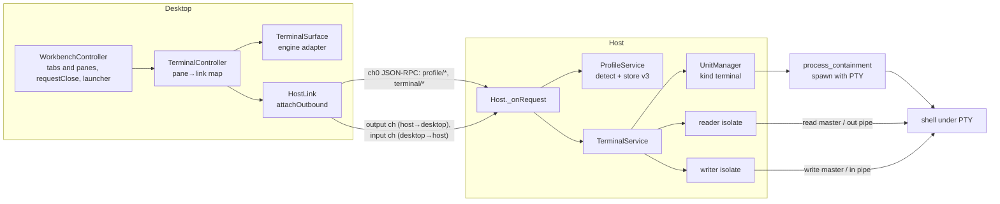
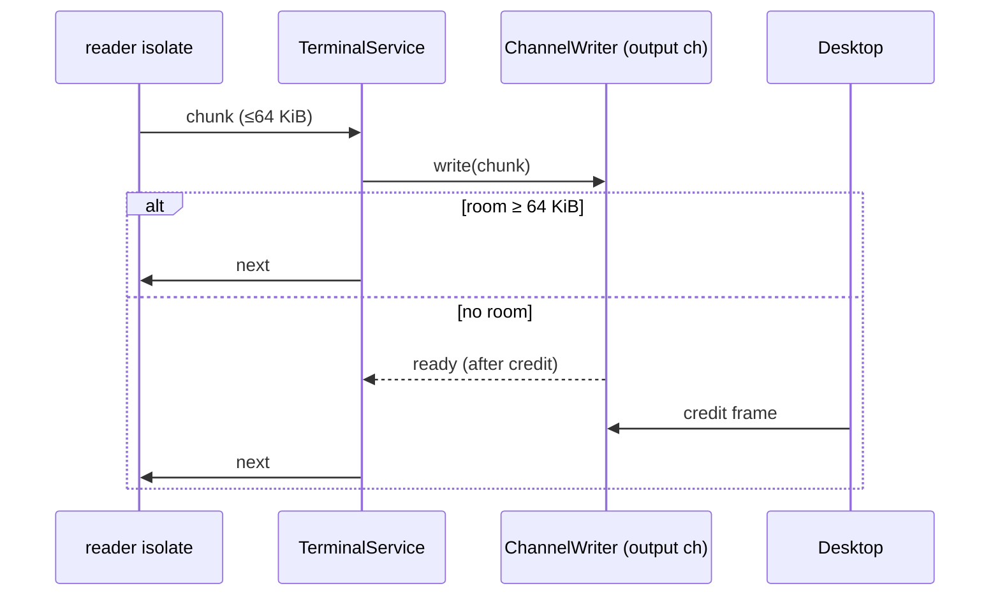

# Design

## Triage

| Trigger | Applies? | Evidence |
|---|---|---|
| T1 Components (new component, or 3+ with directed relationships) | Yes | New PTY spawn in `process_containment`, a host terminal service with per-terminal I/O isolates, a profile service, and a desktop terminal view behind an engine boundary: desktop → host → PTY → shell. |
| T2 State (persistent state, caches, 3+ state machine) | Yes | Store schema v3 (user profiles, default profile) and v4 (layout format 2, D11). A terminal lifecycle with five states (starting, live, exiting, ended, closed). A desktop pane-to-terminal map. |
| T3 Concurrency | Yes | Blocking PTY reads and writes on isolates, credit-driven backpressure, exit racing final output, concurrent opens and closes. |
| T4 Boundaries | Yes | New protocol methods and a capability, host-allocated desktop-to-host channels (`connection.dart:225-240` allows only sender-side allocation today), two store migrations, a new view kind, a new layout format whose store migration discards stored format 1 layouts (D11), and a third-party engine dependency. |
| T5 Volume | Yes | Unbounded terminal output (100 MB `cat`), user input bursts (paste), desktop scrollback, and the profile list. |
| T6 Risk | Yes | Process trees that must not leak (ADR 0001), and close confirmations that guard against losing running work. |

TIER: FULL

## Context

See `proposal.md` for scope; the M1 exit criteria are quoted there.

- **Units.** `UnitManager.launch({target, kind, argv})` (`packages/host/lib/src/unit_manager.dart:73-184`) runs the shutdown and reconcile gates, the Windows outer-job check, the unit cap (64), workspace identity and the cleanup gate. It then records the unit in the ledger as pending, spawns it and marks it running. Today's only kind is `test`. POSIX unit stdio is drained and ignored (`:205-207`).
- **POSIX spawn.** `Process.start(self, --unit-exec id -- argv)`, after which the shim calls `setsid()` and `execve` (`process_containment/lib/src/unit_exec.dart:20-47`). The scaffold design (D2) planned for the PTY change to extend this shim to open the slave and set the controlling terminal.
- **Windows spawn.** A new job per unit, then `CreateProcessW` with `CREATE_SUSPENDED | EXTENDED_STARTUPINFO_PRESENT | CREATE_NO_WINDOW`, `NUL` stdio and a `PROC_THREAD_ATTRIBUTE_HANDLE_LIST`, after which the process is assigned to the job and resumed (`windows_unit.dart:156-305`). The bindings are hand-written over `kernel32` (`windows_api.dart`); there is no `win32` package. Grepping for `CreatePseudoConsole`, `openpty` and `PTY` finds no PTY code.
- **Settle.** POSIX: SIGTERM to the process group, a 2 s grace period, then SIGKILL, with a pid and start-time guard. Windows: job termination with the D8 evidence rules (`settler.dart:38-41, 152, 182-184`).
- **Protocol.**
  - Frames are 10 bytes of header plus at most 64 KiB of payload.
  - `channelWindow` is 256 KiB and `maxChannels` is 32 (`frame_codec.dart:13,16`).
  - The fair writer sends control first, then data round-robin (`fair_writer.dart:287-348`).
  - `ChannelWriter.room` and `ready` give producer backpressure (`fair_writer.dart:33-131`).
  - Data channels are one-way, and today the sender allocates the id with `++_highestChannel` (`connection.dart:225-229`). Both peers allocating at once could collide.
  - Methods are gated by `methodCapability` (`messages.dart:40-54`).
  - The measured control-latency bound is a 250 ms worst-case round-trip under saturation (`packages/host/test/it/protocol_qualification_test.dart:213,238`).
- **Layout (format 1, before D11).** A split tree of `TabGroup{id, context, tabs, active}` leaves, each with its own tab strip, and `LayoutTab{id, kind, workspace, item, state ≤ 4 KiB}` (`domain/lib/src/layout/model.dart:8-30`). `layoutFormat = 1`, `maxTabGroups = 16`, `maxTabs = 128` (`bounds.dart`). A split adds an empty group, and an emptied group that is the only one stays (`operations.dart:73-107`).
  - The host decodes every stored and saved layout with the shared codec. An undecodable stored layout is returned as `restoreError` and not written at load (`host/lib/src/workbench_service.dart:46-77`). The `working_set` row has a `layout_format` column.
  - `openOrFocus` matches tabs on `kind` and `item` (`operations.dart:210-250`).
  - `closeTab` is a pure removal (`:192-206`).
  - The tab close button calls `controller.closeTab` with no confirmation (`desktop/lib/src/workbench_page.dart:731`).
  - **User decision (2026-10-30):** this layout is replaced by tabs that contain panes (D11).
  - Unknown kinds render as *Unsupported view* (`:753-771`).
- **Store.** Migrations v1 (ledger) and v2 (workspace, working set), each in its own transaction (`packages/host/lib/src/store/store.dart:13-67,133-155`). There is no settings table.
- **Audit.** Rule D1 lets `desktop` depend only on `host_protocol`, `domain` and `process_containment` (`tool/audit_dependencies.dart:250-325`).
- **CI.** Three OSes on Flutter 3.47.7, running analysis, package tests and the desktop integration tests, each against a built host (`.github/workflows/ci.yml`).
- **Constraints.** ADR 0001 (process ownership and cleanup), ADR 0002 (channels, credit, control priority), ADR 0003 (store), ADR 0006 (host PTYs, desktop emulation, spike), ADR 0009 (layout document; D11 changes its format and leaf shape).
- **Unverified assumption:** `flutter_alacritty` can be driven by bytes from an external source rather than its own PTY. ADR 0006 says its PTY backend is pluggable; the spike settles this as its first check.

## Decisions

### D1: The host PTY pipeline is built first, then the engine spike, then the UI

- **Choice:** Order the work into four steps:
  1. PTY spawn and I/O in `process_containment`, tested headless.
  2. Terminal channels and the terminal service in `host`, tested with the existing desktop stand-in.
  3. A spike harness in `desktop` (a debug-only entry, never in the release build) that renders a real host terminal through the `TerminalSurface` boundary (D7) with each candidate.
  4. The adopted engine wired into the workbench.

  The spike's per-OS results are recorded in `spike-results.md` in this change. Agent-scripted items run on all three OSes in CI. The work stops for the user's interactive results. User decision (2026-10-29): Linux and macOS user-verified items are recorded as `unproven` and the change finishes on Windows user results. `unproven` is a third result state, allowed only for user-verified items on Linux or macOS, never counted as pass and always listed by `tool/check_spike_results.dart`. A `fail` anywhere still blocks adoption. ADR 0010 records the adoption as provisional until those items are run. A later fail leads to a superseding ADR and a fix change.
- **Rejected:** Spike each engine with its own built-in PTY first, then build the host pipeline. It qualifies the wrong configuration: ADR 0006 requires external bytes, and an engine that only shines with its own PTY would pass. It would also need a second round of runs once the pipeline exists.
- **Reversal cost:** low. It only orders the work.

### D2: PTYs are spawned inside the existing containment primitive

- **Choice:** Add a PTY option to the existing spawn API instead of a new spawn path:
  - **Windows.** Create the pseudo-console with `CreatePipe` ×2 and `ConptyCreatePseudoConsole(size, inRead, outWrite)` from the bundled open-source ConPTY (below). Resize and close use `ConptyResizePseudoConsole` and `ConptyClosePseudoConsole` of the same library. Pass it as `PROC_THREAD_ATTRIBUTE_PSEUDOCONSOLE` in the attribute list, without `CREATE_NO_WINDOW` (it conflicts with pseudo-console attachment). A PTY unit inherits no handle, so it uses `bInheritHandles = FALSE` and no `PROC_THREAD_ATTRIBUTE_HANDLE_LIST` (an empty handle list is invalid). `STARTF_USESTDHANDLES` is set with all three std handles `INVALID_HANDLE_VALUE`; without it the shell inherits the host's own std handles (the desktop pipe) and its output bypasses the pseudo-console. Keep job-then-resume ordering.
  - **Bundled ConPTY (Windows, user decision 2026-10-30).** The host ships Microsoft's open-source ConPTY (`Microsoft.Windows.Console.ConPTY`, MIT): `conpty.dll` and the console host it starts, `OpenConsole.exe`, x64 only, vendored under `third_party/conpty/` with a `KUMIKO.md` giving the package version, SHA-256 of each file and the licence. A build hook in `process_containment` adds both as bundled code assets, so `dart build cli` places them side by side in the host bundle's `lib/` (beside `sqlite3.dll`), `dart run` and `dart test` find them in `.dart_tool/lib/`, and `tool/bundle_host.dart` carries them into the app unchanged. The bindings resolve the `Conpty*` functions through the asset id. When the bundled library cannot be loaded, the host falls back to the `kernel32` functions (the inbox `conhost`), so a damaged install still opens terminals. Measured on the user's machine, 100 MB written in 1 MiB blocks crossed the inbox ConPTY at about 18 MB/s and the bundled one at about 175 MB/s.
  - **POSIX.** The host calls `posix_openpt`, `grantpt` and `unlockpt`, then sets the initial size with `TIOCSWINSZ` on the master. It passes the slave path to the shim (`--unit-exec id --pty /dev/pts/N -- argv`). After `setsid()`, the shim opens the slave, calls `ioctl(TIOCSCTTY)`, `dup2`s it onto 0, 1 and 2, closes the original fd and then calls `execve`, keeping the shim's existing close-on-exec and signal reset.
  - **Exec-result pipe (POSIX).** Today `spawnPosixUnit` returns once the shim has started (`posix_unit.dart:156-170`), and an `execve` failure only prints to stderr and exits 126/127 (`unit_exec.dart:44-46`). That is indistinguishable from a shell that ran and exited with the same status. In PTY mode the shim's original stdout pipe (from `Process.start`) is no longer the program's stdout, so before the slave is `dup2`ed the shim moves that pipe to a high fd marked close-on-exec and uses it as a **status pipe**. Every PTY-setup step (open slave, `TIOCSCTTY`, `dup2`) and `execve` that fails writes one JSON line `{"stage": "<step>", "errno": N}` to it and exits. A successful `execve` closes it with no bytes written. `spawnPosixUnit` with the PTY option returns success only after reading EOF with zero bytes. On a status line, or on no EOF within 5 s, it throws `SpawnFailed(stage, errno)` after the unit is settled. Windows needs no pipe: `CreateProcessW` returns the error synchronously.
  - **Unit kind.** Terminal units are recorded as kind `terminal` and reconciled like any other unit.
- **Rejected:** A Dart PTY package (`flutter_pty` or similar) or the engine's own PTY. Both spawn outside our job, `setsid` and ledger path, so ADR 0001's cleanup guarantee would not cover terminal shells. The engine's PTY would also live in the desktop, which ADR 0006 rejects.
- **Reversal cost:** medium. Hidden behind `process_containment`'s spawn API.

### D3: Each terminal's PTY I/O runs on dedicated isolates, each owning its handles

- **Choice:**
  - **Reader.** Per terminal, one reader isolate owns the output handle (the POSIX master fd for reading; the Windows output pipe's read end). It makes blocking reads of at most 64 KiB and sends each chunk to the main isolate as a transferable typed data buffer. The reader has two modes:
    - **Relay** (normal). It holds at most one chunk in flight and waits for a `next` token before reading again. The main isolate sends `next` only after the chunk has been queued in the output channel's `ChannelWriter` and `room` covers another full chunk. With no credit the reader is parked and the host stops reading that PTY (ADR 0002, `architecture.md:78`).
    - **Discard** (teardown). On `discard`, sent when the terminal enters `closing`, the reader stops waiting for tokens and reads and drops bytes until EOF or the pipe breaks. A parked reader is always woken by `discard`. Teardown never depends on desktop credit.
  - **Writer.** A writer isolate owns the input handle (the POSIX master fd for writing, duplicated; the Windows input pipe's write end). It accepts **one** chunk (≤ 64 KiB) at a time and replies `written` after the native write returns. The main isolate pauses its subscription to the input channel while a chunk is with the writer and resumes it on `written`. Because `_Inbound.pump` stops at a paused controller (`connection.dart:91-102`), credit stops returning while the shell does not read its input. Writer error or death is an I/O failure (Failure & Visibility).
  - **Closer (Windows only).** `ClosePseudoConsole` runs on a short-lived closer isolate that owns the `HPCON`, never on the reader or the main isolate. A pseudo-console close waits for its output to be drained, and the reader keeps draining independently (relay mode for a normal exit, discard mode for a close), so neither path waits on the other.
  - **Pending console cleanups (Windows only).** A host-owned registry holds every closer whose `ClosePseudoConsole` passed its 5 s timeout, with its `HPCON`, pipe handles and closer isolate. Each entry keeps **one terminal admission slot** until the native call returns (entry removed, handles closed) or the host exits. The terminal admission check caps *active terminals + pending console cleanups* at 64; at that cap further opens are refused with the visible reason `console-cleanup-pending`. A service test injects repeated closer timeouts and asserts the cap, the retained ownership in the registry, and the admission refusal.
- **Rejected:** Non-blocking fds polled with a timer on the main isolate. Windows pipes (anonymous pipes from `CreatePipe`) support neither overlapped I/O nor non-blocking mode, so the two OSes would need different designs. Polling also adds latency or burns CPU at idle. Also rejected: closing the pseudo-console on the reader isolate, which deadlocks because the close waits for the drain that only that isolate performs.
- **Reversal cost:** low. Internal to the terminal service.

### D4: The host allocates both terminal channel ids

- **Choice:**
  - **Reserve before spawn.** `terminal/open` first reserves **two** channel slots atomically against `maxChannels` (a new `Connection.reserveChannels(2)`), so that an open at the limit fails with `channel-limit` before any shell starts. Every failure before `attached` releases the reservation; a failure after spawn also settles the unit through the normal end routine (`unit_manager.dart:167-178`), and the reservation is released only after that settle. The open result is sent only after the spawn is **confirmed executed** (the POSIX exec-result pipe, D2; `CreateProcessW` on Windows). A setup or exec failure returns `spawn-failed{stage, osError}`, or `executable-not-found` for `ENOENT`.
  - **Allocation, no traffic yet.** The host allocates both ids from its own counter and returns `{terminalId, outputChannel, inputChannel}`. It sends **no** data and **no** credit on either id yet, and its reader stays parked.
  - **Attach handshake.** After receiving the result, the desktop registers both ids, `attachInbound(output)` without sending credit yet and the new `attachOutbound(input)`, and then sends `terminal/attach {terminalId}`. On that request the host grants the input window, marks the output channel open and starts relaying, and the desktop grants the output window. Every frame on a terminal channel therefore follows a registration the receiver has completed, which `_expectClosed` requires (`connection.dart:304-310`).
  - **Attach timeout.** A terminal not attached within 10 s is closed by the host: the unit is settled and the reservation released.
  - **Channel limit.** `maxChannels` rises from 32 to 160: two per terminal for the unit cap of 64, plus room for session channels in change 4. The old value only covered test channels.
- **Rejected:** Each peer allocates its own direction from disjoint id ranges (desktop even, host odd). That splits allocation knowledge across both peers and changes the meaning of existing ids. Host-only allocation keeps one counter and needs only an additive method. Also rejected: one bidirectional channel per terminal, which would change the credit model the spec defines per direction.
- **Reversal cost:** high once shipped (the protocol contract). The evidence is strong: the collision exists in the code today (`connection.dart:225-229`).

### D5: Terminal control is JSON-RPC on channel 0 under a new `terminal` capability

- **Choice:**
  - **Methods:**
    - `profile/list`, `profile/save`, `profile/remove`, `profile/setDefault`;
    - `terminal/open {profileId, workspaceId?, cols, rows}`;
    - `terminal/attach {terminalId}` (D4);
    - `terminal/resize {terminalId, cols, rows}` (1 ≤ cols ≤ 1000, 1 ≤ rows ≤ 500);
    - `terminal/close {terminalId}`, which returns as soon as the host has entered `closing` (acknowledgement within the 250 ms control bound). Termination completes later.
    - `terminal/release {terminalId}`, sent by the desktop once it has consumed everything after `terminal/exited`. The host then closes both channels and forgets the terminal.
  - **Notifications:**
    - `terminal/exited {terminalId, status, reason: exited|closed|io-error, outputComplete}`. For a shell that exits on its own, it is sent only after the reader reached EOF **and** the output `ChannelWriter` has written every queued byte to the wire (`queued == 0`, last frame flushed). Because control and data share one ordered pipe, it reaches the desktop after the last output byte. A channel is never closed while it holds unsent output. Desktop credit stalls cannot truncate output: the host keeps the bounded queue until credit returns or the terminal is closed. `outputComplete` is also the desktop's condition for closing a pane automatically on a clean exit (D9): status 0 with `outputComplete` false keeps the pane ended with *output may be incomplete*. `outputComplete` is false only on the **read-deadline-expired** path: after process exit the reader gets 1 s of *active reading time* to reach EOF. Time parked waiting for output-channel capacity (no `next` token) does not count toward it, so desktop backpressure alone never expires it. When the deadline expires without EOF, the reader stops, every byte already read is flushed through the retained channel queue as usual, and `terminal/exited {outputComplete: false}` follows the last flushed byte without requiring EOF; the terminal then shows "output may be incomplete". A service/protocol test parks the reader with unread final PTY bytes for longer than 1 s, resumes credit, and asserts byte-exact delivery before `terminal/exited {outputComplete: true}`.
    - Any `terminal/exited`, natural exits included, is sent only after the unit's end routine (`UnitManager` end, `Settler.settle` with the marker scan) has confirmed cleanup.
    - `terminal/closeFailed {terminalId, reason}`, sent when cleanup could not be confirmed within the 30 s overall settlement deadline (Resource Bounds), for a close and for a natural exit alike. The unit is marked unresolved by the existing settle path.
  - **Errors:** `unknown-terminal`, `invalid-size`, `executable-not-found`, `spawn-failed{osError}`, `channel-limit`, `not-attached`, `console-cleanup-pending` (Windows, D3), plus the existing `unit-cap` and cleanup-gate refusals.
  - **Typing.** All are typed messages in `host_protocol` (ADR 0002 §3). The resize bounds above are stated once here.
- **Rejected:** Resize and exit as in-band escape sequences on the data channel. That forces the host to parse the byte stream, which ADR 0006 forbids, and a stalled channel would block resize.
- **Reversal cost:** high (protocol contract). It follows ADR 0002 and 0006 directly.

### D6: Profiles are host-owned: detected built-ins in memory, user profiles in store v3

- **Choice:**
  - **Built-ins.** At start the host detects shells off the main isolate. The probe list per OS is:
    - Windows: `pwsh`, `powershell`, `nu`, `bash` (Git Bash), `fish`;
    - Linux: `bash`, `zsh`, `fish`, `nu`, `pwsh`;
    - macOS: `zsh`, `bash`, `fish`, `nu`, `pwsh`.

    The host searches `PATH` and the well-known install locations. Each shell found becomes a built-in profile with the stable id `builtin:<name>` and is held in memory only.
  - **Store v3:**
    - `shell_profile(id TEXT PK, name, executable, args_json, cwd NULL, env_json, created_at, updated_at)`;
    - `setting(key TEXT PK, value TEXT)`, holding `default_profile`.
  - **Default.** On first launch the default is the first detected built-in in the probe order above. A default naming a missing profile is reported as unavailable, never replaced.
  - **Ownership.** `domain` holds the pure profile model and validation; the host validates every save again.
- **Rejected:** A user-edited profiles file read by the host. It is a second source of truth beside the store, edits race the host, and it needs a parser and a watcher. Also rejected: storing detected profiles, which would go stale when a shell is uninstalled (spec "A detected shell is removed later").
- **Reversal cost:** medium. The stored schema needs a migration to change.

### D7: The engine sits behind one `TerminalSurface` widget boundary in the desktop

- **Choice:**
  - **Interface.** `TerminalSurface` exposes:
    - `feed(Uint8List)`;
    - `Stream<Uint8List> input`;
    - `Stream<(int cols, int rows)> size`;
    - `scrollbackLimit`;
    - `ValueListenable<int> pending`: the bytes passed to `feed` that the engine has not yet applied to its grid. It counts bytes held before the engine is ready, bytes queued in the engine and the batch in flight, and falls to 0 once every fed byte is applied (review round 5);
    - `dispose()`.

    Each candidate has one adapter. A string-based engine such as xterm.dart decodes with a streaming UTF-8 decoder in the adapter; the host contract stays byte-exact.
  - **Session.** The desktop terminal controller pumps channel bytes into `feed` and pauses the channel subscription while `pending` is at or above 1 MiB, so credit stops at the host. It resumes when `pending` falls below 1 MiB. Bytes keep their order and none are dropped. A channel chunk already received when the pause begins is fed whole, so the bound is 1 MiB plus one chunk. `flutter_alacritty` queues fed bytes inside its client with no limit, so the vendored copy reports its queue and in-flight batch to the adapter (a third patch, `third_party/flutter_alacritty/KUMIKO.md`). It debounces `size` to at most one resize every 50 ms, plus a trailing resize.
  - **Dependency rule.** Only the adapter imports the engine package. Audit rule D1 restricts the desktop's dependencies on workspace members only, so the engine, an external package, needs no entry there.
- **Rejected:** The engine's types used across the workbench. Changing engines later, which is medium cost per ADR 0006, would then touch every terminal call site.
- **Reversal cost:** low behind the boundary.

### D8: Terminal panes carry only a profile reference; the live link is desktop memory

- **Choice:**
  - **Pane shape.** A pane (D11) with `kind: terminal`. `item` is a fresh UUID per launch, so `openOrFocus` never matches an existing terminal and every launch opens a new one. `state` is `{"profileId": ..., "profileName": ...}`, well under 4 KiB.
  - **Live link.** The desktop holds a `Map<paneId, TerminalLink>` (terminal id, channels, status, surface) in memory. A pane keeps its id through every move (D11), so moving a pane or a tab keeps its link, surface and scrollback, and sends nothing to the host.
  - **Split.** A split creates a terminal pane with the default profile and the split pane's workspace and starts it like a launcher terminal. With no default profile available, or without the `terminal` capability, the split is refused before any layout change.
  - **Reopen.** A restored pane has no link and shows *ended, not restored*. **Start shell** opens a new host terminal and links it to the same pane.
  - **Deleted profile.** If the profile no longer exists, the pane says so and **Start shell** offers the default profile.
- **Rejected:** Recording live terminal ids in the layout, so that reopen could try to reattach. ADR 0006 and D7 rule out process survival, so any stored id would always be stale, and it would invite a "running" claim that cannot be true.
- **Reversal cost:** low. The pane state is free-form JSON.

### D9: Close confirmations are a desktop policy over a per-kind `warnsOnClose` predicate

- **Choice:**
  - **Kind predicate.** Each registered view kind supplies `warnsOnClose(pane) → String?` (the reason, or null). For terminals it returns the reason whenever the link status is `live` (shell alive), with no detection of child processes.
  - **Close actions** (D11). Pane close and tab close both go through `WorkbenchController.requestClose(paneIds)`; a tab close passes every pane of the tab. It collects the reasons, shows one dialog naming every affected terminal, and on confirm sends `terminal/close` for each live terminal in parallel. Panes with nothing to wait for are removed at once; each terminal pane is removed when its close completes, and its sibling then takes its space. Moves never call it and never warn.
  - **Confirmed close is an intent that survives any exit reason.** Confirming sets `closeRequested` on the pane's link before `terminal/close` is sent. The pane shows *Closing…*. The controller removes a `closeRequested` pane on **any** `terminal/exited` (reason `closed`, `exited` or `io-error`), or on an `unknown-terminal` reply to its close after the earlier `exited` was received. `terminal/exited` of any reason is sent only after the unit's end routine has confirmed cleanup (D5), so removal always follows confirmed cleanup. On `terminal/closeFailed` the pane stays in place with the error and `closeRequested` is cleared, and the workspace shows the host's *cleanup unresolved* state where it applies. **Exits while the confirmation dialog is open** are independent of the dialog, which never freezes the terminal lifecycle. A clean exit (status 0, `outputComplete` true) removes that pane at once, whatever the user then chooses: confirm closes only the panes still present (the workbench rereads the layout and skips missing ids) and cancel leaves the others running. Any other exit leaves the pane `ended`, and confirm then removes it without sending another close (the received `exited` is the confirmation). In a mixed dialog (one pane exits cleanly while others are live) confirm closes the rest and cancel keeps them running. Cancel therefore changes nothing except the independent exits.
  - **A clean exit closes the pane (user decision 2026-10-30, after trying the release build: "when i close a nushell with ctrl+d, the pane/tab should close").** This follows Windows Terminal's graceful close-on-exit. When `terminal/exited` arrives with reason `exited`, status 0 **and `outputComplete` true** for a pane that is not `closeRequested`, the controller removes the pane through the same layout close operation as a user close, with no dialog because nothing is live. The removal is by the pane's stable id from the current layout, so it is correct after or before a move. Any other exit, without `closeRequested`, leaves the pane in `ended` with Start shell: a non-zero status, a signal or external kill, reason `io-error`, and a status 0 exit with `outputComplete` false (D5 keeps *output may be incomplete* visible; the read-deadline path is the only source of it). A user-requested close is unchanged, a restored pane has no link so it stays *ended, not restored*, and a shell started again with **Start shell** closes its pane on a clean exit as well. The ended view's terminal grid fills the pane height (a layout defect seen in the same session: the grid took only the top part).
  - **Removal does not wait for the engine.** The clean exit removes the pane and its link at once, unlike the ended state, which waits for the engine to take the last bytes. Output the desktop has not yet consumed is dropped with the pane; the host side is unchanged (it drained the PTY and flushed its queue before sending `terminal/exited`, and the controller sends `terminal/release` as for any removal). Host drainage and backpressure are untouched, and a stalled engine cannot keep a cleanly exited pane open.
  - **Focus follows D11, not a rule of its own.** The removal is the layout `closePane`, so the sibling takes keyboard focus only when the exiting pane was the window's focused pane. An unfocused pane in the active tab keeps its tab's focused pane; a pane of an inactive tab, or the only pane of one, leaves the active tab, the keyboard focus and `recent` unchanged (D11: closing a pane or tab that is not active changes neither). A background shell can exit with no user interaction, so it must not take focus.
  - **Per-pane link state machine** (desktop): `none` → `starting` → `live` → `closing` → `ended`, plus `ended` → `starting` via **Start shell**, and a removal branch: a clean exit (reason `exited`, status 0, `outputComplete` true) from `live` drops the link and the pane directly, without passing through `ended`.
    - **Start.** **Start shell** and the launcher are disabled while the pane is `starting`, so repeated starts are serialized.
    - **Warnings.** A `starting` pane warns like a `live` one, because its shell is about to exist.
    - **Close while starting.** Closing a `starting` pane removes it from the layout and keeps the pending open in an *orphan* list owned by the controller. When the open result arrives, the controller sends `terminal/close` instead of attaching; if the result is an error, the orphan is dropped. The host's 10 s attach timeout (D4) is the backstop.
    - **Host change.** A result from an earlier host connection is ignored; that host's processes are gone with it.
- **Rejected:** The host decides whether to warn, based on a per-terminal "busy" flag. It would need process-tree inspection that D7 explicitly does not require, and the close and exit confirmations belong to the desktop (`architecture.md:39`).
- **Reversal cost:** low.

### D10: The engine choice is recorded as ADR 0010 after the spike

- **Choice:** Write `docs/adr/0010-terminal-engine.md` (`Status: proposed`) during apply and complete it with the per-OS results table once the user's results are in. It is then accepted, provisionally while Linux or macOS user-verified items are `unproven`, and reviewed with this change's pre-ship review. `architecture.md` gains its index row.
- **Rejected:** Record the engine only in this design. ADR 0006 explicitly asks for a follow-up ADR, and the engine binds every later terminal feature.
- **Reversal cost:** low (a document).

### D11: Tabs contain panes: layout format 2; store migration v4 discards format 1 layouts

- **User decision (2026-10-30, after trying the release build):** replace the VS Code-style layout, a split tree of tab groups each with its own tab strip, where a group created by a split can sit empty and can never be closed, with the Tern, Orca and tmux model. In the user's words: "Tabs contain panes, not the other way around. I can have a tab with a few panes inside, not a pane with a few tabs inside... I want to have a terminal open on the whole free real estate." Later the same day: "we still have the two bars to the side, but in the middle we have terminals OR whatever other window we open (chat UI over ACP, tasks, editor, ...) and they can all occupy a full tab or that tab can be split in panes and have another thing in the pane." The user chose to do this inside `host-terminals`, not as a separate change. **User decision (2026-10-30), on the stored layouts:** "There is no actual used by anyone previous builds so irrelevant, we can be destructive right now." So a stored format 1 layout is discarded, not converted. **User decisions (2026-10-30, after design review round 6):** on focus after a close, "you go to the next tab or nowhere if there's no more tabs", so focus after a close follows tree and strip order, not history; and with no tabs the central area is a blank empty state like Orca's and Tern's (Tern shows "No terminals open / Every tab closed. Open one to start a shell." with a "New tab Ctrl+Shift+T" button), with one prominent **New terminal** and its shortcut. It amends the direction requirements "Tab groups and splits remain independent" and "Each tab group provides a labeled click launcher", and departs from direction decisions D28 ("Independent tab groups") and D30 ("The tab-group +"); D7 already spoke of "one tab containing four panes".
- **Choice:**
  - **Model.** The central area, between the left sidebar and the later right sidebar, which both stay outside it, is a strip of tabs. Each tab is a split tree whose leaves are panes. A pane hosts exactly one view for its whole life. View kinds are an open set: today terminal, workspace overview and *unsupported view*; later kinds such as chat over ACP, tasks or an editor are named only as examples and are not built here. The model, the operations and the codec treat every kind alike: any kind fills a one-pane tab or shares a split tab with any other kind, and splits and moves work the same for all. The one terminal-specific rule is the **default content of a split**: the desktop supplies a new terminal view (fresh UUID `item`, the default profile, the split pane's workspace) as the new pane's view. There are no empty panes: a split always has two children and a pane always has a view. Zero tabs is valid, and the central area then shows the empty state.
  - **Document (format 2).**

    ```json
    {"format": 2,
     "tabs": [{"id": "t1", "focusedPane": "p2",
               "root": {"type": "split", "id": "s1", "direction": "horizontal", "ratio": 0.5,
                        "first":  {"type": "pane", "id": "p1", "kind": "terminal", "workspace": "w1",
                                   "item": "0b6b7d8e-...", "state": {"profileId": "builtin:pwsh", "profileName": "pwsh"}},
                        "second": {"type": "pane", "id": "p2", "kind": "workspace-overview", "workspace": "w1",
                                   "item": "w1", "state": {}}}}],
     "activeTab": "t1",
     "recent": ["p2", "p1"],
     "sidebar": {"collapsed": false, "selected": "w1"}}
    ```

    - A pane is the format 1 tab shape `{id, kind, workspace, item, state}` with `type: pane`, and the pane id is the view's id. ADR 0009's field rules are unchanged: `workspace` is set at creation and never written by an operation, `item` drives open-or-focus, `state` is at most 4 KiB, and an unknown `kind` passes through unchanged.
    - `direction: horizontal` places the children side by side (**Split right**), `vertical` stacks them (**Split down**); `ratio` is the first child's share, 0.1 to 0.9, as in format 1.
    - `activeTab` is null if and only if `tabs` is empty; otherwise it names one of `tabs`, and validation rejects a dangling id. Each tab's `focusedPane` is one of its own panes; the focused pane of the window is the active tab's.
    - `recent` lists pane ids, most recently focused first, without duplicates or unknown ids. It is **sparse**: a valid document may omit panes. Its only use is `selectWorkspace`, which focuses the workspace's most recently focused pane; focus after a close, a move or a tab close never reads it. Dropping it was considered (below); workspace selection needs it.
    - `sidebar.selected` is the workspace new tabs bind to, or null for Personal. It replaces format 1's group contexts. It changes only through sidebar selection, Open folder and workspace removal; focusing a pane does not change it.
    - Ids are unique across tabs, splits and panes. Tabs have no title or workspace of their own: a tab shows its focused pane's view title, plus the pane count when it has more than one.
  - **Operations** (pure, in `domain`; the caller supplies every new id and the new view; none writes a view's `workspace`):
    - `openTab(view)` appends a one-pane tab at the end of the strip and activates it. `openOrFocus(kind, item, view)` focuses the pane with the same `kind` and `item` wherever it is, activating its tab, and otherwise opens a tab.
    - `splitPane(paneId, direction, view)` replaces the pane with a split of ratio 0.5, the old pane first and the new one second, and focuses the new pane.
    - `closePane(paneId)` puts the sibling in the parent split's place; closing a tab's last pane closes the tab. If the closed pane was its tab's `focusedPane`, the tab's `focusedPane` becomes the sibling's first pane in tree order (the leftmost leaf: `first` before `second`); otherwise it is unchanged. `closeTab(tabId)` removes a tab and all its panes. When the active tab closes (by `closeTab` or by its last pane), the tab to its right becomes active, else the tab to its left, keeping that tab's own `focusedPane`; with no tab left `activeTab` is null and the empty state shows. Closing a tab that is not active, or a pane of one, changes neither `activeTab` nor the window's focused pane.
    - `movePaneToNewTab(paneId, newTabId)` is refused for a tab's only pane; otherwise the pane leaves its tree as `closePane` would, so the source tab's focus follows the same tree-order rule, and becomes a one-pane tab right after its source tab, active and focused.
    - `moveTabIntoSplit(tabId, direction, splitId)` is refused for the active tab and when the panes would exceed the per-tab bound. The active tab's root becomes `first` of a new split of ratio 0.5 and the moved tab's root its `second`; the moved tab leaves the strip and its focused pane is focused.
    - `activateTab`, `focusPane`, `setRatio`, `selectWorkspace` (sets `sidebar.selected` and focuses the first pane in `recent` bound to it; when `recent` names none of its panes, its first pane in strip order and then tree order; when it has no panes, focus is unchanged), `clearSelection(workspaceId)` and `repairSelection(known)` complete the set.
    - **History maintenance.** Every operation that changes the window's focused pane (`openTab`, `openOrFocus`, `splitPane`, `focusPane`, `activateTab`, both moves, `selectWorkspace`, and a close that activates another tab or refocuses the active tab) puts the newly focused pane at the front of `recent`, removing its earlier entry. Removing panes deletes their ids from `recent`. A tab's `focusedPane` changing in an inactive tab does not touch `recent`. `setRatio`, `clearSelection` and `repairSelection` leave it unchanged.
  - **Bounds.** At most 128 tabs, 16 panes per tab and 128 panes in the document, so tabs ≤ panes ≤ 128. The existing bounds stay: document ≤ 256 KiB encoded, `state` ≤ 4 KiB, `item` ≤ 4 KiB, ids and kinds ≤ 64 B, ratio 0.1 to 0.9. The pane bounds reuse format 1's numbers (16 groups, 128 tabs), so every valid format 1 tab fits as a one-pane tab and neither the document nor the desktop's view count grows.
  - **Store migration v4 discards format 1 layouts.** ADR 0009 §2 requires a format change to ship with a store migration, so store step v4 runs in its own transaction like every step and is destructive by user decision: it sets the Personal `working_set` row's `layout` and `layout_format` to null, keeping the row and its revision so later saves stay revision-guarded. Nothing else is touched: workspaces, ledger, profiles and settings stay. The first start after the upgrade therefore loads no layout and shows the first-launch layout (no tabs, the launcher), with no restore notice. No format 1 decoder is kept and nothing is converted. This is an authorized exception to ADR 0009 decision 2 ("a store schema migration that converts stored documents"), recorded by ADR 0011; the rest of decision 2 still holds: the format change ships with a store schema version bump, the step runs in one transaction with the version change, and the store's refusal of a newer version keeps older builds out.
  - **Host validation.** `workbench/load` and `workbench/save` accept format 2 only; a format 1 document sent to save is refused `layout-invalid` ("unsupported layout format 1"). No code decodes format 1 any more. Save still refuses a pane bound to an unknown workspace (`unknown-workspace`). `sidebar.selected` is not checked at save; load repairs it to null when its workspace is gone, as format 1 group contexts were repaired. `workspace/remove` is refused while a pane is bound to the workspace, and clears `sidebar.selected` when it names it, stored at the next revision in the same transaction as the row deletion.
  - **Older builds.** Because the store goes to v4, an older build's host (main at store v2, earlier builds of this branch at v3) refuses the store as newer, leaves it unmodified, and its desktop shows the store error (local-store "A store is never reset or downgraded"). It never reaches the restore path. That path was checked: `WorkbenchService.load` writes nothing when the stored layout fails validation, but the older desktop then starts from an empty layout and its first layout save replaces the row (ADR 0009 §6). The store version gate keeps that from happening; this change already makes the same trade with store v3 for profiles. There are no released builds or users, so nobody is cut off.
  - **Desktop.** The tab strip shows each tab with its close button and a menu (**Move into split right**, **Move into split below**, **Close tab**), then the + launcher. Each pane has a header with its view title and workspace and the actions **Split right**, **Split down**, **Move to new tab** and **Close pane**; the focused pane is marked. Split dividers drag to set the ratio. With zero tabs the central area shows the empty state: a short message that no tab is open and one prominent **New terminal** button labeled with its shortcut; the + menu stays next to the tab strip for other view kinds. **New terminal** has a workbench shortcut, **Ctrl+Shift+T** on Windows and Linux and **Cmd+T** on macOS (Cmd+T is the macOS new-tab convention in Terminal.app, iTerm2 and browsers; Cmd+Shift+T there means reopen a closed tab). It works with or without tabs. The workbench handles it before key events reach the focused view, so a focused terminal never receives it; on macOS Cmd chords are not sent to the shell anyway. View state that must survive a move (terminal links and surfaces) is owned by controllers keyed by pane id, never by the pane widget, so a move rebuilds the widget around the same surface and nothing restarts. Drag-and-drop of panes and tabs is not built.
- **Rejected:**
  - **Keeping tab groups** (the model shipped by `local-store-and-workbench-shell`) and adding terminals to them. The user tried it and rejected it: a split leaves an empty group that cannot be closed, and a terminal cannot fill the central area without a group's tab strip around it.
  - **The group stopgap:** keep groups, close a group when it empties and hide the strip of a lone group. It removes the empty-group symptom but keeps panes that contain tabs, the model the user rejected, and every later view kind (chat, tasks, editor) would be built on it.
  - **Converting format 1 layouts:** each group's tabs, in tree order, become one-pane tabs keeping their ids, bindings and state, the focused group's active tab becomes the active tab, and a notice says the split arrangement could not be kept, shown until the next save. Also considered in that family: making the group tree one tab whose panes are each group's active tab. Rejected by user decision 2026-10-30: there are no released builds or users of format 1, so it is not worth the code (a frozen format 1 decoder, the conversion, the notice and its protocol field).
  - **Format 2 with no store version bump**, letting the decoder refuse format 1 at load. An older build would reach the restore path, and its first save would overwrite a format 2 layout (above). It also breaks ADR 0009 §2.
  - **Focus after a close from the most recently used pane** (the earlier D11 rule) and, after design review round 6 M1, **complete focus history** to make it total. Rejected by user decision 2026-10-30: "you go to the next tab or nowhere if there's no more tabs"; tree and strip order are predictable and need no history.
  - **Dropping `recent` entirely**, with workspace selection focusing a workspace's first pane in tree order. Kept instead: selecting a workspace returns to where the user last worked in it, and `recent` costs at most 128 ids.
  - **A separate change for the layout.** The user chose this change: terminals are the first view that needs the whole central area, and the close warnings are built on the same controller.
- **Reversal cost:** medium. The format is stored data, so reversing it needs another format and migration, and the desktop workbench is rebuilt around it. The domain model, operations and codec are pure and fully tested. Until this change merges, no shipped build writes format 2.

## Diagrams (FULL)

**T1 components:**



**T2 terminal lifecycle (host):**

```mermaid
stateDiagram-v2
  [*] --> starting: terminal/open (2 channel slots reserved)
  starting --> closed: refused / spawn failed (reservation released)
  starting --> spawned: shell running, ids returned, no traffic
  spawned --> live: terminal/attach (credit granted both ways)
  spawned --> closing: attach timeout 10 s / terminal/close
  live --> exiting: shell exits on its own
  live --> closing: terminal/close (ack ≤ 250 ms, reader → discard)
  exiting --> closing: terminal/close during final drainage (reader → discard, queued output discarded, even with no credit)
  exiting --> ended: reader EOF + output queue flushed → terminal/exited{outputComplete true}
  exiting --> ended: read deadline expired (1 s active reading, parked time excluded) + queue flushed → terminal/exited{outputComplete false}
  closing --> ended: tree terminated → terminal/exited{closed}
  closing --> unresolved: 30 s overall settlement deadline passed → terminal/closeFailed
  ended --> closed: terminal/release (or pane closed) → channels closed
  unresolved --> closed: channels closed; unit stays unresolved in ledger
  closed --> [*]
```



**T3 output backpressure:**



**T4 open sequence:**

```mermaid
sequenceDiagram
  participant D as Desktop
  participant H as Host
  D->>H: terminal/open {profileId, workspaceId, cols, rows}
  H->>H: reserveChannels(2) or fail channel-limit
  H->>H: resolve profile, cwd, env; UnitManager gates
  H->>H: spawn under PTY (kind terminal); reader parked
  H-->>D: {terminalId, outputChannel A, inputChannel B} (no frames on A/B yet)
  D->>D: attachInbound(A) (no credit yet), attachOutbound(B)
  D->>H: terminal/attach {terminalId}
  H->>H: register A outbound, B inbound
  H-->>D: credit on B (input window)
  H-->>D: attach result
  D-->>H: credit on A (output window)
  H-->>D: data on A (reader → relay)
  D-->>H: data on B (within credit)
```

## State & Ownership (FULL)

| State | Owner (sole writer) | Lifetime | Invalidation / rebuild | Authoritative copy |
|---|---|---|---|---|
| User shell profiles | Host `ProfileService` (store v3) | Until removed | Never rebuilt | Store `shell_profile` |
| Default profile id | Host `ProfileService` | Until changed | Unavailable when it names a missing profile | Store `setting` |
| Built-in profiles | Host `ProfileService` (memory) | One host run | Re-detected at every host start | Host memory |
| Terminal record (id, unit, channels, status) | Host `TerminalService` | `starting` to `closed` | Never rebuilt; gone with the host | Host memory |
| Terminal unit row | Host `UnitManager` (ledger) | Spawn to end | Reconciled by the next host after a crash | Store `unit` |
| Pane-to-terminal link and surface | Desktop `TerminalController` | While the pane and desktop live, through moves; dropped with the pane on a user close or a clean exit (status 0) | Lost on reopen, so the pane shows *ended* | Desktop memory |
| Terminal pane (kind, item, profile ref) | Desktop layout (ADR 0009, format 2, D11), saved by the host | Until the pane is closed | Restored on reopen | Store `working_set.layout` |
| Tabs, split trees, active tab, focused panes, sidebar selection | Desktop layout (D11), saved by the host | Until changed | Restored on reopen; a missing selected workspace is repaired to Personal | Store `working_set.layout` |
| Scrollback and screen | Desktop engine | While the pane is open, through moves | Lost on close, crash or reopen | None durable |
| PTY size | Host (applied from desktop resize) | Terminal lifetime | Re-sent on view attach | Host PTY |

## Failure & Visibility (FULL)

| Component | Fails / dies mid-operation → | Recovery | Retry safe? | Who finds out |
|---|---|---|---|---|
| Spawn (missing or unrunnable executable, PTY setup or `execve` failure) | Shim reports `{stage, errno}` on the status pipe (POSIX) or `CreateProcessW` fails (Windows); unit settled, then reservation released, no unit row survives; error result | User fixes the profile or picks another | Yes | User: error with path and OS reason in the pane |
| Reader or writer isolate dies or errors | No more output, or input stops | Terminal service enters `closing`: tree terminated, then `terminal/exited {reason: io-error}` | No (new terminal) | User: ended state with reason; host log |
| Writer blocked (shell not reading input) | Writer holds one chunk; input subscription paused, so credit stops; desktop input queue fills | Desktop stops accepting input beyond its queue and shows *input paused* | n/a | User |
| Shell exits on its own | Normal | Reader EOF, queue flushed, then exit notification; channels kept until `terminal/release`. On the desktop, status 0 removes the pane through the layout close (D9) and releases the channels; any other status leaves the pane ended | n/a | User: pane closes on status 0; otherwise exit status shown |
| Desktop never attaches (crash between open and attach, or orphaned open) | Shell running, no traffic | 10 s attach timeout closes the terminal | n/a | Nobody needs to: no process survives (agent test) |
| Spawn succeeds, then something fails before attach | Unit running, reservation held | Unit settled by the normal end routine, reservation released, error result | Yes | User: error in the pane |
| `terminal/close` cannot confirm the tree ended | Unit marked unresolved by the existing settle path; `terminal/closeFailed` | Existing cleanup retry and confirm UI | Yes (cleanup retry) | User: pane error, workspace *cleanup unresolved* |
| `ClosePseudoConsole` exceeds 5 s | Process tree already terminated by the job; conhost lingers | Entry moved to the pending-console-cleanup registry (D3), holding one admission slot until the call returns or the host exits; conhost dies with the host's outer job | n/a | User: notice "terminal console host still running until Kumiko restarts"; host log |
| Host dies | All PTYs close (outer job on Windows; SIGHUP plus process group on POSIX); next host reconciles `terminal` units | Existing reconciliation | Yes | User: host status page; terminal panes show *ended* |
| Desktop dies | Host stdin EOF, host shutdown ends all units | Existing shutdown path | n/a | Nobody needs to: no process survives (agent test) |
| ConPTY host (conhost/OpenConsole) | Spawned by the host process, outside the unit job; `ClosePseudoConsole` on terminal end; dies with the host's outer job | Host-death test covers it | n/a | Agent test asserts no leftover conhost |
| Profile save, store write fails | No change | User retries | Yes | User: error in the profile editor |
| Engine adapter throws on feed | Pane shows a render error; host terminal kept | User can close (with warning) | n/a | User; desktop log |
| Store v4 discards a stored format 1 layout (D11, by design) | Layout row cleared, migration succeeds | First start shows the first-launch layout | n/a | User sees the first-launch layout; no notice (user decision 2026-10-30) |
| Store v4 migration fails (SQL error) | Transaction rolled back, store stays v3 | Existing migration-failure path; startup blocked | Yes (next start) | User: store error page |
| Older build starts on a v4 store | Store refused unmodified (`store-newer`) | Run this build or a newer one | n/a | User: store error page with both versions |
| Split refused (pane limit, no default profile, no terminal capability) | Layout unchanged | User picks a default profile or closes panes | Yes | User: reason on the split action |
| Split's terminal refused by the host (unit cap, workspace unavailable, cleanup unresolved) | New pane kept, no terminal | **Start shell** in the pane, or close it | Yes | User: reason in the new pane |
| Tab close partly fails | Closed panes stay removed; failed panes stay with their ids and errors; tab kept while any pane remains | Close again, or the cleanup retry | Yes | User: error in each failed pane |

## Resource Bounds (FULL)

| Queue / buffer / cache / transfer | Bound | At the bound | Timeout | At 10x / 100x |
|---|---|---|---|---|
| Host output per terminal | 256 KiB channel window plus one 64 KiB reader chunk | Reader parked, PTY not read; the shell blocks on write | none | 64 terminals × 320 KiB ≈ 20 MiB host worst case |
| Host input per terminal | 256 KiB inbound window, plus ≤ 256 KiB already handed to the paused stream controller, plus one 64 KiB chunk with the writer: ≤ 576 KiB | Subscription paused, so no credit returns and the desktop stops sending | none | 64 terminals × 576 KiB ≈ 36 MiB worst case, only when every shell stops reading input |
| Output held after exit | Same output bound; kept until credit returns, `terminal/release` or close | Nothing new is read (process gone) | none (bounded memory, closing discards) | Bounded. On the desktop a clean exit (status 0, `outputComplete` true) removes the pane without waiting for the engine, dropping unconsumed output and releasing the terminal; host drainage and backpressure are unchanged |
| Unattached terminal | 1 per open | Closed by the host | 10 s attach timeout | Bounded by unit cap |
| Close acknowledgement | n/a | n/a | ≤ 250 ms (control bound) | Holds under saturation (qualification test) |
| Close completion (termination confirmed) | n/a | `terminal/closeFailed`, unit unresolved | Overall settlement deadline of 30 s, covering termination (POSIX SIGTERM, 2 s grace, SIGKILL; Windows job termination), both marker-scan passes and scan settling (`Settler.settle`, `runMarkerScan`); `ClosePseudoConsole` ≤ 5 s on Windows falls within it. Completion is reported only after cleanup confirmation | n/a |
| Desktop input queue per terminal | 1 MiB | Further input refused, *input paused* shown | none | Large pastes above 1 MiB are refused with a message |
| Desktop pending feed per terminal (`TerminalSurface.pending`) | 1 MiB plus one channel chunk | Channel subscription paused until `pending` falls below 1 MiB, credit stops | none | Bounded, including a stalled engine |
| Desktop scrollback | Engine line cap, default 10 000 lines, configurable | Oldest lines evicted | n/a | Memory ∝ cap × width |
| Data channels per connection | 160 (D4) | `channel-limit` refusal | n/a | Unit cap 64 binds first |
| Terminals per host | Existing unit cap 64, shared with all units | `unit-cap` refusal shown | n/a | Bounded |
| Pending console cleanups (Windows) | Active terminals + pending console cleanups ≤ 64 (D3) | Open refused with `console-cleanup-pending` | 5 s per `ClosePseudoConsole` before an entry is registered | Bounded; entries clear when the native call returns or the host exits |
| Resize messages | At most one per 50 ms per terminal plus a trailing one | Coalesced | n/a | Bounded |
| User profiles | 64 profiles; ≤ 256 args of ≤ 4 KiB each; ≤ 128 env entries; ≤ 64 KiB per profile | Save refused with a reason | n/a | Bounded |
| Shell detection | ≤ 20 probes, 2 s total, off the main isolate | Remaining probes skipped and logged; found ones offered | 2 s | n/a |
| Layout tabs (format 2, D11) | ≤ 128 tabs; never more tabs than panes | Launcher refused with the limit shown | n/a | Bound by the pane bound |
| Layout panes (format 2, D11) | ≤ 16 panes per tab, ≤ 128 panes per document (format 1 had ≤ 16 groups, ≤ 128 tabs) | Split, launcher and **Move into split** refused with the limit; a document over it is `layout-invalid` | n/a | 128 views, as format 1 allowed |
| Layout document (format 2) | ≤ 256 KiB encoded; `state` ≤ 4 KiB; `item` ≤ 4 KiB; ids and kinds ≤ 64 B; ratio 0.1 to 0.9 (unchanged from ADR 0009) | Save refused `layout-invalid` | n/a | Bounded |
| Store v4 step | One row updated in one transaction | n/a | n/a | n/a |
| Post-exit PTY read (reaching EOF/EIO after the shell exited) | Until EOF, capped at 1 s of active reading after process exit; time parked for output-channel capacity is excluded | Read stops; bytes already read are flushed; `terminal/exited {outputComplete: false}`, shown in the pane (a status 0 exit with it keeps the pane, D9) | 1 s active reading | n/a |

## Flow & State Gaps (FULL)

- **Exit races final output.** The reader keeps relaying until EOF (POSIX `EIO` once the slave closes; Windows: after process exit the closer isolate calls `ClosePseudoConsole` while the reader keeps draining until the pipe breaks). `terminal/exited` waits for EOF (or the read-deadline-expired path, D5) and an empty, flushed output queue. Bytes always precede the exit notification. The read deadline counts only active reading time, so parking for credit never truncates output; only a PTY that keeps producing no EOF for 1 s of active reading ends with `outputComplete: false`.
- **Close while output is stalled.** Close is a control message, so it is never queued behind data, and it is acknowledged within the control bound. The reader switches to discard (D3), so it never waits on credit. The tree is terminated, untransmitted output for that terminal is discarded on purpose (the user chose to close), and the channels close when `terminal/exited {closed}` is sent.
- **Close and exit at the same time.** On the host, close during `exiting` moves to `closing`. The reader switches to discard and the queued output is dropped, so close never waits on desktop credit. The host then sends `terminal/exited {closed}` after cleanup is confirmed. A close that arrives after `ended` or `closed` gets `unknown-terminal`. On the desktop, `closeRequested` (D9) makes either exit reason, or `unknown-terminal` after a received `exited`, remove the pane. A confirmed close therefore never leaves its pane or tab open. Tests: controller tests for exit during the confirmation dialog and exit before close acknowledgement; a host service test for close during credit-stalled final drainage.
- **Concurrent opens.** Host-side allocation and the atomic two-slot reservation (D4) make ids unique and refuse cleanly at the limit. Each open passes the unit cap independently, so an over-cap open fails alone.
- **Close while starting.** Handled by the desktop orphan list and the host attach timeout (D9, D4).
- **A program ignores SIGTERM.** The close is acknowledged at once and the pane shows *Closing…*. SIGKILL follows after the 2 s grace period, and `terminal/exited {closed}` arrives only after the marker scan confirms cleanup, within the 30 s overall settlement deadline (Resource Bounds). Past that deadline the host sends `terminal/closeFailed` and the unit stays unresolved. A containment/service test with an escaped marked descendant and a delayed scan asserts that completion follows cleanup confirmation, and that an expired deadline stays visible and unresolved.
- **Input after exit.** Frames for a closed inbound channel are dropped (existing `connection.dart:304-310`).
- **Resize before the link is ready.** The desktop holds the latest size and sends it right after open; open carries the initial size.
- **Profile edited or removed while in use.** The running terminal keeps the argv it started with. Pane state keeps the profile id, and reopen resolves it again (D8).
- **Desktop reconnects to a new host.** All links are dropped and every terminal pane shows *ended*. No reattach.
- **Restart in the middle of the v3 migration.** The step runs in its own transaction (`store.dart:133-155`), so it either completes or did not happen.
- **Tab close partly fails.** Panes whose close succeeded are removed and their siblings take their space. Panes whose close failed stay, with their errors. The tab stays while any pane remains.
- **Move while a terminal is starting or closing.** A move changes only the layout; the link keeps its state and its pending open or close, keyed by the unchanged pane id.
- **Split whose terminal the host refuses.** A split whose new terminal is refused by the host (unit cap, workspace unavailable, cleanup unresolved) keeps the new pane, showing the refusal and **Start shell**, as a launcher terminal does; it is a terminal view, not an empty pane. Only refusals known before the layout change (pane limits, no default profile, no capability) refuse the split itself.
- **Restart in the middle of the v4 migration.** The step runs in its own transaction, so the layout is either cleared with the version at v4, or untouched at v3.

## Mechanism Ledger (FULL)

| Mechanism | Built? | Why (harm nobody catches / expensive later) | Evidence that would change the call |
|---|---|---|---|
| Host-allocated input channel ids | Yes | The collision is real in today's code and the contract is expensive to change later | n/a |
| One-chunk-in-flight reader handshake | Yes | Without it the host buffers unbounded output from a fast program for a stalled desktop, which nobody notices until memory runs out | n/a |
| Output drain and flush before exit notification; channels kept until release | Yes | Without it the last lines of output are lost (for example a build error), invisibly (round-1 review C2) | n/a |
| Attach handshake before any channel traffic | Yes | Without it the first credit frame is a protocol violation that drops the connection and every unit (round-1 review C1) | n/a |
| Reader discard mode and a separate closer isolate | Yes | Without them, closing a saturated or credit-stalled terminal can deadlock on Windows and leak conhost (round-1 review C3) | n/a |
| Writer one-chunk admission | Yes | Without it credit returns before input is written and the host queues input without bound (round-1 review M4) | n/a |
| Atomic two-slot channel reservation before spawn | Yes | Without it an open at the limit starts a shell and then fails (round-1 review M1) | n/a |
| Desktop orphan list for opens that finish after their pane closed | Yes | Without it a shell runs with no pane until the attach timeout, so the user's close is not honoured promptly (round-1 review M2) | n/a |
| Conversion of format 1 layouts with a notice (D11) | No | There are no released builds or users of format 1 (user decision 2026-10-30) | Someone needs their format 1 layout back |
| Store version gate for format 2 (v4) | Yes | Without it an older build's first save overwrites the format 2 layout, unseen (D11) | n/a |
| Drag-and-drop of panes and tabs | No | Menu actions cover the required moves (D11) | Users ask for drag gestures |
| Resize debounce | Yes | A resize storm floods channel 0 ahead of other control | n/a |
| Busy-process detection for close warnings | No | D7 says no busy detection is needed; warning while the shell is alive is a superset | Users report too many prompts on idle shells |
| Scrollback persistence | No | Reopen is layout-only by decision (ADR 0006) | A superseding decision |
| Shell integration (prompt marks, cwd) | No | Optional per spec; none ships | A later change scoped for it |
| Re-detection of shells while running | No | Detection at start meets the spec; a restart picks up new shells | Users installing shells mid-session expect them at once |
| Input write timeout | No | Credit already bounds queued input; a blocked writer only stalls its own terminal | A writer isolate hanging close or shutdown (covered by the settle path, which closes the fds) |

## Risks / Trade-offs

- [Both engines fail part of the bar (IME, mouse, vttest)] → The escalation path is in the spec and the spike reports failures per item. The change pauses for the user's decision instead of adopting a partial engine.
- [`flutter_alacritty` brings a Rust toolchain into CI on three OSes] → The spike records the build cost. CI caches the toolchain. The adapter boundary (D7) keeps a swap to xterm.dart local.
- [The adopted engine carries a local patch (user decisions 2026-10-30)] → `alacritty_terminal`, the plugin's native crate and the plugin's Dart package are vendored under `third_party/`; the native crate is always built from source. Each `KUMIKO.md` names the upstream revision and the patch, and the patch can be offered upstream. The Dart package's patch draws cell backgrounds as one triangle batch: its per-cell rects ask for no anti-aliasing, which Impeller (the Windows and macOS renderer) does not honour, so every row edge showed the default background as a dark line. Moving to a newer upstream means re-vendoring and re-applying the patch until upstream carries it.
- [The host ships third-party Microsoft binaries (`conpty.dll`, `OpenConsole.exe`; user decision 2026-10-30)] → They are Microsoft-signed, MIT-licensed builds of the open-source Windows console, as Windows Terminal, VS Code (node-pty) and other terminals ship. `KUMIKO.md` pins the package version and SHA-256 of each file; an update replaces both together. If they fail to load, terminals fall back to the inbox ConPTY rather than failing.
- [`ClosePseudoConsole` hangs while its output pipe is not drained (a known ConPTY behaviour on older Windows builds)] → Close runs on its own closer isolate while the reader drains independently, in discard mode for a close (D3). A Windows test closes a saturating terminal with no desktop output credit and asserts that close completes within the 30 s overall settlement deadline and no conhost remains.
- [POSIX shim `TIOCSCTTY` behaviour differs between Linux and macOS] → The shim opens the slave without `O_NOCTTY` and then calls `TIOCSCTTY` explicitly, which is valid on both. A per-OS test checks `tty` and job control (Ctrl+Z, `fg`) in bash.
- [Raising `maxChannels` raises the worst-case memory per connection] → The unit cap still bounds terminals. The architecture resource table is updated with real numbers.
- [Linux and macOS interactive items are unproven at merge (user decision 2026-10-29)] → Agent-scripted bar items still run on all three OSes in CI. The unproven items stay listed in `spike-results.md` and in ADR 0010. The M1 daily-driver exit criterion stays unverified until they are run, and milestone close lists it. A later fail leads to a superseding ADR and a fix change.
- [The upgrade discards any stored format 1 layout (user decision 2026-10-30)] → There are no released builds or users; workspaces, profiles and the ledger are kept, and only the arrangement of the developer's own test profiles is lost.
- [Older builds can no longer open the profile once this build has run (store v4)] → They refuse the store unmodified with a visible error rather than overwrite the layout; store v3 in this change already does the same.
- [The desktop workbench is reworked while the earlier terminal UI work is uncommitted] → The per-pane link controller, profiles, close confirmation and ended view carry over in substance; only the group and split UI is replaced (tasks group 8).

## ADRs

- **In force, constraining this change:** 0001 (child host, containment, cleanup), 0002 (frames, channels, credit, control priority), 0003 (host-owned store), 0006 (host PTYs, desktop emulation, spike), 0009 (layout document).
- **To record during apply:** 0010 terminal engine (the adopted engine with per-OS spike results; ADR 0006 follow-up); 0011 workbench tabs contain panes (D11: layout format 2 and its store migration). It amends ADR 0009 decision 3, whose tab shape becomes the pane shape inside tabs, and decision 2, recording the authorized exception that store v4 discards format 1 layouts instead of converting them while the schema-version gate and the transactional migration stay required; ADR 0009's other decisions stay in force.

## Open Questions

- The exact vttest subset (named in `spike-results.md` before the spike runs, as the M1 exit criterion requires).
- Default scrollback cap, if 10 000 lines proves too small in the spike.
