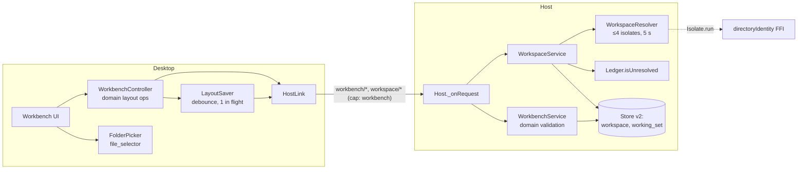
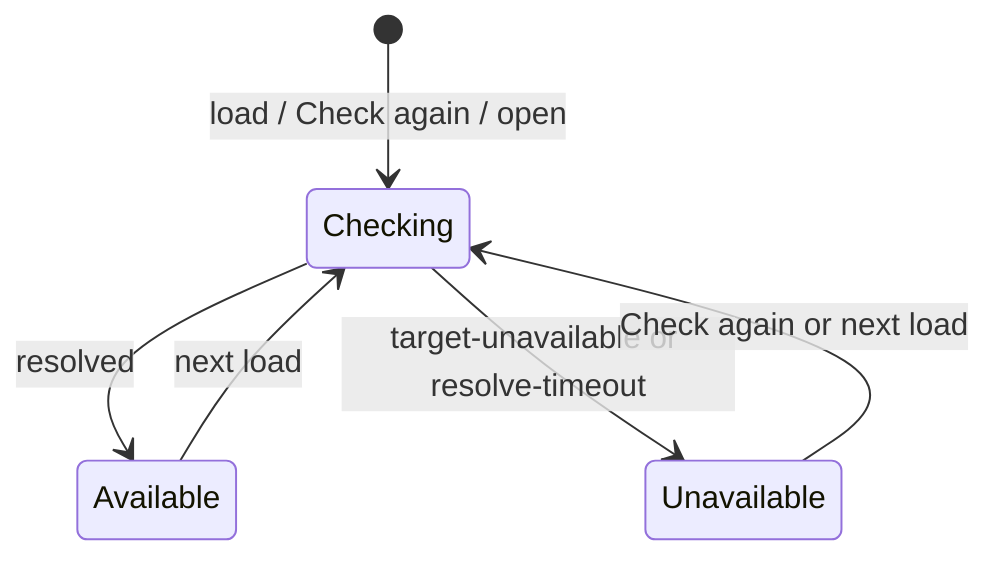

# Design

## Triage

| Trigger | Applies? | Evidence |
|---|---|---|
| T1 Components (new component, or 3+ with directed relationships) | Yes | New host services (workspace, layout) and a desktop workbench controller across `domain`, `host_protocol`, `host` and `desktop`; desktop → host → store and → resolver isolate. |
| T2 State (persistent state, caches, 3+ state machine) | Yes | New store tables (schema v2); desktop save state machine (idle, pending, in flight, failed); workspace availability (available, unavailable, checking). |
| T3 Concurrency (background work, workers/isolates, async, retries) | Yes | Debounced saves with one in flight; directory resolution in short-lived isolates with timeouts; cleanup-state notifications racing workspace loads. |
| T4 Boundaries (data format, migration, shared interface, IPC, external) | Yes | Store migration v1 → v2; a stored layout document format later changes extend; new protocol methods and capability; native directory picker. |
| T5 Volume (grows without a fixed bound) | Yes | Workspaces, tabs, groups and layout document size would grow without caps. |
| T6 Risk (security, money, data loss, unrecoverable user data) | Yes | Losing the user's layout or workspace list; never touching the user's directories on removal. |

TIER: FULL

## Context

The proposal is in [proposal.md](proposal.md). Current state the approach builds on:

- **Store core.** `Store.open` migrates by a list of steps, one transaction each, with `PRAGMA user_version` (`packages/host/lib/src/store/store.dart:12-42`, `:113-138`). Schema v1 holds `host_instance` and `unit` only. A v2 step appends to `schemaMigrations`.
- **Host request dispatch.** One `switch` on the method in `Host._onRequest` (`packages/host/lib/src/host.dart:221-243`). Services are built in `_onHello` after the lock and store (`host.dart:166-217`). The release host advertises no capabilities today: `capabilities: extension?.capabilities ?? const {}` (`host.dart:81`).
- **Capability gating.** `methodCapability` maps methods to capabilities (`packages/host_protocol/lib/src/messages.dart:30-36`), and `Connection` refuses a method whose capability was not negotiated (`packages/host_protocol/lib/src/connection.dart:416`). Messages are hand-written classes with `fromJson`/`toJson` and `_req`/`_opt` helpers (`messages.dart`, for example `CleanupState` at `:372-397`).
- **Directory identity.** `directoryIdentity(path)` returns `ResolvedDirectory(realPath, id)` or `TargetUnavailable` (`packages/process_containment/lib/src/fs_identity.dart:10-47`). It is a synchronous FFI call; `UnitManager.launch` calls it on the host isolate (`packages/host/lib/src/unit_manager.dart:102`). The cleanup gate matches by identity or path (`packages/host/lib/src/ledger.dart:232`).
- **Cleanup state.** `cleanup/state` carries counts and a revision only (`messages.dart:372-397`). `Ledger.isUnresolved(identity:, path:)` answers per directory (`ledger.dart:228-236`).
- **Desktop.** `KumikoApp` shows `HostStatusPage` over a `HostController` `ChangeNotifier` (`packages/desktop/lib/main.dart:62-92`, `packages/desktop/lib/src/host_controller.dart:22-124`). UI reaches the host only through the `HostLink` interface (`packages/desktop/lib/src/host_link.dart:6-36`), which widget tests script with a fake (`packages/desktop/test/support/fake_host.dart`). No state-management package is used. Quit runs `controller.shutdown()` from `AppLifecycleListener.onExitRequested` (`main.dart:70-76`).
- **Tests.** Host integration tests run the real host executable through a desktop stand-in (`packages/host/test/it/support/harness.dart`). Migrations have unit tests (`packages/host/test/store/migrations_test.dart`). The desktop integration test needs the bundled host next to the debug app (`packages/desktop/integration_test/launch_test.dart`).
- **macOS.** The app is not sandboxed (`packages/desktop/macos/Runner/Release.entitlements` is empty), so the directory picker needs no user-selected-files entitlement. `file_selector` documents that entitlement only for sandboxed apps.
- **Product backlog.** Requirements come from `document-kumiko-direction` `workbench-layout` and `execution-workspaces`, with D4, D7, D28, D29, D30 and D41. They are cited per requirement in the specs.

## Decisions

### D1: The layout is a desktop-authored snapshot document, validated and stored by the host

- **Choice:** The desktop owns the live layout in memory and edits it. Each change produces a whole-layout document for the working set, sent to the host by `workbench/save`. The host validates it with the shared `domain` codec and its bounds, checks that every bound workspace id exists, and stores it in one row per working set. The host is the store's only writer (ADR 0003); the desktop never sends partial edits.
- **Rejected:** A host-owned layout model edited through fine-grained protocol operations (`tab/move`, `group/split`, and so on), because:
  - every UI gesture would become a protocol method with its own error path;
  - the layout would live in two processes with ordering between them;
  - each new tab kind would need host changes.

  The layout carries no authority: binding a tab to a workspace grants nothing, and launches are still checked by the host. So validation of a snapshot is enough.
- **Also rejected:** Normalized `tab_group`/`tab` tables. The tree with ratios and active and recent tabs maps badly to rows, and every save would rewrite many rows for no query benefit, since nothing queries layout except by working set.
- **Reversal cost:** Medium. The document is stored data. Its `format` field and the codec make a later conversion one migration step. Recorded as ADR 0009 because later tab kinds extend it.

### D2: The layout model, its operations and its bounds live in `domain`

- **Choice:** `domain` gains the pure layout model:
  - working-set document, split node, tab group, tab;
  - operations: split, move, close, open-or-focus, select workspace, set ratio, collapse sidebar;
  - validation with the bounds from Resource Bounds;
  - the JSON codec.

  The desktop applies operations to it. The host decodes and validates with the same code. `host_protocol` (which already depends on `domain`) carries the document as the codec's JSON.
- **Rejected:** Model and validation in the desktop, with the host storing opaque JSON. The host could not refuse an oversized or malformed document, so a desktop bug would persist a layout that no later build can load.
- **Reversal cost:** Low. A package boundary only.

### D3: Schema v2: `workspace` and `working_set`

- **Choice:** One migration step adds:
  - `workspace(id TEXT PRIMARY KEY, path TEXT NOT NULL UNIQUE, identity TEXT NOT NULL, label TEXT NOT NULL, added_at TEXT NOT NULL)`. `id` is a host-generated random id that stays stable when the directory's identity changes.
  - `working_set(id TEXT PRIMARY KEY, kind TEXT NOT NULL CHECK (kind IN ('personal','project')), layout TEXT, layout_format INTEGER, revision INTEGER NOT NULL DEFAULT 0, updated_at TEXT NOT NULL)`, with the `personal` row inserted by the migration and `layout` NULL.

  Workspaces belong to Personal implicitly in M1; project membership is a later table. Availability is runtime state and is never stored.
- **Rejected:** Keeping workspaces inside the layout document. Workspaces outlive their tabs, the sidebar lists them without tabs, and a later session record (ADR 0004) and the cleanup gate need them addressable by id and path without parsing layout.
- **Reversal cost:** Medium. Stored schema, changed later only by migration.

### D4: Workspace identity: de-duplicate by directory identity, then by path, and refresh identity from the path

- **Choice:** `workspace/open` resolves the path:
  - a resolved identity that equals a stored workspace's identity → that workspace (focus, no new row). When the stored path no longer resolves to that identity (it is missing or holds another directory), the directory was moved: the workspace keeps its id and takes the opened canonical path and its folder name as label. A link to it, a stored path that cannot be resolved now, or a path another workspace holds leaves the stored path unchanged;
  - otherwise a canonical path equal to a stored workspace's path → that workspace, with its stored `identity` updated (directory replaced at the same path);
  - otherwise a new row.

  At load and on Check again, each stored path is resolved:
  - if it resolves, the workspace is *available*, and a changed identity is written back;
  - if not, it is *unavailable* with the reason.

  The canonical path is what the user sees and what later targets use (ADR 0004 targets are host and absolute path). The identity catches the same directory reached through links.
- **Rejected:** Matching by identity only, with a changed identity meaning a new workspace. A re-cloned checkout at the same path would then appear twice, or its tabs would become orphaned.
- **Rejected:** Matching by path only. A junction or symlink to an open directory would create a duplicate, unlike the cleanup gate's identity-or-path rule (`ledger.dart:232`).
- **Reversal cost:** Low. A resolution rule over stored columns.

### D5: Directory resolution runs off the host isolate, with a timeout and a slot cap

- **Choice:** `WorkspaceResolver` runs `directoryIdentity` in a short-lived isolate (`Isolate.run`), at most 4 at once, each with a 5 s timeout.
  - A path that times out is reported `resolve-timeout` (open refused, or workspace *unavailable: not answering*).
  - Its isolate is abandoned, not killed: an FFI call blocked in the kernel cannot be interrupted. It keeps its slot until the call returns.
  - When all 4 slots are held, a new resolution is refused `busy` at once.

  Load resolves all workspaces through the same slots.

  **Ordering and invalidation (review M4).** Ordering uses one host-wide sequence, not per-workspace counters, so a token exists before resolution says which workspace a path belongs to.
  - **Taking a token.** Every resolution (load-time check, Check again, open) takes `seq = ++resolveSeq` when its request arrives, before resolving.
  - **Applying a result.** Once resolution finishes and the matching workspace is known (D4 match, or a new row), the result is applied only when all of these hold:
    - its call finished within its timeout;
    - the row still exists (or is being created by this open);
    - `seq` is greater than that workspace's `appliedSeq`.

    Applying sets `appliedSeq[id] = seq`, writes back the identity, sets availability and publishes `workspace/changed`.
  - **Losing an ordering.** An open whose result loses the ordering still returns the matched workspace as `existing: true`, with that workspace's current record and `appliedSeq`. It writes nothing and publishes nothing.
  - **Late calls.** A call that completes after its timeout only releases its slot.
  - **Removal.** `workspace/remove` drops the id and its `appliedSeq`, so a resolution in flight at removal finds no row and publishes nothing. A later open of the same path creates a new row with a new id.
  - **Desktop side.** Every workspace record the host sends carries `seq` (its `appliedSeq`): `workspace/changed`, and the `workspace/check`, `workspace/open`, `workspace/list` and `workbench/load` results. The desktop applies a record's **identity and availability** only when its `seq` is above the last one it applied for that id and the id is still listed.
  - **Cleanup ordering is separate.** A record's `cleanup` field is not gated by `seq`. Every response that carries workspace records also carries `cleanupRevision`, the `cleanup/state` revision the host read the ledger at. The desktop applies the `cleanup` fields of a response when its `cleanupRevision` is at least the last one it applied. A cleanup-only change (retry or confirm, which never resolves a directory) therefore reaches the sidebar through `workspace/list` after the `cleanup/state` notification, even though `seq` is unchanged (review M4, re-check 2).

  `appliedSeq` is host memory, reset on host start; the first check after start always applies.
- **Rejected:** Calling `directoryIdentity` on the host isolate like `UnitManager.launch` does. A path on a hung network share would block the host's event loop: no control responses, including Stop and cleanup, and the desktop has no detector for a live but silent host. Launch keeps its synchronous call in this change. Its paths are workspaces already resolved here, so the realistic hang now happens at open and load, which this covers.
- **Reversal cost:** Low. Internal to the host.

### D6: Saves are debounced, one in flight per working set, coalesced, and flushed on quit

- **Choice:** The desktop's `LayoutSaver`:
  - starts a 500 ms trailing debounce on each change, and also a **maximum dirty age of 2 s** from the first unsaved change (review M1): a save is dispatched when either expires, so continuous changes (a long resize drag) are still sent at least every 2 s;
  - sends the latest snapshot with a revision one higher than the **highest revision it has ever sent** (not the last acknowledged);
  - keeps at most one save in flight;
  - when changes arrive during a save, sends only the newest snapshot after the save returns;
  - gives each save a **10 s deadline** (review M5; `Connection.request` has no timer of its own). When the deadline passes, the save counts as failed: the saver enters *Failed*, shows *Layout not saved: the host did not answer*, and frees its slot so Retry or the next change can send.

  The host stores a save only if its revision is greater than the stored one, and answers `stale-revision` otherwise, so a reordered or replayed save can never overwrite a newer layout.

  **Late and uncertain commits.** A save that timed out may still commit. This is harmless: every later save is a whole snapshot with a higher revision, so it replaces the late one. A late `ok` for revision *n* is recorded as the highest acknowledged revision, and clears *Failed* only when no change was made after *n* was taken. A late error is ignored when a higher revision was already acknowledged. The desktop never lowers its revision counter.

  On quit, `onExitRequested` awaits a flush (pending debounce sent at once, bounded by 2 s) before `shutdown()`. A failure sets the *Layout not saved* notice. Retry and the next change send again.

  After *host lost* and Restart host, the desktop keeps its in-memory layout. It loads workspaces again, and saves its layout when it is dirty or the host's stored revision is older.
- **Rejected:** Saving synchronously on every change. A drag or ratio change would emit tens of saves per second, each an fsync under `synchronous=FULL` (ADR 0008).
- **Rejected:** A host-side timer persisting a desktop-pushed in-memory copy. It moves the crash-loss window into the host without shrinking it, and adds a second copy.
- **Accepted loss:** While saves succeed, a kill loses at most the changes of the last 2 s (the maximum dirty age) plus one save round-trip. While saves fail or stall, every change since the last acknowledged save can be lost, and the *Layout not saved* notice is shown for that whole time.
- **Reversal cost:** Low.

### D7: Tabs have a kind, an immutable workspace binding and an item key; unknown kinds are carried

- **Choice:** A tab is `{id, kind, workspace (id or null), item, state}`:
  - `item` is the kind's identity key, used for focus-existing (the workspace id for Workspace overview; later a session id or terminal id);
  - `state` is a kind-owned JSON object of at most 4 KiB.

  `workspace` is set at creation, and no `domain` operation writes it. A tab whose `kind` the build does not know is validated only for the common fields, shown as *unsupported view*, and re-encoded unchanged.

  The launcher lists the kinds registered in the desktop. This change registers Workspace overview only, which needs a workspace.
- **Rejected:** A closed enum of kinds that fails validation on an unknown kind. After a later change adds `terminal`, running an older build with the same store version would discard the whole layout.
- **Reversal cost:** Medium. Part of the stored document (ADR 0009).

### D8: Each group has a workspace context, separate from its tabs' bindings

- **Choice:** Each group stores `context` (a workspace id or null), and the document stores `focusedGroup` and `recent` (tab ids, most recent first). The rules:
  - **New tab:** binds to its group's `context`.
  - **Sidebar selection:** focus the first tab in `recent` bound to that workspace. If none exists, set the focused group's `context` to it.
  - **Activating a tab:** sets its group's `context` to the tab's workspace.

  Bindings are never derived from context.
- **Rejected:** A single global focused workspace for all groups. The spec requires a click on + in group 2 to use group 2's context, not the last focused one.
- **Reversal cost:** Low.

### D9: Protocol: capability `workbench`, six methods and one notification

- **Choice:** Every host advertises `workbench`, release included. The desktop requests it, and treats a host without it as incompatible (shown like `incompatible-version`). The methods:
  - `workbench/load` returns at once with the Personal layout (or a `restoreError` with the reason), its revision, and the workspace records with cleanup state and availability `checking`. Each workspace's availability then arrives in a `workspace/changed` notification as its resolution finishes (see Flow & State Gaps).
  - `workbench/save` stores a layout at a revision.
  - `workspace/open` takes a path and returns a workspace and whether it was existing.
  - `workspace/check` takes an id and returns the workspace.
  - `workspace/list`.
  - `workspace/remove` takes an id.

  New error reasons: `layout-invalid`, `stale-revision`, `resolve-timeout`, `workspace-cap`, `workspace-in-use`, `unknown-workspace`. `target-unavailable` and `busy` are reused.

  **Cleanup per workspace (review M3).** `isUnresolved` is a boolean and cannot lead to the records to act on. A new `Ledger.unresolvedGroupsFor(identity:, path:, after:, limit:)` pages the distinct `target_identity` values of unresolved units matching the workspace's current identity **or** its path. This includes old identities left by a directory replaced at the same path. A count variant supplies the record's `groups`. Each workspace record carries `cleanup: {groups}`, the number of matching groups, with no identity list. `cleanup/list` gains an optional `workspace` parameter (a workspace id). With it, the host pages over **all** groups whose `target_identity` matches the workspace's current identity or whose units' `target_path` equals its path. It uses the same `(target_identity, containment_id)` cursor and page sizes as today, so a ninth or ninetieth matching group is reached by paging (review M3 re-check). The workspace's cleanup link opens that filtered list. Retry and Confirm stay per identity (`cleanup/retry`, `cleanup/confirm`), and the workspace is clear once no group matches. The desktop calls `workspace/list` again on each `cleanup/state` revision.
- **Rejected:** A per-workspace push notification for cleanup changes. `cleanup/state` already signals every change, and a list of at most 64 workspaces is cheap to reload.
- **Reversal cost:** Medium once sessions depend on the methods; additive under ADR 0002.

### D10: Invalid stored layout: report it and start empty; the next save replaces it

- **Choice:** When the stored document fails decode or validation, `workbench/load` returns `restoreError` and no layout. The desktop shows an empty Personal layout and a notice with the reason. The first save overwrites the row.

  A layout format change always comes with a store schema migration that converts stored documents. The store's newer-version refusal (`local-store`) therefore keeps an older build from reading a newer format.
- **Rejected:** Keeping the invalid document in a side column until the user decides. Layout is reconstructible arrangement, not user content. The loss is visible, and the extra column and decision UI would protect only a bug's output.
- **Reversal cost:** Low.

### D11: Removal only without bound tabs, checked by the host against the stored layout

- **Choice:** The desktop disables Remove while a tab is bound to the workspace. Before calling `workspace/remove` it flushes the layout. The host then runs one transaction:
  1. It refuses `workspace-in-use` when the stored Personal layout binds the id to any tab.
  2. Otherwise it applies the `domain` operation `clearContext(id)` to the stored document, setting every group `context` equal to the id to null (review M2).
  3. It stores the result at revision `stored + 1`.
  4. It deletes the workspace row.

  The response carries the new revision. The desktop applies the same `clearContext(id)` to its in-memory layout, including changes made since the flush, and raises its revision counter to at least the returned one. Because deletion and context clearing commit together, no interruption can leave a stored context pointing at a deleted row.

  As a second line, `workbench/load` repairs any group context naming an id with no workspace row by setting it to null, and reports nothing for this repair: a context is a launcher default, not a binding. No file system call is made.
- **Rejected:** Removing a workspace together with its tabs. Once terminals and agents bind to workspaces (changes 3 and 4), this would need the process-loss confirmations of D7 and change 6. Refusing now keeps removal harmless.
- **Reversal cost:** Low.

### D12: Native directory picker through `file_selector`, behind an interface

- **Choice:** A `FolderPicker` interface with a `file_selector` `getDirectoryPath()` implementation (null on cancel). Widget tests inject a fake. The package is Flutter first-party and must pass the dependency audit.
- **Rejected:** A typed-path field only. It is error-prone and not what "Open folder" means on any of the three OSes.
- **Rejected:** Asking the host to show a dialog. The host is headless and has no window.
- **Reversal cost:** Low.

## Diagrams (FULL)

T1, components:



T2, desktop save state:

```mermaid
stateDiagram-v2
    [*] --> Clean
    Clean --> Pending: layout change
    Pending --> Pending: change (debounce restarts; dirty age keeps running)
    Pending --> InFlight: 500 ms quiet, or 2 s dirty age, or flush
    InFlight --> Clean: ok and no newer change
    InFlight --> Pending: ok and newer change
    InFlight --> Failed: error, or 10 s deadline passed (notice shown)
    Failed --> Clean: late ok covering the current snapshot
    Failed --> Pending: change or Retry
    Failed --> InFlight: flush on quit
```



T2, workspace availability (runtime only):



T3/T4, open and save sequence:

```mermaid
sequenceDiagram
    participant U as User
    participant D as Desktop
    participant H as Host
    participant R as Resolver isolate
    participant S as Store
    U->>D: Open folder (picker returns path)
    D->>H: workspace/open {path}
    H->>R: directoryIdentity(path) (≤5 s)
    R-->>H: ResolvedDirectory(realPath, id)
    H->>S: match identity, else path (update identity), else insert
    H-->>D: {workspace, existing}
    D->>D: group context := workspace; mark layout dirty
    Note over D: 500 ms debounce
    D->>H: workbench/save {document, revision n}
    H->>H: decode + validate (domain), ids exist, n > stored
    H->>S: UPDATE working_set (one transaction)
    H-->>D: ok {revision n}
```

## State & Ownership (FULL)

| State | Owner (sole writer) | Lifetime | Invalidation / rebuild | Authoritative copy |
|---|---|---|---|---|
| Live layout (groups, tabs, bindings, context, recent, sidebar) | Desktop `WorkbenchController` | App session | Built from `workbench/load` at connect; kept across host restart | Desktop memory while running; store between runs |
| Stored layout document and revision | Host `WorkbenchService` | Until replaced by a newer-revision save | Replaced on each accepted save; invalid → reported and replaced by the next save (D10) | Store `working_set` row |
| Workspace records (id, path, identity, label) | Host `WorkspaceService` | Until the user removes the workspace | Identity refreshed when the path resolves to a new directory (D4) | Store `workspace` table |
| Workspace availability | Host `WorkspaceService`, computed | One load / check | Recomputed at load, Check again, open | Host response (not stored) |
| Workspace cleanup-unresolved flag | Host `Ledger` (existing) | Until retry or confirm | Desktop reloads the list on each `cleanup/state` revision | Store `unit` table |
| Save notice (*Layout not saved*, reason) | Desktop `LayoutSaver` | Until a save succeeds | Cleared on success | Desktop memory |
| Tab workspace binding | Set once by the `domain` create operation | Tab lifetime | Never rewritten | Layout document |

## Failure & Visibility (FULL)

| Component | Fails / dies mid-operation → | Recovery | Retry safe? | Who finds out |
|---|---|---|---|---|
| `workbench/save` store write | Transaction rolls back; stored layout stays at the previous revision | Next change or Retry resends the latest snapshot | Yes: whole snapshot, revision-guarded | User: *Layout not saved* with reason |
| Desktop killed between debounce and save | At most the last 2 s of changes (maximum dirty age) plus one round-trip lost | Next launch restores the last stored layout | n/a | Nobody: accepted bound (D6) |
| Host alive but not answering a save | Save deadline (10 s) passes; the slot is freed; a late commit may still land | Retry or the next change sends a higher revision, which replaces any late commit | Yes: whole snapshot, revision-guarded | User: *Layout not saved: the host did not answer* |
| Host lost with a save in flight | Save result unknown; the store holds either the old or the new revision, never a partial one | After Restart host, the desktop saves its in-memory layout if newer | Yes | User: host lost (existing) plus *Layout not saved* until it saves |
| Flush on quit does not finish in 2 s | Quit continues; the last changes may be lost | Next launch restores the last stored revision | n/a | Host log records no save; accepted (quit must not hang) |
| Resolver isolate hangs (network path) | Request answered `resolve-timeout` after 5 s; isolate abandoned, slot held | Slot frees when the call returns | Yes, as Check again | User: open refused or workspace *unavailable: not answering* |
| All resolver slots held | New resolutions refused `busy` immediately | Slots free as calls return | Yes | User: open or check refused, saying the host is busy resolving folders |
| `workspace/open` insert fails | No row; nothing shown as added | User opens again | Yes | User: error with reason |
| Stored layout invalid | Empty Personal layout | Next save replaces it | n/a | User: restore notice with reason |
| `workspace/remove` with bound tabs | Refused `workspace-in-use`; nothing deleted | User closes the tabs first | Yes | User: message |
| Migration v2 fails | Existing `local-store` behaviour: store unchanged at v1, startup stops | Fix and relaunch | n/a | User: store-migration error |
| Picker plugin throws | No open | User retries | Yes | User: error message |

## Resource Bounds (FULL)

All bounds are constants in `domain` (layout) or the host (workspaces, resolver), and tested at the limit.

| Queue / buffer / cache / transfer | Bound | At the bound | Timeout | At 10x / 100x |
|---|---|---|---|---|
| Workspaces in Personal | 64 | `workspace/open` refused `workspace-cap` | n/a | Not reachable: refused; a later change raises it with paging |
| Tab groups per working set | 16 | Split refused, reported (spec) | n/a | Refused |
| Tabs per working set | 128 | New tab refused, reported (spec) | n/a | Refused |
| `recent` list | ≤ tab count (128) | Closed tabs removed; never longer than the tabs | n/a | Bounded by tabs |
| Tab `state` object | 4 KiB encoded | Document invalid (`layout-invalid`) | n/a | Kinds keep state small; terminal and chat state lives elsewhere |
| Layout document | 256 KiB encoded (limit 128 tabs × (4 KiB state + ids) fits; control message cap is 1 MiB) | `workbench/save` refused `layout-invalid`; notice shown | n/a | Refused |
| String fields (ids ≤ 64 B, kind ≤ 64 B, label and path ≤ the existing `maxPathBytes`) | As stated | Document or request invalid | n/a | Refused |
| Split ratio | 0.1 to 0.9 | Clamped by the operation; out of range is invalid on save | n/a | n/a |
| Saves in flight per working set | 1, plus one coalesced pending snapshot | Newer snapshot replaces the pending one | Save deadline 10 s (D6, desktop timer); quit flush 2 s | At most about 2 saves per second (debounce) and at least one save per 2 s of continuous change (dirty age), regardless of gesture rate |
| Resolver isolates | 4 concurrent | Open and Check again refused `busy`; load-time checks queue for a slot (≤ 64 queued, one per workspace) | 5 s per path | 64 workspaces all hung: ≤ 16 rounds of 5 s (80 s) until every one reports *unavailable: not answering*. `workbench/load` itself answers at once, and each workspace shows *checking* until its result. A timed-out call keeps its slot until it returns. When all 4 slots are held by timed-out calls, every queued check finishes at once as *unavailable: host busy resolving folders*, so no workspace stays *checking* indefinitely; Check again retries it later |
| `workspace/changed` notifications | One per workspace per check (≤ 64 per load) | n/a | n/a | Bounded by the workspace cap |
| Workspace list reload on `cleanup/state` | One `workspace/list` in flight; extra revisions coalesce | Latest revision wins | n/a | 64 rows, one indexed query each |
| Cleanup groups per workspace | A count in the record; groups paged by `cleanup/list` with the `workspace` filter, existing page size | Paging | n/a | Any number of groups is reachable by paging |
| Resolution sequence and `appliedSeq` (host memory) | One 64-bit counter, plus one value per workspace (≤ 64) | Dropped on removal | n/a | Bounded by the workspace cap |

## Flow & State Gaps (FULL)

- **Load with hung paths.** `workbench/load` returns at once with the layout and the workspace records, each with availability `checking`. The host then resolves them through the resolver slots and sends a `workspace/changed` notification per workspace as each result arrives. The UI never waits on the slowest path. This is the seventh protocol message; it carries one workspace.
- **Save during reconciliation.** Allowed: layout and workspace methods are not execution, so the reconciling gate does not apply.
- **Concurrent open of the same path.** Requests are handled in order on the host isolate after their resolutions return. The second finds the row the first inserted (identity or path match) and returns `existing: true`. The `UNIQUE(path)` constraint backs this.
- **Remove racing a debounced save.** The desktop flushes before `workspace/remove`, and the host checks the stored layout, clears contexts and deletes in one transaction (D11). The removal raises the stored revision, so a save still carrying the old context at a lower revision gets `stale-revision`. The desktop has already applied `clearContext` to its in-memory layout, and its next save carries a higher revision without the id. A save that binds a tab to a removed id fails with `layout-invalid` (`unknown-workspace` detail), which is visible. The desktop prevents it by disabling a workspace's removal while it holds tabs bound to it.
- **Reversed resolution order, removal during a check, completion after timeout.** Handled by the sequence rule in D5: only a result with a sequence above the workspace's applied one, finished within its timeout, for a row that still exists, is applied or published. This covers opens, whose workspace is known only after resolution.
- **Stale save after host restart.** A new host loads the stored revision. The desktop's next revision is above its own last-sent revision, which is at least the stored one, so it is accepted. A replayed older save gets `stale-revision`, which the desktop treats as success when its current snapshot was already stored at a later revision. Otherwise it resends with a revision above both its counter and the host's stored revision, which `stale-revision` reports.
- **Directory replaced while open.** The next check finds a new identity at the same path, updates the row, and the workspace stays the same id, so tabs stay bound (D4).
- **Cleanup state changes during load.** The desktop requests `workspace/list` again after any `cleanup/state` revision newer than the one its load saw. Results for an older revision are dropped, as `CleanupController` does for pages.
- **Quit while a save is failing.** The flush tries once. On failure, quit continues and the notice is moot. The last stored revision is restored next time.
- **Two windows / second desktop.** Not reachable: one host per profile (ADR 0001), and the second desktop exits before loading layout.

## Mechanism Ledger (FULL)

| Mechanism | Built? | Why (harm nobody catches / expensive later) | Evidence that would change the call |
|---|---|---|---|
| Host-side validation of layout documents with `domain` bounds | Yes | A desktop bug would persist an unloadable or unbounded document (expensive later: stored data) | n/a |
| Revision guard on saves | Yes | A reordered or replayed save after reconnect would silently overwrite newer layout | n/a |
| Off-isolate resolution with timeout and slot cap | Yes | A hung network path would freeze every control response with no detector (harm nobody catches) | n/a |
| Debounce plus flush on quit | Yes | Without debounce, fsync per gesture; without flush, last changes lost on every normal quit | n/a |
| `workspace/changed` notification for async availability | Yes | Load would otherwise block on the slowest path | n/a |
| Unknown-kind passthrough | Yes | Stored data written by a newer build would be discarded (expensive later) | n/a |
| Keeping invalid layouts aside | No | Visible loss of reconstructible arrangement | Users reporting lost layouts after upgrades |
| Liveness ping for a silent host | No | D5 removes the realistic cause in this change's paths | A hang seen in launch paths (then move launch resolution off-isolate too) |
| Window size and position restore | No | Not in M1 scope; needs a window plugin | M1 user feedback |
| Resolution sequence ordering | Yes | Late or reordered resolutions would silently overwrite newer identity or availability, or publish removed workspaces (review M4) | n/a |
| Save deadline | Yes | A live but silent host would hold the only save slot forever, with no notice (review M5) | n/a |
| Per-workspace cleanup push | No | `cleanup/state` plus list reload covers it (D9) | More than 64 workspaces |
| Layout history / undo | No | Not specified | User request |

## Risks / Trade-offs

- [The layout document format binds every later tab kind] → `format` field, unknown-kind passthrough, kind-owned `state`, and ADR 0009 stating the extension rules.
- [Abandoned resolver isolates keep a blocked thread each] → Capped at 4, refused beyond; recorded in the architecture bounds.
- [`file_selector` adds a native plugin on three OSes] → First-party package, audited in CI. macOS needs no entitlement while unsandboxed; a later sandboxing change must add `files.user-selected.read-only`.
- [Restoring a layout with tabs bound to unavailable workspaces could confuse] → Tabs stay in place showing *workspace unavailable* with the path and Check again.
- [Workspace overview is a thin view kind] → It exists to make the workbench demoable and testable before terminals. It stays useful later as the workspace's status page (cleanup state, path, identity).

## ADRs

- **In force, constraining this change:**
  - 0001: the profile lock and one host;
  - 0002: an additive capability, with control on channel 0;
  - 0003: the host as sole store writer, transactional migrations, debounced layout saves;
  - 0004: an immutable target, focus never retargets;
  - 0008: `package:sqlite3`, WAL with `synchronous=FULL`.
- **To record during apply:** ADR 0009, *Workbench layout document*. It records:
  - a desktop-authored, host-validated snapshot per working set;
  - the `format` version, converted only by store migrations;
  - the tab shape (`kind`, immutable `workspace`, `item`, kind-owned `state` ≤ 4 KiB);
  - unknown-kind passthrough;
  - revision-guarded saves.

  The same task adds its index row, the new resource-bound rows and the state-row detail to `openspec/architecture.md`.

## Open Questions

- Debounce (500 ms) and resolver timeout (5 s) values are starting points. They are tuned during apply without changing specs, as long as the spec scenarios hold.
