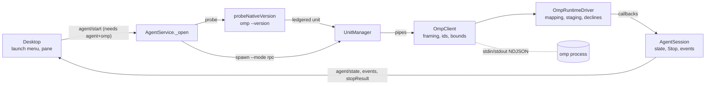
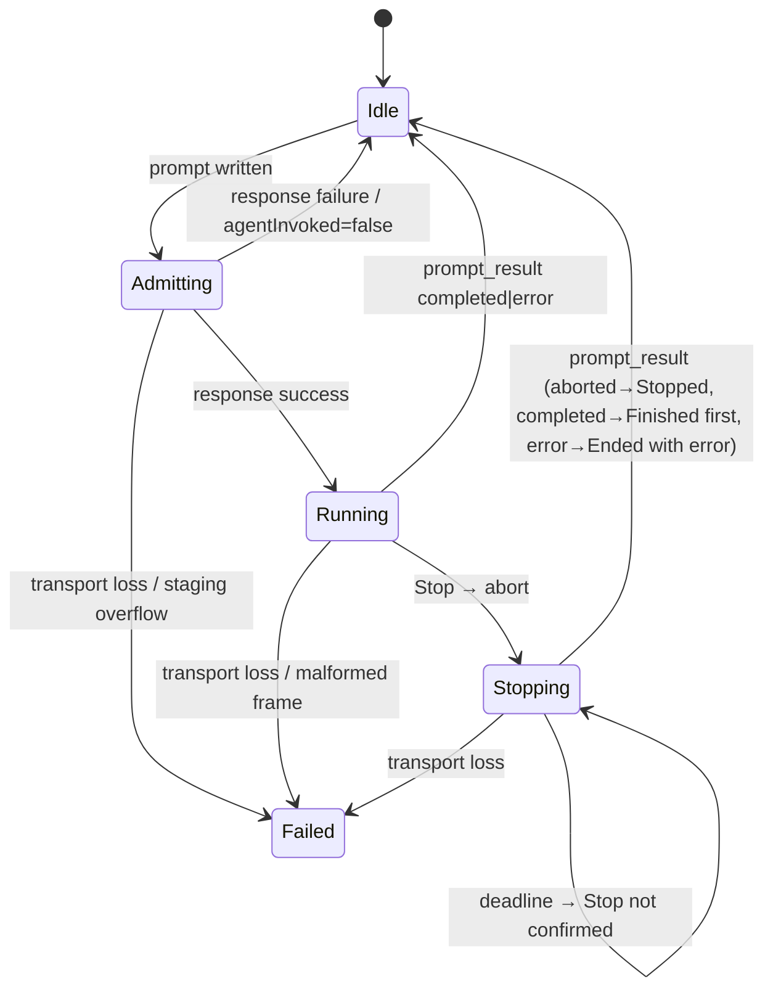

# Design

## Triage

| Trigger | Applies? | Evidence |
|---|---|---|
| T1 Components (new component, or 3+ with directed relationships) | Yes | This adds an OMP client, a driver and a version probe under `packages/host/lib/src/agent/omp/`. The path runs desktop → AgentService → UnitManager → OMP process. |
| T2 State (persistent state, caches, 3+ state machine) | Yes | New saved records get runtime kind `omp` and adapter `omp-rpc`. The driver has a turn state machine (idle, admitting, running, stopping, ended). |
| T3 Concurrency (background work, workers/isolates, async, retries) | Yes | Responses and events interleave out of order, and `prompt_result` can race the prompt response. Stop, close and declines all write while a turn is running. |
| T4 Boundaries (data format, migration, shared interface, IPC, external) | Yes | OMP's RPC wire is an external contract. There is a new desktop-host capability `omp`, and the saved-record values are new. |
| T5 Volume (grows without a fixed bound) | Yes | Streamed deltas, events before admission, notices and pending commands all need a bound. |
| T6 Risk (security, money, data loss, unrecoverable user data) | Yes | Tool approvals must never be granted automatically, provider secrets reach OMP through the inherited environment, and project configuration loads without a trust gate. |

TIER: FULL

## Context

The proposal (proposal.md) sets the scope. This section covers the host shape that the scope builds on.

**Driver seam.** Every runtime implements `RuntimeDriver` (`packages/host/lib/src/agent/runtime_driver.dart:131-197`).
- AgentSession sets its callbacks (`agent_session.dart:69-75`). It treats any driver whose `acp` is null as native. A native Stop settles from `onNativeTurnEnded` results (`agent_session.dart:230-260`).
- The Codex driver is the model for a native driver:
  - `prompt` registers the turn before the admitted write (`runtime_driver.dart:1226-1262`);
  - events that arrive before admission are staged, up to 64 entries or 256 KiB, and overflow fails the run (`runtime_driver.dart:1362-1440`).

**Shared wire mechanics.** These are already shared (`native_io.dart`):
- the 16 MiB line limit, with a single host-wide permit above 1 MiB (`:7-45`);
- line framing with consume-then-read backpressure (`:47-161`);
- a 1 MiB write admission (`:163-210`).

Each existing client keeps its own correlation. Codex caps waiting requests at 32 (`codex/codex_client.dart:172`).

**Launch path.** `AgentService._open` (`agent_service.dart:933-1258`) does the following, in order:
1. gates the peer and kind (`:938-946`);
2. resolves and stats the executable (`:950-952`);
3. runs the Codex-only version probe and re-checks the executable (`:953-975`);
4. reserves the channel and creates the grant;
5. spawns through UnitManager with the family environment (`:901-929`, `:1011-1020`);
6. builds the driver in `_AgentIO` (`:113-128`);
7. initializes, creates the session, and maps start failures (`:1140-1257`).

The kind allowlist is the literal `const ['claude-code', 'codex']` at `:941`. There is no runtime-family registry. Kinds are compared directly in the host, the desktop launch menu (`workbench_page.dart:704-775`), the profile dialog (`runtime_profiles_dialog.dart:226-228`, `:433-460`) and the agent controller (`agent_controller.dart:61-84`, `:1131-1141`).

**Version probe.** `probeCodexVersion` (`codex/version_probe.dart:41-140`) runs `--version` as a separately ledgered unit:
- in the host profile directory;
- with an allowlisted environment and a 4 KiB output cap;
- with a 5 s timeout;
- settled before it returns.

**Bounds.** The shared agent bounds in `openspec/architecture.md` (Agent lifecycle, Native session identity, Adapter stderr ring and Agent session events rows) apply unchanged unless a row below says otherwise.

**OMP contract.** Research read `docs/rpc.md` of can1357/oh-my-pi at `b7fe8c7f` (18.20.1) without running `omp`:
- newline-delimited JSON, not JSON-RPC;
- a `ready` frame first;
- `id`-correlated `response` frames;
- id-less events;
- `prompt_result` for completion;
- `abort` for Stop;
- `get_state` for `sessionId`;
- interactive client requests as `extension_ui_request`;
- stdin EOF for an orderly shutdown;
- `omp --version` printing `omp/<version>`.

Approvals default to yolo in OMP. Project `.omp`, `.claude` and MCP configuration loads from the working directory without a trust gate.

## Decisions

### D1: A narrow OMP client and driver, sharing only the existing wire mechanics

- **Choice:** Add `omp/omp_client.dart`, which owns the following, built on `NativeLineReader`, `NativeWriteAdmission` and `LargeLinePermit`:
  - framing;
  - `id` correlation;
  - envelope validation;
  - a 32-command waiting cap;
  - per-command deadlines;
  - an issued high-water mark.

  Command ids are `k<n>`, with `n` a per-client counter that starts at 1 and only increases. The client keeps one integer: the highest `n` it has issued. A command whose deadline passes is removed from the waiting map. A response for an id that is not waiting is handled as follows:
  - `k<n>` with `1 ≤ n ≤ high-water`: the command was issued earlier and has expired or already been settled. The response is dropped without effect, however late it arrives.
  - Any other id (a malformed id, `n` above the high-water mark, or a non-string): a protocol failure.

  This is a permanent, constant-size record of every id ever issued, so a late acknowledgement can never become a failure. The Codex client drops unmatched responses silently (`codex/codex_client.dart:346-347`). OMP keeps the failure rule only for ids Kumiko never issued.

  Add `OmpRuntimeDriver extends RuntimeDriver`, which owns the mapping. Kumiko generates command ids as `k<n>` strings. The persisted adapter name is `omp-rpc`.
- **Rejected:** Extracting a shared correlation core from the ACP and Codex clients first. The three envelopes differ: ACP requires `jsonrpc:"2.0"`, Codex is JSON-RPC without it, and OMP is not JSON-RPC at all. A shared core would be a refactor of two working clients inside a transport change, which is the kind of scope growth this split exists to avoid (ADR 0015 decision 1: "Extract only wire mechanics concretely shared").
- **Reversal cost:** low. A later change can extract a common correlation core once three clients show which parts truly match.

### D2: The version comes from a shared contained probe; readiness proves protocol compatibility

- **Choice:**
  - **Shared probe.** Move the launch, settle, output-cap and timeout logic of `probeCodexVersion` into a shared `probeNativeVersion(..., parse, environment)`. Codex keeps its parse, its allowlist and its 0.166.0 minimum unchanged.
  - **OMP probe.** It runs `<exe> --version` in the host profile directory with the environment allowlist `SystemRoot`, `WINDIR`, `PATH`, `PATHEXT`, `TEMP`, `TMP`, `HOME`, `USERPROFILE` and `LOCALAPPDATA`, under the same 4 KiB and 5 s bounds. It parses exactly one line `omp/<major>.<minor>.<patch>`, with an optional pre-release suffix.
  - **Minimum version.** The minimum is **18.20.1**, the version whose contract was studied. After the probe, the executable is re-checked as for Codex.
  - **Readiness.** The `ready` frame must carry `supportedProtocolVersions` containing 1. The client never sends `negotiate_protocol`, so v1 framing stays in force.
- **Rejected:** Taking identity from the session itself (the `ready` frame or `get_state`). `ready` carries no application version, and identity would arrive only after spawning in the workspace with project configuration loaded. The probe refuses before anything runs in the workspace.
- **Rejected:** Negotiating protocol v2 for 64 MiB chunked frames. In v1, OMP itself caps frames at 1 MiB and elides oversized event fields, and the turn needs nothing larger. v2 can come with history restore in change 4 if it needs it.
- **Reversal cost:** low. The minimum is a constant. Lowering it needs only the older version's contract to be read.

### D3: The native turn path is reused; the prompt is committed on OMP's admission response

- **Choice:** `prompt` follows the Codex native path.
  1. Register the turn.
  2. Write `{type:"prompt", id, message}` through admission.
  3. Resolve admission from the `response`. Success with `data.agentInvoked:false` ends the turn at once.
  4. Otherwise complete the turn from the `prompt_result` whose `id` matches the prompt:
     - `completed` → end turn;
     - `aborted` → cancelled;
     - `error` → error, with the message bounded and redacted.

  `turnId` reports the prompt id. `onNativeTurnEnded(sessionId, promptId, result)` fires so AgentSession's native Stop settlement works unchanged. Events between the write and the admission response are staged under the Codex staging bounds (64 entries or 256 KiB; overflow fails the run). They are released after admission, so the user event always precedes the reply.
- **Rejected:** Ending the turn on `agent_end` or `session_settled`. OMP documents that `agent_end` with `yielded:false` continues the run, and that `session_settled` covers background work beyond the prompt. `prompt_result` is the single per-prompt terminal.
- **Reversal cost:** low.

### D4: Streaming uses delta-only message updates, deduplicated against the final message

- **Choice:** After `ready`, send `set_event_filter {events:null, messageUpdates:"delta"}`. A failure fails the start.
  - Map `message_update` `text_delta` to `agentText` and `thinking_delta` to `thought`. Assistant messages only; user and tool-result messages are not echoed.
  - Track per `messageId` and `contentIndex` whether any delta was seen. On `message_end`, emit only the text and thinking blocks that had no deltas, so a provider that sends whole blocks still shows them once, then release that message's entry. `message_end` is OMP's final frame for a message.
  - At most 64 messages may be open (started, not ended) at once. Each may have at most 256 flagged content indexes, and each `messageId` may be at most 4 KiB encoded. Exceeding any of these fails the session with an OMP protocol reason. Failing, rather than evicting, keeps the no-duplicate guarantee: an evicted flag could re-emit text already shown.
  - Map `notice` frames to notices, and `auto_retry_*` and compaction frames to one bounded notice each.
  - Ignore other event types.
- **Rejected:** Rendering from `message_end` alone. The reply would not stream.
- **Rejected:** Keeping the full `partial` snapshots. They multiply volume per delta.
- **Reversal cost:** low.

### D5: Interactive OMP requests are declined fail-closed; display-only requests trigger nothing

- **Choice:**
  - **Interactive requests.** For `extension_ui_request` with method `select`, `confirm`, `input`, `editor` or `ask`, write `{type:"extension_ui_response", id, cancelled:true}` exactly once. Add a notice "OMP asked: <title> — not supported in Kumiko yet; declined". The title is clamped to 256 characters, redacted with `redactToolSecrets`, and has control and bidi characters escaped as in the Codex approval preview.
  - **Display-only requests.** `notify` becomes a notice under the same clamp. `setStatus`, `setWidget`, `setTitle`, `set_editor_text`, `open_url` and `cancel` are ignored.
  - **Notice cap.** At most 8 such notices per turn (or per idle period). After that, one "further OMP requests declined" notice is shown, and declines continue without notices.
  - **Write failure.** A decline that cannot be admitted or written fails the session, so OMP is never left waiting on an unanswered request.
  - **Launch flags.** Kumiko launches no `--no-ui` or approval-mode flag. OMP's own approval mode stays the user's choice; with `yolo`, which is OMP's default, tools run without asking, as in the user's terminal.
- **Rejected:** Launching with `--no-ui`, so that OMP itself fails approvals closed. It would also suppress `notify` and change OMP's behaviour through a Kumiko-chosen flag that change 3 must undo. Declining in the host keeps every request visible and gives change 3 one seam to replace.
- **Rejected:** Forcing `--approval-mode always-ask`. It would change the user's configuration, and every tool call would be declined.
- **Reversal cost:** low. Change 3 replaces the decline with real approval mapping.

### D6: Unsupported features are reported, not hidden

- **Choice:**
  - **Tool activity.** Count `tool_execution_start` events per turn. At turn end, emit one notice: "OMP ran N tool calls; tool activity is not shown in Kumiko yet".
  - **Kumiko tools.** Mint no grant for `omp` runs: the grant step at `agent_service.dart:987-1010` is skipped. Report the tools status `unavailable` with the reason "Kumiko tools are not delivered to OMP yet".
  - **Continue.** `continueSession` on an `omp` record is refused `methodNotAvailable` before any probe or spawn, with the reason "OMP Continue is not supported in this Kumiko version".
  - **Steering.** It stays unavailable, because `canSteer` requires kind `codex` (`agent_controller.dart:70-82`).
- **Rejected:** Minting a grant and leaving it unused until change 3. Unused grants must be revoked (agent-tool-access), and nothing could use this one.
- **Reversal cost:** low.

### D7: The session identity comes from `get_state` and is required

- **Choice:**
  1. After `ready` and the event filter, call `get_state`.
  2. Require `sessionId` to be a non-empty string within the existing native session identity bound (4 KiB encoded).
  3. Call `newSession`'s `onCreated` with it, so the record is inserted exactly as for the other runtimes.

  The `sessionFile` path is not stored. Change 4 decides what Continue needs.
- **Rejected:** Launching with Kumiko-chosen `--session-dir` and owning the files. That decides change 4's history design now and writes files outside the user's OMP layout.
- **Reversal cost:** medium. Records saved now carry only `sessionId`. If change 4 finds that it needs the session file path, it must look the file up by id under OMP's documented layout or ask the user. Evidence that would settle it: change 4's history research.

### D8: Launch inherits the user's environment; close ends input before containment

- **Choice:**
  - **Environment.** The OMP session launches with `inheritParentEnvironment: true` plus the profile overrides, like Claude (`agent_service.dart:1018`). OMP reads provider keys and its home from that environment.
  - **Secret scope.** Kumiko does not know which inherited values are secrets. The existing redaction only knows Kumiko grant secrets (`agent_service.dart:403-408`), and OMP has no grant. The enforceable guarantee is therefore that Kumiko never copies the environment into a record, log, start result, state or event message. Text that OMP itself writes (replies, errors, notices, request titles, the stderr tail) is OMP's output and is shown as OMP wrote it, after the existing redaction and escaping, exactly as for Claude today. A per-value redaction of inherited variables is not built: Kumiko cannot tell a key from any other value, and guessing by variable name would be incomplete while looking complete.
  - **Close.**
    1. Abort a running turn, waiting up to the existing 2 s close grace for its `prompt_result`.
    2. Close OMP's stdin.
    3. Keep reading stdout so OMP's spool drains.
    4. Wait up to 2 s more for the leader to exit.
    5. Settle through the existing `units.end` and its 30 s settlement deadline.

    Shutdown on desktop loss is unchanged and handled by unit termination.
- **Rejected:** Codex's host-private allowlisted environment. Codex needed it to keep the bridge secret away from model commands. OMP gets no bridge in this change, and an allowlist would hide the user's provider keys from OMP.
- **Reversal cost:** low. Change 3 may tighten this when it delivers the bridge.

### D9: OMP is a peer capability; kinds stay explicit, with one shared list

- **Choice:**
  - **Capability.** Add `Capability.omp = 'omp'`. The host and desktop advertise it. `_open` requires `agent` and `omp` from the peer for `omp` profiles, before any probe or spawn.
  - **Kind list.** Replace the inline allowlist at `agent_service.dart:941` with a `supportedRuntimeKinds` constant in `host_protocol`. The desktop profile dialog uses the same constant.
  - **Desktop entries.**
    - OMP launch-menu items `#omp` and `#omp-profile`, with an unavailable reason;
    - the profile-dialog kind "OMP native RPC";
    - the composer hint "Message OMP";
    - OMP auth guidance: "OMP sign-in and models are managed by OMP; run `omp` in a terminal to set them up".
  - **Detection.** Add `detectOmp` in `adapter_detector.dart`, run in the same isolate and under the same 2 s cap. Lookup is file-only:
    - Windows: PATH entries `omp.exe` and `%LOCALAPPDATA%\omp\omp.exe`. `.cmd` and `.ps1` shims are skipped.
    - POSIX: PATH entries `omp`, plus the existing well-known directories.

    The built-in profile is `builtin:omp` with args `["--mode","rpc"]`. It is listed after Claude and Codex. The empty-store default order becomes Claude, Codex, OMP (`runtime_profile_service.dart:91-135`).
- **Rejected:** A runtime-family descriptor registry that folds every kind branch into one table. It is the right long-term shape (the seam map counts about 40 branch sites), but it is a refactor across host, protocol and desktop. It would roughly double this change.
- **Reversal cost:** low. A follow-up can introduce the registry; it is recorded as a follow-up, not built.

## Diagrams (FULL)

### Components (T1)



### Turn state (T2)



### Start sequence (T3, T4)

```mermaid
sequenceDiagram
  participant S as AgentService
  participant U as UnitManager
  participant O as omp
  S->>U: probe unit: omp --version (5 s, 4 KiB)
  U-->>S: "omp/18.20.1", settled
  S->>S: re-stat executable, min version
  S->>U: spawn omp --mode rpc (cwd = target)
  O-->>S: {"type":"ready","supportedProtocolVersions":[1,2]}
  S->>O: {"type":"set_event_filter","id":"k1","messageUpdates":"delta"}
  O-->>S: {"type":"response","id":"k1","success":true}
  S->>O: {"type":"get_state","id":"k2"}
  O-->>S: {"type":"response","id":"k2","data":{"sessionId":"…"}}
  S->>S: insert record (kind omp, adapter omp-rpc, version, sessionId)
  S-->>S: session Idle; agent/start result
```

## State & Ownership (FULL)

| State | Owner (sole writer) | Lifetime | Invalidation / rebuild | Authoritative copy |
|---|---|---|---|---|
| Saved record (`runtime_kind` `omp`, adapter `omp-rpc`, version, native `sessionId`) | AgentService, through `onCreated` | Until deleted by the Sessions surface | Never rebuilt; failed starts create none | Local store |
| Waiting commands (id → completer, deadline) | OmpClient | One command | Removed on response, deadline or transport close; close fails every waiter | OmpClient memory |
| Turn (prompt id, phase, staged events, tool count, notice count, per-message delta flags) | OmpRuntimeDriver | One prompt | Cleared on terminal result or failure | Driver memory |
| Session state (Idle, Running, Stopping, Failed, Closed) | AgentSession | One live run | Published to the desktop as `agent/state` | AgentSession |
| OMP session files | OMP | OMP's own retention | Kumiko never writes them | OMP's session directory |

## Failure & Visibility (FULL)

| Component | Fails / dies mid-operation → | Recovery | Retry safe? | Who finds out |
|---|---|---|---|---|
| Version probe | Times out, exits non-zero, over-long output, unparsable output | Unit settled; start refused before spawn | Yes, by the user starting again | User: the start error names the reason |
| OMP before `ready` | Exits, writes non-JSON, or exceeds the 60 s start deadline | Unit ended; no record; stderr tail in the error | Yes | User: start error with stage `ready` |
| `set_event_filter` / `get_state` | Failure response or deadline | As above, stage `session` | Yes | User |
| Running OMP | Exit or stdout EOF | Session Failed; unit settled; record kept | New start only; admitted input is never re-sent | User: pane Failed with exit reason |
| Malformed frame, or a response with an unknown id | Protocol failure | Session Failed; unit terminated | No automatic retry | User |
| Decline write | Admission refused or write error | Session Failed | No | User |
| Abort | Refused, or no `prompt_result` within 10 s | *Stop not confirmed*; stays Stopping; a late result settles it | User may close | User |
| Close | OMP ignores EOF | Contained termination after the grace; failure reported as `agent/closeFailed` | Retry close | User |

## Resource Bounds (FULL)

| Queue / buffer / cache / transfer | Bound | At the bound | Timeout | At 10x / 100x |
|---|---|---|---|---|
| OMP stdout line | Shared 16 MiB line limit and the large-line permit above 1 MiB (OMP v1 itself emits ≤ 1 MiB) | Line over 16 MiB: session Failed *adapter message too large* | n/a | Unchanged; v1 caps frames upstream |
| Waiting commands | 32 per session | New command refused `busy` before writing | Control 60 s (start), 10 s (abort) | Bounded |
| Writes to OMP stdin | Shared 1 MiB write admission | Prompt refused busy with composer kept; decline write → Failed | n/a | Bounded |
| Events before admission | 64 entries or 256 KiB (Codex staging bound) | Session Failed with a protocol reason | Ends with admission | Bounded |
| Decline/notify notices | 8 per turn or idle period, plus one overflow notice | Further requests declined silently in the chat, still answered | n/a | Bounded |
| Open-message delta flags | ≤ 64 open messages × ≤ 256 content indexes; `messageId` ≤ 4 KiB encoded (≤ 256 KiB of ids) | Session Failed with an OMP protocol reason | n/a | Released at each `message_end`, so long tool loops stay at their open-message count |
| Issued-id high-water mark | One integer per client | n/a (counter cannot overflow a 64-bit int in practice) | n/a | Constant |
| Probe output | 4 KiB | Probe fails | 5 s | Bounded |
| Native session identity | 4 KiB encoded (existing row) | Start fails `adapter-protocol` | n/a | Bounded |
| Stderr | Existing 64 KiB ring per session | Oldest bytes overwritten | n/a | Bounded |

## Flow & State Gaps (FULL)

- **`prompt_result` before the prompt response.** OMP may answer `prompt` out of order. A `prompt_result` for the registered prompt id that arrives before its response is held. When the success response arrives it applies at once. If the response is a failure, it is dropped. Any other `prompt_result` id fails the session.
- **Events before `ready`.** `available_commands_update`, `extension_error`, `notice` and `config_*` frames are ignored before `ready`. A `response` before `ready` fails the start.
- **Stop during admission.** AgentSession's `stop` (`agent_session.dart:1276-1310`) addresses `activeNativeTurns`. The driver reports the registered prompt as active from the moment it is written, so Stop writes `abort` after the prompt. OMP handles both in order.
  - If admission then succeeds, the run's `prompt_result` settles Stop.
  - If admission fails, or reports `agentInvoked:false`, the turn ends at once. Stop settles as *Finished before Stop*, or as *Turn ended with an error after Stop* when admission failed.
- **Stop and the result race.** If the result arrives before the abort's response, AgentSession settles from the result. The abort command then waits for its response or its deadline as usual, and then retires. An abort response that arrives after its 10 s deadline is dropped as a previously issued id (D1), however late it arrives, and the session stays Stopping until `prompt_result`. Fixture tests cover three cases:
  - acknowledgement after `prompt_result`;
  - acknowledgement after the deadline;
  - acknowledgement delivered after more than 32 later commands have been issued and settled, which proves that no window eviction exists.
- **Close during Stopping.** Close proceeds as in D8. An unconfirmed abort is not waited on twice.
- **Interactive request during admission.** It is declined at once; the decline is not staged.
- **Host restart.** Live OMP processes are ended by the existing unit shutdown and ledger reconciliation. Saved records remain, and Continue is unavailable (D6).

## Mechanism Ledger (FULL)

| Mechanism | Built? | Why (harm nobody catches / expensive later) | Evidence that would change the call |
|---|---|---|---|
| Version probe before spawn | Yes | Without it, OMP runs project configuration in the workspace before Kumiko knows the version | `ready` gaining an app version |
| Minimum-version gate | Yes | Older OMP may lack `prompt_result` or the event filter, which would break turn completion | Reading an older contract |
| Delta event filter | Yes | Snapshots inflate volume per delta | n/a |
| Fail-closed declines | Yes | An unanswered approval hangs OMP, and an automatic approve is a security failure | Change 3 replaces it |
| Pre-admission staging | Yes | The reply would otherwise show before the user's prompt | n/a |
| Protocol v2 chunking | No | v1 caps frames at 1 MiB; nothing in this change needs more | Change 4 history pages over 1 MiB |
| Shared correlation core | No | Refactor risk to two shipped clients | A fourth client |
| Runtime-family registry | No | Large cross-package refactor | Recorded as a follow-up |
| Workspace trust gating for OMP project configuration | No | Same deferral as Codex (issue #22) | Issue #22 decision |
| Approval-mode override | No | Would change the user's OMP configuration | Change 3 or #22 |

## Risks / Trade-offs

- **[Risk]** OMP's default yolo mode means tools run without Kumiko seeing approvals, and tool activity shows only as a count.
  → **Mitigation:** the turn-end notice says so. The behaviour matches the user's own terminal use of OMP. Change 3 adds tool cards and approvals before qualification.
- **[Risk]** Project configuration in the workspace (MCP servers, extensions) starts processes inside the session without a trust prompt.
  → **Mitigation:** they run inside the session's contained unit and end with it. Trust gating is tracked in #22 for all native runtimes.
- **[Risk]** The installed OMP may be older than 18.20.1 (the machine has a Tern-bundled copy first on PATH), so it would be refused.
  → **Mitigation:** the refusal names both versions, and an explicit profile can point at another executable. Lowering the minimum is a constant change (Open Questions).
- **[Risk]** Wire details are taken from docs and source, not from a real run (ordering of approvals, stderr noise, startup latency).
  → **Mitigation:** the fixture scripts the documented contract; change 5 qualifies real behaviour.
- **[Trade-off]** About 40 per-kind branches grow by one more family instead of being consolidated (D9).

## ADRs

- **In force, constraining this change:**
  - ADR 0002 (capability gates);
  - ADR 0004 (adapter per runtime family; OMP through native RPC; claims from evidence);
  - ADR 0005 and ADR 0013 (tool delivery and status semantics);
  - ADR 0012 (session transport bounds);
  - ADR 0015 decision 1 (narrow driver, share only concrete wire mechanics) and decision 3 (probe pattern, minimum-version admission), which this change applies to OMP.
- **To record during apply:** ADR 0016, "Native OMP RPC transport". It amends, for OMP only:
  - ADR 0004 decision 2: claims come from the native contract with minimum-version admission, not an exact-version qualified list;
  - ADR 0012's qualification wording: OMP evidence is recorded by change 5 and does not gate admission;
  - ADR 0005 and ADR 0013's per-run tool entry: OMP runs get no entry and no grant until change 3, and report tools unavailable.

  It binds:
  - the OMP wire choice (v1 NDJSON);
  - the minimum-version admission with the probe;
  - fail-closed declines until approvals are mapped;
  - the `omp` capability gate;
  - the saved adapter identity `omp-rpc`.

  The same task updates `openspec/architecture.md`:
  - the runtime adapters row;
  - the runtime protocols line;
  - the component diagram;
  - an "OMP RPC contract" section with the bounds above.

## Open Questions

- What exact version do the installed OMP binaries report? If it is below 18.20.1, change 5 reads that version's contract and the minimum may drop. That is a constant change.
- What does OMP write to stderr during normal RPC startup? It affects only the diagnostic tail, not behaviour.
