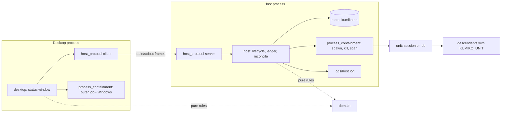
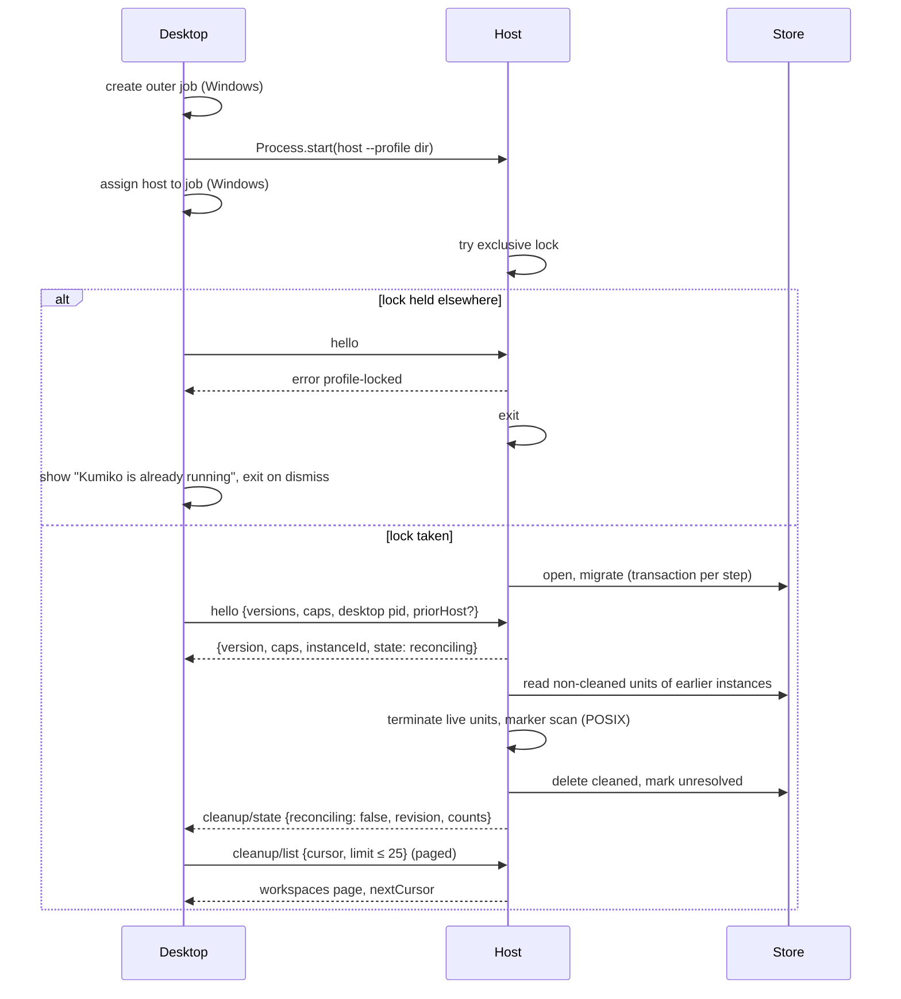
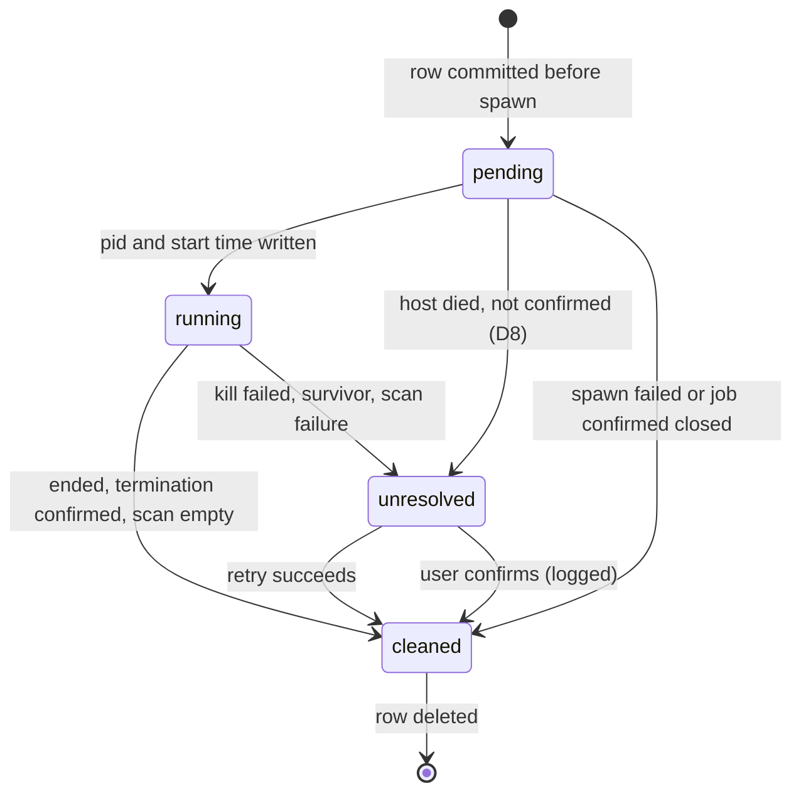
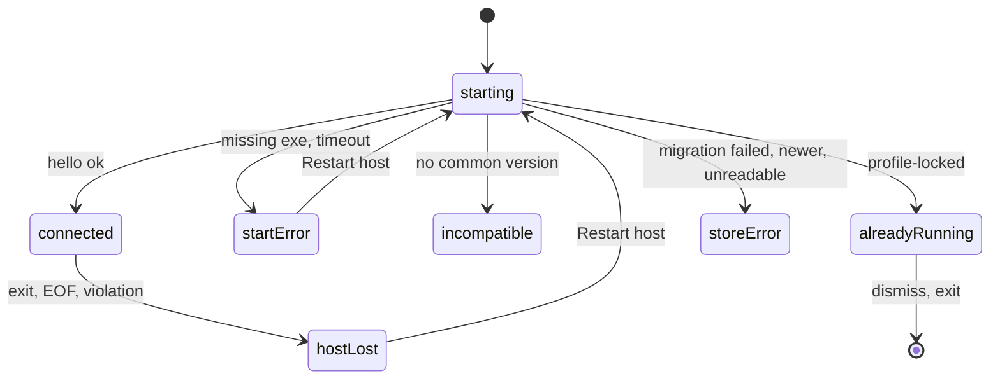
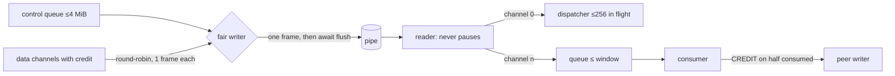

# Design

## Triage

| Trigger | Applies? | Evidence |
|---|---|---|
| T1 Components (new component, or 3+ with directed relationships) | Yes | New desktop, host, protocol, containment and store packages; desktop → host → units, host → store (architecture Components). |
| T2 State (persistent state, caches, 3+ state machine) | Yes | New SQLite store with the process ledger and host-instance records; unit states pending/running/unresolved/cleaned; desktop host-status machine with 7 states. |
| T3 Concurrency (background work, workers/isolates, async, retries) | Yes | Concurrent units, an async fair writer, pipe readers, reconciliation running after the handshake, retry of cleanup, two simultaneous launches racing for the lock. |
| T4 Boundaries (data format, migration, shared interface, IPC, external) | Yes | Wire frame format and `hello` contract (ADR 0002), store schema and migrations (ADR 0003), OS process APIs, CI. |
| T5 Volume (grows without a fixed bound) | Yes | Data channel streams, pending control, ledger rows across crashes, diagnostic log. |
| T6 Risk (security, money, data loss, unrecoverable user data) | Yes | Killing processes by pid (reused pids), an arbitrary-spawn test method that must not ship, store reset or downgrade. |

TIER: FULL

## Context

The repository holds planning only: no `pubspec.yaml`, no Dart source and no CI workflow (`git ls-files` lists `.agents/`, `.claude/`, `openspec/` and `docs/adr/` only). The reference checkouts `orca/`, `t3code/` and `itsaplan/` are untracked references, not dependencies. Dart 3.13.7 and Flutter 3.47.x are available through mise.

Constraints come from the accepted ADRs, not restated here: ADR 0001 (one child host per profile, the lock, containment units, the two-step ledger, the marker scan, the workspace gate, the four packages), ADR 0002 (stdio transport, frames, JSON-RPC on channel 0, `hello`, fair writer, credit, receivers that never block) and ADR 0003 (SQLite, host sole writer under the lock, transactional migrations, the M1 binding probe). Scope and the two user decisions of 2026-10-29 (store core pulled forward; second launch shows a message and exits) are in [proposal.md](proposal.md). Architecture rows this change fills with numbers: "Desktop-host pipe", "Concurrent sessions and terminals", "Host process (whole)", "Local store write or migration", "Host diagnostics" ([architecture.md](../../architecture.md), Resource bounds).

Library facts checked against current docs: `package:sqlite3` bundles a prebuilt SQLite through Dart build hooks by default and can be switched to the OS library with `hooks.user_defines.sqlite3.source: system` (sqlite3.dart `doc/hook.md`). Whether a hook-bundled native library survives `dart compile exe`, or needs `dart build cli` and its `bundle/lib/` layout, is unverified and is the first question of the probe (D11).

## Decisions

### D1: Five workspace packages, with OS process calls in `process_containment`

- **Choice:** A pub workspace (root `pubspec.yaml` with `workspace:`; each package `resolution: workspace`) with `packages/domain`, `packages/host_protocol`, `packages/process_containment`, `packages/host` and `packages/desktop`. `process_containment` holds the `dart:ffi` bindings to OS APIs (Windows jobs and process creation, POSIX `setsid`/`execve`/`kill`/`killpg`, process start times, the environment scan). It ships no native library of its own. The desktop uses it only for the Windows outer job. Dependency rule, checked in CI: `desktop` → `host_protocol`, `domain`, `process_containment`; `host` → all but `desktop`; `domain` imports no `dart:io` or `dart:ffi`.
- **Rejected:** The OS calls inside `host`, with the desktop's job code duplicated. That means two copies of the most error-prone code, or a desktop that depends on `host`, which ADR 0001 forbids.
- **Reversal cost:** low. Package boundaries move freely before other code depends on them.

### D2: POSIX units start through the host's own `--unit-exec` shim

- **Choice:** On Linux and macOS the host starts a unit with `dart:io` `Process.start` of its own executable: `kumiko_host --unit-exec <containment-id> -- <argv...>`, with `KUMIKO_UNIT=<containment-id>` in the environment. In that mode the process calls `setsid()` and then `execve()`s the target through FFI. The pid survives `execve`, so the pid and start time recorded after `Process.start` are the unit's own. `dart:io` keeps reaping and stdio plumbing, which later changes need for ACP pipes. The PTY change can extend the shim to open the slave and set the controlling terminal before `execve`.
- **Rejected:** FFI `posix_spawn` with `POSIX_SPAWN_SETSID`. It bypasses `dart:io`, so stdio needs custom fd readers. The `dart:io` exit-code handler may reap children it did not start (unverified; it waits on child pids in a runtime thread), which would race our waits.
- **Reversal cost:** medium. It is hidden behind `process_containment`'s spawn API, but later PTY work builds on it. Evidence that would change it: a probe showing VM-thread or signal problems with `execve` from a Dart process.

### D3: Windows units are created suspended in their own nested job

- **Choice:** The desktop creates an outer job with `JOB_OBJECT_LIMIT_KILL_ON_JOB_CLOSE` and no breakaway. It starts the host with `Process.start` and assigns the host to the job before it sends `hello`; the host spawns nothing before `hello`. For each unit the host creates a new job, calls `CreateProcessW` with `CREATE_SUSPENDED` (the process is born in the outer job), assigns it to the unit job (nested jobs, Windows 8+), and resumes it. Units in this change get `NUL` stdio. Pipe and ConPTY attributes are added to the same primitive by later changes. Exit is observed with a wait on the process handle in a helper isolate. The host refuses launches unless `hello` reported the outer job held and `IsProcessInJob` is true.
- **Rejected:** `Process.start` and assigning the unit job afterwards. Descendants started before the assignment miss the unit job, so closing one unit would not reach them. Also rejected: a resident Dart shim per unit that assigns itself, which costs a second VM process per unit.
- **Reversal cost:** medium. Behind the same spawn API.

### D4: The ledger is two store tables, and workspace state is derived

- **Choice:** Schema v1 (`PRAGMA user_version = 1`, `journal_mode=WAL`, `synchronous=FULL` so a committed pending entry is durable before the spawn):
  - `host_instance(id, host_pid, host_started_at, desktop_pid, desktop_started_at, os, opened_at, closed_cleanly)`;
  - `unit(containment_id PK, host_instance_id, kind, target_path, target_identity, state CHECK IN ('pending','running','unresolved'), pid NULL, process_started_at NULL, unresolved_reason NULL, created_at, updated_at)`.

  A cleaned unit's row is deleted, and the host log records `unit-cleaned`. A workspace is *cleanup unresolved* exactly when an `unresolved` row targets it. There is no separate workspace table. User confirmation deletes the rows and logs `unit-confirmed-by-user`. `host_instance` rows are deleted once no `unit` row references them, except the current one. Workspace identity is resolved by the host, through `process_containment`, before the ledger insert and before every gate check:
  - `target_path` is the OS-resolved path (`realpath` on POSIX; `GetFinalPathNameByHandleW` on Windows, which resolves symlinks and junctions and returns the on-disk case);
  - `target_identity` is the directory's file identity (`st_dev:st_ino` on POSIX; volume serial and 128-bit file id from `GetFileInformationByHandleEx(FileIdInfo)` on Windows).

  The gate refuses a launch when its target's identity equals an unresolved row's `target_identity`, **or** its resolved path equals an unresolved row's `target_path` byte for byte. The path clause covers a directory deleted and recreated with a new identity. No case folding is applied: aliases and case-insensitive volumes collapse through the identity, and distinct case-differing directories on case-sensitive volumes stay distinct. A target that does not exist or cannot be opened is refused with `target-unavailable` before any ledger write. `domain` holds no path logic.
- **Rejected:** A `workspace_cleanup` table holding the flag alongside the units. It gives one fact two writers that can drift; a flag left set with no unit behind it would block a workspace forever.
- **Reversal cost:** medium. It is stored data, but small and forward-migratable; nothing else depends on it yet.

### D5: Handshake first, then reconciliation, with launches refused meanwhile

- **Choice:** Host start: take the lock (non-blocking) → open and migrate the store → write `host_instance` → answer `hello` with `state: reconciling` → reconcile → send `cleanup/state` with `reconciling: false`. Cleanup results are paged and never sent in one message:
  - `cleanup/state {reconciling, revision, unresolvedWorkspaces, unresolvedUnits}` is a summary notification of constant size. It is sent at reconciliation end and after every retry or confirm.
  - `cleanup/list {cursor?, limit ≤ 25}` returns workspaces, each with `target_path`, a unit count and at most 10 units, plus `nextCursor`.
  - `cleanup/units {workspace, cursor?, limit ≤ 100}` pages a workspace's units.
  - Reasons are capped at 256 bytes and paths at 4 KiB, so a page stays under 512 KiB, well inside the 1 MiB control limit.
  - `cleanup/retry {workspace}` and `cleanup/confirm {workspace}` act on every unit of the workspace, whatever was paged.
  - Cursors are keyed by `(target_identity, containment_id)`. A page read across a changed `revision` is flagged `stale` so the desktop reloads it.

  Launches during reconciliation are refused with `reconciling`. A host without the lock still answers `hello`, with error `profile-locked`, and then exits.
- **Rejected:** Reconciling before answering `hello`. Termination timeouts would leave the desktop blind for seconds, indistinguishable from a hung host.
- **Reversal cost:** low.

### D6: Wire format and numbers

- **Choice:** Frame = `u32 payload length` · `u32 channel` · `u8 kind` · `u8 flags` · payload, big-endian, 10-byte header. Kinds: `0 DATA`, `1 CREDIT` (payload `u32` bytes granted). Any other kind is a violation. Channel 0 is control: JSON-RPC 2.0 UTF-8 messages fragmented into DATA frames, with flags bit 0 = end of message. Numbers (recorded once here, copied into the architecture's bounds table during apply):
  - max frame payload **64 KiB**;
  - max control message **1 MiB**;
  - data channel credit window **256 KiB**, granted in full at open and topped up when the consumer has taken half;
  - at most **32** open data channels per connection; an open beyond it is refused with `channel-cap`, so host channel buffering is at most 32 × 256 KiB = 8 MiB;
  - per-channel receive queue bound = the window;
  - pending outbound control bound **4 MiB** per side; past it the peer is treated as lost;
  - at most **256** concurrent inbound control requests; more are answered `busy`;
  - `hello` timeout **30 s**; host-loss detection **≤ 2 s**;
  - control latency bound for the qualification: **≤ 250 ms** worst case over 100 round-trips under a saturating channel on CI runners.

  Data channels are opened by control requests (in this change only `test/channel.open`) and closed by `channel/close`. Frames for a channel the receiver closed are discarded. Frames for a channel that was never opened are a violation.
- **Rejected:** Newline-delimited JSON with base64 data, which ADR 0002 rejects. Also rejected: variable-length (varint) headers, a few bytes smaller but harder to bound and validate.
- **Reversal cost:** medium. A protocol version bump, cheap while desktop and host ship together.

### D7: Control is not credit-controlled, but it is bounded

- **Choice:** Channel 0 has no credit. Its consumer is the protocol dispatcher, which never waits on the UI. The fair writer drains all pending control frames, then sends one frame from the next data channel with both pending data and credit (round-robin). It submits **one frame at a time** to the stdio `IOSink` and awaits `flush()` before choosing the next frame. Priority is therefore decided per frame on the wire, never per batch: a control message enqueued while a data frame is being written waits for that one frame only. The sink's buffer holds at most one frame (≤ 64 KiB + header). The protocol tests assert the ordering on a recording sink (control enqueued mid-write with several data frames pending) as well as by latency.
- **Rejected:** Credit on control as well. A stalled control consumer would block Stop and permission replies, which ADR 0002 exists to prevent. Also rejected: batched writes of several frames per flush. Already-submitted data frames would sit ahead of a newly enqueued control frame, breaking the one-frame guarantee.
- **Reversal cost:** medium.

### D8: Windows pending entries are confirmed through the desktop's job

- **Choice:** On Windows every unit process is inside the desktop's kill-on-close outer job. A unit of an earlier host instance (pending or running) is cleaned when either:
  - (a) the `hello` from the current desktop attests that it terminated that host instance's outer job and saw zero active processes (`priorHost: {instanceId, jobTerminated: true}`), or
  - (b) the recorded desktop (`desktop_pid` and start time) is no longer running, so the OS closed the job.

  A running entry whose pid and start time are still alive is terminated by pid and marked unresolved, because its descendants cannot be enumerated without the lost job handle. On host loss, the desktop terminates the outer job, waits up to 5 s for zero active processes, and passes the result in the next `hello`.
- **Rejected:** Always treating a Windows pending entry as unresolved. A desktop killed during a spawn would then block a workspace even though the OS provably killed the job.
- **Reversal cost:** low.

### D9: The POSIX marker scan has a defined population and failure rule

- **Choice:** The scan reads every current-user process whose start time is at or after the oldest reconciled unit's `created_at` (minus 1 s for clock granularity):
  - on Linux `/proc/<pid>/environ` and `/proc/<pid>/stat`;
  - on macOS `sysctl KERN_PROCARGS2` and `proc_pidinfo`.

  Matches on `KUMIKO_UNIT` get `SIGKILL`, then the scan runs again. When an environment read fails, the scan re-checks that pid:
  - The process no longer exists (Linux `ENOENT`/`ESRCH` on `/proc/<pid>`; macOS `proc_pidinfo` fails with `ESRCH`), or its start time differs: it is **gone** and does not count.
  - The process still exists with the same start time (`EACCES`/`EPERM`): it is a scan failure, and the units being reconciled stay unresolved with the reason `scan-unreadable:<pid>`. A process table that cannot be listed makes every reconciled unit unresolved.
- **Rejected:** Skipping unreadable processes as "not ours". That claims *cleaned* without the evidence ADR 0001 requires.
- **Reversal cost:** low. Risk: macOS may leave many same-user processes unreadable (see Risks).

### D10: Test capabilities exist only in test builds

- **Choice:** `const bool.fromEnvironment('kumiko.testHooks')` guards registration of `test.units`, `test.channels` and `test.faults`. Test builds are compiled with `-Dkumiko.testHooks=true`; release builds are compiled without it and tree-shake the code. The methods:
  - `test/unit.launch {target, fixture}`, where the fixture is `tree`, `escaper`, `sleeper` or `stubborn` (plus `lock-holder`, started directly by tests, which only holds the profile lock); fixtures are the host executable in `--test-fixture` mode, also test-build only;
  - `test/unit.end`;
  - `test/channel.open {rateBytesPerSec}`;
  - `test/fault.set {crashAfterPendingWrite | crashAfterSpawnBeforePid | killFails | pendingWriteFails}`.

  CI runs a contract test against the release executable: `hello` advertises no `test.*` capability and `test/unit.launch` returns method-not-available.
- **Rejected:** A runtime flag or environment variable. It would ship an arbitrary-spawn method in every build.
- **Reversal cost:** low.

### D11: SQLite binding chosen by a probe, recorded as ADR 0008

- **Choice:** The first task group builds a throwaway probe host on each OS (via CI) using `package:sqlite3` in two modes: bundled through hooks (the default), and `source: system`. It measures:
  - whether `dart compile exe` works or `dart build cli` is required;
  - the bundle layout;
  - WAL and `synchronous=FULL` behaviour, including a kill during a write;
  - the licence.

  The result is written as `docs/adr/0008-sqlite-binding-for-the-local-store.md` with its index row. Expected outcome: the bundled mode built with `dart build cli`, shipped as `host/bin/kumiko_host[.exe]` with `host/lib/`. The app bundle always carries the host as a `host/` directory, so either outcome fits one packaging layout.
- **Rejected:** Picking the binding without the probe. ADR 0003 item 5 requires the probe.
- **Reversal cost:** medium before more tables exist (ADR 0003).

### D12: The host owns its diagnostic log

- **Choice:** After taking the lock, the host writes minimal structured JSON lines (`ts`, `component`, `version`, `op`, `durationMs`, `code`, ids only, no content per D46) to `<profile>/logs/host.log`, rotated at 4 MiB with 2 files kept. Before the lock it writes nothing to disk. The desktop drains host stderr into a 64 KiB in-memory ring shown in start-error details, and never writes it to disk.
- **Rejected:** The desktop writing host stderr to the log. A refused second desktop would then write into the first instance's log, and the log would have two writers.
- **Reversal cost:** low.

### D13: Dependency audit from the resolved graph

- **Choice:** `tool/audit_dependencies.dart` runs `dart pub deps --json` at the workspace root and fails on any resolved package (dev dependencies included) that matches a denylist. The denylist has exact names (`firebase_analytics`, `firebase_crashlytics`, `firebase_performance`, `sentry`, `sentry_flutter`, `datadog_flutter_plugin`, `bugsnag_flutter`, `amplitude_flutter`, `mixpanel_flutter`, `posthog_flutter`, `segment_analytics`, `newrelic_mobile`, `instabug_flutter`, `appcenter`, `aptabase_flutter`, `countly_flutter`, `rollbar_flutter`, `embrace`) and substring patterns (`analytics`, `crashlytics`, `telemetry`, `crash_report`, `sentry`, `bugsnag`, `datadog`). Overrides live in `tool/audit_allowlist.yaml`, one line per package with a reason. The failure names the package and the dependency path from a shipped package. The same tool checks the D1 dependency rule. A missing lock or a failing `pub deps` fails the audit.
- **Rejected:** Grepping `pubspec.yaml` files. It misses transitive dependencies.
- **Reversal cost:** low.

## Diagrams (FULL)

Components and dependencies (T1):

Launch, handshake and reconciliation (T3, T4):

Unit state (T2):

Desktop host status (T2):

Writer and reader data flow (T4):

## State & Ownership (FULL)

| State | Owner (sole writer) | Lifetime | Invalidation / rebuild | Authoritative copy |
|---|---|---|---|---|
| Profile lock | Host process holding the OS lock on `<profile>/kumiko.lock` | Process lifetime; the OS releases it on death | Never rebuilt. The lock file is opened once and never by other code (an extra fcntl fd would release it on close) | OS lock table |
| Store schema version | Host under the lock | Store lifetime | Forward migrations only; newer → refused | `PRAGMA user_version` |
| `host_instance` rows | Host under the lock | Until no unit references them | Deleted at reconciliation end | Store |
| `unit` rows (ledger) | Host under the lock | Pending before spawn → deleted when cleaned or confirmed | Reconciled by the next lock holder | Store |
| Workspace *cleanup unresolved* | Derived from `unit` rows; no writer of its own | While an unresolved row exists | Recomputed on every gate check and `cleanup/state` | Store (derived) |
| Live unit handles (job handle, pid, exit future) | Host | Until the unit is cleaned or the host exits | Never rebuilt; lost with the host and replaced by reconciliation | Host memory |
| Windows outer job | Desktop | Desktop lifetime, or until terminated on host loss | A new job per host start | OS job object |
| Prior-host attestation | Desktop | From host loss until the next `hello` | Discarded after it is sent | Desktop memory |
| Negotiated version and capabilities | Each side, set once at `hello` | Connection lifetime | A new connection renegotiates | Both sides (identical by construction) |
| Channel credit and queues | Receiver grants; sender only spends | Channel lifetime | Dropped at channel close | Receiver's counter |
| Desktop host status | Desktop | Process lifetime | Driven by protocol events only | Desktop memory |
| Host diagnostic log | Host under the lock | Rotation (2 × 4 MiB) | Rotated, never edited | `<profile>/logs/` |
| Pre-lock stderr ring | Desktop | Process lifetime, 64 KiB | Overwritten | Desktop memory |

## Failure & Visibility (FULL)

| Component | Fails / dies mid-operation → | Recovery | Retry safe? | Who finds out |
|---|---|---|---|---|
| Host process | Units keep running in their sessions (POSIX) or die with the terminated outer job (Windows) | Desktop shows *host lost*, terminates the outer job (Windows); restarted host reconciles before launches (D5, D8) | Yes: reconciliation is idempotent (pid + start time, marker) | User, ≤ 2 s |
| Desktop process | Host sees stdin EOF, terminates units within the 30 s shutdown deadline, exits; on Windows the OS closes the outer job | Rows of units not confirmed by the deadline stay in the ledger; the next launch reconciles them and shows survivors as *cleanup unresolved* | Yes | Nobody at the time; next launch shows any unresolved cleanup |
| Host killed between pending write and spawn, or between spawn and pid write | Pending row without pid | Next host: cleaned only under D8 (Windows), otherwise unresolved | Yes | User, via the unresolved list |
| Unit termination | Kill fails, survivor, unreadable scan | Unit unresolved with a reason; Retry cleanup | Yes: the same checks again | User, unresolved list with reason |
| Store migration | Transaction rolls back | Startup stops with `store-migration-failed`; the file stays at the old version | Yes after a fix; never auto-reset | User, error screen |
| Store write (pending entry) | Launch refused with `store-error` | None needed: nothing was spawned | Yes | Requester (test API now; UI later) |
| Protocol violation (oversize, bad kind, credit overrun, unopened channel) | Connection closed | As host lost | Restart is safe | User, *host lost* with `protocol-violation` |
| `hello` timeout | Desktop kills the host | Restart host | Yes | User, start error |
| Lock file directory unwritable | Host cannot lock → reports `profile-unavailable` with the path | User fixes permissions | Yes | User, start error |
| Dependency audit or CI build | CI fails | Fix the dependency | Yes | Author, CI status |

## Resource Bounds (FULL)

| Queue / buffer / cache / transfer | Bound | At the bound | Timeout | At 10x / 100x |
|---|---|---|---|---|
| Frame payload | 64 KiB (D6) | Split across frames; a larger declared length is a violation | n/a | Fixed per frame |
| Control message | 1 MiB assembled | Violation, connection closed | n/a | Later stores page their queries, never one message |
| Pending outbound control per side | 4 MiB | Peer treated as lost | n/a | Control is small; 100x chatty control is still ≪ 4 MiB/s with a reading peer |
| Inbound control requests in flight | 256 | Answered `busy` | Per-method timeouts set by later changes | Bounded |
| Data channel credit / receive queue | 256 KiB per channel | Sender pauses that channel; host stops reading its source | n/a | Bounded by the channel cap below, not by unit count |
| Open data channels | 32 per connection | Open refused, `channel-cap` | n/a | Total channel buffering ≤ 8 MiB per side regardless of open/close patterns; later changes raise it after measurement |
| Cleanup result pages | 25 workspaces × 10 units per `cleanup/list`, 100 units per `cleanup/units`, < 512 KiB | Paged with cursors | n/a | Any number of unresolved rows stays reachable |
| Writer sink | One frame (≤ 64 KiB + header), then await flush | Writer waits | n/a | Bounded |
| Concurrent units | 64 per host (configurable) | Launch refused, `unit-cap` | n/a | Raised by the changes that add real units, after measurement |
| Ledger rows | Live units (≤ cap) + unresolved | New unresolved rows only after crashes; the user clears them | n/a | 100 crashes with full caps would be 6,400 rows; the desktop pages them (cleanup result pages) |
| `host_instance` rows | Current + those referenced by units | Deleted at reconciliation | n/a | Bounded by the ledger |
| Unit termination | POSIX: SIGTERM, 2 s grace, SIGKILL, 3 s wait; Windows: TerminateJobObject, 5 s wait | Unit unresolved | ≤ 5 s per unit, units in parallel | Parallel; 64 units still ≤ ~6 s |
| Marker scan | One pass covers every unit being ended or reconciled; at most two passes | Pass timeout → affected units unresolved (`scan-timeout`) | 10 s per pass | Process count is OS-bounded; one shared pass, not one per unit |
| Host shutdown on desktop loss | Parallel unit termination (≤ 5 s), then the shared scan passes (≤ 2 × 10 s) | At the deadline the host stops, leaves every unconfirmed unit's row in the ledger (`running` rows unchanged; `unresolved` rows get `shutdown-deadline`), and exits; the next host reconciles them | **30 s** total | Independent of unit count: termination and scans are shared |
| Desktop wait for host exit on quit | 35 s (shutdown deadline + 5 s) | Desktop closes the job (Windows) and exits; on POSIX the ledger covers anything left | 35 s | Same |
| Pre-lock stderr ring (desktop) | 64 KiB | Oldest bytes dropped | n/a | Bounded |
| Host log | 2 × 4 MiB | Rotation | n/a | Bounded |

## Flow & State Gaps (FULL)

- **Two launches at once:** the OS lock decides. The loser answers `hello` with `profile-locked` without having opened the store (scenario in `execution-host`). The byte-identity test holds the lock with a quiescent test fixture (`--test-fixture lock-holder`, test builds only) instead of a live host, so any write in the profile during the test can only come from the refused instance.
- **Request before `hello`, or `hello` twice:** protocol error, nothing processed; a second `hello` is a violation.
- **Launch during reconciliation:** refused with `reconciling`. The desktop disables launch actions until `cleanup/state` arrives.
- **Retry and confirm on the same workspace:** cleanup operations on one workspace are serialized in the host. A confirmation while a retry runs is refused with `retry-in-progress`.
- **Unit exits by itself while the host ends it:** termination is idempotent; the leader's exit future and the kill path converge on the same "end unit" routine, guarded by unit state.
- **Pid reuse:** every signal is guarded by pid and start time. `killpg` is used only while the leader with the matching start time is alive; otherwise only the marker scan acts (D9).
- **Late frames after channel close:** discarded. Frames on a never-opened channel are a violation.
- **Host restarted while the old host still exits:** the new host blocks on nothing; it fails the non-blocking lock, reports `profile-locked`, and the desktop retries Restart host once after 2 s before showing the error. Windows: the old job is already terminated (D8).
- **Clock changes:** start times compare as OS-reported values with exact equality; the scan window has a 1 s margin (D9).
- **Partial migration:** each step is one transaction. A crash mid-step leaves the previous version.

## Mechanism Ledger (FULL)

| Mechanism | Built? | Why (harm nobody catches / expensive later) | Evidence that would change the call |
|---|---|---|---|
| Profile lock | Yes | ADR 0001; a second owner corrupts the ledger | - |
| Two-step ledger with `synchronous=FULL` | Yes | Without durability, a crash right after spawn leaves an untracked process | - |
| Marker scan (POSIX) | Yes | Session escapees are otherwise invisible (ADR 0001) | - |
| Desktop-held outer job (Windows) | Yes | Host death must not orphan units | - |
| Windows attestation (D8) | Yes | Avoids false *cleanup unresolved* after a normal desktop kill | - |
| Fair writer and credit | Yes | ADR 0002; qualifies the exit criterion | - |
| Test-only capabilities | Yes | Qualification needs real-executable tests; a runtime switch would ship arbitrary spawn | - |
| Dependency audit | Yes | Exit criterion; nobody notices a transitive SDK otherwise | - |
| Second-instance window focus | No | User decision 2026-10-29; needs an IPC channel | User asks for it after M1 |
| Automatic retry of unresolved cleanup | No | Retry is user-triggered; a background loop could kill a process the user just confirmed is theirs | Reports of units that clear by themselves |
| Credit on control | No | Would block Stop (D7) | - |
| Store backups or auto-repair | No | ADR 0003 forbids reset; backups are M6 | - |
| Code signing and notarization | No | Not needed for CI builds; M6 distribution | macOS refusing to run the unsigned helper in CI (then ad-hoc signing in CI) |
| File-identity workspace gate | Yes | Path aliases (symlink, junction, case) would otherwise bypass ADR 0001's gate | - |
| Paged cleanup results | Yes | Accumulated unresolved rows would otherwise exceed the 1 MiB control limit exactly when recovery is needed | - |
| Prefix (nested-path) workspace gate | No | ADR 0001 names the target workspace; a Personal terminal in `~` would block every checkout | An observed clobber of a parent workspace by a nested unit |

## Risks / Trade-offs

- [macOS denies `KERN_PROCARGS2` for some same-user processes started after a unit, making cleanup always *unresolved*] → The D9 time window shrinks the population. The qualification on CI and on the author's Mac counts unreadable processes. If a normal session still trips it, apply stops and escalates to the user with the observed list before the rule changes.
- [`execve` from a multithreaded Dart process misbehaves (signal masks, inherited fds)] → An early spike task tests the shim on Linux and macOS. The shim resets the signal mask and closes fds above 2 before `execve`. If it fails, fall back to `posix_spawn` and re-plan with the user.
- [A hook-bundled SQLite needs `dart build cli`, and a `-D` define may not pass through it] → The probe checks both; the `host/` bundle layout absorbs either. If test hooks cannot be compiled in, the test build uses `dart compile exe` with the system SQLite on CI only, and that is recorded in ADR 0008.
- [fcntl locks fail on network home directories] → Out of scope; the host reports `profile-unavailable` if locking errors.
- [CI cannot prove "from main" until the user pushes] → The workflow runs on pushes to `main` and on pull requests; the exit criterion is checked at milestone close.
- [The 250 ms control latency bound is flaky on shared CI runners] → Measured worst case is logged; the bound applies to CI. A flaky run is investigated, never retried green.

## ADRs

- **In force, constraining this change:** 0001 (host, lock, containment, ledger, packages; `process_containment` is a fifth package within item 6, and its FFI calls are the platform needs that item 7 and item 5's job objects require; no native library is shipped), 0002 (transport, frames, `hello`, writer, credit), 0003 (store, sole writer, migrations, probe).
- **To record during apply:** `0008-sqlite-binding-for-the-local-store` (D11), with its row in `openspec/architecture.md`. The same task updates the architecture's Components table (add `process_containment`) and Resource bounds (the numbers in D6 and Resource Bounds above).

## Open Questions

- Exact `dart build cli` versus `dart compile exe` invocation and bundle paths: answered by the probe (D11), with no change to specs or tasks.
